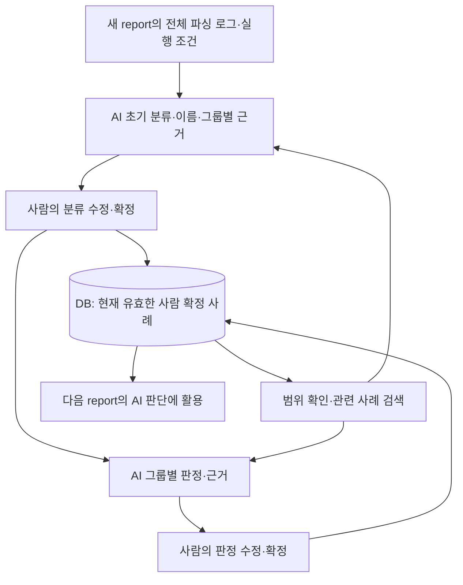
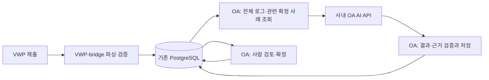

# AI 분류·판정과 사람의 확정 근거를 축적하는 설계

기준: 2026-10-22 사용자 결정. **이 프로젝트의 최우선 목표는 AI 판단 품질이다.** AI가 새 report의 로그를 이해해 초기 그룹과 판정을 제안하고, 사람이 확정한 구성·판정·근거를 DB에서 찾아 다음 판단에 활용한다. 수집·파서·DB·SSO·화면은 이 순환에 필요한 입력의 신뢰성, 실행, 검토를 지원한다.

이 문서는 AI의 목표·우선순위·완료 기준에 대한 기준 문서다. 이전 문서의 **VWP에서만 AI 실행**, **OA 모델 사용 금지** 방침은 이번 사용자 결정으로 대체한다. 이번 연동의 우선 대상은 **사내 OA의 OpenAI 호환 AI API**다. VWP 경로를 유지하더라도 같은 판단·사례·검증 원칙을 사용한다.

**문서 상태:** 목표 설계와 첫 판단 순환의 공통 구현을 구분한다. OA 모델 호출·직접 근거 판정·사례 검색·작업/운영 화면 연결은 [OA 실행 계약](oa/AI_RUNTIME.md)에 정리했다. 이번 제공 범위는 전체 입력이 설정 한도에 들어가는 대상이며, 대용량 모델 분할과 사내 실제 판단 품질 검증은 남아 있다. 현재 제공된 계약과 남은 구현은 8절에 구분한다. 사내 AI의 코드 수정 범위는 [가이드](INTERNAL_AI_GUIDE.md)를 따르며, 목표를 읽고 공통 보호 코드를 자체 구현하지 않는다.

## 1. 가장 먼저 완성할 제품 동작

1. 과거 사례가 없는 첫 report도 AI가 로그의 의미·패턴·실행 조건을 분석해 초기 그룹·이름·그룹별 분류 근거를 만든다.
2. 사람이 그룹 이동·분리·병합·이름과 근거를 수정하고 확정한다. AI 원안과 사람의 수정 이유를 함께 보존한다.
3. AI가 **확정한 각 그룹 전체의 근거**를 검토해 PASS/FAIL/보류와 판단 이유를 제안한다. 과거 사례가 없어도 현재 로그와 확인된 점검 기준으로 충분히 설명할 수 있으면 제안할 수 있어야 한다.
4. 사람이 판정과 이유를 채택·정정·확정한다. 도구 원래 결과, AI 제안, 사람 최종 판정을 각각 보존한다.
5. 다음 report에서 관련된 유효한 확정 사례를 검색하고, AI가 적용 조건·예외·반례를 비교해 새 분류와 판정을 제안한다.

**AI 호출 성공이나 화면 표시만으로 핵심 기능이 완료되지 않는다.** 이번 로그를 실제로 판단했는지, 필요한 과거 사례를 찾았는지, 근거가 맞는지, 사람의 정정이 다음 판단에 반영되는지까지 확인해야 한다.

## 2. 두 단계와 피드백 순환

| 단계 | AI가 해야 할 판단 | 사람이 확정할 내용 | 다음 AI에 남길 자료 |
|---|---|---|---|
| 1단계 분류 | 함께 검토할 로그와 구분할 로그, 새 그룹·이름, 그룹별 공통 패턴·차이·예외 | 전체 구성·그룹별 분류 근거 | AI 원안, 최종 구성·이름·근거, 이동/분리/병합 이유, 원본 참조 |
| 2단계 판정 | 해당 그룹을 PASS/FAIL/보류로 보는 이유, 적용한 점검 기준·과거 사례와 이번 조건의 차이 | 그룹별 최종 판정·판단 근거 | AI 제안, 사람 최종 판정·정정 이유·적용 조건·반례, 원본 참조 |

분류 근거는 **왜 함께 묶었는가**, 판정 근거는 **왜 이 결과로 판단했는가**를 설명한다. 그룹마다 각각 필요하며 전체 report 메모 하나로 대체하지 않는다. 사람이 현재 분류 전체를 확정한 뒤 그룹 판정을 진행한다.

과거 그룹은 참고 사례다. 기존 그룹 ID/이름과의 강제 매칭, 고정 분류 사전, 필드의 정확한 일치만으로 AI의 의미 판단을 대체하지 않는다. 새 패턴에는 새 그룹을 만들고 과거와 다른 분리·병합을 제안할 수 있어야 한다. 그룹 이름은 AI가 이번 구성과 근거에 맞춰 제안하고 사람이 정정한다.

## 3. 확정 사례를 찾고 판단에 사용하는 방법

사람의 확정 결과를 다음 AI의 **참고 사례 후보로 축적하는 것이 기본 동작**이다. 별도 재사용 체크나 실행 가능한 규칙 작성이 있어야만 참고 자료가 되는 구조로 만들지 않는다. 사례를 참고하는 것과 과거 규칙·판정·승인을 새 report에 자동 적용하는 것은 별개다.

검색은 다음 순서로 설계한다.

1. **2026-10-23 사용자 확정:** AI는 서비스에 등록된 모든 프로젝트·블록·revision·ECO의 현재 유효한 사람 확정 사례를 기본 공유 지식으로 참고한다. 사용자의 원문 열람 권한이 없는 블록의 확정 지식도 포함한다. 블록·버전별 참고 허용 체크나 기존 `reusable`·`compatible_versions` 값으로 후보를 제한하지 않는다.
2. 전체 공유 사례에서 분류 의도·판정 근거·예외·적용 조건이 관련된 사례를 찾는다. 프로젝트·블록·item·도구·parser/규칙 버전·layout·NET_VER·revision·ECO는 출처와 조건 차이로 모델에 제공하며 동일성 필터로 강제하지 않는다. 비슷한 허용 사례뿐 아니라 다른 그룹으로 나눈 이유, FAIL 반례, 예외와 기준 충돌도 함께 후보로 찾는다.
3. 선택한 사례의 원본 참조·사람 최종 근거·적용 조건·개정과 이번 로그를 AI에 함께 제공한다. AI는 무엇을 참고했고 어떤 조건이 같거나 달라 적용했는지 설명한다. 근거 없는 이름·코드 유사성만으로 결론을 정하지 않는다.
4. 결과 저장 시 실제 제공한 사례 집합과 인용한 사례를 연결하고, 현재 유효성·범위·근거 ID를 서버가 검증한다. 검색 결과 0건도 정상 입력이며, 새 패턴 판단을 시작할 수 있어야 한다.

확정되지 않은 AI 초안은 사람의 정답 사례로 사용하지 않는다. 철회·정정 전 결과는 현재 정답 후보에서 제외한다. 필요하면 잘못된 이전 판단과 사람의 정정을 명확히 표시한 피드백으로 사용한다. 자기 판단 대상의 정답이나 미래의 확정 결과를 입력에 섞지 않는다.

모든 과거 기록을 매번 prompt에 넣지 않는다. 사례 검색·선정은 필수 기능이며, 정확한 필드 일치만으로 관련 사례를 찾는 것으로 완료하지 않는다. 의미 검색의 구현 방식과 필요한 인덱스는 후속 공통 설계로 정한다. 현재 제공한 검색은 단어·한글 n-gram 관련도와 현재 유효성 검사다. 이 점수는 AI 판단을 대신하지 않으며 의미 검색 품질을 검증한 결과가 아니다. 새 벡터 DB·임베딩 서비스·테이블을 요구하는 계약은 없다.

초기 운영 연결은 서버가 관련 사례를 찾아 모델 입력으로 제공하는 흐름을 먼저 완성한다. 추가 사례가 필요하면 AI가 검색을 요청할 수 있는 도구 연결로 확장할 수 있다. 이때도 조회 범위·권한·입력 개정은 서버가 검사한다. OpenAI 호환이라는 확인만으로 도구 호출 지원까지 검증됐다고 간주하지 않는다.

OA AI는 `reusable=false`, `compatible_versions=false`인 과거 확정 사례도 전역 공유 후보로 사용한다. 두 필드는 기존 조건 일치 엔진의 실행 승인 이력으로 보존하며 AI 참고 허용으로 재해석하거나 일괄 true로 고치지 않는다. **AI 참고 허용 체크를 분류·판정 화면의 필수/선택 단계로 두지 않는다.** 판정 화면에는 기본 결과·근거와 선택형 규칙 예외 기록만 둔다. 합성 참고 엔진의 명시적인 규칙 실행 설정은 운영 OA AI의 공유 사례 정책과 구분한다.

### 3.1. 일반 판정과 규칙 예외 — 2026-10-23 사용자 결정

기본 입력은 PASS/FAIL/보류와 판정 근거다. 별도 재사용 체크 없이 현재 유효한 확정 사례를 다음 AI 참고 후보로 축적한다. 선택형 **이번 판정을 규칙 예외로 기록**은 특정 조건에서 일반 기준과 다르게 판단한 사람의 설명이며, AI 참고에서 제외하거나 다음 report를 자동 승인하는 설정이 아니다. 도구 FAIL을 사람이 PASS로 정정했다는 사실만으로 예외를 추정하지 않는다.

예외를 선택하면 예외 대상 규칙, 예외 사유, 예외가 성립하는 조건을 함께 저장한다. `exception={rule,reason,conditions}`는 사람의 설명을 담은 별도 객체이며 실행 가능한 matching 규칙이나 승인된 점검 기준 catalog의 변경이 아니다. 일반 판정은 `exception=null`, 기존 필드가 없는 과거 판정은 예외 여부가 기록되지 않은 상태로 보존한다. 보류에는 예외 확정을 기록하지 않는다.

예외 사유·조건도 사례 검색과 실제 모델 입력에 포함한다. 다음 AI는 이번 원본에서 예외 조건이 성립하는지 다시 확인하고 일치·차이·불확실성을 설명한다. 예외 PASS를 일반 PASS 기준으로 확대하거나 과거 예외를 그대로 복사하지 않는다. 정보가 부족하면 보류하고 사람의 확정을 기다린다. 정정은 새 불변 개정으로 남겨 이전 예외·참조·사람의 수정 이력을 보존한다.

**같은 블록의 호환되는 다른 버전에서도 AI 참고 허용** 입력은 제거한다. 일반/예외 판정 모두 모든 블록·revision·ECO의 공유 후보가 된다. 기존 조건 적용 승인 기록을 일반 판정으로 편집하면 승인 필드를 보존하고, 예외·보류로 바꿔 저장하면 해당 조건 적용 승인을 해제하고 과거 이력에 남긴다. 예외를 기존 조건 일치 엔진의 일반 판정 규칙으로 적용하지 않는다.

### 3.2. 공유 확정 지식과 원문 조회의 분리

전역 공유 대상은 사람이 확정한 그룹 이름·그룹별 분류 근거·구성원 수, 판정·판정 근거·예외·적용 조건과 출처/개정이다. 서버는 현재 head·원본 해시·구성·참조의 유효성을 확인한 뒤 **공유 지식 DTO**로 전달한다. 과거 사례의 `records.raw`, 파싱된 `fields`, 원본 파일, 전체 record ID·원문 위치·대표 evidence ID·명령 snapshot은 이 DTO에 넣지 않는다. 모델 입력과 브라우저 참고 사례 모두 같은 지식 경계를 따른다. 예전 저장 이력의 중첩 references도 응답 시 같은 경계로 정리한다.

모델은 **현재 판단 대상의 전체 로그**와 **과거 사람이 확정한 공유 지식**을 비교한다. 공유 지식에 포함되지 않은 과거 원문 전체를 검토했다고 표시하지 않는다. 출처의 프로젝트·블록·버전·ECO와 조건 차이를 설명하고, 과거 지식만으로 적용 여부를 확인할 수 없으면 필요한 근거를 명시해 보류한다. 과거 전체 원문을 생략한 것을 현재 report의 일부 로그만 처리한 것과 혼동하지 않는다. 현재 report/확정 그룹 전체 입력 보장은 유지한다.

원본 report·파싱 로그·파일 다운로드 API는 기존 프로젝트/블록 조회 권한을 그대로 검사한다. 공유 사례를 찾았다는 사실이 해당 원문 열람 권한이나 다른 블록의 판정 수정 권한을 주지 않는다. 승인된 점검 기준 catalog의 적용 범위도 기존처럼 현재 대상과 대조한다. **사례 참고의 범위 확대는 점검 기준 적용이나 과거 판정의 자동 승계가 아니다.**

## 4. AI에 전달할 내용과 근거의 품질

분류 입력은 이번 report의 전체 추출 로그, 안정 record ID·원문 위치·원본 해시, 프로젝트/블록/item·버전·실행 조건, 관련 확정 분류 사례와 정정 이유다. 판정 입력은 현재 확정한 그룹의 전체 구성·분류 근거, 확인된 점검 기준과 적용 조건, 관련된 확정 판정 사례·반례다.

2026-10-26 사용자 결정으로 원본 report 파일은 [VWP private DB에 분할 보관](vwp/DB_ORIGINALS.md)하며 파싱에만 임시 복원한다. 기존 파일 보관은 호환 경로다. OA는 기존 DB 경계로 전달된 로그·필드·원문 참조와 허용된 근거를 사용한다. 화면 미리보기나 일부 대표 로그만 모델에 보내고 전체를 판단했다고 표시하지 않는다. 마스킹·미수신·파싱 누락으로 필요한 정보가 없으면 추가 근거 요청 또는 보류로 명시한다.

2026-10-27의 [토큰 없는 VWP 접수](vwp/HTTPS_SUBMISSION.md)는 제출자를 미확인 표시로 기록한다. OA에 로그인한 현재 블록 OWNER가 정확한 예상 범위·누락·제외를 확정한 뒤에만 보고서를 공개한다. 접수 범위 확정은 AI 분류·사람의 그룹 확정·최종 판정과 별개이며, 접수만으로 정답 사례를 만들거나 AI 완료로 표시하지 않는다.

2026-10-28의 [수집 전용 parser](vwp_bridge/PARSER_INTEGRATION.md#collection-only-parser)는 VWP-bridge에서 새 PASS/FAIL 계산 없이 전체 원문·추출 필드를 준비한다. `evaluation="none"`의 공통 등록·검증·집계·VWP→OA 연결을 COMMON-02F로 제공한다. 수집/파싱 완료와 판정 미실행을 구분하고 원문 위치·해시·전체 건수·실제 오류 차단을 유지한다. 원문 도구 결과는 보존하며 수집 완료에서 PASS나 사람의 정답 사례를 생성하지 않는다. 정상 수집된 로그는 기존 접수 범위·권한 검사를 통과한 뒤 OA AI 초기 분류·사람의 그룹 확정·그룹 판정과 피드백으로 이어진다. 내부 AI의 공통 코드 수정 권한은 늘리지 않으며 실제 형식·모델 판단 품질의 현장 검증은 별도다.

AI의 분류 근거에는 공통 패턴, 다른 그룹과 나눈 기준, 예외/미확인 사항, 자기 구성원의 원본 참조가 필요하다. 판정 근거에는 이번 그룹의 사실, 적용 기준·조건, 그 사실에서 결론을 도출한 이유, 원본 참조와 사용한 과거 사례가 필요하다. 분류 설명을 판정 이유로 복사하지 않는다.

과거 사례가 없는 최초 판정도 **이번 원본 근거와 확인된 점검 기준**으로 제안할 수 있어야 한다. 미지원 형식·미완료 근거·필수 조건 부족은 보류 사유다. 가짜 과거 사례를 만들거나 도구 결과만 복사해 AI 판단으로 표시하지 않는다. 최초 판정은 `common/sanity_ai_contracts.py`의 schema 2 출력으로 현재 근거와 제공된 점검 기준 또는 확정 사례를 검증한다. 과거 사람 사례만 허용하는 legacy 계약은 별도 경로로 유지한다.

공통 prompt에는 두 단계의 목적, 현재 원본·선택 그룹의 범위, 근거·사례 적용/불일치 설명, 새로운 패턴 처리, 불확실성 표시, 출력 형식과 사람 확정 구분을 명시한다. item별 확인된 점검 기준과 사례는 별도 입력으로 전달한다. prompt·기준·모델 버전을 실행 이력에 결합한다. 공통 prompt·Chat Completions/Responses 요청과 strict JSON 응답 검증은 `oa/sanity_ai_model.py`에서 제공한다. 실제 사내 API 세부 호환성과 모델 판단 품질은 사내에서 확인한다.

### 4.1. 보존 원천 근거와 AI 입력 — 2026-10-28

[plan 3 보존 계약](vwp/PRESERVED_SOURCES.md)은 full.rpt·SDC를 원본 그대로 보관하고 해당 report의 목록·역할·귀속·hash를 OA 분류/그룹 판정의 **실제 요청 메타데이터**에 연결한다. 입력 SHA256·불변 source 개정·prompt 버전에 기록한다. 보존 파일이 바뀌면 이전 사람 확정 근거를 덮어쓰지 않고 새 분석 개정으로 검토한다.

plan 3은 `content_available_to_ai=false`인 메타데이터 전용이다. 모델에는 SDC/카탈로그를 읽지 않았음을 명시하고 부족한 근거와 DEFER를 설명하도록 한다. 파일 ID를 로그·확정 사례·승인 기준으로 인용하는 응답은 거부한다. 후속 본문 활용은 원본 위치/hash와 추출 개정, 정확한 적용 범위, 마스킹, 전체성/입력 한도, 실제 사용 근거 인용 검증을 함께 제공해야 한다. SDC 명령을 실행하거나 Rule Information을 자동으로 승인 기준으로 승격하지 않는다. 승인된 기준·사람 정정·실제 모델의 독립 정답 비교가 판단 품질의 근거다.

2026-10-28 후속 [plan 4 본문 계약](vwp/PRESERVED_TEXT.md)은 명시된 UTF-8 본문 전체를 줄/byte 위치·hash와 함께 추출·마스킹하고 기존 DB로 OA에 전달한다. 사내 형식을 임의 해석하는 parser가 아니라 전체 텍스트 경로이며 SDC를 실행하지 않는다. AI 요청의 `preserved_evidence`, 별도 검증된 본문 인용·입력 hash·prompt 개정, OA의 권한별 마스킹 본문 조회/다운로드를 제공한다. 같은 파일을 여러 정확한 대상에 연결할 수 있다. 승인 기준/사람 사례 요건은 유지하며 모델 입력 한도 초과는 호출 전 실패한다. 형식별 의미 검증·대용량 모델 분할/통합·실제 판단 품질 실측은 후속이다.

## 5. OA AI API와 서버의 역할

사용자가 **사내 OA AI에 OpenAI 호환 API가 있음**을 확인했다. 세부 API 종류·인증 방식·모델/버전·구조화 출력·처리 한도는 사내에서 확인한다. 실제 endpoint·토큰·report는 공개 문서에 기록하지 않는다.

- 기존 OA 백엔드가 로그인·권한·화면 API와 작업 등록을 담당한다. 모델에 DB 계정을 주지 않는다.
- OA 배포 환경의 백그라운드 실행 코드가 DB에서 입력·사례를 읽고 API를 호출하며 검증된 결과를 저장한다. 별도의 AI용 HTTP 서버나 새 서버 장비를 필수로 추가하지 않는다. 기존 OA의 수신 worker가 이 모델 실행 기능을 이미 제공하는 것은 아니다.
- VWP-bridge는 원천 수집 인계·item별 추출·검증·원본 보관·DB 전달을 맡는다. OA 기본 실행에서 VWP AI를 거쳐야 하는 의존성을 두지 않는다. 원천 보충 요청은 기존 VWP 경계로 처리한다.
- VWP AI 경로를 계속 사용할 때도 공통 입력·결과 검증·사례 정책을 공유하고, 실제 실행 위치를 이력에 기록한다. OA 호출 실패를 다른 모델 호출이나 합성 결과로 자동 대체하지 않는다. 실행별 provider·모델·prompt·입력 개정을 고정한다.
- VWP↔OA 전달은 기존 DB 방식이다. OA에서 자기 사내 모델 API를 호출하는 것은 브리지 사이의 HTTP/RPC 통신과 구분한다. 브라우저가 모델 API를 직접 호출하지 않는다.

OA 작업·결과·사례는 `sanity_oa_data`의 기존 저장 경계를 활용하는 방향으로 설계한다. 첫 순환의 작업은 기존 `WS_CONFIG`의 `oa-ai-v1` namespace에 불변 이벤트로 저장하고 기존 네 테이블을 사용한다. 설정·기준 파일·worker 명령은 [OA 실행 계약](oa/AI_RUNTIME.md)을 따른다. 대용량 후속 구현에 필요한 구조/인덱스는 별도로 검토한다.

## 6. 대용량과 실행·사례 이력

규모는 **한 sanity item report의 평균 약 10,000건이며 100,000건 이상도 가능**하다. 현재 첫 순환은 전체 직렬화 입력이 설정 한도에 들어가는 대상만 실행하며, 초과하면 `AI_INPUT_LIMIT`으로 실패한다. 아래 모델 분할·통합은 COMMON-05의 미완성 목표다. 모델의 실제 입력·출력 한도에 맞춰 전체를 분할해 처리하고, 서로 다른 조각의 그룹을 비교·통합한 뒤 모든 원본 ID가 정확히 한 번 배정됐는지 검사한다. 각 조각 성공만으로 report 전체 완료를 선언하지 않는다. 한도를 넘어 처리할 수 없으면 범위·사유를 명시한다.

판정도 선택 그룹 전체에 대한 검토 범위를 보장한다. 기록 수·원문 길이·고유 그룹 수·과거 사례 크기를 함께 고려한다. 분할·검색·통합이 판단 품질에 미친 영향과 누락을 검증한다.

논리적으로 다음 자료를 보존해야 한다. 현재 작업/모델/검색 이력 계약은 [OA 실행 계약](oa/AI_RUNTIME.md)을 따른다. 조각별 모델 처리 이력은 COMMON-05 후속 계약이다.

| 구분 | 보존할 내용 |
|---|---|
| 판단 입력 | 원본 report/record·scope·버전·실행·해시, 분류 개정·그룹 구성 해시, 점검 기준 개정 |
| 사례 검색 | 검색 범위/질의·검색 방식 버전, 선정된 사례·개정, 실제 제공한 입력과 사용한 참조 |
| AI 실행 | 요청 UUID, 실행 위치·모델·prompt 버전, 처리 범위/진행, 응답·직접 근거·사용량/실패 |
| 사람 피드백 | AI 원안과 최종 결과, 수정 전후 구성·판정·근거, 수정 이유·확정자·시각·적용 조건 |
| 유효성 | 정정·철회·참조 변경, 늦게 도착한 응답의 입력 개정, 현재 유효 사례와 과거 이력의 구분 |

실제 원본/분류/판정 개정이 바뀐 뒤 도착한 응답은 자동 적용하지 않는다. 권한도 결과 반영 전에 재확인한다. API timeout으로 결과가 불명확하면 요청 조회 등 확인된 계약으로 처리하고 무조건 재호출하지 않는다. 사람 수정이 AI 결과로 덮어써지지 않게 한다.

## 7. 판단 품질의 완료 기준

사례 축적은 DB의 지식을 검색해 모델 판단에 활용하는 방식이다. 모델 가중치의 자동 재학습을 뜻하지 않는다. 사례 수 증가만으로 정확도 향상을 보장하지 않으며 검색·사례 품질·prompt·모델·item별 기준을 함께 평가한다.

| 수용 시나리오 | 확인할 결과 |
|---|---|
| 사례 없는 첫 report | AI가 새 그룹·이름·개별 근거를 제안. 확인된 직접 근거로 그룹 판정을 제안하거나 부족한 사실을 명시해 보류 |
| 사람의 분리·병합·이동·판정 정정 후 다음 report | 최종 확정 사례와 정정 이유가 실제 모델 입력에 들어가고, 적용 이유/다르게 판단한 이유 확인 |
| 비슷한 문장이나 같은 코드지만 다른 조건·원인 | 잘못된 통합/판정 전이를 방지하고 차이를 설명 |
| 서로 다른 문장·코드지만 같은 검토 의도 | 확인된 사실·관계·사람의 통합 사례를 근거로 제안 가능 |
| 관련 사례·FAIL 반례·충돌하는 기준 존재 | 관련 사례 검색과 출처 검증, 충돌·예외 설명. 단순 다수결로 PASS 처리하지 않음 |
| 다른 블록·revision·ECO·도구/규칙 조건의 관련 확정 사례 | 별도 허용 체크 없이 공유 지식을 제공하고 출처·적용 조건의 일치/차이를 설명. 과거 판정을 자동 승계하지 않음 |
| 철회/미확정/정정 전/자기 정답 사례와 무권한 원문 요청 | 유효 후보에서 제외하고 원문 API의 권한 검사 유지. 공유 사례 응답/모델 입력에 과거 원문을 끼워 넣지 않음 |
| 10,000건·100,000건 이상 또는 많은 고유 그룹 | 전체 처리 범위·배정 검증, 조각 간 그룹 정합성·그룹별 근거·판정 범위 유지 |
| 실제 모델의 잘못된 응답·실패·늦은 결과 | 형식/참조/개정 검사, 진행·실패 표시, 사람 확정과 이전 유효 이력 보존 |

평가는 같은 검증 입력·모델·prompt 조건에서 **사례 미제공 / 관련 확정 사례 제공** 결과를 비교한다. 목표 report나 미래의 정답을 참고 입력에 넣지 않는 독립 검증 집합을 사용하고 item·버전·분포별로 기록한다.

기록할 지표는 관련 사례 검색률과 부적절 사례 혼입, 잘못된 병합/분리와 사람 수정량, 그룹 판정 일치율, FAIL을 PASS로 놓친 비율, 보류 비율, 근거의 원본·기준 일치와 허위 참조, 전체 처리율, 검토 시간이다. 무조건 제안을 많이 내거나 보류만 늘려 정확도를 높게 보이지 않는다. 수용 목표 수치는 사내 정답 집합과 업무 위험을 기준으로 정하며, 실측 전 값을 보장으로 쓰지 않는다.

합성 테스트는 계약·피드백 경로·누락 방지를 검증한다. 실제 사내 모델의 의미 판단 품질은 사내에서 실제 정답·반례로 별도 검증한다. 로그인·파싱·DB 수신·mock 통과를 AI 판단 품질 완료로 보고하지 않는다.

## 8. 현재 구현과 우선 구현 순서

| 항목 | 현재 제공된 것 | 남은 핵심 연결 |
|---|---|---|
| 분류 | OA OpenAI 호환 호출·공통 prompt·전체 ID/그룹별 근거 검증, 운영 workbench 편집·확정 | 사내 API 실제 호환·의미 판단 품질, 입력 한도 초과 시 모델 분할/통합 |
| 판정 | schema 2의 현재 원본+확인된 기준/확정 사례 참조 검증, 최초 판정·DEFER, 사람 최종 판정 분리 | 사내 기준 catalog·독립 정답/반례 검증, 대량 그룹 판정 |
| 실행 | `oa.ai_worker`, namespace가 있는 불변 작업 이력, 권한·개정 재검사·결과 불명 재호출 금지 | 사내 실행 환경 배포/운영 확인, COMMON-05 계층적 처리 |
| 사례 활용 | 현재 유효한 사람 확정 사례의 기본 후보화, 단어/한글 n-gram 검색·반대 판정 고려·실제 입력/인용 이력 | 검색 적합성과 사람 정정 반영의 실제 모델 평가, 고도화된 의미 검색 |
| 운영 입력/화면 | V2 source receiver의 운영 권한 연결, 기존 SSO의 `/?page=workbench`·`/api/workbench/*` | 실제 VWP 입력·신원/승인·parser 어댑터와 회사 환경의 전체 연결 확인 |
| 수집 전용 입력 | COMMON-02F: `none` 등록·구조 검사, 판정 미실행 marker/건수, VWP→OA 검증·준비/화면과 기존 두 단계 연결 | 실제 회사 parser/도구 버전·완료/건수 의미와 사내 모델 판단 품질·운영 반영 검증 |
| 품질 완료 | 계약/합성 검증과 실제 모델 평가를 분리하는 수용 기준 | COMMON-06 사내 독립 정답에서 사례 전후 판단 품질 실측 |

실행 순서는 다음과 같다. 표의 COMMON ID는 [인계 명세](INTERNAL_AI_HANDOFF.md#5-codex-공통-연결의-상태와-남은-작업)와 대응한다.

1. **COMMON-03·04 제공 범위 검증:** OA OpenAI 호환 호출·공통 prompt·직접 근거 판정·유효 사례 검색/결과 검증을 합성 시험으로 확인한다. 사내에서는 지원 설정과 승인된 기준 catalog를 준비하고 실제 API 호환성·한도를 확인한다.
2. **최소 판단 순환:** item 한 개에서 실제 AI 초기 분류 → 사람 확정 → 실제 AI 그룹 판정 → 사람 정정·확정 → 다음 report의 사례 검색·적용까지 이어 검증한다. 사내 실제 모델 검증과 합성 검증을 구분한다.
3. **COMMON-01·02의 현장 연결 검증:** 제공된 운영 SSO 권한·V2 입력·조회·검토 연결을 실제 회사 어댑터로 검증한다. AI 작업 실행·결과 반영은 현재 대상의 권한·개정을 검사하고, 공유 사례는 자신의 등록 소속·확정 개정·원본 무결성을 검사한다. 사례의 소속이 현재 대상과 같아야 하는 것은 아니다.
4. **COMMON-05:** 실제 모델 한도에 맞춘 분할·그룹 정합성·재개·중복 제어로 10,000건·100,000건 이상에 확장하고, 누적 사례 전후의 판단 품질을 측정한다.

사내 AI가 확인할 최소 정보는 OA API의 종류/인증/모델과 JSON·도구 지원, 입력·출력/동시성/timeout/사용량·조회·취소 계약, item별 점검 기준·정답·반례, 비식별 규모 분포다. 실제 값과 원문은 사내에만 보관한다.

로그인·관리 UI·배포 편의 개선의 완료를 AI 기능 완료로 대신하지 않는다. 이후 작업의 우선순위는 이 판단 순환을 실행·검증하는 데 기여하는지를 기준으로 정한다.
