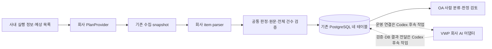

# 사내 AI 구현 인계 명세

기준: 2026-10-16. 현재 승인된 검토 UI와 두 단계 흐름을 유지한다. 이 문서는 사내 구현을 시작할 때 보는 작업 지도이며, 권한은 [INTERNAL_AI_GUIDE.md](INTERNAL_AI_GUIDE.md)의 허용 목록을 따른다. 내부 AI는 이 문서나 지침을 수정해 자신의 역할을 넓히지 않는다.

## 1. 목표와 현재 상태

1. VWP에서 실제 report를 수집·파싱한다. 예상 sanity 목록에 있는 누락·실패 항목도 유지한다.
2. VWP AI가 **이번 report 전체 로그 + 유효한 과거 사람 확정 사례**로 초기 그룹·이름·그룹별 분류 근거를 제안한다. 첫 report에는 과거 사례가 없어도 된다.
3. OA에서 사람이 로그 이동·분리·병합·이름/근거 수정을 하고 분류를 확정한다.
4. 확정 그룹마다 VWP AI가 판정과 판정 근거를 제안하고, 사람이 PASS/FAIL/보류를 검토·저장한다.
5. 확정 분류와 사용자 판정을 각각 DB 사례로 축적해 다음 AI 입력에서 참고한다. 모델 가중치 재학습 완료를 뜻하지 않는다.

**공통 검토 화면·저장·페이지/개정 검증과 회사 연동 어댑터는 서로 다른 완료 단위다.** 현 `/workspace`는 합성 사용자/DB와 참고 엔진 또는 명시적으로 켠 외부 모델 합성 시험을 사용한다. 회사 report·SSO·사내 SDK로 운영 중인 화면이 아니다. 외부 모델의 합성 시험 경로를 사내 자료에 연결하지 않는다.

| 영역 | 제공된 추상화/실제 구현 | 사내 AI 작업 | 현재 연결 상태 |
|---|---|---|---|
| SSO 검증·계정 연결 | `SSOIdentityProvider`, `UserDirectory`, 고정 모델/검증 | 승인 SDK·영속 `(issuer, subject) → user_id` 조회 | 회사 어댑터 미구현. legacy `/api/session` 주입 지점 제공 |
| 예상 sanity 목록 | `SanityPlanProvider.get_plan`, `CollectionPlan`, 기존 `validate_plan` | 실행 메타데이터/승인된 목록을 기존 `plan.json`에 대응 | 새 기본 어댑터는 `PLAN_NOT_CONFIGURED`; collector 자동 연결 없음 |
| item별 report parser | `ReportParser.parse`, 이벤트/원문 span/registry/공통 검증 | 실제 도구·형식 버전별 추출과 명시적 등록 | 회사 registry는 기본 비어 있음 |
| 1단계 AI 분류 | `ClusteringAdvisor.propose`, V2 출력/전체 배정·그룹별 근거 검증 | VWP 사내 SDK와 모델 입력·출력 대응 | `CORPORATE` 미연결. SDK stub은 `AI_NOT_CONFIGURED` |
| 2단계 AI 판정 | `ReviewAdvisor.propose`, 판정/참조 검증 | 선택 그룹의 원문·확정 분류 근거·사람 사례로 제안 | `CORPORATE` 미연결. 현재 화면은 조건 적용 참고 엔진 |
| 실제 프로젝트·블록·버전/담당 | workspace 범위 검사·PoR·불변 판정 저장 | 실제 원천 필드/안정 ID/담당 범위의 대응 자료 | 원천 수신→workspace 운영 연결과 SSO 연결은 공통 후속 작업 |
| DB·TLS·운영 실행 | 직접 PostgreSQL·네 테이블·기존 전송/작업자 | 회사 환경의 확인된 접속/SDK 제약 자료 | 실제 DB 확인·DDL/배포는 사용자/DBA 관리 |

타입 선언은 [sanity_integration_contracts.py](sanity_integration_contracts.py)에 있다. 기존 dict/JSON 키, 메서드 인자 순서와 저장 계약은 유지했다. 타입 힌트는 런타임 검증·권한 검사·회사 연결을 대신하지 않는다. 작은 합성 입력/출력은 [sanity_integration_examples.py](sanity_integration_examples.py), 실행 가능한 계약 검증은 [test_integration_contracts.py](tests/test_integration_contracts.py)에 있다.

## 2. 책임과 시스템 경계



- **사내 AI:** 확인된 회사 사실에 근거한 SDK wrapper·입력 매핑·item 추출·어댑터 전용 테스트와 사내 검증 결과를 작성한다.
- **설계 담당 Codex:** 공통 모델/검증·권한·DB/전송·worker·페이지/작업 재개·UI/API와 디버깅을 담당한다. 회사 사실은 비식별 계약과 합성 예제로 전달받는다.
- **사용자/현장 담당자/DBA:** 실제 업무 기준·예상 목록 승인·정답 사례 검증·계정/역할 발급·운영 DB 적용·배포를 관리한다. 이 문서가 운영 쓰기 권한을 부여하지 않는다.

OA에서 사내 AI SDK를 실행하지 않는다. VWP와 OA는 기존 DB 경계로만 전달하며 HTTP/RPC·공유 파일 전송을 추가하지 않는다. **기존 VWP legacy worker의 AI 접속 설정 완료는 새 workspace 분류/판정의 운영 연결 완료가 아니다.**

## 3. 읽는 순서와 수정 위치

먼저 [AGENTS.md](AGENTS.md) → [INTERNAL_AI_GUIDE.md](INTERNAL_AI_GUIDE.md) → 이 문서 → 해당 세부 계약을 읽는다. 필요한 `requirement.md` 절과 `PROTOCOL.md`는 각 계약에서 연결한다.

| 작업 ID | 수정 가능한 회사 지점 | 필수 세부 계약 |
|---|---|---|
| INT-01 | `oa-bridge/corporate_sso.py`: `authenticate`, `resolve`; 허용된 생성자/import, `company_sso/`, `sso_app.py`의 주입 | [SSO_INTEGRATION](oa-bridge/SSO_INTEGRATION.md) |
| INT-02 | `site_integration/corporate_plan.py`: `get_plan`; 허용된 생성자/import, `company_plan/`의 입력 wrapper/테스트 | [PLAN_INTEGRATION](vwp-bridge/PLAN_INTEGRATION.md) |
| INT-03 | `site_integration/corporate_parsers.py`: `parse`, 명시적 registry 등록; `company_parsers/` | [PARSER_INTEGRATION](vwp-bridge/PARSER_INTEGRATION.md) |
| INT-04 | `site_integration/corporate_clustering.py`: `propose`; 허용된 생성자/import, `company_clustering/` | [CLUSTERING_INTEGRATION](vwp-bridge/CLUSTERING_INTEGRATION.md) |
| INT-05 | `site_integration/corporate_review.py`: `propose`; 허용된 생성자/import, `company_review/` | [REVIEW_INTEGRATION](vwp-bridge/REVIEW_INTEGRATION.md) |
| INT-06 | 허용된 `site_integration/`의 별도 비식별 대응표·진단 자료 | 아래 5절과 PLAN_INTEGRATION의 원천 대응표 |

표의 `company_*/`는 사내 AI가 추가할 수 있는 위치다. 자동 plugin 탐색·운영 등록 경로가 아니다. `sanity_integration_contracts.py`, `sanity_integration_examples.py`와 기존 공통 코드/SQL/UI/테스트는 사내 AI에게 읽기 전용이다. 새 의존성·env 키·서명/반환 변경이 필요하면 먼저 Codex에게 문의한다.

## 4. 사내 AI 작업 명세

### INT-01. SSO와 내부 사용자 연결

**먼저 확인:** 실제 SSO 방식, 승인 SDK/버전, 검증 완료 신원의 안정 키, 영속 계정 매핑 저장소와 비활성화/폐기 정책, 콜백·쿠키·CSRF 요구 조건. 실제 주소·값은 사내 문서에만 남긴다.

**산출물:** `authenticate(AuthRequest) → VerifiedIdentity`, `resolve(VerifiedIdentity) → LocalUser | None`, 필요한 회사 로그인 router와 전용 SDK 모의 테스트.

**수용 기준:** 위조/만료/잘못된 issuer·audience/서비스 장애를 구분하고, 동명이인·이름 변경·다른 issuer·미연결·비활성·동시 요청을 검증한다. 토큰 decode/신뢰되지 않은 사용자 헤더만으로 성공시키지 않는다. `AUTHORIZATION_NOT_IMPLEMENTED`는 유지한다.

**연결 경계:** `sso_app.py`는 legacy `/api`용이다. `/workspace/api/session`과 합성 비밀번호 로그인을 회사 SSO로 바꾸는 공통 연결은 아직 제공되지 않았다. 어댑터를 구현해도 현재 테스트 계정이 회사 사용자로 바뀌지 않는다.

### INT-02. 예상 sanity 목록과 실행 정보

**먼저 확인:** 생성된 파일 목록과 별개인 권위 있는 예상 목록·버전·승인 사실, 실제 실행 결과의 `COMPLETED/FAILED/UNKNOWN/NOT_RUN`, 적용 제외의 승인 근거.

**산출물:** `get_plan(run_reference) → CollectionPlan`과 실행 출처/필드 대응표. `run_reference`는 사내 실행 조회 키이며 shell 명령이 아니다. provider는 plan만 반환하고 보고서 수집·실행·DB 쓰기를 하지 않는다.

**수용 기준:** 누락된 report의 예상 unit을 제거하지 않는다. 실행 성공을 예상 목록 승인으로 해석하지 않는다. `validate_plan`의 통과는 구조 검증이며 목록 승인·분석 완료를 뜻하지 않는다. 반환은 기존 schema 1이며 workspace 전용 필드를 임의로 붙이지 않는다.

### INT-03. item별 parser

**먼저 확인:** item·도구/형식/규칙 버전, 실제 섹션/컬럼/다중 행, 완료/건수·0건 의미, 수치의 비교 방향/정확한 단위/임계값과 identity 출처.

**산출물:** `parse(ReportSource, ParseContext) → Iterable[ParseEvent]`, 명시적 parser 등록, 공개 가능한 합성 예제와 사내 비공개 정답 비교표. GCA·VC LP·SpyGlass 참고 파서를 운영 완료 구현으로 복사하지 않는다.

**수용 기준:** 정상/위반/경계값/명시적 0건/빈 파일/잘림/새 섹션/encoding 오류/버전 변경, 정확한 span·EOF·전체 건수와 UNKNOWN 보존을 검증한다. 파서는 추출만 하며 최종 수치 판정은 공통 엔진이 담당한다. parser/rule version 변경 기준은 세부 계약을 따른다.

### INT-04. 1단계 VWP AI 초기 분류

**먼저 확인:** 승인된 SDK·동기 호출/timeout·JSON 응답 방식·토큰/출력/동시성 한도·사용량/실패 구분. 실제 평균 약 10,000개이며 100,000개 이상도 가능한 **한 report 안의 로그/위반 항목 수**다.

**산출물:** `propose(context, cases, identity_fields) → ClusteringProposalV2`. 정확한 네 키는 `groups`, `reason`, `reference_ids`, `group_rationales`다. 현재 group ID는 report 내 식별자이며 고정 전사 그룹 사전의 키가 아니다.

**수용 기준:** 과거 사례 0건에서 시작, 사람의 이동/통합/분리/근거 정정을 다음 제안에 반영, 새 패턴의 그룹 생성, 모든 원본 ID의 정확한 단일 배정, 그룹마다 별도 근거와 자기 구성원의 대표 ID, 과거 case/group 참조를 검증한다. `validate_clustering_advice(..., require_rationales=True)`를 사용한다. 사례 이름이 같다는 이유만으로 기존 그룹에 자동 귀속하지 않는다.

**규모 경계:** 64개 표본/현재 참고 엔진의 chunk 수/작은 외부 모델 실험은 회사 모델의 토큰 예산이나 대량 처리 완료 근거가 아니다. 전체 원본 ID coverage, 조각 간 그룹 통합·분리, 취소/재개, 결과 불명확 시 중복 호출 방지를 위한 공통 실행 계약은 Codex 후속 작업이다. 입력을 잘라 완료로 보고하거나 SDK wrapper 안에 독자 worker/DB/운영 재시도 루프를 만들지 않는다. 한도를 넘는 입력은 조용히 처리하지 말고 확인한 한도를 인계한다.

### INT-05. 2단계 VWP AI 그룹별 판정

**먼저 확인:** 회사 판정 기준과 예외·반례, 허용된 모델의 근거 형식, 대표 로그가 아닌 선택 그룹 전체를 판단할 수 있는 입력/출력 한도.

**산출물:** `propose(context, cases) → ReviewProposal`. 정확한 세 키는 `conclusion`, `reason`, `reference_ids`다. `context.group_evidence`가 판단 대상이며 `report.records`의 다른 그룹을 섞지 않는다. 전체 report snapshot/hash는 원본 검증 맥락이다. 분류 근거와 PASS/FAIL 판정 근거를 따로 작성한다.

**현재 계약의 제한:** `validate_advice`는 **AI PASS/FAIL 제안에 입력된 사람 확정 사례의 참조를 최소 한 건 요구**한다. 사람 사례가 없으면 `DEFER`다. 최초 report도 원본만 보고 AI가 PASS/FAIL을 제안하는 목표까지 완료된 것은 아니다. 이 제한의 확장에는 원본 근거를 포함하는 공통 판정 계약·검증 변경이 필요하며, 내부 AI가 참조를 만들거나 검사를 삭제하지 않는다. 사람은 검토 후 도구 FAIL과 다른 PASS를 저장할 수 있다.

**수용 기준:** 선택 그룹/확정 분류 개정/소속 hash·현재 근거를 유지하고, 기준 충돌·다른 scope·자료 부족은 보류 사유를 명시한다. SDK 제안에 사용자 확정·검토자·저장 상태를 넣지 않는다. 제안 채택 후에도 사용자 저장이 필요하다. 불확실 timeout을 성공 또는 참고 엔진 응답으로 대체하지 않는다.

### INT-06. 실제 원천 대응표와 현장 검증

사내 확인표에는 원천 시스템/필드의 사내 문서 식별자, 대상 필드, 안정 ID 근거·변환 규칙·누락/충돌 처리, 확인자/확인일을 기록한다. 외부 인계에는 합성 예제와 자료형·길이·존재 여부만 포함한다.

- 사용자 `(issuer, subject) → user_id`; 프로젝트 TOP과 블록 담당 배정의 권위 있는 출처/해제·변경 방식.
- 프로젝트/블록의 안정 ID와 관계; 블록별 `NET_VER`, 전체 `REVISION`, `PRE/POST`, ECO; 서로 다른 블록의 같은 문자열 구분.
- 실행 `run_id`·review unit·item·도구/파서/규칙 버전과 실제 report의 연결. 하나의 도구가 여러 item을 만들 때 구분 근거.
- 실제 운영 DB 역할/DDL 적용 단계·TLS·프로세스 환경·SDK 지원/한도. 공개 문서에 내부 endpoint·DSN·계정을 넣지 않는다.
- PoR의 현장 정책. 현재 UI의 블록당 PoR 하나를 PRE/POST별 별도 PoR 정책으로 임의 해석하지 않는다.

현 legacy run/bundle과 workspace의 block/version/report ID는 같은 계약이 아니다. 대응표를 제출하고 공통 수신 연결을 검토받는다. 기존 payload에 필드를 추가하거나 REVISION/파일명/표시 이름에서 ID·권한을 추정해 직접 저장하지 않는다.

## 5. Codex에 남는 공통 연결 작업

아래는 **사내 AI에게 위임한 구현 작업이 아니다.** 사내 AI는 필요한 회사 사실과 검증 결과를 전달하고 보호 파일 수정이 필요한 단계에서 인계한다.

| ID | 공통 후속 작업 | 사내에서 먼저 제공할 자료 |
|---|---|---|
| COMMON-01 | SSO 신원→workspace 사용자/담당 범위 연결, legacy 업무 API 범위 제한, UI 로그인/로그아웃·CSRF | SSO·계정/권한 출처·세션/폐기 계약 |
| COMMON-02 | 수신 run/bundle→project/block/version/report/item의 검증된 import·개정·감사 연결 | 실제 원천 필드 대응과 누락/충돌 사례 |
| COMMON-03 | 새 workspace 분류/판정의 VWP job·기존 DB 요청/결과 전달·worker/상태·UI 연결 | 회사 SDK 입출력·실패·취소·조회·처리 한도 |
| COMMON-04 | 최초 AI 판정의 직접 원본 근거 계약, 확정 사례 기본 활용과 선택형 재사용 필드의 관계 정리 | 사례 없는 판정의 사내 기준/정답·반례, 기존 승인 범위 정책 |
| COMMON-05 | 대용량 회사 AI의 입력 분할·조각 간 그룹 정합성·완전성·개정/중복 호출 제어 | 10,000/100,000+건의 크기/토큰 분포와 SDK 한도·현장 성능 목표 |

COMMON-03의 요청/결과 envelope에는 원본 snapshot·project/block/item/버전 scope·분류/판정 개정·선택 group/소속·사례 목록의 불변 참조와 요청 UUID/입력 hash가 필요하다. **현재 신규 운영 메시지 schema가 제공된 것은 아니다.** 내부 AI가 임의 envelope·queue record type을 추가하지 않는다. 기존 legacy clustering 규칙 JSON과 새 workspace V2를 서로 대신 보내지 않는다.

`source_sha256`는 입력 context의 값을 그대로 보존한다. 현재 workspace에서는 정규화한 report snapshot의 digest이며 원본 파일 bytes hash/부분 로그 hash와 바꾸어 쓸 수 없다. 파일의 hash는 collector의 별도 `files[].sha256` 계약을 따른다. 그룹/사례/개정 검증은 SDK의 자체 판단에 맡기지 않는다.

## 6. 작업 순서·검증 명령

1. 기존 변경을 기록하고 INT 작업 하나를 선택한다. 수정 파일/메서드와 확인된 사내 사실을 제시한다.
2. 필요한 사실이 없으면 `FACTS_REQUIRED`, 허용된 구현과 모의 검증이 끝나면 `ADAPTER_VERIFIED`로 기록한다. 이 상태는 운영 연결 완료가 아니다.
3. SDK/형식별 신규 전용 테스트와 비공개 실제 자료 비교를 각각 수행한다. 예상된 실패 입력이 올바르게 거부되어 테스트가 통과하는 것은 정상이다. **예상 밖 오류/테스트 실패/보호 파일 수정 필요는 `WAITING_FOR_CODEX`로 전환**하고 수정·재시도를 중단한다.
4. 아래 공통 계약 시험과 자기 어댑터 시험 결과를 분리해 인계한다. 회사 디렉터리는 기존 runner가 자동 수집하지 않는다.
5. Codex 검토 후 승인된 공통 연결을 받고, 사용자 관리 아래 사내 전체 흐름을 검증한다. 사내 AI가 보호 코드를 수정하거나 실제 DB/배포를 자동 실행하지 않는다.

위 상태는 인계 문서의 작업 보고용이며 DB/AI job의 상태 코드를 추가하는 것이 아니다. `READY_FOR_REVIEW`는 변경·검증·남은 의존성을 정리해 Codex 검토에 제출할 준비가 되었다는 뜻이며 운영 사용 가능을 의미하지 않는다.

사내망·DB·모델 호출 없이 실행할 수 있는 공통 시험:

```bash
.venv/bin/python -m unittest discover -s tests -p test_integration_contracts.py -v
.venv/bin/python -m unittest discover -s tests -p test_auth.py -v
.venv/bin/python -m unittest discover -s tests -p test_parsers.py -v
.venv/bin/python -m unittest discover -s tests -p test_review_advice.py -v
.venv/bin/python -m unittest discover -s tests -p test_workspace_pipeline_advice.py -v
.venv/bin/python -m unittest discover -s tests -p test_workspace_rationale.py -v
.venv/bin/python -m unittest discover -s oa-bridge -p test_sso.py -v
```

회사 어댑터 테스트를 해당 디렉터리에 **작성한 후**, 맡은 작업의 명령만 실행한다:

| 작업 | 전용 테스트 명령 |
|---|---|
| SSO | `.venv/bin/python -m unittest discover -s oa-bridge/company_sso -p 'test_*.py' -v` |
| plan | `.venv/bin/python -m unittest discover -s site_integration/company_plan -p 'test_*.py' -v` |
| parser | `.venv/bin/python -m unittest discover -s site_integration/company_parsers -p 'test_*.py' -v` |
| clustering | `.venv/bin/python -m unittest discover -s site_integration/company_clustering -p 'test_*.py' -v` |
| review | `.venv/bin/python -m unittest discover -s site_integration/company_review -p 'test_*.py' -v` |

합성 예제의 `clustering_example(with_history=False/True)`와 `group_review_example(with_history=False/True)`는 SDK wrapper 모의 테스트의 입력/기대 응답으로 사용할 수 있다. 실제 SDK 대신 명시적인 테스트 더블을 주입하고, 입력 불변·예외/timeout·JSON 오류·미지 참조·원본 ID coverage를 검증한다. 예제의 가상 확정 기록을 운영 DB에 seed하거나 회사 정답으로 취급하지 않는다. `codex-button-live`나 `run_codex_mock`은 이 검증 절차에 포함되지 않는다.

## 7. 인계 완료 보고 형식

```text
작업 ID / 기준 commit / 작업 전부터 있던 변경:
현재 상태: FACTS_REQUIRED / ADAPTER_VERIFIED / WAITING_FOR_CODEX / READY_FOR_REVIEW
수정한 허용 파일·메서드:
확인한 회사 계약: 사내 문서 식별자·SDK/도구/형식 버전 (접속값 제외)
추상 입력→SDK/원천 입력→출력 대응 요약:
검증: 명령, 통과/실패/skip, 모의/실제 실행 구분
정확성: item별 기대/실제 건수, 누락·0건·잘림·버전 대응
규모/호출: 전체 로그 수, 입력/출력 한도, timeout/결과 불명·재호출 여부
사내 실제 자료 검증: 미실시 / 실시, 비식별 결과와 현장 확인자
공통 보호 파일 변경 여부: 없음 / 필요 사유(변경하지 않고 문의)
남은 COMMON 의존성 / 비식별 Codex 문의:
운영 적용: 미적용 / 사용자 관리하에 승인된 적용(근거)
```

예상 밖 오류의 상세 문의는 [가이드 6절](INTERNAL_AI_GUIDE.md#6-디버깅이-필요하면-codex에게-문의)의 양식을 사용한다. 직접 통신 수단이 없으면 사용자가 현재 Codex 대화로 전달한다. 실제 report·SDK 예외 원문·인증 claim·개인정보·주소/토큰/DSN은 외부 대화나 공개 Git에 첨부하지 않는다.

## 8. 그대로 전달할 시작 지시문

> AGENTS.md, INTERNAL_AI_GUIDE.md, INTERNAL_AI_HANDOFF.md와 맡은 INT 작업의 연동 문서를 읽어라. 너는 사내 연동 구현자이며 허용된 회사 어댑터·전용 wrapper/테스트·비식별 대응표만 작성한다. 기존 검토 UI와 공통 저장/판정/권한/DB 전송/worker를 수정하지 않는다. 회사 문서와 실제 자료로 확인한 사실만 사용하고 실제 report는 사내에서만 검증한다. 한 작업씩 구현·검증하며 신규 SDK 의존성·env 키·출력 변경은 먼저 Codex에게 문의한다. 예상 밖 오류나 보호 파일 변경이 필요하면 수정/재시도를 멈추고 비식별 문의와 WAITING_FOR_CODEX 상태를 남긴다. 어댑터 검증 완료와 COMMON 운영 연결·실제 배포 완료를 구분하고, 보호 장치나 합성 환경 조건을 해제하지 않는다.
