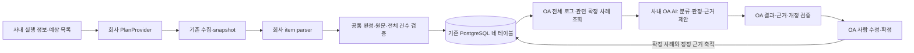

# 사내 AI 구현 인계 명세

최초 기준: 2026-10-16. 2026-10-22의 최우선 목표·사례 검색·품질 기준과 OA API 연동 방향은 [AI 판단 설계](AI_DECISION_DESIGN.md)를 따른다. **가장 중요한 산출물은 AI의 분류·판정과 사람 확정 근거가 다음 판단에 반영되는 순환**이다. 운영 범위 권한은 [ACCESS_MANAGEMENT.md](oa/ACCESS_MANAGEMENT.md)를 우선한다. 이 문서는 사내 작업 지도이며 권한은 [INTERNAL_AI_GUIDE.md](INTERNAL_AI_GUIDE.md)의 허용 목록을 따른다. 내부 AI는 문서를 수정해 자신의 역할을 넓히지 않는다.

소스와 사내 구현 위치는 [서버별 소스·실행 안내](DEPLOYMENT.md)에 따른다. 각 서버는 Git 저장소 루트에서 자기 모듈만 실행한다. VWP=`vwp/`, VWP-bridge=`vwp_bridge/`, OA=`oa/`, 공통=`common/`, 합성 시험=`devtools/`다. 회사 어댑터도 각 서버의 `integration/`에 분리되어 있다.

Q1 이후의 수집·버전 연결은 [분산 수집·PRE/POST 설계](vwp/SOURCE_COLLECTION_DESIGN.md)를 따른다. 사용자별 한 REVISION 제출에 여러 원천 버전/실행이 포함될 수 있으며 예상 범위의 발견/승인과 원본·분석·전송 중복을 구분한다. 기존 schema 1과 별도 V2 공통 구현을 제공하며 실제 회사 SDK/인프라 연결은 남아 있다.

사용자 명령과 데이터 경로는 [제출 실행 안내](vwp/SUBMISSION.md)를 따른다. 구현한 `sanity submit/status/retry` → 인증된 VWP 내부 제출 폴더 → bridge 영속 원본/DB → OA 수신·검토 → DB 응답/사용자 receipt 흐름이다. 실제 원천/신원·승인 SDK·mount/ACL·운영 DB와 SSO 연결 완료를 뜻하지 않는다. 사내 AI는 아래 허용된 회사 메서드만 연결한다.

## 1. 목표와 현재 상태

1. VWP에서 실제 report를 수집·파싱한다. 예상 sanity 목록에 있는 누락·실패 항목도 유지한다.
2. AI가 **이번 report 전체 로그 + 검색한 유효한 과거 사람 확정 사례**로 초기 그룹·이름·그룹별 분류 근거를 제안한다. 이번 연동은 사내 OA의 OpenAI 호환 API를 우선 사용한다. 첫 report에는 과거 사례가 없어도 된다.
3. OA에서 사람이 로그 이동·분리·병합·이름/근거 수정을 하고 분류를 확정한다.
4. 확정 그룹마다 AI가 전체 구성원의 근거·점검 기준과 관련 사례를 비교해 판정과 이유를 제안하고, 사람이 PASS/FAIL/보류를 검토·저장한다. 사례 없는 최초 직접 근거 판정도 필수 구현 범위다.
5. 확정 분류와 사용자 판정을 각각 DB 사례로 축적하고, 다음 판단에서 관련 사례·정정 이유·반례를 검색해 활용한다. 별도 재사용 체크를 참고 후보화의 필수 조건으로 삼지 않는다. 모델 가중치 재학습 완료를 뜻하지 않는다.

완료 기준은 API 호출 성공이 아니라 분류·판정·근거의 타당성과 사람 피드백의 다음 호출 반영이다. 로그인·수집·DB·화면은 이 판단 순환의 필수 지원 기능이다. 단계별 사례 전후 비교와 사내 품질 검증은 [AI 판단 설계 7절](AI_DECISION_DESIGN.md#7-판단-품질의-완료-기준)을 따른다.

**공통 검토 화면·저장·페이지/개정 검증과 회사 연동 어댑터는 서로 다른 완료 단위다.** 별도 `/workspace`는 합성 사용자/DB와 참고 엔진 또는 명시적으로 켠 외부 모델 합성 시험을 사용하며 운영에는 마운트하지 않는다. 회사 report·SSO·사내 SDK로 운영 중인 화면이 아니다. 외부 모델의 합성 시험 경로를 사내 자료에 연결하지 않는다.

| 영역 | 제공된 추상화/실제 구현 | 사내 AI 작업 | 현재 연결 상태 |
|---|---|---|---|
| 1단계 AI 분류 | `ClusteringAdvisor.propose`, V2 출력/전체 배정·그룹별 근거 검증 | OA API·입출력/한도 확인, 실제 점검 기준·정답/반례 | OA 공통 호출·검색·작업/운영 결과 연결 제공. 실제 사내 API/품질 검증과 대량 분할은 별도 |
| 2단계 AI 판정 | OA schema 2 직접 원본+기준/사례 참조 검증, legacy `ReviewAdvisor`와 분리 | OA 모델의 근거 형식·한도와 사내 판정 정답/반례 | OA 최초 판정 제공. 현재 근거와 확인된 기준 또는 유효 사례 필요; 자료 부족은 DEFER |
| 사례 검색·피드백 | 확정·개정·근거 저장, 전역 공유 지식 조회·단어/한글 n-gram 선정 | 관련/무관 사례·블록/버전/조건 차이·사람 정정의 비공개 검증 | 모든 블록·revision·ECO의 확정 지식을 opt-in 없이 참고. 과거 원문 DTO와 분리하며 원문 RBAC 유지. 실제 검색/판단 품질은 미검증 |
| SSO 검증·계정 연결 | `SSOIdentityProvider`, `UserDirectory`, 고정 모델/검증 | 승인 SDK·영속 `(issuer, subject) → user_id` 조회 | 운영 `/api/session` 주입 지점 제공. 회사 구현/현장 검증은 사내에서 관리 |
| 예상 sanity 목록·제출 | schema 1 provider와 별도 V2 `SubmissionInputProvider`·`SubmissionAuthority`, CLI/분할 수신 | 승인된 원천/선언 입력, 신원·최신 담당·승인 SDK와 실행 ID/순서 대응 | 공통 구현 제공. 회사 `corporate_submission.py`는 기본 차단 |
| item별 report parser | `ReportParser.parse`, 이벤트/원문 span/registry/공통 검증 | 실제 도구·형식 버전별 추출과 명시적 등록 | 회사 registry는 기본 비어 있음 |
| 실제 프로젝트·블록·버전/담당 | 운영 레지스트리·Welcome 신청/승인·legacy scope 권한, 별도 source import/workspace PoR | 실제 원천의 고정 ID·소속·동일 계정 대응, 사내 검증 | 운영 관리 계약은 [ACCESS_MANAGEMENT](oa/ACCESS_MANAGEMENT.md). 운영 `/api/workbench/*`와 source receiver의 권한 연결 제공. 현장 어댑터/배포 검증 필요 |
| DB·TLS·운영 실행 | 직접 PostgreSQL·네 테이블·기존 전송/작업자 | 회사 환경의 확인된 접속/SDK 제약 자료 | 실제 DB 확인·DDL/배포는 사용자/DBA 관리 |

타입 선언은 [sanity_integration_contracts.py](common/sanity_integration_contracts.py)에 있다. 기존 필드와 호출의 호환성을 유지하며 추가 계약은 해당 명세에서 구분한다. 2026-10-23 판정의 구조화된 `exception` 및 모든 블록·revision·ECO의 공유 확정 지식은 [규칙 예외와 AI 참고 범위](oa/WORKSPACE.md#규칙-예외와-ai-참고-범위)를 따른다. 예외도 다음 AI의 참고 지식이며 별도 버전 참고 허용은 필요 없다. 원문·파싱 로그는 공유 DTO와 분리하고 기존 열람 권한을 유지한다. 기존 `reusable` 승인 기록을 예외/전역 규칙 실행 승인으로 재해석하거나 내부 AI의 수정 권한을 넓히지 않는다. 타입 힌트는 런타임 검증·권한 검사·회사 연결을 대신하지 않는다. 작은 합성 입력/출력은 [sanity_integration_examples.py](common/sanity_integration_examples.py), 실행 가능한 계약 검증은 [test_integration_contracts.py](tests/test_integration_contracts.py)에 있다.

## 2. 책임과 시스템 경계



- **사내 AI:** 확인된 회사 사실에 근거한 SDK wrapper·입력 매핑·item 추출·어댑터 전용 테스트와 사내 검증 결과를 작성한다.
- **설계 담당 Codex:** 공통 모델/검증·권한·DB/전송·worker·페이지/작업 재개·UI/API와 디버깅을 담당한다. 회사 사실은 비식별 계약과 합성 예제로 전달받는다.
- **사용자/현장 담당자/DBA:** 실제 업무 기준·예상 목록 승인·정답 사례 검증·계정/역할 발급·운영 DB 적용·배포를 관리한다. 이 문서가 운영 쓰기 권한을 부여하지 않는다.

OA 프로그램이 DB에서 허용된 전체 로그·확정 사례를 조회하고 **자기 사내 OpenAI 호환 AI API**를 호출하도록 연결한다. 새 AI용 HTTP 서버는 필수가 아니며 모델에 DB 계정을 주지 않는다. VWP↔OA는 기존 DB 경계로만 전달한다. **기존 VWP legacy worker나 합성 mock의 성공은 OA AI 판단 순환 완료가 아니다.** 모델 호출·검색·최초 직접 근거 판정·작업/저장·운영 workbench 공통 연결은 [OA 실행 계약](oa/AI_RUNTIME.md)을 따른다. 현재 전체 입력 한도 내의 첫 순환을 제공하며 대량 모델 분할·실제 모델 품질 검증은 남아 있다.

### 2.1. 세 개발 AI의 작업 소유권

사용자는 사내 개발 AI를 VWP·VWP-bridge·OA 세 담당으로 구분했다. 아래의 개별 지시문을 각각 전달하며, 운영 추론 모델과 개발 담당 이름을 혼동하지 않는다. 원천 수집은 `vwp/`, bridge는 `vwp_bridge/`, OA는 `oa/`에 대응한다.

| 개발 담당 | 맡는 작업 | 소유하는 회사 코드 | 직접 전달할 문서 |
|---|---|---|---|
| VWP | INT-02, INT-06 실행·예상 목록·버전/report·제출자/승인 SDK; item 형식/정답 | `vwp/integration/corporate_plan.py`, `corporate_submission.py`, `company_plan/` | [VWP 지시문](vwp/INTERNAL_AI_TASK.md) |
| VWP-bridge | INT-03 parser·원본 검증·DB 전달 준비, INT-06 인증된 mount 신원/승인. 기존 VWP SDK는 해당 경로 유지 시만 담당 | 기존 `vwp_bridge/integration/`의 허용 parser·submission·VWP 어댑터와 `company_*/` | [VWP-bridge 지시문](vwp_bridge/INTERNAL_AI_TASK.md) |
| OA | INT-04·05 OA API 설정·승인 기준·품질 검증, INT-01·06 사용자/source 동일 계정·OA 접속 | 기존 SSO/source 허용 지점 유지. OA 지원 private 설정·기준 catalog·평가 자료만 준비; 모델/검색/작업 공통 코드는 읽기 전용 | [OA 지시문](oa/INTERNAL_AI_TASK.md) |

VWP가 형식/점검 의미·정답을 준비하고 VWP-bridge가 parser를 구현한다. OA는 모델 API·한도와 판단 정답/반례를 확인한다. Codex가 두 단계 prompt·사례 검색·최초 직접 근거 판정·모델 실행/저장·품질 비교를 연결한다. 결과는 역할별 형식으로 인계하며 서로의 파일을 대신 고치거나 자동 연락 채널을 만들지 않는다.

**DB 연결은 두 bridge만 담당한다.** 원천 VWP는 DB 계정이 없고, 기본 모드에서 VWP-bridge는 VWP 로그인/`sanity_vwp_app`, OA는 별도 OA 로그인/`sanity_oa_app`을 사용한다. 별도 제한 계정을 확보할 수 없는 환경은 양쪽에서 `SANITY_DB_ALLOW_SINGLE_ACCOUNT=true`를 명시해 공유 로그인 계약을 선택한다. 이 모드는 DB의 private/큐 컬럼 격리를 제공하지 않으며 검사 실패 후 자동 선택하지 않는다. 실제 접속값은 비공개 `.env`에 현장 입력한다. 지원 키·우선순위·모드별 권한·읽기 전용 확인 명령·비공개 인계 양식은 [DB 연결 인계](db/CONNECTION_HANDOFF.md)에 있다. 실제 DB 확인·설치·배포와 내부 AI의 공통 코드 보호 범위는 유지한다.

## 3. 읽는 순서와 수정 위치

먼저 [AGENTS.md](AGENTS.md) → [INTERNAL_AI_GUIDE.md](INTERNAL_AI_GUIDE.md) → 이 문서 → 자기 역할의 지시문 → 해당 세부 계약을 읽는다. 필요한 `requirement.md` 절과 `PROTOCOL.md`는 각 계약에서 연결한다. 아래 INT별 허용 위치 중 **자기 역할이 소유하는 파일만** 수정한다.

| 작업 ID | 수정 가능한 회사 지점 | 필수 세부 계약 |
|---|---|---|
| INT-01 | `oa/integration/corporate_sso.py`: `authenticate`, `resolve`; `corporate_submission.py`: `CorporateSourceIdentity.resolve`; 허용된 생성자/import, `company_sso/`, `sso_app.py`의 주입 | [SSO_INTEGRATION](oa/SSO_INTEGRATION.md), [제출 SDK](vwp/SUBMISSION.md#3-세-사내-ai가-연결할-메서드) |
| INT-02 | `vwp/integration/corporate_plan.py`: `get_plan`; `corporate_submission.py`: 입력 `prepare`, authority의 네 메서드/명시적 factory; 허용 생성자/import, `company_plan/` | [PLAN_INTEGRATION](vwp/PLAN_INTEGRATION.md), [제출 SDK](vwp/SUBMISSION.md#3-세-사내-ai가-연결할-메서드) |
| INT-03 | `vwp_bridge/integration/corporate_parsers.py`: `parse`, 명시적 registry 등록; `company_parsers/` | [PARSER_INTEGRATION](vwp_bridge/PARSER_INTEGRATION.md) |
| INT-04 | OA 지원 private 모델 설정·검증 자료는 [실행 계약](oa/AI_RUNTIME.md). 모델/검색 공통 코드는 수정하지 않음. VWP SDK 경로 유지 시 기존 허용 지점 사용 | [AI 판단 설계](AI_DECISION_DESIGN.md), [CLUSTERING_INTEGRATION](vwp_bridge/CLUSTERING_INTEGRATION.md) |
| INT-05 | OA 승인 기준 catalog·정답/반례는 비공개 위치. schema 2의 공통 loader/검증은 읽기 전용. VWP SDK 경로 유지 시 기존 허용 지점 사용 | [AI 판단 설계](AI_DECISION_DESIGN.md), [REVIEW_INTEGRATION](vwp_bridge/REVIEW_INTEGRATION.md) |
| INT-06 | bridge `corporate_submission.py` authority의 네 메서드·허용 import/생성자와 `company_submission/`; 자기 `company_*/`의 원천 대응표·비공개 진단 | 위 역할별 지시문, [제출 SDK](vwp/SUBMISSION.md#3-세-사내-ai가-연결할-메서드), [DB 연결 인계](db/CONNECTION_HANDOFF.md) |

표의 `company_*/`는 사내 AI가 추가할 수 있는 위치다. 자동 plugin 탐색·운영 등록 경로가 아니다. `common/sanity_integration_contracts.py`, `common/sanity_integration_examples.py`와 기존 공통 코드/SQL/UI/테스트는 사내 AI에게 읽기 전용이다. 새 의존성·env 키·서명/반환 변경이 필요하면 먼저 Codex에게 문의한다.

## 4. 사내 AI 작업 명세

### INT-01. SSO와 내부 사용자 연결

**먼저 확인:** 실제 SSO 방식, 승인 SDK/버전, 검증 완료 신원의 안정 키, 영속 계정 매핑 저장소와 비활성화/폐기 정책, 콜백·쿠키·CSRF 요구 조건. 실제 주소·값은 사내 문서에만 남긴다.

**산출물:** `authenticate(AuthRequest) → VerifiedIdentity`, `resolve(VerifiedIdentity) → LocalUser | None`, 필요한 회사 로그인 router와 전용 SDK 모의 테스트.

**수용 기준:** 위조/만료/잘못된 issuer·audience/서비스 장애를 구분하고, 동명이인·이름 변경·다른 issuer·미연결·비활성·동시 요청을 검증한다. 토큰 decode/신뢰되지 않은 사용자 헤더만으로 성공시키지 않는다. 권한 엔진 미설정의 `AUTHORIZATION_NOT_IMPLEMENTED`와 설정 후 대상별 scope 보호를 유지한다.

**연결 경계:** `sso_app.py`는 운영 `/`·legacy `/api/*`용이다. Welcome·관리는 같은 SSO 세션을 사용하며 합성 `/workspace`와 그 로그인은 운영에 마운트하지 않는다. 회사 어댑터를 구현해도 테스트 계정을 회사 사용자로 재사용하지 않는다. 관리 env·계정·승인·scope 계약은 [ACCESS_MANAGEMENT](oa/ACCESS_MANAGEMENT.md)을 따른다.

### INT-02. 예상 sanity 목록과 실행 정보

**먼저 확인:** report 존재 목록과 별개인 확인된 예상 목록 또는 담당자가 승인한 범위 선언서·개정·승인 근거, 실제 실행 결과의 `COMPLETED/FAILED/UNKNOWN/NOT_RUN`, 적용 제외의 승인 근거. 스캔 후보만 있으면 자동 승인하지 않는다.

**산출물:** 새 제출의 `prepare(target) → SubmissionInput(plan, reports)`와 검증된 caller/inbox 신원·현재 블록 담당·scope 승인 SDK. 원본은 읽고 경로를 대응하며 공통 CLI가 snapshot을 만든다. 기존 `get_plan(run_reference) → CollectionPlan`을 유지할 경우 schema 1이며 `run_reference`는 사내 조회 키다. 두 provider 모두 파일/DB 쓰기·sanity 실행을 하지 않는다.

VWP 내부의 여러 물리 루트는 허용된 회사 launcher에서 byte 동일 export한 뒤 기존 collector에 전달한다. 원본 완료·복사 전후 hash·누락/예상 밖 파일 보존 조건을 지킨다. `get_plan()`은 export하지 않는다. 세부 규칙은 [Q1 설계](vwp/SOURCE_COLLECTION_DESIGN.md)를 따른다.

**수용 기준:** 누락된 report의 예상 unit을 제거하지 않는다. 실행 성공/사용자 제출 확인을 예상 목록 승인으로 해석하지 않는다. 구조 검증 통과는 승인·분석 완료가 아니다. V2는 고정 source 계약을 따른다. schema 1의 승인된 선택형 `run.scope`는 고정 프로젝트·블록 ID에 대응하되 NET_VER/REVISION/사용자·배정 등 다른 workspace 필드를 임의로 붙이지 않는다. 상세 신원/승인·원천 ID/순서 시험은 [SUBMISSION.md](vwp/SUBMISSION.md)를 따른다.

### INT-03. item별 parser

**먼저 확인:** item·도구/형식/규칙 버전, 실제 섹션/컬럼/다중 행, 완료/건수·0건 의미, 수치의 비교 방향/정확한 단위/임계값과 identity 출처.

**산출물:** `parse(ReportSource, ParseContext) → Iterable[ParseEvent]`, 명시적 parser 등록, 공개 가능한 합성 예제와 사내 비공개 정답 비교표. GCA·VC LP·SpyGlass 참고 파서를 운영 완료 구현으로 복사하지 않는다.

**수용 기준:** 정상/위반/경계값/명시적 0건/빈 파일/잘림/새 섹션/encoding 오류/버전 변경, 정확한 span·EOF·전체 건수와 UNKNOWN 보존을 검증한다. 파서는 추출만 하며 최종 수치 판정은 공통 엔진이 담당한다. parser/rule version 변경 기준은 세부 계약을 따른다.

### INT-04. 1단계 AI 초기 분류 — OA API 연동 우선

**먼저 확인:** 승인된 SDK·동기 호출/timeout·JSON 응답 방식·토큰/출력/동시성 한도·사용량/실패 구분. 실제 평균 약 10,000개이며 100,000개 이상도 가능한 **한 report 안의 로그/위반 항목 수**다.

**산출물:** `propose(context, cases, identity_fields) → ClusteringProposalV2`. 정확한 네 키는 `groups`, `reason`, `reference_ids`, `group_rationales`다. 현재 group ID는 report 내 식별자이며 고정 전사 그룹 사전의 키가 아니다.

**수용 기준:** 과거 사례 0건에서 시작, 사람의 이동/통합/분리/근거 정정을 다음 제안에 반영, 새 패턴의 그룹 생성, 모든 원본 ID의 정확한 단일 배정, 그룹마다 별도 근거와 자기 구성원의 대표 ID, 과거 case/group 참조를 검증한다. `validate_clustering_advice(..., require_rationales=True)`를 사용한다. 사례 이름이 같다는 이유만으로 기존 그룹에 자동 귀속하지 않는다.

**사례 조회·실행 위치:** 이번 원본과 관련 있는 유효한 확정 사례·정정 이유·반례를 검색해 실제 모델 입력으로 공급한다. 조회가 정확한 필드 일치나 별도 재사용 체크에만 의존하지 않도록 공통 구현을 확장한다. OA 연결은 제공된 `OAAdvisor.cluster`·작업자를 지원 설정으로 사용한다. 현재 검색은 단어/한글 n-gram 선정이며 의미 판단 품질 검증과 구분한다. 기존 VWP 회사 파일을 OA에 복사하거나 합성 외부 모델 경로를 회사 자료에 연결하지 않는다.

**규모 경계:** 64개 표본/현재 참고 엔진의 chunk 수/작은 외부 모델 실험은 회사 모델의 토큰 예산이나 대량 처리 완료 근거가 아니다. 현재 첫 순환은 전체 입력·정확한 배정 검증과 불확실 호출의 자동 재시도 금지를 제공한다. 조각별 모델 실행·그룹 통합/분리·대량 작업 재개는 COMMON-05 후속이다. 입력을 잘라 완료로 보고하거나 SDK wrapper 안에 독자 worker/DB/운영 재시도 루프를 만들지 않는다. 한도를 넘는 입력은 조용히 처리하지 말고 확인한 한도를 인계한다.

### INT-05. 2단계 AI 그룹별 판정 — 최초 직접 근거 판정 포함

**먼저 확인:** 회사 판정 기준과 예외·반례, 허용된 모델의 근거 형식, 대표 로그가 아닌 선택 그룹 전체를 판단할 수 있는 입력/출력 한도.

**산출물:** OA `OAAdvisor.review(context, cases, criteria)`는 `schema_version=2`와 `conclusion`, `reason`, `evidence_ids`, `reference_ids`, `criterion_ids`를 검증한다. `context.group_evidence`의 현재 확정 그룹 전체가 대상이다. 분류 근거와 판정 근거를 따로 작성하며 다른 그룹의 ID를 현재 직접 근거로 인용하지 않는다. 기존 VWP `ReviewAdvisor.propose`의 3-key 출력은 legacy 계약으로 유지한다.

**최초 판정:** 현재 직접 근거를 하나 이상 인용하고, 제공된 확인 기준 또는 유효한 사람 확정 사례를 하나 이상 인용해야 PASS/FAIL을 제안할 수 있다. 사례가 없어도 승인된 기준이 있으면 가능하다. 기준과 사례가 모두 없거나 정보가 부족하면 DEFER다. 점검 기준은 [비공개 catalog](oa/AI_RUNTIME.md#3-최초-판정을-위한-확인된-점검-기준)에 담당자가 승인한 내용/개정/scope를 넣는다. 모델이 기준·과거 사례를 생성/승인하거나 검사 삭제로 우회하지 않는다. 사람은 검토 후 도구 FAIL과 다른 PASS를 저장할 수 있다.

**수용 기준:** 선택 그룹/확정 분류 개정/소속 hash·현재 근거를 유지하고, 기준 충돌·다른 scope·자료 부족은 보류 사유를 명시한다. SDK 제안에 사용자 확정·검토자·저장 상태를 넣지 않는다. 제안 채택 후에도 사용자 저장이 필요하다. 불확실 timeout을 성공 또는 참고 엔진 응답으로 대체하지 않는다.

### INT-06. 실제 원천 대응표와 현장 검증

사내 확인표에는 원천 시스템/필드의 사내 문서 식별자, 대상 필드, 안정 ID 근거·변환 규칙·누락/충돌 처리, 확인자/확인일을 기록한다. 외부 인계에는 합성 예제와 자료형·길이·존재 여부만 포함한다.

- 사용자 `(issuer, subject) → user_id`는 [009](oa/SSO_IDENTITY.md)를 따른다. 운영 TOP/OWNER 배정의 권위는 [Welcome 요청·관리자 승인/회수](oa/ACCESS_MANAGEMENT.md)이며 별도 SDK 담당 목록과 자동 동기화하지 않는다.
- 프로젝트/블록의 안정 ID와 관계; 블록별 `NET_VER`, 전체 `REVISION`, `PRE/POST`, ECO; 서로 다른 블록의 같은 문자열 구분.
- 실행 `run_id`·review unit·item·도구/파서/규칙 버전과 실제 report의 연결. 하나의 도구가 여러 item을 만들 때 구분 근거.
- 실제 운영 DB 역할/DDL 적용 단계·TLS·프로세스 환경·SDK 지원/한도. 공개 문서에 내부 endpoint·DSN·계정을 넣지 않는다.
- PoR의 현장 정책. 현재 UI의 블록당 PoR 하나를 PRE/POST별 별도 PoR 정책으로 임의 해석하지 않는다.

legacy의 자유 `run.project`와 registry ID는 같은 계약이 아니다. 승인된 `run.scope={schema_version:1,project_id,block_id}`는 VWP 수집 전 회사 provider가 실제 소속을 확인해 제공한다. 그 밖의 version/report ID는 V2 대응표로 검토받으며 REVISION/파일명/표시 이름에서 ID·권한을 추정하거나 scope를 수신 후 추가하지 않는다. V2 SourceReceiver의 운영 진입점은 같은 SSO 계정 매핑과 AccessStore 권한을 주입한다. 실제 원천 어댑터/신원·승인과 운영 환경의 연결 검증은 별도이며 synthetic `WS_USER`/`tops/owners`로 대신하지 않는다.

Q1 인계에는 제출 대상 REVISION과 각 PRE/POST report의 실제 소속, 예상 슬롯×mode×item과 범위 승인 근거, 원천 실행 ID/순서·다른 PC 재전달 보존 방식, 실제 tool/version을 추가한다. 같은 PRE가 여러 POST 제출에 포함될 때 한 원본을 참조해야 한다. `.done`·REVISION/ECO 문법·임계값/제외 근거의 현장 확인 여부를 구분한다.

## 5. Codex 공통 연결의 상태와 남은 작업

아래는 **사내 AI에게 위임한 구현 작업이 아니다.** 사내 AI는 필요한 회사 사실과 검증 결과를 전달하고 보호 파일 수정이 필요한 단계에서 인계한다.

| ID | 공통 후속 작업 | 사내에서 먼저 제공할 자료 |
|---|---|---|
| COMMON-03 | **첫 순환 제공:** OA OpenAI 호환 호출·prompt·작업/worker·결과/운영 UI와 현재 확정 사례 검색/실제 입력·인용 이력. 전체 입력 한도 내에서 실행 | private API 설정·세부 호환/한도, 실제 관련/무관 사례·반례. 사내 호출·품질 확인은 별도 |
| COMMON-04 | **첫 계약 제공:** schema 2 직접 원본+확인 기준/유효 사례 인용, 과거 사례 없는 최초 판정, `reusable=false` 확정 사례의 참고 후보화 | 승인된 item 기준 catalog, 독립 정답/반례·예외/허용 조건. legacy 자동 적용 승인 의미 유지 |
| COMMON-05 | **미완성:** 대용량 OA AI 분할·조각 간 그룹 정합성·전체 범위와 재개. 현재 한도 초과는 명시적 실패 | 평균 10,000/100,000+건 크기/토큰·고유 그룹 분포와 API 한도·현장 성능 목표 |
| COMMON-06 | **미검증:** 실제 판단 품질 비교. 사례 미제공/제공, 정정 전후, 검색 적합성·분류 수정량·근거/판정 일치·FAIL 누락·보류 | 사내 독립 정답·반례 집합과 수용 목표. 실제 입력·정답은 사내에 보관 |
| COMMON-01 | **공통 연결 제공:** 기존 SSO와 운영 AccessStore의 workbench·PoR·V2 대상 권한 검사. 합성 `/workspace`는 운영에 마운트하지 않음 | 현장 활성 계정·관리자 설정·프로젝트/블록 승인·실제 소속·프록시/CSRF 검증 |
| COMMON-02 | V2 제출·분할 source 수신·receipt와 운영 권한 주입 제공. 아래 02A~E와 현장 준비 구분 | 원천/승인/실행 ID·인증된 mount/ACL·동일 계정·parser·운영 DB의 실제 연결 검증 |

COMMON-02의 구현 순서와 경계:

| 하위 작업 | Codex 구현 / 수용 기준 |
|---|---|
| COMMON-02A | 계획 V2 타입/validator·collection과 개별 원천 메타데이터·schema 1 호환/미지원 거부. NET_VER를 design에, REVISION을 condition에 숨기지 않음 |
| COMMON-02B | 예상 범위 선언/승인을 정확한 집합 digest·프로필 개정·검증된 블록 권한에 결합. 스캔 자동 승인 금지, 누락/평가 기준 차단과 분리 |
| COMMON-02C | VWP 봉인/DB 전달·OA 원자 import. project/block 포함 버전/단위/실행/원본/분석 키, 같은 PRE 참조·재전달 중복 방지·같은 실행 원문 충돌 보류 |
| COMMON-02D | workspace 원천/분석 개정·누락/감사와 현재 두 단계 UI 연결. 새 수신으로 PoR·사람 판정 자동 변경 없음 |
| COMMON-02E | 사용자 `sanity submit/status/retry`·PATH/설치·별도 배포 설정, VWP 내부 spool 공개/접수·원본 보관·DB/파일 중단 복구·OA 응답/receipt·상태 조회. [제출 설계](vwp/SUBMISSION_DESIGN.md) 기준 |

위 02A~E는 **공통 코드·증분 SQL 제공, 합성 검증** 상태다. 실제 회사 어댑터는 기본 차단이며 mount/ACL·원천/실행 ID·승인/계정·운영 DB는 현장 준비/검증이 필요하다. source 실행 ID 정책이 없으면 같은 바이트의 재검사와 재전달을 구별할 수 없으므로 운영 완료를 선언하지 않는다. 상세 ID는 [수집 설계](vwp/SOURCE_COLLECTION_DESIGN.md), 설치/저장/실행은 [SUBMISSION.md](vwp/SUBMISSION.md)를 따른다. 내부 AI에게 공통 코드 수정 권한을 주지 않는다. COMMON-01의 운영 SSO workbench/V2 연결과 COMMON-03·04의 전체 입력 한도 내 첫 순환은 공통 코드로 제공한다. 현장 어댑터/배포 검증, COMMON-05 대용량 모델 처리와 COMMON-06 실제 품질 평가는 남아 있다. 단계 순서는 [AI 판단 설계 8절](AI_DECISION_DESIGN.md#8-현재-구현과-우선-구현-순서)을 따른다.

운영 관리·권한의 최신 API/저장/반영 순서는 [ACCESS_MANAGEMENT.md](oa/ACCESS_MANAGEMENT.md)를 따른다. 추가 DDL 없이 기존 SSO 행을 보존하며, 계정 JSON이나 synthetic `tops/owners`를 운영 권한 저장소로 바꾸지 않는다. 회사 AI의 공통 수정 권한은 확대하지 않는다.

COMMON-03의 판단 작업은 원본 snapshot·project/block/item/버전 scope·분류/판정 개정·선택 group/소속·선정 사례의 불변 참조, 요청 UUID/입력 hash와 모델/prompt 버전에 결합한다. OA 실행은 OA의 DB 조회·자기 모델 API 호출·결과 저장으로 처리하며, 매 호출을 VWP 큐로 왕복시킬 필요는 없다. 현재 작업은 기존 `WS_CONFIG`의 `oa-ai-v1` namespace에 불변 이벤트로 기록한다. 지원 설정·승인 기준 파일·`oa.ai_worker`·운영 API는 [OA 실행 계약](oa/AI_RUNTIME.md)을 따른다. 모델 호출 동안 DB 잠금/트랜잭션을 유지하지 않으며 결과 불명은 자동 재호출하지 않는다. 사내 AI가 임의 envelope·queue record type을 추가하지 않는다. legacy 규칙 JSON과 새 분류 V2를 서로 대신 보내지 않는다.

`source_sha256`는 입력 context의 값을 그대로 보존한다. workspace 입력 digest이며 PARTS_V2는 불변 header/전체 parts hash에 결합한다. 원본 파일 bytes hash/부분 로그 hash와 바꾸어 쓸 수 없다. 파일 hash는 collector의 `files[].sha256`/source의 `raw_sha256`다. 그룹/사례/개정 검증은 SDK 자체 판단에 맡기지 않는다.

## 6. 작업 순서·검증 명령

1. [AI 판단 설계](AI_DECISION_DESIGN.md)의 첫 분류·판정·사례 검색·피드백 순환에서 맡을 부분을 확인한다. 기존 변경과 자기 INT 작업·수정 파일/메서드·확인된 사내 사실을 기록한다. 로그인·DB 연결만으로 핵심 AI 기능 완료를 보고하지 않는다.
2. 필요한 사실이 없으면 `FACTS_REQUIRED`, 허용된 구현과 모의 검증이 끝나면 `ADAPTER_VERIFIED`로 기록한다. 이 상태는 운영 연결 완료가 아니다.
3. SDK/형식별 신규 전용 테스트와 비공개 실제 자료 비교를 각각 수행한다. 예상된 실패 입력이 올바르게 거부되어 테스트가 통과하는 것은 정상이다. **예상 밖 오류/테스트 실패/보호 파일 수정 필요는 `WAITING_FOR_CODEX`로 전환**하고 수정·재시도를 중단한다.
4. 아래 공통 계약 시험과 자기 어댑터 시험 결과를 분리해 인계한다. 회사 디렉터리는 기존 runner가 자동 수집하지 않는다.
5. Codex 검토 후 승인된 공통 연결을 받고, 사용자 관리 아래 사내 전체 흐름을 검증한다. 사내 AI가 보호 코드를 수정하거나 실제 DB/배포를 자동 실행하지 않는다.

위 상태는 인계 문서의 작업 보고용이며 DB/AI job의 상태 코드를 추가하는 것이 아니다. `READY_FOR_REVIEW`는 변경·검증·남은 의존성을 정리해 Codex 검토에 제출할 준비가 되었다는 뜻이며 운영 사용 가능을 의미하지 않는다.

전체 개발 의존성을 설치한 Git checkout의 저장소 루트에서 사내망·DB·모델 호출 없이 실행하는 공통 시험:

```bash
.venv/bin/python -m unittest discover -s tests -p test_integration_contracts.py -v
.venv/bin/python -m unittest discover -s tests -p test_auth.py -v
.venv/bin/python -m unittest discover -s tests -p test_parsers.py -v
.venv/bin/python -m unittest discover -s tests -p test_review_advice.py -v
.venv/bin/python -m unittest discover -s tests -p test_workspace_pipeline_advice.py -v
.venv/bin/python -m unittest discover -s tests -p test_workspace_rationale.py -v
.venv/bin/python -m unittest discover -s oa -p test_sso.py -v
```

회사 어댑터 테스트를 해당 디렉터리에 **작성한 후**, 맡은 작업의 명령만 실행한다:

| 작업 | 전용 테스트 명령 |
|---|---|
| SSO | `.venv/bin/python -m unittest discover -s oa/integration/company_sso -p 'test_*.py' -v` |
| plan | `.venv/bin/python -m unittest discover -s vwp/integration/company_plan -p 'test_*.py' -v` |
| parser | `.venv/bin/python -m unittest discover -s vwp_bridge/integration/company_parsers -p 'test_*.py' -v` |
| clustering | `.venv/bin/python -m unittest discover -s vwp_bridge/integration/company_clustering -p 'test_*.py' -v` |
| review | `.venv/bin/python -m unittest discover -s vwp_bridge/integration/company_review -p 'test_*.py' -v` |

합성 예제의 `clustering_example(with_history=False/True)`와 `group_review_example(with_history=False/True)`는 SDK wrapper 모의 테스트의 입력/기대 응답으로 사용할 수 있다. 실제 SDK 대신 명시적인 테스트 더블을 주입하고, 입력 불변·예외/timeout·JSON 오류·미지 참조·원본 ID coverage를 검증한다. 예제의 가상 확정 기록을 운영 DB에 seed하거나 회사 정답으로 취급하지 않는다. `codex-button-live`나 `run_codex_mock`은 이 검증 절차에 포함되지 않는다.

위 기존 시험은 현재 계약을 검증한다. 사례 없는 `group_review_example`의 DEFER는 기존 제한이며 최초 직접 근거 판정의 목표 정답을 고정하는 것이 아니다. OA schema 2·API/기준·사례 검색·작업/운영 경로는 별도 전용 시험으로 검증한다. 기존 합성 legacy 예제의 제한은 새 OA 직접 근거 계약에 적용하지 않는다. 지금 이 명령들로 실제 사내 AI 판단 품질이 검증됐다고 보고하지 않는다.

## 7. 인계 완료 보고 형식

```text
담당 개발 AI: VWP / VWP-bridge / OA 중 하나
작업 ID / 기준 commit / 작업 전부터 있던 변경:
현재 상태: FACTS_REQUIRED / ADAPTER_VERIFIED / WAITING_FOR_CODEX / READY_FOR_REVIEW
수정한 허용 파일·메서드:
확인한 회사 계약: 사내 문서 식별자·SDK/도구/형식 버전 (접속값 제외)
추상 입력→SDK/원천 입력→출력 대응 요약:
검증: 명령, 통과/실패/skip, 모의/실제 실행 구분
정확성: item별 기대/실제 건수, 누락·0건·잘림·버전 대응
규모/호출: 전체 로그 수, 입력/출력 한도, timeout/결과 불명·재호출 여부
판단·피드백: 실제 모델 호출 여부, 관련 사례 제공/인용, 사람 정정의 다음 입력 반영, 품질 비교 실시 여부
사내 실제 자료 검증: 미실시 / 실시, 비식별 결과와 현장 확인자
공통 보호 파일 변경 여부: 없음 / 필요 사유(변경하지 않고 문의)
남은 COMMON 의존성 / 비식별 Codex 문의:
운영 적용: 미적용 / 사용자 관리하에 승인된 적용(근거)
```

예상 밖 오류의 상세 문의는 [가이드 6절](INTERNAL_AI_GUIDE.md#6-디버깅이-필요하면-codex에게-문의)의 양식을 사용한다. 직접 통신 수단이 없으면 사용자가 현재 Codex 대화로 전달한다. 실제 report·SDK 예외 원문·인증 claim·개인정보·주소/토큰/DSN은 외부 대화나 공개 Git에 첨부하지 않는다.

## 8. 그대로 전달할 시작 지시문

각 담당자에게 아래 문서의 **7절 시작 명령**을 따로 전달한다. 역할별 구현 순서·소유 파일·검증·다음 담당자 인계까지 같은 문서에 있다.

| 전달 대상 | 작업 지시문 | DB side |
|---|---|---|
| VWP 개발 AI | [VWP 전용 지시문](vwp/INTERNAL_AI_TASK.md) | 없음 |
| VWP-bridge 개발 AI | [VWP-bridge 전용 지시문](vwp_bridge/INTERNAL_AI_TASK.md) | `vwp` |
| OA 개발 AI | [OA 전용 지시문](oa/INTERNAL_AI_TASK.md) | `oa` |

공통으로 AGENTS/가이드의 보호 범위와 `WAITING_FOR_CODEX` 중단 규칙을 따른다. 실제 회사 사실은 사내에서 검증하고 Codex에는 합성 입력만 전달한다. SDK 어댑터 검증·공통 운영 연결·실제 적용 승인은 별도다.
