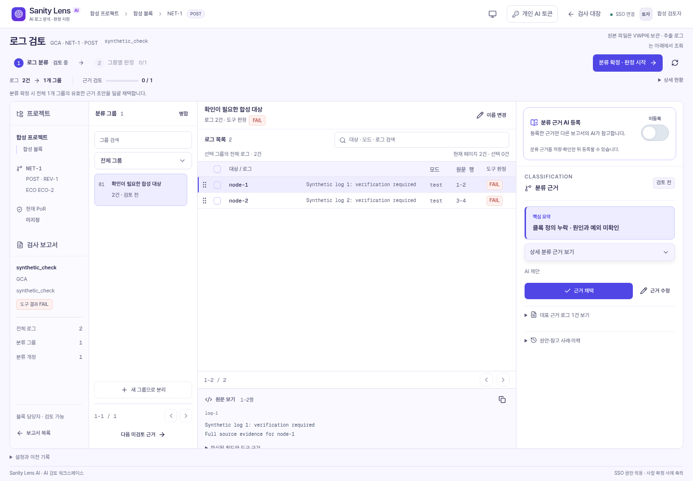

# Design Atlas 개발 현황

설계 점검과 변화 검토의 반복 공수(MM)를 줄이기 위한 통합 작업 공간입니다. 공통 프로젝트·블록·버전에서 Sanity 로그 검토와 구성·면적·전력 비교를 연결합니다. AI가 분류·판정 근거를 제안하면 담당자가 최종 결정하고, 선택한 확정 근거는 다음 판단에도 활용합니다.

- **개발 과정:** 로그 수집·저장 → 웹 검토와 이력 관리 → AI 분류·판정 및 과거 사례 활용 → 대량 처리와 사용성 개선.
- **현재 상태:** Sanity 핵심 기능을 구현하고 일부 점검 항목을 사내 시험 적용 중입니다. 구성·전력 추적과 공통 제품 흐름의 로컬 통합은 사내 실제 데이터·모델·SSO 검증과 구분합니다.
- **기대 효과:** 로그 정리·설계 변화 비교·반복 검토·과거 근거 검색의 MM을 줄이고 개인의 경험을 팀의 지식으로 축적합니다.
- **향후 계획:** 수작업 대비 검토 공수와 판단 정확도를 비교해 MM 절감 효과를 확인하고, AI 판단·사례 검색을 개선하며 여러 점검 항목으로 확대합니다. VWP에서 Sanity Check를 실행한 뒤 AI 판단이 완료되면 담당자에게 메일 알림을 보내는 기능도 추가할 계획입니다.

*기능 화면 예시(합성 데이터): 유사 로그 분류와 근거 검토.*
