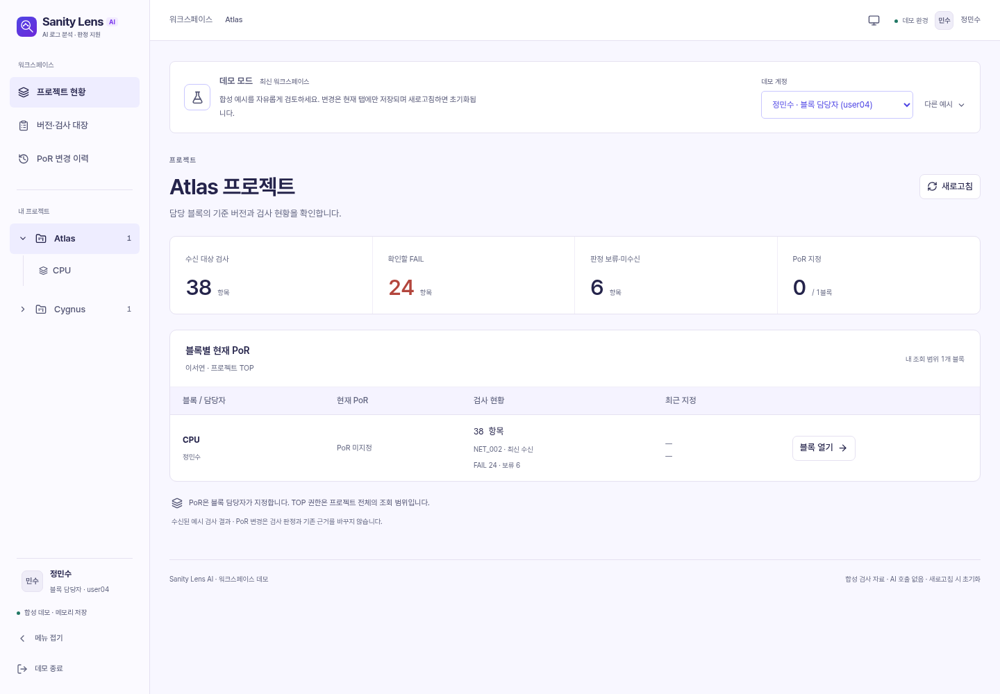
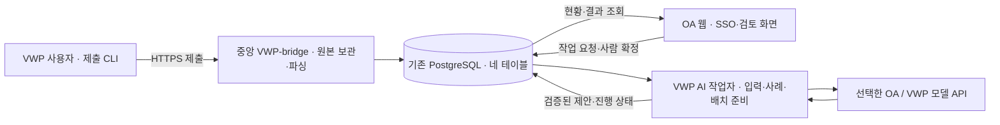

# Sanity Lens AI

**AI 로그 분석 · 판정 지원**

Sanity report의 전체 로그를 AI가 분류하고 그룹별 판정과 근거를 제안합니다. 사람이 그룹 구성과 판정을 수정·확정하면 그 근거를 DB에 보존하고, 다음 report의 AI 판단에 참고 사례로 제공합니다. 수집부터 검토까지의 목표는 **이번 판단을 설명하고, 사람의 정정이 다음 판단에 반영되게 하는 것**입니다.

[AI 판단 설계](AI_DECISION_DESIGN.md) · [모델 연결·실행](oa/AI_RUNTIME.md) · [VWP AI 작업자](vwp_bridge/AI_WORKER.md) · [설치·배포](DEPLOYMENT.md)



*현재 UI의 합성 데모 화면입니다. 표시된 사용자·프로젝트·검사 수치는 예시이며, 이 화면에서는 실제 DB·SSO·모델을 호출하지 않습니다.*

## 무엇을 할 수 있나요?

| 기능 | 현재 제공하는 동작 |
|---|---|
| AI 로그 분류 | 전체 로그로 초기 그룹·이름·분류 근거를 제안합니다. 사람이 이동·분리·병합·수정한 뒤 분류를 확정합니다. |
| 그룹별 AI 판정 | 확정 그룹의 전체 근거와 승인된 점검 기준·관련 사례를 비교해 PASS / FAIL / 보류와 이유를 제안합니다. 도구 원본 결과·AI 제안·사람 최종 판정을 각각 보존합니다. |
| 확정 사례 활용 | 사람이 확정한 분류·판정·정정 이유·조건·예외를 다음 판단에 제공합니다. 프로젝트·블록·버전이 다른 사례도 조건 차이를 비교하며, 과거 원문 열람 권한은 유지합니다. |
| OA·VWP 모델 관리 | 관리자가 연결을 추가·수정·삭제하고 허용 모델·기본 모델을 정합니다. 사용자는 연결·모델과 개인 인증값을 설정합니다. 삭제 후에도 과거 작업·판정 이력은 보존합니다. VWP 모델 주소와 게이트웨이 공통 설정은 VWP 프로필에 둡니다. |
| 대량 입력 처리 | 선택형 배치로 전체 로그·확정 그룹·보존 본문을 모델 예산에 맞춰 나누고 통합합니다. 전체 범위와 근거 검증을 통과한 뒤 최종 제안을 공개합니다. |
| 병렬 호출 | 관리자가 작업당 동시 호출 수를 1~8로 지정합니다. 각 응답을 바로 저장하고 같은 단계의 결과를 모아 통합합니다. 완료 배치를 보존하며 결과 불명 목록은 명시 확인 후 복구합니다. [설정 안내](oa/PARALLEL_BATCHES.md) |
| AI 입력 최적화 | item별 `ai_fields`·원문/부가정보 전송 설정으로 판단할 필드를 선택합니다. 전체 원본은 DB에 보존하며 짧은 요청 ID를 서버에서 원본에 연결합니다. [설정 안내](oa/AI_INPUT_FIELDS.md) |
| 작업 현황·복구 | 카드에서 준비·전송·응답·검증 단계, 완료량, 실측 호출 시간·건당 속도를 확인합니다. 안전한 실패의 재시도와 저장된 배치부터의 재개를 제공합니다. |
| 검토 워크스페이스 | 프로젝트·블록·NET_VER / REVISION·ECO·PoR, 권한별 검토와 변경 이력을 관리합니다. 인디고·바이올렛 테마, 밝은/어두운 모드, 폭 조절·접기 애니메이션을 지원하는 사이드바와 홈으로 돌아가는 브랜드 로고를 제공합니다. |
| 원본·근거 보존 | HTTPS 제출, 원본의 VWP private DB 보관, item별 파싱, 원문 위치·해시 검증을 연결합니다. 선택형 무손실 압축·근거 페이지·공유 본문 저장을 지원합니다. |

AI 제안은 사람이 확정한 결과와 구분합니다. 과거 사례가 없는 첫 report도 현재 로그와 확인된 기준으로 판단할 수 있어야 하며, 모델 호출 성공만으로 판단 품질 검증을 대신하지 않습니다.

## AI와 사람이 함께 만드는 판단 순환

1. **AI 초기 분류:** 현재 report의 전체 로그와 관련된 유효 확정 사례로 그룹과 분류 근거를 제안합니다.
2. **사람의 분류 확정:** 구성·이름·이동/분리/병합 이유를 수정하고 확정합니다.
3. **AI 그룹 판정 → 사람 확정:** 확정 그룹의 근거로 판정을 제안하고, 사람이 채택·정정한 이유와 적용 조건을 기록합니다.
4. **다음 판단에 활용:** 현재 유효한 사람 확정 사례를 검색해 다음 report에 제공합니다. 미확정 AI 초안을 정답 사례로 사용하지 않습니다.

현재 사례 검색은 단어·한글 n-gram 관련도와 유효성 검사에 기반합니다. 임베딩 기반 의미 검색이나 모델의 재학습을 완료한 것으로 표시하지 않습니다. 설계와 수용 기준은 [AI 판단 설계](AI_DECISION_DESIGN.md)에 있습니다.

## 실행 구조

**AI 작업자 전체는 중앙 VWP에서 실행하고, OA 웹은 인증·작업 등록·현황·사람의 검토를 담당합니다.** 코드의 `oa` 패키지는 작업·권한·결과의 논리적 소유자를 뜻하며, 물리적 AI 실행 서버를 뜻하지 않습니다.



VWP-bridge와 OA의 업무 데이터 전달은 기존 PostgreSQL 네 테이블을 사용합니다. 모델 API 호출과 사용자 CLI의 HTTPS 제출은 이 DB 경계와 별도입니다. AI 작업자를 옮기기 위해 새 HTTP 중계 서버·테이블·권한을 추가하지 않습니다.

| 실행 위치 / 역할 | 코드 | 책임 |
|---|---|---|
| VWP 사용자 환경 | [`vwp/`](vwp/README.md), `bin/sanity` | 완료된 report 수집과 `submit / status / retry`. DB·모델 계정을 사용자에게 배포하지 않습니다. |
| 중앙 VWP-bridge | [`vwp_bridge/`](vwp_bridge/README.md) | HTTPS 접수, 원본 DB 보관, parser 실행, 전체 근거 검증·전달 |
| 중앙 VWP AI 작업자 | [`oa/ai_worker.py`](oa/ai_worker.py) | 전체 입력 복원, 사례 검색, 배치 계획, OA/VWP 모델 호출, 결과 검증·저장 |
| OA 웹·수신기 | [`oa/`](oa/README.md), [`oa/dashboard/`](oa/dashboard/README.md) | SSO·현재 권한, 제출 범위 확정, 작업 등록·조회, 사람 검토·이력 |
| 공통 계약·DB | [`common/`](common/README.md), [`db/`](db/README.md) | 설정·검증·DB 계약과 승인된 증분 SQL |
| 개발·합성 검증 | [`devtools/`](devtools/README.md), `tests/`, `tools/` | 독립 mock DB, 합성 report·모델 응답, 회귀·화면 검증 |

### 모델 연결과 실패 처리

- **관리자:** OA 연결에는 전체 모델 URL·같은 모델의 보조 URL·인증 방식·모델 목록·기본 모델·토큰 발급 링크·한도를 설정합니다. Bearer, `x-client-api-key`, 둘을 함께 쓰는 게이트웨이를 지원하며 Bearer 단독 연결에 클라이언트 키는 필요하지 않습니다.
- **VWP 연결:** 실제 URL·게이트웨이 공통 클라이언트 키·CA는 VWP의 비공개 프로필에 보관합니다. 관리자는 프로필·허용 모델·기본 모델과 선택형 HTTPS 발급 링크를 정하고, 승인된 각 사용자는 OA에서 본인의 개인 인증값을 등록합니다. 공용 모델 토큰이나 다른 사용자 키로 대체하지 않습니다.
- **전송:** 모델 API는 HTTP/HTTPS와 지원되는 Chat Completions / Responses 형식을 사용합니다. 추가 클라이언트 식별이 필요한 게이트웨이는 Chat Completions만 지원합니다. HTTPS 인증서·호스트명 검증은 유지하며, 보조 URL은 요청 전 연결 수립 실패에만 사용합니다. 제출 전송과 토큰 발급 URL은 계속 HTTPS입니다.
- **재시도:** 최초 시도 이후 실패한 호출당 최대 5회 추가 시도합니다. 전송 전 연결 실패, 명확한 HTTP 429/500/502/503/504, 완전히 수신한 응답의 지원되는 형식·검증 오류가 대상입니다. 성공한 배치는 재사용하고 실패한 시도도 전체 호출 한도에 포함합니다.
- **재개:** 조건을 충족한 실패나 호출 중이 아닌 취소는 원래 요청자가 최대 5회 재개할 수 있습니다. 배치는 완료한 저장 지점부터, 단일 호출은 전체 입력으로 다시 실행합니다. `UNKNOWN` 배치도 미완료 호출의 중복 가능성을 원래 요청자가 확인하고 명시적으로 승인하면 저장 지점에서 복구할 수 있습니다. 이미 끝난 배치는 재호출하지 않습니다. `UNKNOWN` 단일 호출과 `AI_BATCH_LIMIT`은 복구하지 않습니다. 자동 재전송은 없으며 현재 권한·입력·설정·사례·개인 인증을 재검증하고 전체 호출 예산을 유지합니다.
- **진행률:** 배치의 현재 단계/라운드를 기준으로 표시합니다. 완료 호출이 2회 이상 쌓였을 때만 해당 단계의 예상 종료 시간을 계산하며, 작업자 응답 없음·조회 실패·재시도 대기에는 ETA를 숨깁니다. 전체 작업의 종료 시간을 보장하지 않습니다.

정확한 설정·제한은 [AI 실행 계약](oa/AI_RUNTIME.md), [배치 처리 계약](oa/BATCHED_CLUSTERING.md), [VWP 작업자·프로필·복구 안내](vwp_bridge/AI_WORKER.md)를 따릅니다.

## 빠르게 화면 보기

회사 DB·SSO·모델 없이 합성 화면을 확인할 수 있습니다. Node.js는 [`oa/dashboard/.nvmrc`](oa/dashboard/.nvmrc)의 **20.18.0**을 기준으로 하며, 의존성은 lockfile로 고정합니다.

```bash
npm --prefix oa/dashboard ci
npm --prefix oa/dashboard run dev
```

브라우저에서 **http://127.0.0.1:5173/?demo=1** 에 접속합니다. 데모의 검토 데이터 변경은 탭 메모리에만 보관하고 새로고침하면 초기화합니다. 테마·사이드바 폭 같은 화면 설정은 브라우저에 별도로 저장합니다. 별도의 API 서버나 모델 인증값은 필요하지 않습니다. 운영 접속 오류를 데모로 자동 대체하지 않습니다.

운영 SSO 화면은 `/?page=workbench`, 업무 API는 `/api/workbench/*`입니다. `/workspace`는 [별도로 실행하는 합성 검증 앱](oa/WORKSPACE.md)이며 운영에 자동 마운트하지 않습니다. 기존 번들 검토·CLI와 합성 자료 예시는 [화면 안내](oa/dashboard/README.md)와 [개발 도구](devtools/README.md)를 참고하세요.

## 설치와 사내 배포

Python **3.10 이상**, PostgreSQL **12.1 이상·UTF-8**을 전제로 합니다. Node.js는 화면 빌드·개발에 사용합니다. PostgreSQL 18의 알려진 호환 문제는 아래 검증 상태를 확인하세요.

### 1. 의존성과 비공개 설정 준비

아래는 전체 개발·검증 환경의 설치 예입니다. 서버 배포에서는 [역할별 의존성](DEPLOYMENT.md)을 사용합니다.

```bash
python3 -m venv .venv
.venv/bin/python -m pip install -r requirements.txt
```

설정 예제는 [OA](oa/.env.example), [VWP-bridge](vwp_bridge/.env.example), [VWP AI 작업자](vwp_bridge/ai-worker.env.example)에 있습니다. 실제 설정은 **각 서버의 저장소 루트 `.env` 또는 프로세스 환경**에 두며, 예제 디렉터리 안의 `.env`는 자동으로 읽지 않습니다. 실제 접속 정보·토큰·인증서·회사 report는 Git이나 `VITE_*`에 넣지 않습니다.

기본 DB 모드는 `SANITY_DB_ACCESS=postgresql`이며 psycopg2로 직접 접속합니다. 제한 계정을 분리하는 기본 계약과 별도로, 사용자가 확인한 공유 계정을 활용하는 VWP AI 작업자 배포 구성에는 `SANITY_DB_ALLOW_SINGLE_ACCOUNT=true`를 명시합니다. 공유 계정 모드는 OA/VWP 간 DB 권한 격리를 제공하지 않습니다. TLS·DSN 우선순위·권한은 [DB 연결 인계](db/CONNECTION_HANDOFF.md)를 따릅니다.

### 2. 기존 DB의 적용 상태 확인

| 테이블 | 역할 |
|---|---|
| `sanity_vwp_data` | VWP 원본·파싱 근거·분석 |
| `sanity_oa_data` | 수신·작업·검토·확정 사례·변경 이력 |
| `sanity_vwp_to_oa` | 분석·전체 근거·응답 전달 |
| `sanity_oa_to_vwp` | 요청·수신 응답 전달 |

최초 신청 form과 증분 SQL을 구분하고, **이미 적용한 SQL이나 테이블 생성을 반복하지 않습니다.** HTTPS 제출·DB 원본 보관은 010까지의 관련 계약을 사용하며, 011~013은 무손실 압축·근거 페이지·공유 본문 저장의 선택형 변경입니다. 호환 코드 선배포와 DBA의 적용 검토가 필요하며 앱이 DDL·기존 데이터 변환을 자동 실행하지 않습니다.

실제 순서와 설치 상태 확인은 [DB 안내](db/README.md)와 [읽기 전용 설치 점검](db/INSTALLATION_CHECKS.md)을 따릅니다. 모델·작업자 업데이트 자체에는 새 migration이 필요하지 않습니다.

### 3. 화면과 작업자 실행

```bash
# OA: 화면 빌드 후, 회사 SSO 어댑터·권한 설정이 준비된 환경에서 실행
npm --prefix oa/dashboard ci
npm --prefix oa/dashboard run build
.venv/bin/python -m oa.sso_app
```

직접 실행은 loopback의 `http://127.0.0.1:8000`을 사용합니다. 사내 Nginx 뒤의 OA 배포는 [CI/CD Docker 안내](docker/README.md), 제출·파싱·OA 수신기는 [HTTPS 제출 실행 안내](vwp/HTTPS_SUBMISSION.md)를 따릅니다. SSO·OWNER·회사 parser의 미구현 보호 상태는 유지합니다.

```bash
# 중앙 VWP: 같은 릴리스·DB·승인 기준과 필요한 인증 설정을 준비한 뒤 별도 실행
.venv/bin/python -m oa.ai_worker --site vwp --interval 2
```

OA 또는 VWP 개인 인증값을 처리하려면 웹과 작업자에 같은 암호화 키를 안전하게 주입합니다. VWP 모델은 `SANITY_VWP_AI_PROFILES_FILE`의 비공개 프로필과 허용 사용자 설정을 사용하며, 프로필에 공용 모델 토큰은 넣지 않습니다. 직접 실행에서 OA 모델만 사용하면 VWP 프로필은 선택 사항이지만, 제공된 Compose 구성은 빈 목록이라도 올바른 프로필 파일이 필요합니다.

기존 OA AI 작업자를 전환할 때는 진행 중 호출과 저장 상태를 확인하고 같은 버전으로 교체합니다. `oa.main work`, 제출·파싱·수신기는 별도 프로세스입니다. 전용 컨테이너·프로필 권한·전환·복구 절차는 [VWP AI 작업자 배포 안내](vwp_bridge/AI_WORKER.md)에 있습니다.

## 검증과 현재 확인 범위

일상 수정은 관련 전용 테스트와 기본 **`quick`** 프로필로 확인합니다. 기본 실행은 독립 mock DB 준비·종료를 포함해 **3분 이내 완료를 목표**로 합니다. 이전의 넓은 quick 범위는 `regression`, 전체 회귀·포털 전체 단계·10만 건 검사는 `full`로 보존합니다. 기본 실행은 느린 테스트 5건의 시간을 표시하며 `--report-json 새파일.json`으로 전체 테스트별 시간을 기록할 수 있습니다.

```bash
# 선택 대상 확인 / 기본 회귀
.venv/bin/python run_tests.py --profile quick --list
.venv/bin/python run_tests.py --profile quick

# 별도의 새 로컬 PostgreSQL + 합성 입력·모의 AI 응답으로 통합 검증
.venv/bin/python db/tests/run_mock.py --profile quick

# 이전의 넓은 quick 회귀 범위가 필요한 경우
.venv/bin/python db/tests/run_mock.py --profile regression

# 필요할 때 전체 검증 (기존 DB나 회사 자료를 사용하지 않음)
.venv/bin/python db/tests/run_mock.py --profile full

# 디스크 동기화를 유지하는 직렬 검증
.venv/bin/python db/tests/run_mock.py --profile quick --jobs 1 --durability durable
```

mock 실행에는 로컬 PostgreSQL 서버 바이너리(`initdb`, `pg_ctl`, `postgres`)가 필요합니다. PATH에 없으면 `--pg-bin /path/to/postgresql/bin`을 지정합니다. 독립 DB를 만들며 사내 `.env`·접속 정보·실제 report는 읽지 않습니다. 일반 회귀는 외부 모델을 호출하지 않습니다. 별도로 명시하는 [실제 모델 합성 시험](oa/WORKSPACE.md)은 일반 회귀와 구분합니다. DB 테스트의 skip이나 `quick` 통과를 전수·운영 검증 성공으로 표시하지 않습니다.

mock 실행기는 CPU 가용량에 맞춰 최대 4개의 작업자 DB를 만들고 테스트를 분산합니다. `--jobs`로 병렬 수를 지정하며, 선택한 테스트와 실제 실행한 ID를 대조해 누락·중복·중도 종료를 검출합니다. 폐기용 mock 클러스터는 기본적으로 디스크 동기화를 끄며 `--durability durable`로 원래 동기화 동작을 선택할 수 있습니다. 이 설정은 운영 DB에 적용하지 않습니다. 자세한 격리·결과 파일·내구성 범위는 [DB 검증 안내](db/README.md)를 따릅니다.

**2026-10-30~31 전수 시간 조사:** 기존 Python 테스트 파일 100개·테스트 메서드 1,172개를 대조했습니다. 기존 업무·보안 테스트 본문·입력·기대값은 유지했고, 실행기 테스트 3곳의 옵션·시간 검증을 보강하고 전용 검증 16건을 추가했습니다. 원본 DDL을 한 트랜잭션으로 준비하고, 테스트 클라이언트별 HTTP 이벤트 루프를 재사용하며, AI 입력 JSON 직렬화와 배치 적합성 확인의 중복 연산을 줄였습니다. 토큰·바이트 한도, 비밀값 검사와 DB 권한 검사는 유지합니다.

같은 Termux/PostgreSQL 18.6 환경에서 기기를 깨어 있게 유지하고 이전 기본과 새 기본을 순서대로 비교했습니다. **366건의 203.473초 → 393건의 91.643초로 약 55% 단축**됐습니다. 시간은 DB 준비·종료를 포함합니다.

| 실행 범위 | 작업자 / 디스크 동기화 | 실행 | 경과 시간 | 결과 |
|---|---|---:|---:|---|
| 이전 기본 `quick` | 1 / durable | 366건 | 203.473초 | 358 통과, 실패 5·오류 3 |
| 새 기본 `quick` | 4 / ephemeral | 393건 | 91.643초 | 385 통과, 실패 5·오류 3 |
| `regression` | 2 / ephemeral | 663건 | 528.170초 | 655 통과, 실패 5·오류 3 |
| `full` 전수 스냅샷 | 2 / ephemeral | 1,174건 | 약 45분 49초 | 1,160 통과, 실패 10·오류 4 |

모든 실행의 skip은 0건이며 DB 종료를 확인했습니다. 전체 성공 상태가 아닙니다. 회귀 실패로 후속 demo·별도 저장 probe는 실행하지 않았습니다. 전수에는 기존 10만 건 AI 전달·그룹 판정·근거 페이지·원본 파싱·10만 그룹 편집/마지막 그룹 판정이 포함됩니다. 3분 목표는 기본 `quick`에 적용하며 전수는 계속 오래 걸립니다. 전수 스냅샷 이후의 계측·보수적 가드는 전용 **30건 통과**와 최종 `quick`으로 확인했습니다. 원본/배치 fixture의 컬럼·제약·인덱스·ACL 동등성 전용 1건과 로컬 합성 파일 보안 10건도 통과했습니다.

과거 실행기의 `monotonic` 시간은 기기 절전을 제외했습니다. 전수 JSON의 2,366.302초는 이 방식의 기록이며, 위 표는 첫 스냅샷 파일과 summary 시각 사이의 실제 경과 시간으로 보정한 근삿값입니다. 이후 실행기는 지원 플랫폼에서 `CLOCK_BOOTTIME`을 사용해 절전도 포함합니다. 마지막 기본 비교는 별도 벽시계로 측정했으며 DB 준비·종료에 대한 실행기 기록은 이전 202.932초, 새 기본 91.041초입니다.

브라우저 spec 27개·정적 테스트 선언 248개와 Playwright 설정 8개도 조사했습니다. 독립 mock UI만 병렬화했고 DB를 공유하는 설정은 직렬을 유지합니다. 설정 8개의 TypeScript 변환은 통과했지만 Android의 Playwright 미지원으로 브라우저 실측은 미실행입니다. 별도 컨테이너 시작·앱 origin 검사 13건은 통과했으며, 실제 Nginx가 필요한 5건은 바이너리 부재로 미실행입니다.

이전 AI 연결 삭제·재개 가용성 전용 15건, 관리자 화면 13건과 프런트엔드 빌드의 통과 기록은 유지합니다. 삭제 시 과거 이력 보존, OA/VWP 호출 및 결과 적용 차단, 불명 결과 보존, 관리자 권한·개정·화면 재조회 경합을 합성 자료로 확인한 결과입니다.

- **PostgreSQL 18:** `quick` 5건·`full` 9건의 포털 카탈로그 관련 실패가 미해결입니다. 별도로 전수의 업무 HTTP `AI available` 기대값 실패 1건은 변경 전 원본에서도 동일하게 재현했습니다.
- **Termux:** 실제 하드링크 생성과 root 소유 설정 파일이 필요한 기존 보안 테스트 2건은 사내 독립 Linux 실환경 검증 대기입니다. [`tests/test_submission_files.py`](tests/test_submission_files.py)의 로컬 합성 stat/소유권 검증 통과는 실제 하드링크·소유권 검증 완료를 뜻하지 않습니다. 보안 검사·기대값은 유지합니다.
- **로컬 의존성:** `requirements.txt`의 `tokenizers==0.23.3` 준비가 필요합니다. 캐시된 Android wheel의 직접 설치도 ABI 심볼 오류로 로드하지 못해 원복했습니다. 실제 tokenizer 검증을 통과로 표시하거나 관련 테스트를 제외/skip하지 않았습니다.
- **추가 로컬 DB 오류:** 절전 영향이 있던 전수 실행에서 VWP 등록 검사의 `DATABASE_UNAVAILABLE` 1건이 발생했습니다. 별도 21건 프로파일링도 DB 오류가 있어 속도 개선 비교에 사용하지 않았습니다. VWP 등록 검사는 현재/원본 단독 실행과 기기를 깨운 663건 회귀에서는 통과했지만, 원래 전수 오류는 그대로 보존합니다.
- **사내 확인 대상:** 실제 report parser·SSO/OWNER·운영 DB/TLS·VWP 작업자 배포·컨테이너 실행·모델 API 호환성 및 판단 품질·속도·대량 처리 한도는 현장 검증이 필요합니다. 합성 데이터의 저장 규모나 모델 응답 mock만으로 운영 성능을 보장하지 않습니다.

세부 검증 원칙은 [AGENTS.md](AGENTS.md), 테스트 방법과 누적 기록은 [DB 검증 안내](db/README.md)·[REVIEW.md](REVIEW.md)를 참고하세요.

## 더 알아보기

| 문서 | 내용 |
|---|---|
| [AI 판단 설계](AI_DECISION_DESIGN.md) | 초기 판단·확정 사례 검색·피드백·품질 수용 기준 |
| [AI 실행 계약](oa/AI_RUNTIME.md) / [VWP 작업자](vwp_bridge/AI_WORKER.md) | 모델·인증·개인 토큰·작업·프로필·현황·재시도·복구 |
| [배치 처리](oa/BATCHED_CLUSTERING.md) | 전체 로그·그룹 판정·보존 본문의 분할·통합·예산·coverage |
| [HTTPS 제출](vwp/HTTPS_SUBMISSION.md) / [원본 DB 보관](vwp/DB_ORIGINALS.md) | 토큰 없는 접수·OWNER 범위 확정·파싱용 임시 복원 |
| [보존 원천](vwp/PRESERVED_SOURCES.md) / [본문 전달](vwp/PRESERVED_TEXT.md) | full.rpt·SDC 등의 불변 참조와 선택형 본문 분석 |
| [설치·배포](DEPLOYMENT.md) / [DB 연결](db/CONNECTION_HANDOFF.md) | 서버별 실행·설정·계정·권한·TLS |
| [DB 설치](db/README.md) / [저장 용량](db/TOTAL_STORAGE.md) | 기존 네 테이블·증분 SQL·선택형 무손실 저장·합성 측정 |
| [워크스페이스](oa/WORKSPACE.md) / [데이터 계약](PROTOCOL.md) / [요구사항](requirement.md) | 합성 앱·업무 모델·전송/검토 계약 |
| [사내 AI 작업 가이드](INTERNAL_AI_GUIDE.md) / [통합 인계](INTERNAL_AI_HANDOFF.md) | 역할별 허용 파일·회사 어댑터·오류 문의·수용 기준 |

사내 연동 AI는 작업 전에 [AGENTS.md](AGENTS.md)와 [INTERNAL_AI_GUIDE.md](INTERNAL_AI_GUIDE.md)를 읽고 자기 역할의 허용 어댑터만 구현합니다. 실제 회사 자료·비밀값은 외부 대화나 공개 Git에 올리지 않습니다. 예상 밖 오류나 보호 코드 변경이 필요하면 기존 문의 절차를 따릅니다.

수집·접수·파싱 성공은 검토 완료나 sanity PASS를 뜻하지 않습니다. 전체 근거·권한·개정·해시 검증이 실패하면 중단하며, 일부 결과·로컬 DB·다른 모델·데모로 자동 우회하지 않습니다. 원문 조회 권한과 자격증명 보호를 유지하고, SDC는 분석 자료로만 취급해 실행하지 않습니다. legacy 번들·CLI·VWP 규칙 제안 경로는 호환 기능이며 현재 전체 로그 AI 작업자와 구분합니다.
