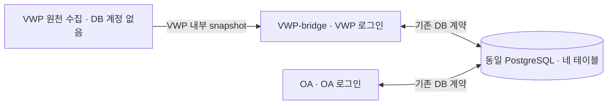

# 사내 AI별 DB 연결 인계

이 문서는 **기존 PostgreSQL 연결 구현과 권한 계약**을 세 담당자에게 전달한다. 실제 접속값은 기입하지 않았다. [공통 작업 지침](../INTERNAL_AI_GUIDE.md)과 [DB 설치/증분 안내](README.md)를 함께 따른다. 이 문서가 운영 DB 쓰기·SQL 적용 권한을 부여하지 않는다.

코드 위치와 실행은 [서버별 소스 안내](../DEPLOYMENT.md)를 따른다. [VWP-bridge 설정 예제](../vwp_bridge/.env.example)와 [OA 설정 예제](../oa/.env.example)의 키를 각 서버의 **저장소 루트 `.env`**에 설정한다. 예제 파일은 자동으로 읽거나 덮어쓰지 않는다.

## 1. 누가 어떤 계정을 사용하는가

| 담당 개발 AI | 실행 단계 | DB 로그인/역할 | 확인할 내용 |
|---|---|---|---|
| [VWP](../vwp/INTERNAL_AI_TASK.md) | 원천 조회·예상 목록·snapshot 수집 | **없음** | plan과 VWP 내부 snapshot을 VWP-bridge에 인계 |
| [VWP-bridge](../vwp_bridge/INTERNAL_AI_TASK.md) | parser·VWP 모델 SDK 연동, 기존 분석/전달 실행 환경 | VWP 전용 제한 로그인 → `sanity_vwp_app` | VWP 서버 설정, `--side vwp` 점검 결과 |
| [OA](../oa/INTERNAL_AI_TASK.md) | SSO·사용자 연결, 기존 수신/사람 검토 실행 환경 | OA 전용 제한 로그인 → `sanity_oa_app` | OA 서버 설정, `--side oa` 점검 결과 |

**개발 AI는 세 개지만 앱 DB 계정은 두 개**다. 두 bridge는 같은 PostgreSQL DB와 네 테이블을 사용한다. 접속 endpoint는 각 망에서 승인된 주소를 사용하며, 주소 문자열이 다르더라도 DBA가 같은 논리 DB/스키마임을 확인해야 한다. `sanity_vwp_app`·`sanity_oa_app`은 권한 역할 이름이며 보통 `NOLOGIN`이다. 실제 발급된 로그인 이름은 별개로 확인한다. 코드의 side는 `vwp`, `oa`만 지원한다. `vwp-bridge`라는 새 side를 만들지 않는다.



원본 수집→bridge의 로컬 입력과 VWP↔OA 경계를 구분한다. 두 bridge 사이에 HTTP/RPC·공유 파일·별도 DB를 추가하지 않는다. OA 회사 계정 조회용 저장소는 이 DB와 같다고 가정하지 않는다.

## 2. 현장에서 받아야 할 접속 정보

사용자/DBA는 아래 값을 각 서버의 **비공개 root `.env` 또는 프로세스 환경**에 설정한다. `root`는 `common/`·`vwp/`·`vwp_bridge/`·`oa/`를 포함하는 저장소 루트이며 `vwp_bridge/.env`, `oa/.env`는 자동으로 읽지 않는다. 환경변수는 빈 값까지 `.env`보다 우선하고 변수 보간은 하지 않는다. 두 bridge가 같은 개발 checkout을 사용하면 실행 프로세스별 환경을 분리한다. 하나의 `.env`에 두 로그인 값을 번갈아 덮어쓰지 않는다.

| 지원 키 | 필수/기본값 | 인계할 내용 |
|---|---|---|
| `SANITY_DB_ACCESS` | `postgresql` | 직접 `psycopg2` 접속. `dbaas_http`는 임시 읽기 전용이며 저장 불가 |
| `SANITY_DB_HOST` | 필수 | 해당 망에서 접근 가능한 승인 endpoint와 인증서 호스트 일치 |
| `SANITY_DB_PORT` | 기본 `5432` | 실제 발급 포트, 1~65535 |
| `SANITY_DB_NAME` | 필수 | 두 bridge가 함께 사용하는 실제 DB 이름 |
| `SANITY_DB_USER_NAME` | 필수 | 해당 서버의 제한 로그인. 반대편 계정/owner/관리자 사용 금지 |
| `SANITY_DB_PASSWORD` | 필수 | 해당 로그인 비밀번호, 비밀 저장 경로에서 현장 주입 |
| `SANITY_DB_SCHEMA` | 기본 `public` | 네 테이블의 실제 스키마. DB 이름과 별개 |
| `SANITY_DB_SSLMODE` | 기본 `verify-full` | DBA 승인 TLS 정책. 연결 오류를 해결하려고 검증 수준을 낮추지 않음 |
| `SANITY_DB_SSLROOTCERT` | CA 필요 시 | 해당 서버 신뢰 CA 파일의 **절대 경로**, 인증서 파일은 비공개 배포 |
| `SANITY_VWP_DSN` | 선택, VWP 측만 | 비어 있지 않으면 VWP의 host/user/password/port/TLS 필드보다 우선 |
| `SANITY_OA_DSN` | 선택, OA 측만 | 비어 있지 않으면 OA의 host/user/password/port/TLS 필드보다 우선 |

필드 방식은 아래 공개 예제에서 시작한다. 빈 필수 값은 실제 사용 전에 **사내에서** 입력한다. `.env` 전체나 값을 출력하는 점검 명령을 실행하지 않는다. VWP 원천 수집 단계에는 이 설정을 만들 필요가 없다.

```dotenv
SANITY_DB_ACCESS=postgresql
SANITY_DB_HOST=
SANITY_DB_PORT=5432
SANITY_DB_NAME=
SANITY_DB_USER_NAME=
SANITY_DB_PASSWORD=
SANITY_DB_SCHEMA=public
SANITY_DB_SSLMODE=verify-full
SANITY_DB_SSLROOTCERT=
```

VWP-bridge 서버는 VWP 로그인 값만, OA 서버는 OA 로그인 값만 넣는다. 지원 예제는 [VWP-bridge](../vwp_bridge/.env.example)와 [OA](../oa/.env.example)로 구분하며, 구현 근거는 [sanity_config.py](../common/sanity_config.py)다. 실제 `.env`는 실행 계정만 읽도록 관리한다. 실제 `dbaccess.md`, 인증서, DSN·비밀번호·토큰을 Git/브라우저/`VITE_*`/외부 대화에 넣지 않는다.

**DSN 우선순위:** 기존 side DSN이 남아 있으면 위 필드를 고쳐도 접속이 바뀌지 않는다. 필드 방식으로 전환할 때는 승인된 설정에서 자기 side DSN을 제거하거나 비운다. DSN 사용 시 TLS/CA 등 연결 조건도 DSN 쪽에서 완결해야 한다. DSN 실패 후 필드 방식/다른 계정/HTTP로 자동 재접속하지 않는다. 새 env 키가 필요하면 공통 설정을 수정하지 말고 Codex에게 문의한다.

## 3. 네 테이블과 유효 권한

기준은 [003_grants.sql](003_grants.sql)이다. 아래는 **기존 앱의 실행 권한**이며 개발 AI가 임의 SQL을 작성/실행할 허가가 아니다.

| 테이블 | VWP 로그인 (`sanity_vwp_app`) | OA 로그인 (`sanity_oa_app`) |
|---|---|---|
| `sanity_vwp_data` | SELECT, INSERT, 지정 상태 컬럼 UPDATE | 접근 없음 |
| `sanity_oa_data` | 접근 없음 | SELECT, INSERT, 지정 상태 컬럼 UPDATE |
| `sanity_vwp_to_oa` | SELECT, 지정 송신 컬럼 INSERT | SELECT, 지정 수신 상태 컬럼 UPDATE |
| `sanity_oa_to_vwp` | SELECT, 지정 수신 상태 컬럼 UPDATE | SELECT, 지정 요청 컬럼 INSERT |

- private 테이블 UPDATE: `state`, `status`, `version`, `updated_at`만 허용한다. 기존 payload/원문/봉인 자료를 바꾸는 권한이 아니다.
- VWP→OA INSERT: `message_id`, `message_type`, `payload`, `project`, `run_id`, `bundle_id`, `correlation_id`, `payload_gzip`, `payload_sha256`, `uncompressed_bytes`.
- OA→VWP INSERT: `message_id`, `message_type`, `payload`, `project`, `run_id`, `bundle_id`, `expires_at`.
- 양쪽 수신 큐 UPDATE: `status`, `error_message`, `attempt_count`, `next_attempt_at`, `lease_token`, `lease_owner`, `lease_expires_at`, `completed_at`, `updated_at`.

DBA는 각 로그인에 자기 역할 하나만 연결한다. 두 앱 모두 owner/superuser/BYPASSRLS/상대 역할 상속이나 과도한 유효 권한을 사용하지 않는다. DELETE/TRUNCATE/DDL·schema CREATE는 앱 권한이 아니다. 앱의 현재 권한 검사는 직접 GRANT뿐 아니라 상속/공개 권한도 확인한다. 실패 시 광범위 GRANT나 검사 삭제로 해결하지 않는다.

## 4. 실제 연결 확인과 결과 인계

실제 사내 DB 확인은 사용자가 각 서버의 승인된 환경에서 수행한다. 내부 AI는 설정 준비와 비식별 결과 정리를 맡는다. 저장소 루트에서 자기 명령 하나만 사용한다.

```bash
# VWP-bridge 서버
.venv/bin/python -m common.sanity_db check --side vwp
```

```bash
# OA 서버
.venv/bin/python -m common.sanity_db check --side oa
```

두 명령은 읽기 전용으로 **연결·설치 스키마·유효 권한**을 검사한다. 성공 출력은 `status=CONNECTED backend=POSTGRESQL driver=psycopg2 side=vwp checks=schema,permissions` 또는 같은 형식의 `side=oa`다. 실패 시 고정 `code=...`와 종료 코드 2를 보고한다. 연결 성공은 실제 송수신/사내 SSO/모델/새 workspace 운영 완료를 뜻하지 않는다.

접속 점검에서는 PING INSERT, 분석/수신/worker 실행, queue 상태 수정, fixture/전체 DB 시험을 하지 않는다. 쓰기·잠금·재수신·중복 방지의 전체 검증은 별도 승인된 점검 환경/절차에서 수행한다. `db/tests/run_mock.py`, `db/tests/create_fixture.sh`, `run_tests.py --require-db`는 일반 접속 점검 명령이 아니며 실제 운영 DB에 실행하지 않는다.

예상 밖 접속/권한/스키마 오류는 [가이드 6절](../INTERNAL_AI_GUIDE.md#6-디버깅이-필요하면-codex에게-문의)에 따라 `WAITING_FOR_CODEX`로 남긴다. 실패한 요청을 반복하거나 TLS·권한·로그인·SQL을 임의 변경하지 않는다. 비밀값 대신 설정 키의 존재 여부, side, 비식별 오류 코드·발생 횟수와 설치 버전을 인계한다.

## 5. DBA 설치 상태 확인

테이블은 이미 신청한 form을 기준으로 한다. **재신청·재생성·완료 SQL 재실행을 지시하지 않는다.** 사용자/DBA가 실제 적용 내역을 확인해 [DB 안내](README.md)의 순서와 비교한다.

| 단계 | 상태 확인 대상 |
|---|---|
| 최초 form·`002`·역할 준비·`003` | 네 테이블/제약/인덱스, 별도 로그인과 컬럼 권한 |
| `004_clustering.sql` | 기존 legacy 분류 작업/개정 |
| `005_workspace.sql` | workspace 관리 레코드/PoR/세션 |
| `006_workspace_reviews.sql` | 사용자 판정/사례/제안 |
| `007_workspace_pipeline.sql` | 두 단계 분류/그룹 판정과 불변 event 연결 |
| `008_submissions.sql` | V2 제출/실행/outbox·OA staging과 SOURCE 메시지·원천 순서/중복 제약 |

사내 실제 적용 상태는 **미확인**이다. 합성 테스트 DB의 `008` 적용 기록으로 대체하지 않는다. 앱은 DDL/자동 migration을 하지 않는다. 비공개 스키마를 쓰면 SQL 대상과 `SANITY_DB_SCHEMA`가 일치해야 한다. 불일치는 DBA/Codex 검토로 해결하며 내부 AI가 SQL을 수정/적용하지 않는다.

사용자가 2026-10-21 확인한 포털의 단일 문장 DDL/FK 경로에는 [포털 초기 설치 안내](portal/README.md)를 사용한다. 네 테이블이 모두 빈 상태에서 기존 읽기 전용 접속으로 catalog JSON을 사내에 저장하고 오프라인 도구로 실제 스키마/제약 이름에 맞는 실행본을 만든다. 원본 form/002~008은 보존하며 005를 생략하지 않는다. 앱에 DDL 권한을 주지 않고, 포털 적용은 사용자/승인 운영 담당자가 수행한다. 003의 별도 역할·컬럼 권한 완료와 양쪽 앱 로그인의 읽기 전용 검사는 여전히 필수다. 생성된 catalog·실제 스키마·SQL bundle은 공개 저장소나 외부 대화에 올리지 않는다.

## 6. 사내에 남길 접속 인계 기록

아래 양식을 **서버별** 비공개 `dbaccess.md` 또는 승인된 비밀 관리/작업 폴더에 복사해 채운다. 실제 비밀번호는 이 양식에 복제하지 않고 승인된 비밀 주입 경로에서 관리한다. `.env`/`dbaccess.md`는 Git 제외 대상이다. 아래 빈 양식은 실제 접속 정보가 확보되거나 검증됐다는 뜻이 아니다.

```text
담당: VWP-bridge 또는 OA (VWP 수집 단계는 해당 없음)
기준 commit / 확인일 / 사내 확인 담당자:
실행 서버·망 / 동일 논리 DB 확인 근거: [사내에만 기입]
설정 위치: root .env 또는 프로세스 환경의 사내 관리 위치
DB host / port / name / schema: [사내에만 기입]
발급 로그인 이름 / 소속 앱 역할: [사내에만 기입]
비밀 주입 경로 / 회전 담당자: [사내 참조, 비밀번호 자체 제외]
TLS 정책 / 신뢰 CA의 사내 배포 경로:
side DSN 사용 여부 / 필드 방식 전환 여부:
설치 확인: form·002·003·004·005·006·007·008 각각 적용/미적용/미확인
읽기 전용 check: 미실행/성공/실패, side·일시·종료 코드·비식별 오류 코드
실제 쓰기/송수신 시험: 미실시 또는 별도 승인/실행 기록의 사내 참조
남은 의존성 / 다음 담당자 / WAITING_FOR_CODEX 문의 ID:
```

외부 Codex에 전달할 때는 실제 서버/주소/DB/로그인/경로/비밀 참조를 제거하고 `담당·기준 commit·설정 키 존재 여부·역할 일치 여부·설치 단계·check 성공/오류 코드·미확정 사항`만 남긴다. 모델 URL/token은 VWP 측 별도 비밀이며 DB 계정/SSO 자격증명과 공유하지 않는다.

## 7. 사용자 제출의 저장 경로

[제출 실행 안내](../vwp/SUBMISSION.md)의 CLI·양쪽 source 작업자와 `008_submissions.sql`을 제공한다. **실제 회사 SDK·mount/ACL·운영 DB/배포는 미연결**이며 사용자/DBA가 준비·검토한다. 사용자 CLI의 root 소유 JSON 설정은 DB 자격증명이 없는 별도 계약이다.

| 단계 | 쓰기 주체 / 위치 |
|---|---|
| `sanity submit` 인계 | 사용자 VWP → `/srv/sanity/vwp-submit/inbox/<principal-key>/<submission-id>.ready/`. 사용자 DB 계정 없음 |
| 검증된 원본 보관 | bridge service → `/var/lib/sanity/vwp-bridge/submissions/<submission-id>/`. OA에는 제공하지 않음 |
| 접수·전체 근거 | VWP 제한 로그인 → `sanity_vwp_data`. 기존 분석/근거와 구분되는 제출/원천 참조 필요 |
| 범위/분석 전달 | VWP 제한 로그인 → `sanity_vwp_to_oa`. SOURCE_MANIFEST/PART/COMMIT; envelope 포함 압축 전/후 각 4MiB, data part당 1,000건 이하 |
| staging/최종 업무 반영 | OA 제한 로그인 → `sanity_oa_data`. 전체 scope/해시/조각 검증 전 일반 검토 노출 없음 |
| OA 저장/거부 결과 | OA 제한 로그인 → `sanity_oa_to_vwp`. SOURCE_RECEIPT. OA 반영/응답 등록을 같은 트랜잭션으로 확정 |
| 사용자 상태 | bridge service → `/srv/sanity/vwp-submit/receipts/<principal-key>/<submission-id>.json`. 검증한 DB 상태/응답만 반영 |

`008_submissions.sql`이 같은 네 테이블 안에서 신규 종류·scope·불변성/중복·실행 순서를 추가한다. 기존 legacy run 필수/제약과 최소 권한을 유지하며 별도 로그인·새 테이블·광범위 GRANT가 필요하지 않다. 앱은 008 미적용 시 실패하고 fake run/bundle ID·기존 PING/ANALYSIS_BUNDLE로 우회하지 않는다. 원본 byte 동일 파일은 VWP 영속 volume, 개별 raw 근거는 VWP private DB에 유지하며 OA는 상대 private 테이블을 읽지 않는다.

사내 비공개 인계에는 기존 DB 접속 기록과 함께 제출 마운트의 신원/ACL·실제 위치·용량/rename 검증, bridge 영속 volume/백업, 신원→블록 배정 검증 경로, release/설정 대응과 원본/DB 보존 정책의 담당자를 남긴다. 실제 인프라가 미구비면 접수를 차단하며 새 HTTP/SCP·별도 DB로 대체하지 않는다.
