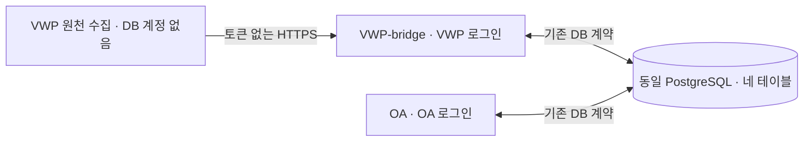

# 사내 AI별 DB 연결 인계

이 문서는 **기존 PostgreSQL 연결 구현과 권한 계약**을 세 담당자에게 전달한다. 실제 접속값은 기입하지 않았다. [공통 작업 지침](../INTERNAL_AI_GUIDE.md)과 [DB 설치/증분 안내](README.md)를 함께 따른다. 이 문서가 운영 DB 쓰기·SQL 적용 권한을 부여하지 않는다.

배포 시의 모드 선택, 오류 코드별 읽기 전용 진단, `public` 이외 스키마용 SQL 사본과 010 확인은 [설치 점검](INSTALLATION_CHECKS.md)을 따른다. 현재 기본 경로는 토큰 없는 HTTPS 접수·원본 DB 보관이며 7절에 정리했다.

DB의 핵심 목적에는 **사람이 확정한 분류·판정·근거와 정정 이력을 축적해 다음 AI 판단에 제공하는 것**이 포함된다. 최신 목표는 [AI 판단 설계](../AI_DECISION_DESIGN.md)를 따른다. 이번 연동은 OA의 사내 OpenAI 호환 API를 우선 사용하며 OA 프로그램이 자기 범위의 로그·사례를 조회하고 결과를 검증·저장한다. 모델에 DB 계정을 주거나 VWP private 접근 권한을 추가하지 않는다. OA 모델 작업은 기존 `sanity_oa_data`의 `WS_CONFIG` 불변 ledger와 namespace `oa-ai-v1`에 저장하고 검증된 결과는 기존 분류/그룹 판정 event와 FK로 연결한다. 이번 한도 내 첫 판단 순환에 새 테이블·DDL·GRANT를 추가하지 않는다. 작업/사례가 누적될 때의 큐 인덱스·처리 성능은 별도 검토 대상이며 현재 구조가 무제한 처리 보장은 아니다. 설정·실행은 [OA AI 실행 안내](../oa/AI_RUNTIME.md)를 따른다.

코드 위치와 실행은 [서버별 소스 안내](../DEPLOYMENT.md)를 따른다. [VWP-bridge 설정 예제](../vwp_bridge/.env.example)와 [OA 설정 예제](../oa/.env.example)의 키를 각 서버의 **저장소 루트 `.env`**에 설정한다. 예제 파일은 자동으로 읽거나 덮어쓰지 않는다.

## 1. 누가 어떤 계정을 사용하는가

| 담당 개발 AI | 실행 단계 | DB 로그인/역할 | 확인할 내용 |
|---|---|---|---|
| [VWP](../vwp/INTERNAL_AI_TASK.md) | 원천 조회·예상 목록·snapshot 수집 | **없음** | plan과 VWP 내부 snapshot을 VWP-bridge에 인계 |
| [VWP-bridge](../vwp_bridge/INTERNAL_AI_TASK.md) | parser·원본 검증·DB 전달, 기존 VWP 모델 경로 유지 시 자기 SDK | VWP 전용 제한 로그인 → `sanity_vwp_app` | VWP 서버 설정, `--side vwp` 점검 결과 |
| [OA](../oa/INTERNAL_AI_TASK.md) | SSO/source 수신·현재 사례 검색·OA 모델 작업·검증 결과/사람 근거 저장 | OA 전용 제한 로그인 → `sanity_oa_app` | 공통 경로의 DB 점검과 사내 API·한도·점검 기준·정답/반례 검증 |

위 표는 기본 `restricted` 모드다. **개발 AI는 세 개지만 앱 DB 계정은 기본 두 개**다. 두 bridge는 같은 PostgreSQL DB와 네 테이블을 사용한다. 별도 제한 계정을 발급할 수 없는 환경은 [3.1절의 단일 계정 모드](#31-단일-계정-모드)를 명시적으로 선택할 수 있다. 이 경우 두 bridge가 공유 DB 로그인 하나를 사용하며 VWP 원천 수집에는 여전히 DB 계정이 없다.

접속 endpoint는 각 망에서 승인된 주소를 사용하며, 주소 문자열이 다르더라도 같은 논리 DB/스키마임을 현장에서 확인해야 한다. `sanity_vwp_app`·`sanity_oa_app`은 기본 모드의 권한 역할 이름이며 보통 `NOLOGIN`이다. 실제 발급된 로그인 이름은 별개로 확인한다. 코드의 side는 두 모드 모두 `vwp`, `oa`만 지원한다. `vwp-bridge`라는 새 side를 만들지 않는다.



VWP 원천→bridge의 HTTPS 제출과 VWP-bridge↔OA의 기존 DB 경계를 구분한다. 두 bridge 사이에 HTTP/RPC·공유 파일·별도 DB를 추가하지 않는다. OA 회사 계정 조회용 저장소는 이 DB와 같다고 가정하지 않는다.

## 2. 현장에서 받아야 할 접속 정보

사용자/DBA는 아래 값을 각 서버의 **비공개 root `.env` 또는 프로세스 환경**에 설정한다. `root`는 `common/`·`vwp/`·`vwp_bridge/`·`oa/`를 포함하는 저장소 루트이며 `vwp_bridge/.env`, `oa/.env`는 자동으로 읽지 않는다. 환경변수는 빈 값까지 `.env`보다 우선하고 변수 보간은 하지 않는다. 두 bridge가 같은 개발 checkout을 사용하면 실행 프로세스별 환경을 분리한다. 하나의 `.env`에 두 로그인 값을 번갈아 덮어쓰지 않는다.

| 지원 키 | 필수/기본값 | 인계할 내용 |
|---|---|---|
| `SANITY_DB_ACCESS` | `postgresql` | 직접 `psycopg2` 접속. `dbaas_http`는 임시 읽기 전용이며 저장 불가 |
| `SANITY_DB_HOST` | 필수 | 해당 망에서 접근 가능한 승인 endpoint와 인증서 호스트 일치 |
| `SANITY_DB_PORT` | 기본 `5432` | 실제 발급 포트, 1~65535 |
| `SANITY_DB_NAME` | 필수 | 두 bridge가 함께 사용하는 실제 DB 이름 |
| `SANITY_DB_USER_NAME` | 필수 | 기본은 해당 서버의 제한 로그인, 단일 모드는 공유 로그인. owner/관리자 사용 금지 |
| `SANITY_DB_PASSWORD` | 필수 | 해당 로그인 비밀번호, 비밀 저장 경로에서 현장 주입 |
| `SANITY_DB_SCHEMA` | 기본 `public` | 네 테이블의 실제 스키마. DB 이름과 별개 |
| `SANITY_DB_ALLOW_SINGLE_ACCOUNT` | 기본 `false` | 정확한 소문자 `true`만 단일 계정 모드 선택. `false`는 기본 제한 모드. 빈 값·`yes`·`1`·대문자 등은 `DATABASE_CONFIG` |
| `SANITY_DB_SSLMODE` | 기본 `verify-full` | DBA 승인 TLS 정책. 연결 오류를 해결하려고 검증 수준을 낮추지 않음 |
| `SANITY_DB_SSLROOTCERT` | CA 필요 시 | 해당 서버 신뢰 CA 파일의 **절대 경로**, 인증서 파일은 비공개 배포 |
| `SANITY_VWP_DSN` | 선택, VWP 측만 | 비어 있지 않으면 VWP의 host/user/password/port/TLS 필드보다 우선 |
| `SANITY_OA_DSN` | 선택, OA 측만 | 비어 있지 않으면 OA의 host/user/password/port/TLS 필드보다 우선 |

필드 방식은 아래 공개 예제에서 시작한다. 빈 필수 값은 실제 사용 전에 **사내에서** 입력한다. `.env` 전체나 값을 출력하는 점검 명령을 실행하지 않는다. VWP 원천 수집 단계에는 이 설정을 만들 필요가 없다.

```dotenv
SANITY_DB_ACCESS=postgresql
SANITY_DB_ALLOW_SINGLE_ACCOUNT=false
SANITY_DB_HOST=
SANITY_DB_PORT=5432
SANITY_DB_NAME=
SANITY_DB_USER_NAME=
SANITY_DB_PASSWORD=
SANITY_DB_SCHEMA=public
SANITY_DB_SSLMODE=verify-full
SANITY_DB_SSLROOTCERT=
```

기본 모드에서는 VWP-bridge 서버는 VWP 로그인 값만, OA 서버는 OA 로그인 값만 넣는다. 단일 모드에서는 양쪽 서버의 비공개 설정에 같은 공유 로그인을 현장 주입하며 모델/SSO 자격증명을 공유하지 않는다. 지원 예제는 [VWP-bridge](../vwp_bridge/.env.example)와 [OA](../oa/.env.example)로 구분하며, 구현 근거는 [sanity_config.py](../common/sanity_config.py)다. 실제 `.env`는 실행 계정만 읽도록 관리한다. 실제 `dbaccess.md`, 인증서, DSN·비밀번호·토큰을 Git/브라우저/`VITE_*`/외부 대화에 넣지 않는다.

**DSN 우선순위:** 기존 side DSN이 남아 있으면 위 필드를 고쳐도 접속이 바뀌지 않는다. 필드 방식으로 전환할 때는 승인된 설정에서 자기 side DSN을 제거하거나 비운다. DSN 사용 시 TLS/CA 등 연결 조건도 DSN 쪽에서 완결해야 한다. DSN 실패 후 필드 방식/다른 계정/HTTP로 자동 재접속하지 않는다. 새 env 키가 필요하면 공통 설정을 수정하지 말고 Codex에게 문의한다.

## 3. 네 테이블과 유효 권한

기본 `restricted` 모드의 기준은 [003_grants.sql](003_grants.sql)이다. 아래는 **앱의 실행 권한**이며 개발 AI가 임의 SQL을 작성/실행할 허가가 아니다. 단일 계정 모드의 권한 계약은 3.1절을 따른다.

| 테이블 | VWP 로그인 (`sanity_vwp_app`) | OA 로그인 (`sanity_oa_app`) |
|---|---|---|
| `sanity_vwp_data` | SELECT, INSERT, 지정 상태 컬럼 UPDATE | 접근 없음 |
| `sanity_oa_data` | 접근 없음 | SELECT, INSERT, 지정 상태 컬럼 UPDATE |
| `sanity_vwp_to_oa` | SELECT, 지정 송신 컬럼 INSERT | SELECT, 지정 수신 상태 컬럼 UPDATE |
| `sanity_oa_to_vwp` | SELECT, 지정 수신 상태 컬럼 UPDATE | SELECT, 지정 요청 컬럼 INSERT |

- private 테이블 UPDATE: `state`, `status`, `version`, `updated_at`만 허용한다. 기존 payload/원문/봉인 자료를 바꾸는 권한이 아니다.
- VWP→OA INSERT: `message_id`, `message_type`, `payload`, `project`, `run_id`, `bundle_id`, `correlation_id`, `payload_gzip`, `payload_sha256`, `uncompressed_bytes`.
- OA→VWP INSERT: `message_id`, `message_type`, `payload`, `project`, `run_id`, `bundle_id`, `expires_at`.
- 양쪽 수신 큐 UPDATE: `status`, `error_message`, `attempt_count`, `next_attempt_at`, `lease_token`, `lease_owner`, `lease_expires_at`, `completed_at`, `updated_at`.

기본 모드에서 DBA는 각 로그인에 자기 역할 하나만 연결한다. 두 앱 모두 owner/superuser/BYPASSRLS/상대 역할 상속이나 과도한 유효 권한을 사용하지 않는다. 기본 모드에서는 DELETE/TRUNCATE/DDL·schema CREATE를 허용하지 않는다. 앱의 권한 검사는 직접 GRANT뿐 아니라 상속/공개 권한도 확인한다. 실패 시 광범위 GRANT나 검사 삭제로 해결하지 않는다.

DB 버전 조건은 PostgreSQL 12.1 이상·UTF-8이며 실검증 버전은 12.1/16.15다. PG12의 기본 `public` 스키마는 `PUBLIC`에 CREATE가 부여되어 있을 수 있으므로 DBA가 **실제 앱 스키마와 두 로그인**의 유효 CREATE 권한까지 검토한다. 원본 `003`은 스키마의 PUBLIC CREATE를 자동 회수하지 않는다. 별도 비공개 스키마도 실제 권한으로 확인하며, 내부 AI나 앱이 권한을 자동 변경하지 않는다.

### 3.1. 단일 계정 모드

두 bridge의 저장소 루트 `.env` 또는 프로세스 환경에 `SANITY_DB_ALLOW_SINGLE_ACCOUNT=true`를 명시한다. 미설정은 `false`다. `.env`의 `true`보다 프로세스 환경의 `false`가 우선하며, 빈 환경변수도 오류로 처리한다. DSN 우선순위·TLS·접속 실패 처리와 별개인 권한 계약 선택이며, 기본 모드 검사 실패 후 자동 전환하지 않는다. HTTP DBaaS를 PostgreSQL 저장 연결로 바꾸지도 않는다.

| 검사 | 기본 `restricted` | 명시적 `single_account` |
|---|---|---|
| `sanity_vwp_app` / `sanity_oa_app` 소속 | 자기 역할만 필수 | 역할 조회·존재 요구 없음 |
| 유효 SELECT/INSERT/UPDATE | 위 표의 side·컬럼별 범위와 정확히 일치 | 네 테이블의 모든 컬럼에 세 권한 모두 필수 |
| 상대 private 테이블 접근 | 금지 | 허용, DB 격리 미제공 |
| DELETE | 금지 | 보유 허용, 필수 아님 |
| TRUNCATE / REFERENCES / TRIGGER | 각각 금지 | 각각 계속 금지 |
| superuser / CREATEROLE / BYPASSRLS·상위 관리자 역할 소속 | 금지 | 계속 금지 |
| 테이블 소유·소유자 역할 소속 | 금지 | 계속 금지 |
| 스키마 CREATE | 앱 스키마 금지 | 앱 스키마와 `public` 모두 금지 |
| 네 테이블·필수 UNIQUE 검사 | 필수 | 그대로 필수 |

`Database._check_contract`가 공통 관리자/소유/스키마/인덱스 검사와 모드별 ACL을 검사한다. 이 검사는 **DB 수준의 private 테이블 격리와 송수신 컬럼 분리를 단일 모드에서 보장하지 않는다.** 공유 계정으로 다른 SQL을 실행하면 상대 private 읽기·쓰기, 큐 내용·상태 수정, DELETE가 가능할 수 있다. 정상 앱 경로의 서버별 사용 범위, 송신 필드 제한·불변값 충돌 검사·상태 전이·트랜잭션·lease는 유지되지만 DB 권한 분리를 대신하지 않는다. 모드 선택만으로 일반 삭제 API/작업자를 제공하지 않는다. 2026-10-30 사용자 요청의 [AI 작업 삭제](../oa/AI_RUNTIME.md#53-ai-작업-카드와-실행-이력-삭제--2026-10-30)는 기존 OA DELETE 권한이 있을 때 본인의 종료 작업 실행 이력에 한정해 제공한다.

이 모드는 기존 공유 계정의 실측 권한을 검사하는 별도 계약이다. 모드 선택 자체가 새 GRANT·역할·테이블·증분 SQL을 요구하지 않으며, 기본 제한 계정용 `003_grants.sql`이나 포털 계획을 변경·실행해 우회하지 않는다. 테이블 구조용 `002`, `004`~`010`의 해당 기능별 설치 조건은 그대로다. 기존 완료 DDL을 반복하지 않는다.

**공용 서버이면 restricted만 가능하다는 기준은 없다.** 공유 서버라도 별도 DB면 그 DB의 권한으로 판단한다. 같은 DB의 `public` CREATE를 유지해야 하는 환경은 앱 스키마를 분리한 제한 계정 구성이 가능한지 확인한다. 앱 테이블도 `public`이고 유효 CREATE를 없앨 수 없다면 두 모드 모두 맞지 않는다. [모드 선택 표](INSTALLATION_CHECKS.md#1-restricted--single_account-선택)에서 로그인·스키마·PUBLIC/상속 권한을 함께 대조한다.

설정·DB 공통 코드·기존 테스트·명세 변경은 Codex 담당이다. 내부 AI는 제공된 수정본과 자기 서버 설정으로 아래 읽기 전용 check를 준비하고 비식별 결과를 인계한다. 회사 어댑터 변경 범위, SSO 검증·업무 권한·`AUTHORIZATION_NOT_IMPLEMENTED`는 확대하거나 해제하지 않는다.

## 4. 실제 연결 확인과 결과 인계

실제 사내 DB 확인은 사용자가 각 서버의 승인된 환경에서 수행한다. 내부 AI는 설정 준비와 비식별 결과 정리를 맡는다. 저장소 루트에서 자기 명령 하나만 사용한다.

```bash
# VWP-bridge 서버
.venv/bin/python -m common.sanity_db check --side vwp
```

```bash
# OA 서버
.venv/bin/python -m common.sanity_db check --side oa
```

두 명령은 읽기 전용으로 **연결·설치 스키마·선택한 모드의 유효 권한**을 검사한다. 기본 모드 성공은 `status=CONNECTED backend=POSTGRESQL driver=psycopg2 side=vwp checks=schema,permissions privilege_mode=restricted db_isolation=enforced`이며 OA는 같은 형식의 `side=oa`다. 단일 모드에서는 `privilege_mode=single_account db_isolation=not_enforced`를 출력한다. `checks=schema,permissions`만으로 제한 계정 격리가 통과했다고 보고하지 않는다. 실패 시 고정 `code=...`와 종료 코드 2를 보고한다. 연결 성공은 실제 송수신/사내 SSO/모델/새 workspace 운영 완료를 뜻하지 않는다.

`DATABASE_UNAVAILABLE`은 망 접속 실패뿐 아니라 초기화/계약 검사 중 psycopg2 오류도 포함한다. `restricted`에서 역할이 없는 채 `pg_has_role`을 호출한 경우도 이 코드가 될 수 있다. [읽기 전용 진단 순서와 코드 표](INSTALLATION_CHECKS.md#2-오류를-좁히는-순서)로 접속·스키마·역할 존재·네 테이블·유효 GRANT·제약을 구분한다. 공통 check 성공은 010 검증을 포함하지 않으므로 [원본 저장 계약 검사](INSTALLATION_CHECKS.md#4-010-적용의-확인-기준)를 별도로 수행한다.

접속 점검에서는 PING INSERT, 분석/수신/worker 실행, queue 상태 수정, fixture/전체 DB 시험을 하지 않는다. 쓰기·잠금·재수신·중복 방지의 전체 검증은 별도 승인된 점검 환경/절차에서 수행한다. `db/tests/run_mock.py`, `db/tests/create_fixture.sh`, `run_tests.py --require-db`는 일반 접속 점검 명령이 아니며 실제 운영 DB에 실행하지 않는다.

예상 밖 접속/권한/스키마 오류는 [가이드 6절](../INTERNAL_AI_GUIDE.md#6-디버깅이-필요하면-codex에게-문의)에 따라 `WAITING_FOR_CODEX`로 남긴다. 실패한 요청을 반복하거나 TLS·권한·로그인·SQL을 임의 변경하지 않는다. 비밀값 대신 설정 키의 존재 여부, side, 비식별 오류 코드·발생 횟수와 설치 버전을 인계한다.

## 5. DBA 설치 상태 확인

테이블은 이미 신청한 form을 기준으로 한다. **재신청·재생성·완료 SQL 재실행을 지시하지 않는다.** 사용자/DBA가 실제 적용 내역을 확인해 [DB 안내](README.md)의 순서와 비교한다.

| 단계 | 상태 확인 대상 |
|---|---|
| 최초 form·`002`·권한 준비 | 네 테이블/제약/인덱스. 기본 모드는 역할·`003`, 단일 모드는 3.1절의 실측 권한 계약 |
| `004_clustering.sql` | 기존 legacy 분류 작업/개정 |
| `005_workspace.sql` | workspace 관리 레코드/PoR/세션 |
| `006_workspace_reviews.sql` | 사용자 판정/사례/제안 |
| `007_workspace_pipeline.sql` | 두 단계 분류/그룹 판정과 불변 event 연결 |
| `008_submissions.sql` | V2 제출/실행/outbox·OA staging과 SOURCE 메시지·원천 순서/중복 제약 |
| `009_sso_identity.sql` | OA SSO identity의 kind/scope·계정 JSON 계약 |
| `010_raw_sources.sql` | 기존 VWP private의 원본 DB 보관. v4 CHECK 6개와 인덱스 3개, 새 테이블/GRANT 없음 |
| `011_payload_storage.sql` | 선택형 VWP 근거/OUTBOX 무손실 압축. 기존 자료 변환은 별도 DBA 절차 |
| `012_source_evidence_pages.sql` | 선택형 새 V2 근거 묶음. kind/status는 v5로 확장하고 기존 원본 보호는 유지 |
| `013_shared_source_packets.sql` | 선택형 전체 용량 최적화. 기존 공유 본문 한 개와 두 private FK 참조·최종 COMMIT 전 claim 차단 |

사내 실제 적용 상태는 **미확인**이다. 합성 테스트 DB의 적용 기록으로 대체하지 않는다. 앱은 DDL/자동 migration을 하지 않는다. 비공개 스키마는 `002`~`010`의 `public.`과 `003`의 schema USAGE 대상을 실행 사본에서 함께 대응하고 `SANITY_DB_SCHEMA`와 맞춘다. [공식 사본 생성 절차](INSTALLATION_CHECKS.md#3-public-이외-스키마에-원본-sql-대응)를 사용하며 원본 SQL/포털 계획은 수정하지 않는다. 실제 적용은 사용자/DBA가 관리한다.

전체 약 14MB → 20MB 목표는 [011~013 도입 안내](TOTAL_STORAGE.md)를 따른다. 선택한 후속 SQL의 `public.`도 동일하게 대응하고 양쪽 호환 코드를 먼저 배포한다. 적용된 단계는 반복하지 않으며 기존 inline 데이터가 자동 변환되거나 참조된 큐 본문을 ACK 후 삭제할 수 있다는 뜻이 아니다. 포털은 `--shared-source-packets`의 빈 DB 전용 경로를 사용한다.

사용자가 2026-10-21 확인한 포털의 단일 문장 DDL/FK 경로에는 [포털 초기 설치 안내](portal/README.md)를 사용한다. 네 테이블이 모두 빈 상태에서 기존 읽기 전용 접속으로 catalog JSON을 사내에 저장하고 오프라인 도구로 실제 스키마/제약 이름에 맞는 실행본을 만든다. 원본 form/002~008은 보존하며 005를 생략하지 않는다. 앱에 DDL 권한을 주지 않고, 포털 적용은 사용자/승인 운영 담당자가 수행한다. 기본 모드에서는 003의 별도 역할·컬럼 권한 완료가 필요하며, 단일 모드는 3.1절을 따른다. 두 모드 모두 양쪽 서버의 읽기 전용 검사가 필수다. 생성된 catalog·실제 스키마·SQL bundle은 공개 저장소나 외부 대화에 올리지 않는다.

## 6. 사내에 남길 접속 인계 기록

아래 양식을 **서버별** 비공개 `dbaccess.md` 또는 승인된 비밀 관리/작업 폴더에 복사해 채운다. 실제 비밀번호는 이 양식에 복제하지 않고 승인된 비밀 주입 경로에서 관리한다. `.env`/`dbaccess.md`는 Git 제외 대상이다. 아래 빈 양식은 실제 접속 정보가 확보되거나 검증됐다는 뜻이 아니다.

```text
담당: VWP-bridge 또는 OA (VWP 수집 단계는 해당 없음)
기준 commit / 확인일 / 사내 확인 담당자:
실행 서버·망 / 동일 논리 DB 확인 근거: [사내에만 기입]
설정 위치: root .env 또는 프로세스 환경의 사내 관리 위치
DB host / port / name / schema: [사내에만 기입]
발급 로그인 이름 / 소속 앱 역할: [사내에만 기입]
권한 모드: restricted 또는 single_account / DB 격리: enforced 또는 not_enforced
비밀 주입 경로 / 회전 담당자: [사내 참조, 비밀번호 자체 제외]
TLS 정책 / 신뢰 CA의 사내 배포 경로:
side DSN 사용 여부 / 필드 방식 전환 여부:
설치 확인: form·002·003·004·005·006·007·008·009·010 각각 적용/미적용/미확인 (단일 모드의 003은 해당 없음)
010 증거: v4 CHECK 6개·인덱스 3개 정의/유효 상태와 원본 저장 계약 검사 결과의 사내 참조
읽기 전용 check: 미실행/성공/실패, side·일시·종료 코드·비식별 오류 코드
실제 쓰기/송수신 시험: 미실시 또는 별도 승인/실행 기록의 사내 참조
남은 의존성 / 다음 담당자 / WAITING_FOR_CODEX 문의 ID:
```

외부 Codex에 전달할 때는 실제 서버/주소/DB/로그인/경로/비밀 참조를 제거하고 `담당·기준 commit·설정 키 존재 여부·역할 일치 여부·설치 단계·check 성공/오류 코드·미확정 사항`만 남긴다. 모델 URL/token은 실제 모델 호출 서버의 별도 비밀이다. OA 모델의 비밀은 OA에만 두고 VWP legacy 모델·DB 계정·SSO 자격증명과 공유하지 않는다.

## OA AI 작업과 사례 저장

운영 `/api/workbench/*`는 기존 SSO 인증 후 현재 프로젝트/블록 권한을 검사한다. 작업 등록과 결과 반영도 같은 권한·원본·분류/판정 개정 및 선정 사례의 현재 유효성을 다시 확인한다. `WS_CONFIG` job에는 명령/입력 고정값·검색/모델 provenance·상태 변화를 불변 이벤트로 보존하고, 네트워크 호출 동안 DB 트랜잭션/권한 잠금을 유지하지 않는다.

사람 확정 기록은 기존 `WS_CLUSTER_EVENT`, `WS_GROUP_REVIEW_EVENT`에서 조회한다. [AI 판단 설계](../AI_DECISION_DESIGN.md)에 따라 모든 프로젝트·블록·revision·ECO의 현재 유효한 확정 지식을 공유 후보로 삼고 출처/조건 차이를 모델 입력에 명시한다. `reusable`/`compatible_versions`는 후보 제한 조건이 아니며 미확정·철회·정정 전·자기 정답은 제외한다. 과거 원문/파싱 필드와 현재 판단 대상의 전체 로그를 구분하고 원문 조회·수정의 기존 블록 권한은 유지한다. 검색은 현재 lexical 방식으로, 새 vector DB나 모델용 DB 계정을 요구하지 않는다.

상태와 복구·기준 파일·사내 검증 절차는 [AI_RUNTIME.md](../oa/AI_RUNTIME.md)를 따른다. 현재 앱은 전체 입력이 모델 한도에 맞는 순환을 제공한다. 대량 모델 분할/통합·큐 누적 성능·실제 판단 품질은 남은 검증/구현 범위다.

## 7. 사용자 제출의 저장 경로

[토큰 없는 HTTPS 제출](../vwp/HTTPS_SUBMISSION.md)의 CLI·bridge API/worker·OA source receiver와 기존 `008/009/010`을 사용한다. 실제 회사 provider/parser·DB/TLS/망·SSO/OWNER·운영 배포는 현장에서 확인한다. 사용자 CLI의 root 소유 JSON에는 DB 자격증명이 없다. TLS 종료 위치와 bridge가 관측하는 peer CIDR은 HTTPS 안내 2.1·2.2절을 따른다.

| 단계 | 쓰기 주체 / 위치 |
|---|---|
| `sanity submit` 인계 | 사용자 VWP → bridge HTTPS API. 제출용 토큰/공유 폴더/사용자 DB 계정 없음 |
| 검증된 원본 보관 | VWP 앱 로그인 → `sanity_vwp_data`의 `RAW_SUBMISSION/RAW_FILE/RAW_CHUNK`. byte 조각 최대 1MiB, 전체 크기/SHA256 확인 |
| 파싱과 전체 근거 | bridge worker가 DB 원본을 실행 중에만 임시 복원·전체 파싱하고 같은 VWP private에 제출/원천 참조와 근거 저장 |
| 범위/분석 전달 | VWP 제한 로그인 → `sanity_vwp_to_oa`. SOURCE_MANIFEST/PART/COMMIT; envelope 포함 압축 전/후 각 4MiB, data part당 1,000건 이하 |
| staging/최종 업무 반영 | OA 앱 로그인 → `sanity_oa_data`. 전체 scope/해시/조각 검증과 현재 OWNER의 정확한 예상 범위 확정 전 일반 검토/AI 입력 노출 없음 |
| OA 저장/거부 결과 | OA 제한 로그인 → `sanity_oa_to_vwp`. SOURCE_RECEIPT. OA 반영/응답 등록을 같은 트랜잭션으로 확정 |
| 사용자 상태 | CLI의 HTTPS 상태 조회로 원본/제출 DB 상태와 검증한 OA 응답을 확인. OWNER 대기/최종 상태를 구분 |

`008`이 같은 네 테이블 안에서 신규 종류·scope·불변성/중복·실행 순서를 추가하고 `010`이 원본 byte DB 보관을 확장한다. 기존 legacy run 필수/제약과 선택한 모드의 권한 계약을 유지하며 추가 로그인·새 테이블·광범위 GRANT가 필요하지 않다. 앱은 필요한 migration이 없으면 실패하고 fake run/bundle ID·기존 PING/ANALYSIS_BUNDLE로 우회하지 않는다. OA의 정상 앱 경로는 상대 private 테이블의 원본을 읽지 않으며 단일 계정 모드에서는 이 경계를 DB가 강제하지 못한다.

사내 비공개 인계에는 DB 접속 기록, 010 적용 증거, TLS/peer CIDR 근거, parser 프로필, 임시 파싱 공간/정리, DB 용량·WAL·백업, OA SSO/현재 OWNER·범위 확정과 보존 정책의 담당자를 남긴다. 이전 폴더/영속 archive/receipt는 [filesystem 호환 제출](../vwp/SUBMISSION.md)의 별도 배치다. 현재 HTTPS 원본 DB 보관의 필수 공유 폴더로 해석하지 않는다. 준비되지 않은 인프라는 다른 전송/저장 방식으로 자동 대체하지 않는다.
