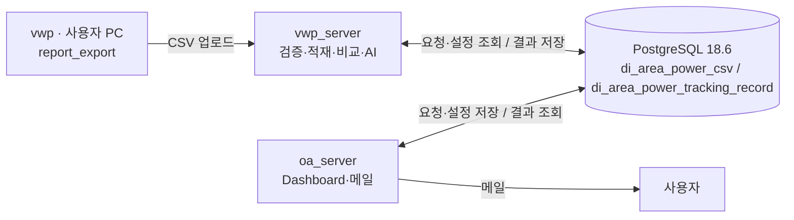
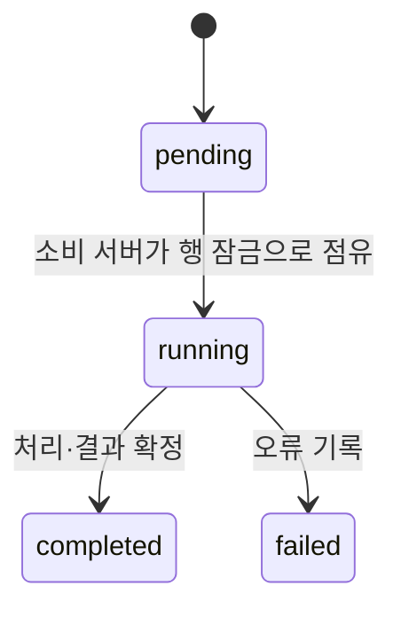

# Area/Power PostgreSQL 18.6: 두 테이블 설계

## 확정 사항

테이블별 결재 부담 때문에 Area/Power 업무 테이블은 **`di_area_power_csv`, `di_area_power_tracking_record` 두 개**로 제한한다. Sanity의 기존 네 테이블과는 별도 계약이다. 사용자가 두 테이블의 **생성 신청을 완료**했다. 승인·실제 생성·컬럼 일치·제약·권한 적용 완료는 아직 확인하지 않았다. 다시 생성 신청하거나 재생성하지 않는다. 앱·parser·worker·Dashboard·메일 발송기는 구현했고 로컬 실행을 확인했다. 사내 연결 확인과는 구분한다.

- DB는 사내 PostgreSQL 18.6 DBaaS이며 사용자에게 DBA 권한은 없다.
- 실제 스키마명은 사내 비밀 정보다. 요구하거나 저장하지 않는다. 실행용 SQL의 테이블 참조는 `<schema>.di_area_power_csv`, `<schema>.di_area_power_tracking_record`로 표기하며 사내에서 **`<schema>` 문자열만 실제 이름으로 일괄 치환**한다. 점은 이미 있으므로 치환값에 점을 덧붙이지 않는다.
- 치환 전 파일은 실행 가능한 SQL이 아닌 템플릿이다. 점검 SQL의 to_regclass 문자열·ALTER 대상·REFERENCES 대상·인덱스 ON 대상도 모두 치환한다. 컬럼 정의 파일은 표의 이름을 포함하지 않는 조각이므로 스키마를 붙이지 않는다. 제약·인덱스 이름은 테이블 참조가 아니므로 스키마를 붙이지 않는다. CREATE SCHEMA·SET search_path나 이전 문장의 세션 유지에 의존하지 않는다.
- 초기에는 컬럼·자료형·NOT NULL·기본값만 신청한다. REFERENCES·PK·UNIQUE·CHECK·인덱스는 두 테이블이 실제 존재한 뒤 분리 적용한다. 기존 컬럼 신청 내용의 일치를 먼저 확인하고 임의로 바꾸지 않는다.
- 초기 정의 파일은 **CREATE TABLE 전체 SQL이 아닌 컬럼 목록**이다. 웹페이지 컬럼 정의 입력란에 넣으며 SQL 실행란에 파일 그대로 실행하지 않는다.
- 후속 SQL은 한 문장당 물리적 한 줄이다. 자동 DDL, 일괄 트랜잭션, 확장·함수·트리거·시퀀스 설치는 전제하지 않는다.
- ALTER TABLE·인덱스 생성에는 해당 테이블 소유권 또는 권한 있는 운영자가 필요하다. DML 권한 확인과 구조 변경 권한은 구분한다.
- Power 없는 cell usage 단독 업로드는 제외한다. 입력은 현재 [81개 컬럼](csv_structure)의 통합 CSV이며 파일 하나는 단일 corner다.

### 파일별 사용 시점

| 파일 | 사용 시점·주의 |
| --- | --- |
| [00_inspect.sql](../../db/area_power/00_inspect.sql) | 사내에서 테이블 존재·컬럼·기존 제약·인덱스 확인. 아직 없어도 조회 가능. 결과를 외부에 공유할 필요 없음 |
| [01_di_area_power_csv.columns.sql](../../db/area_power/01_di_area_power_csv.columns.sql) | 이미 생성 신청한 첫 테이블의 설계 참고본. 재신청용이 아니며 실제 신청 컬럼과 사내에서 대조 |
| [02_di_area_power_tracking_record.columns.sql](../../db/area_power/02_di_area_power_tracking_record.columns.sql) | 신청 완료한 두 번째 테이블의 컬럼 참고본. 실제 신청 컬럼과 사내에서 대조 |
| [03_constraints.sql](../../db/area_power/03_constraints.sql) | 두 테이블 생성·컬럼 일치 확인 후 PK·UNIQUE → CHECK → FK 순서로 미적용 정의 실행 |
| [04_indexes.sql](../../db/area_power/04_indexes.sql) | 제약 적용 후 인덱스 생성. Selection UNIQUE 인덱스는 필수 정합성 제약 |

신청 단계만 끝났다고 서비스 준비 완료로 처리하지 않는다. FK를 포함한 필수 제약과 selection 유일성까지 적용된 뒤 정상 운영을 시작한다. 테이블만 있는 중간 단계에는 참조·중복·수치·상태 보호가 갖춰져 있지 않다.

이미 PK·동일 제약·인덱스가 생성돼 있으면 이름뿐 아니라 정의를 사내에서 비교해 일치하는 항목은 다시 실행하지 않는다. 후속 파일은 전체를 무조건 재실행하는 idempotent 스크립트가 아니다. 오류가 발생하면 중단해 원인을 확인하고 실제로 빠진 정의만 이어서 적용한다. 기존 데이터가 제약을 위반하면 추가가 실패하며 데이터 삭제·자동 보정·오류 숨김으로 우회하지 않는다.

### 실제 테이블 이름으로의 backend 전환 — 2026-11-12

물리 테이블 이름은 정확히 `di_area_power_tracking_record`, `di_area_power_csv`다. CSV 이름·업무 컬럼·record_type·UUID/API 계약은 바꾸지 않는다. 앱에는 이전 테이블 alias/fallback이나 자동 DDL·rename·migration이 없다. 기존 사용자 DB·사내 DB의 데이터를 자동 변환하지 않는다.

사내에서 00으로 실제 두 테이블·컬럼·권한을 비공개 점검하고 승인된 누락 정의만 권한 있는 운영자가 적용한다. 03/04의 새 객체 이름은 신규 수동 DDL의 표준일 뿐이다. 기존 제약·인덱스가 다른 이름이어도 같은 대상/컬럼/참조/조건의 유효한 정의라면 이름 변경·중복 생성 없이 유지한다. readiness는 PK/UNIQUE/FK signature·selection 유일성·검증된 CHECK를 확인하며 객체 이름을 강제하지 않는다.

준비 완료 후 OA·중앙 VWP 업로드·worker를 승인된 같은 소스로 함께 전환한다. PC transport/config/API와 UI는 그대로이므로 이 변경만으로 재-export·재-upload·의존성 변경·frontend build를 하지 않는다. 현재 로컬 사용자 DB/기존 OA 서비스도 자동 변경·재시작하지 않는다. 새 소스의 readiness가 실패하면 다른 DB/이전 테이블로 우회하지 말고 승인된 배포 준비를 중단한다.

## 서버 연결



**oa_server와 vwp_server 사이에는 API·파일 전달·메시지 브로커를 두지 않는다. 두 서버의 요청·응답은 DB 행으로 전달한다.** 사용자 PC에서 vwp_server로 전달하는 업로드 경로는 이 제약과 별개다.

중앙 VWP의 Area CSV 업로드와 상태 GET은 추가 인증 없이 사내 도달성을 신뢰한다. 요청의 사용자명/신원 헤더는 저장 출처로 신뢰하지 않는다. 새 업로드의 `uploaded_by`와 해당 snapshot의 `created_by`/`updated_by`는 기술적 서비스 `vwp_server`이며 사람의 인증 신원이 아니다. 기존 NOT NULL 컬럼·두 테이블·과거 행은 그대로 두고 추가 DDL/인증 테이블을 만들지 않는다. OA API의 로그인·SSO·양쪽 프로젝트 권한과 기존 worker의 실제 프로세스 소유권은 유지한다.

## 1. di_area_power_csv — 업로드 한 건당 원본 한 개

한 행은 특정 구조 snapshot을 특정 분석 조건에서 실행한 통합 CSV 한 파일이다. 수정본이나 같은 조건 재실행도 새 UUID의 행으로 저장하고 원본을 덮어쓰지 않는다.

| 컬럼 묶음 | 주요 컬럼 | 의미 |
| --- | --- | --- |
| 식별·범위 | `id`, `project_id`, `version_id`, `block_id`, `snapshot_id` | 업로드 실행과 명시적인 프로젝트·버전·구조 구분 |
| 실행·출처 | `execution_name`, `original_filename`, `uploaded_by` | 표시용 이름과 수신 서비스 출처(`vwp_server`, 인증된 사람 아님). 이름만으로 조건을 추정하지 않음 |
| CSV 조건 | `process_label`, `voltage_v`, `temp_c`, `pex` | 모든 행이 동일한 조건인지 검증 후 저장 |
| 전체 분석 조건 | `analysis_conditions`, `condition_key`, `conditions_complete` | Mode·clock·activity·RC·도구·전압 영역 등과 조건 식별 key |
| 구조·입력 계약 | `structure_digest`, `input_contract` | 전체 구조 및 파싱·단위·분류·정밀도 계약 |
| 요약 | `root_summary` | 루트의 구조·power 조회값. 상세 hierarchy 전체 복제본이 아님 |
| 원본 | `csv_gzip`, `original_sha256`, 원본·압축 byte 길이, `encoding` | gzip은 한 번 보관. Checksum은 압축 전 CSV bytes 기준 |
| 검증 | `state`, `row_count`, `validation_report`, `error_detail`, 검증·생성 시각 | `pending / ready / failed` |

### 다른 corner와 수정본

- 동일 구현의 다른 corner는 같은 `snapshot_id`, 다른 upload ID로 저장한다.
- Snapshot 재사용은 명시적으로 선택하고 전체 구조 행·경로·area 기준·library·입력 계약을 검증한다. 루트 수치나 digest만으로 다른 구현을 자동 병합하지 않는다.
- Cell 구성·구조 산출 기준이 달라지면 새 snapshot이다. 이전 snapshot의 power를 가져다 붙이지 않는다.
- 같은 조건의 수정본도 기존 gzip에 append하지 않고 새 행을 만든다. 완료 비교가 참조한 이전 업로드는 보존한다.
- 파일명·scenario·업로드 시각으로 비교 기준을 선택하지 않는다. 단위·조건 미확인은 NULL 또는 명시적인 미확인 정보로 남기며 추정값을 넣지 않는다.

### 조건 key

`condition_key`는 실제 PVT·PEX와 mode·clock·activity·RC·분석 방식·도구 등 비교 의미에 영향을 주는 조건을 정규화한 SHA-256이다. JSON key 순서·숫자 표시 자릿수만 다르다고 다른 조건이 되지 않게 한다. 모르는 항목도 명시적으로 포함한다.

Key가 같아도 조건이 불완전하면 `comparable`로 판단하지 않는다. `conditions_complete`는 앱이 검증하며 DB는 PVT·PEX의 일부 필수값만 확인할 수 있다. 같은 corner 이름만으로 같은 조건으로 취급하지 않는다.

## 2. di_area_power_tracking_record — 설정·결과·알림·작업

한 행은 한 업무 객체의 revision, 한 hierarchy 집계·비교 결과, 한 판정, 한 알림 또는 한 작업이다. 프로젝트 전체·전체 후보 목록을 하나의 거대한 JSON으로 갱신하지 않는다. 원본 bytes나 base64 CSV를 payload에 넣지 않는다.

| 공통 컬럼 묶음 | 주요 컬럼 | 의미 |
| --- | --- | --- |
| 식별·revision | `id`, `record_type`, `entity_id`, `revision` | 실제 행 ID, 종류, 경로와 독립된 객체 ID, 보존 revision |
| JSON 계약 | `payload_schema_version`, `payload` | 종류별 상세 데이터와 앱 검증 계약 버전 |
| 동시 수정 | `row_version` | 변경 가능한 선택·설정·사용자 상태의 compare-and-set 버전 |
| 연결 | `parent_id`, `previous_id` | 같은 테이블의 부모·이전 행. 자기 참조 금지 |
| 조회 범위 | project/version/block/snapshot ID, `condition_key` | 목록·범위 검색에 쓰는 일반 컬럼 |
| 파일 참조 | `upload_id`, `baseline_upload_id` | 사용한 현재·기준 파일의 FK. 과거 결과는 이 ID를 고정 |
| 선택 범위 | `selection_scope` | 공유 기본 선택 또는 명시한 사용자별 선택의 범위 |
| 중복 방지 | `dedupe_key` | 종류별 입력을 정규화한 SHA-256. NULL이면 중복 방지 key 없음 |
| 상태·작성자 | `state`, 생성·수정 주체·시각 | 종류별 상태와 변경 책임 |
| 작업 점유 | `job_kind`, `consumer_server`, `claim_owner`, 점유·시작·종료 시각, 오류 | DB를 통한 서버 간 작업 전달 |
| 사용자 처리 | 읽음·확인·해소 시각·주체, 해소 설명 | 알림에만 사용. AI 결과와 분리 |

`revision`은 보존할 원문·매핑 등의 새 버전이고 `row_version`은 같은 행의 동시 수정 방지 번호다. 둘을 혼용하지 않는다.

### record_type과 작성 주체

다음은 초기 앱 계약이다. 새 종류의 추가는 보통 JSON schema 변경으로 처리하지만 공통 컬럼·인덱스·보안 변경이 필요하면 별도 DDL 검토가 필요하다.

| 종류 | 내용 | 작성 주체 |
| --- | --- | --- |
| `project`, `version`, `block` | 명시적인 버전 연결·프로젝트 기준 | OA |
| `snapshot` | 구현 실행·구조 기준과 최초 구조 원본 ID | vwp_server |
| `target`, `mapping`, `change` | 관심 대상, 대응 그룹·범위, 변경 원문 revision | OA |
| `selection` | 조건별로 현재 사용할 upload ID | OA |
| `change_extraction` | 변경 원문 해석·근거·불명확한 항목·실패 | vwp_server |
| `comparison` | 범위·양쪽 업로드·매핑·정책·조건의 고정 입력과 처리 범위 | OA 등록, vwp_server 계산 |
| `metric_result` | hierarchy·그룹·지표별 값·분모·비교 상태·후보. 현재 앱의 target 조회도 이 결과 사용 | vwp_server |
| `ai_run`, `judgement` | 고정한 원문·추출물·후보·AI 설정과 개별 판정·실패 | vwp_server |
| `alert` | 알림 내용·관측 연결, 별도 사용자 처리 상태 | 내용은 vwp_server, 읽음·확인·해소 컬럼은 OA |
| `alert_event` | 판정 변경·사용자 처리의 추가 이력 | 각 변경을 수행한 서버 |
| `job` | 적재·비교·추출·판정·메일 요청 | 요청한 서버가 등록, 지정 소비 서버가 점유·결과 갱신 |

공개 매핑·원문 revision·완료 결과는 새 행을 추가해 이력을 남기고 덮어쓰지 않는다. 변경 설명만 바뀌면 기존 수치 결과에 새 AI 실행을 연결한다. 알림은 안정적인 dedupe key의 같은 행을 유지하며 재판정으로 읽음·해소 컬럼을 초기화하지 않는다.

### 프로젝트의 단일 지정 기준

주 화면의 A→B 기준은 기존 `record_type='project'` 행의 `payload.baseline_project_id`에 UUID 또는 null로 저장한다. 한 현재 프로젝트에 하나만 저장하며 반대쪽/다른 프로젝트는 갱신하지 않는다. 같은 기준을 여러 프로젝트가 사용할 수 있고 자기 자신은 거부한다. 새 record_type·컬럼·테이블·DDL·migration은 없다.

`POST /api/area-power/projects/{id}/baseline`은 필수 `expected_row_version`으로 project 행을 잠그고 CAS 갱신한다. 현재 프로젝트 권한과 새 기준 프로젝트 권한을 각각 검사한다. 이전 기준 권한이 사라져도 현재 프로젝트와 해제/교체는 막지 않으며 응답/목록에서는 이전 기준 ID·이름을 가린다. 기준 프로젝트의 다른 기준으로 연쇄 탐색하지 않는다.

모든 새 교차 프로젝트 비교/매핑은 이 저장 기준을 검사한다. 비교는 기존 `frozen` payload에 당시 `baseline_designation={project_id,baseline_project_id,row_version}`과 정확한 upload/snapshot·mapping revision을 고정한다. 후속 설정 변경은 완료 결과를 수정하거나 다른 입력으로 재해석하지 않는다. 조회 권한은 실제 고정된 양쪽 프로젝트/원본을 계속 검사한다. 매핑 또는 상대 데이터가 없으면 값을 0으로 보완하지 않고 해당 비교의 Δ/%를 null/unavailable로 남긴다.

교차 프로젝트 비교의 수치 dedupe 입력에는 지정 기준의 `baseline_project_id`도 포함한다. 기준 upload가 없는 현재 관측 비교라도 A→B와 A→C는 별개다. 같은 C를 재저장해 project `row_version`만 달라지면 기존 C 비교를 재사용할 수 있으며, 과거 B 결과나 B의 권한 조회가 새 C 요청을 가로막지 않는다. 당시 row_version은 frozen 감사 정보로만 보존하고 수치 동일성 키에는 넣지 않는다.


## 현재 파일 선택과 과거 결과

`record_type='selection'`은 `(selection_scope, snapshot_id, condition_key)`마다 한 행만 허용한다. `upload_id`와 프로젝트·버전·block·snapshot·조건은 복합 FK로 업로드와 일치해야 한다. OA는 선택 전에 해당 파일이 ready인지 확인하고 트랜잭션으로 선택을 변경한다.

수정본 업로드만으로 기존 선택이 바뀌지는 않는다. 사용자에게 명시된 선택 행을 갱신한다. 공유 선택과 사용자별 선택을 섞지 않으며 요청·비교 화면에서 사용할 선택 범위를 명시한다.

동시 변경은 다음 규칙을 사용한다. 실제 SQL은 고정 문자열 결합이 아니라 파라미터 바인딩으로 실행한다.

```sql
UPDATE <schema>.di_area_power_tracking_record SET upload_id = $1, row_version = row_version + 1, updated_by = $2, updated_at = CURRENT_TIMESTAMP WHERE id = $3 AND record_type = 'selection' AND row_version = $4 RETURNING id, row_version;
```

갱신 0행이면 다른 사용자가 먼저 수정했거나 대상이 없어진 상태다. 무조건 다시 덮어쓰지 않고 최신 선택을 읽어 충돌을 표시한다. OA의 알림 사용자 상태 변경도 같은 원칙을 따른다.

과거 비교는 selection 행의 최신값을 다시 따라가지 않는다. 비교 시작 시 선택한 `upload_id`, `baseline_upload_id`, 모든 조건별 업로드 ID, 매핑·변경 revision ID와 실제 경로 그룹을 고정한다. 추가 조건·그룹의 참조 ID는 payload에 넣고 앱이 존재·종류·준비 상태를 검사한다.

## DB만을 통한 작업 전달

### job의 대상과 소비 서버

| job_kind | 소비 서버 | 연결 |
| --- | --- | --- |
| `ingest` | vwp_server | 기존 `upload_id` 원본의 재검증. HTTP 업로드 자체는 요청 안에서 검증·적재 |
| `compare` | vwp_server | `parent_id`는 분석 요청·비교 입력 객체 |
| `extract` | vwp_server | `parent_id`는 변경 원문·추출 입력 |
| `judge` | vwp_server | `parent_id`는 AI 실행 입력 |
| `mail` | oa_server | `parent_id`는 발송할 알림·알림 event |

OA가 DB에 요청과 pending job을 함께 저장하면 vwp_server가 주기적으로 가져간다. vwp_server는 결과·판정·알림과 mail job을 DB에 저장하고 OA가 가져간다. 메일이 실패해도 이미 완료한 수치 비교·판정은 실패로 바꾸지 않는다.



소비 서버는 자기 `consumer_server`의 pending job만 짧은 트랜잭션에서 `FOR UPDATE SKIP LOCKED`로 점유한다. Running과 점유 정보를 commit한 뒤 CSV 분석·AI·사내 메일 호출을 수행한다. 외부 호출 중 DB 트랜잭션이나 행 잠금을 유지하지 않는다. 결과 확정 시 자기 점유·상태를 다시 확인한다.

완료는 요청 범위 전체 처리 후에만 표시한다. 전체 예상/처리/실패/비교 불가 건수와 상세 범위는 payload에 남기고 실제 결과와 대조한다. 후보 0개를 미처리와 혼동하지 않는다.

명시 재실행은 새 job ID·새 dedupe key로 등록하고 `previous_id`로 원 job을 연결한다. 원 job의 종류·대상·종료 상태를 앱에서 확인한다. 자동 재시도·점유 시간 만료 후 자동 회수는 전제하지 않는다.

사내 메일 접수와 DB commit은 하나의 트랜잭션이 아니다. 요청 직후 상태 저장이 실패하면 발송 여부가 불명확해질 수 있다. 정확히 한 번 전송을 보장하지 않으며 시도·접수/거부·불명확 상태를 payload에 보존한다. Completed는 회사 서비스의 전체 요청 접수이지 수신/열람 확인이 아니다. [MailSender 계약](../../oa/MAIL_INTEGRATION.md)과 회사 어댑터를 명시적으로 주입하며 미연결은 DB 접속·job 점유 전에 실패한다. 새 이력은 `provider_accepted`를 사용하고 과거 SMTP JSON 이력은 재작성하지 않는다. 추가 DDL은 없다.

## 조회와 성능 경계

- 목록·조건 검색은 일반 컬럼과 인덱스를 사용하고 `csv_gzip`을 SELECT하지 않는다.
- 현재 화면은 selection이 가리키는 upload를 읽고 과거 화면은 저장된 upload ID를 읽는다. 최신 업로드 시간으로 자동 대체하지 않는다.
- 루트는 `root_summary`, 분석한 target·hierarchy는 `metric_result`를 읽는다. 별도 `scope_result` 캐시는 생성하지 않는다. 전체 hierarchy 비교는 선택한 원본을 압축 해제해 수행한다.
- gzip 내부 값은 일반 SQL 검색 대상이 아니다. 임의 hierarchy 수치 검색이 자주 필요하면 같은 `di_area_power_tracking_record`에 조회용 행을 더 저장한다. 테이블 추가는 필요 없지만 인덱스·저장량·갱신 비용은 별도 검토한다.
- Payload의 지표·단위·분모·경로를 문서 schema에 맞춰 보존한다. JSONB 숫자와 Python Decimal을 손실 없이 직렬화하고 float로 우회하지 않는다. 결측을 0으로 만들지 않는다.
- 전체 payload마다 무조건 GIN 인덱스를 두지 않는다. 운영 규모·실제 SQL이 확인되지 않았으므로 실데이터 성능을 보장하지 않는다.

## DB 제약과 앱 검증의 경계

아래 DB 보장은 후속 제약·필수 인덱스 적용 후 기준이다. 컬럼만 생성한 단계에서는 NOT NULL·기본값 외의 보호가 적용되었다고 간주하지 않는다. 두 서버의 실제 스키마 지정은 사내 접속 설정에서만 수행한다.

| DB가 보장 | 앱이 검증·처리하는 것 |
| --- | --- |
| 두 PK, 종류·객체·revision 및 종류별 dedupe key의 유일성 | 프로젝트·버전·block·snapshot의 타입·소유 관계와 버전 순환 금지 |
| 업로드·자기참조 FK, 선택의 업로드·범위·조건 일치 | Parent/previous 및 payload 참조의 종류·실제 대상·불변 revision |
| 같은 범위·snapshot·조건의 선택 하나 | ready 파일만 선택, 동일 구조 검증, 조건 비교 가능성 |
| JSON object 모양·checksum 길이·byte 길이·finite PVT | 전체 JSON schema, count·area·power 유한값·분모·정밀도·합계·분류 누락 |
| Job 소비 서버, 대상 존재, 행 내부 상태·점유 시각 | 허용 상태 전이·작성 주체·배타 점유·전체 범위 처리·이력 보존 |
| 알림에만 사용자 처리 컬럼 사용 | 재판정 시 읽음·해소 보존, AI가 운영 한도 알림을 해제하지 않음 |
| 참조 중인 업로드·행의 삭제 제한 | 보존 기간·삭제 순서·전체 ready 원본과 완료 결과의 갱신 금지 |

두 서버는 반드시 같은 payload schema와 상태 계약을 배포해야 한다. 작성 주체 컬럼은 감사 정보이지 접근 권한을 강제하는 보안 장치가 아니다. 양쪽 서버의 실제 DML 권한은 사내에서 정하고 코드가 담당 컬럼·상태만 갱신하도록 한다. 트리거·RLS·행별 권한 정책을 구현했다고 가정하지 않는다.

이전 설계의 지표별 typed-column CHECK가 JSON 안까지 자동 적용되지는 않는다. SQL만으로 parser·수치 비교·매핑·AI 검증이 완성된 것으로 처리하면 안 된다.

## 다음 적용 순서

1. 신청 완료한 `di_area_power_csv`의 실제 생성·컬럼·기존 PK를 사내에서 확인한다. 재신청하지 않는다.
2. 신청 완료한 `di_area_power_tracking_record`의 실제 생성·컬럼을 사내에서 확인한다. 재신청하지 않는다.
3. 두 테이블·컬럼이 맞는지 확인한 뒤 사내 권한 있는 실행자가 03의 미적용 제약을 PK·UNIQUE → CHECK → FK 순으로 적용한다.
4. 04의 인덱스와 실제 권한·유효 상태를 확인한다. 특히 selection UNIQUE 누락 상태로 운영하지 않는다.
5. [실행 안내](../../area_power/README.md)에 따라 구현된 vwp_server·OA·worker를 사내 환경변수로 연결하고 실제 CSV·AI·메일의 통합 동작을 확인한다. 공통 JSON 계약·상태 전이는 [공통 코드](../../area_power/common/models.py)와 각 서비스가 검증한다.


## 검증 범위

현재 설치 절차는 컬럼 정의 → 두 테이블 실제 생성 → 제약 → 인덱스의 단계별 적용이다. 이전 일체형 CREATE TABLE 검증을 이 새 절차의 검증으로 대신하지 않는다. 사내 스키마·접속·테이블 생성 완료·실제 신청 컬럼은 외부에서 확인하지 않으며 관련 정보를 요구하지 않는다.


### 로컬 실행 결과

2026-11-10, 사내와 독립된 로컬 PostgreSQL 18.6 전용 DB에서 확인했다.

- 테이블이 하나도 없을 때 00 점검 SQL은 존재 여부 false와 빈 목록을 반환했다.
- 원본 테이블과 독립적인 두 번째 테이블의 컬럼 정의를 먼저 생성할 수 있었다. 이후 원본 컬럼을 별도로 생성했다. 초기에는 NOT NULL만 있고 PK·UNIQUE·CHECK·FK는 없음을 확인했다.
- 두 테이블 생성 후 03의 모든 ALTER TABLE과 04의 인덱스 생성이 성공했다. PK 2개·UNIQUE 3개·CHECK 19개·FK 5개가 검증된 상태였다.
- 후속 적용 뒤 정상 파일·선택·비교·job 행을 저장하고 worker 행 잠금·점유를 확인했다.
- 조건이 다른 파일 연결, 중복 selection, 잘못된 JSON 배열, 다른 선택 수치가 NULL인 상태의 NaN 전압, 참조 중 원본 삭제를 거부했다.
- 검증 후 전용 DB와 수동 데이터는 삭제했다.

위 SQL 검증은 사내 신청 결과·컬럼 일치·권한·스키마·실데이터 검증을 대신하지 않는다. 운영 시작 전 사내에서 실제 정의와 미적용 항목을 확인해야 한다. 앱의 별도 로컬 실행 범위는 아래와 같다.

추가로 `<schema>` 토큰을 로컬 검증용 비기본 스키마명으로 일괄 치환해 00·03·04 SQL을 실행했다. 대상 테이블 2개, 같은 대상 스키마를 참조하는 검증 완료 FK 5개, 유효 인덱스 16개를 확인하고 전용 DB를 삭제했다. 사내 실제 스키마명은 사용하거나 제공받지 않았다.

### 구현 앱의 DB 연동

실행 코드는 [공통 DB 계층](../../area_power/common/db.py), [VWP 적재](../../area_power/vwp_server/ingest.py), [분석 worker](../../area_power/vwp_server/worker.py), [OA 서비스](../../area_power/oa/service.py), [OA 메일](../../area_power/oa/mail.py)이다. 실제 스키마는 런타임 `AREA_POWER_DB_SCHEMA`로만 주입하며 Identifier로 인용한다. 앱은 컬럼·키·FK·필수 selection 유일성·CHECK 설치 상태를 읽기 전용으로 확인하고 DDL을 실행하지 않는다.

이전 구현 당시 로컬 PostgreSQL 18.6의 USAGE/DML 전용 계정으로 업로드·gzip bytea 왕복·명시 선택·revision 충돌·전체/target/split 비교·새 AI 실행·사용자 상태 보존·SMTP 수락을 확인했다. SMTP 구현은 현재 제거됐으므로 이 기록이 사내 메일 어댑터 검증을 뜻하지 않는다. 실제 입력·결과와 검증 한계는 [README의 로컬 실행 검증](../../area_power/README.md#로컬-실행-검증)을 따른다. AI는 미설정 실패 경로만 확인했으며 사내 운영 연결·실데이터·성능 검증은 아니다.

### 실제 이름 cutover 실행 결과 — 2026-11-12

- 기존 사용자 DB와 분리한 폐기 PostgreSQL 18.6의 비소유 USAGE/DML 로그인에서 `di_area_power_tracking_record` 컬럼을 먼저 독립 생성하고 CSV 컬럼·03 제약·04 인덱스를 적용했다. 새 두 relation만 존재하고 readiness가 성공했으며 옛 relation은 DB helper 허용 목록에서 거부됐다.
- 실제 catalog UUID를 DB에 등록하고 기존 canonical CLI `--config`를 다른 cwd에서 실행해 실제 FastAPI로 두 번 업로드했다. 두 새 upload/ready snapshot, gzip 원본·SHA·범위/actor·상태 GET 200·자동 selection 0개를 확인했다.
- 실제 OA catalog/선택 CAS·비교/AI 실행 dedupe·job 점유/종료·명시 비교/ingest 재실행, VWP dedupe와 version 조회/AI 미설정 실패 저장이 성공했다. 회사 AI·메일·SSO 호출이나 실데이터 검증은 하지 않았다.
- 자체 DB/로그인/서버/임시 CSV·metadata·config를 제거했다. 기존 사용자 DB/서비스/설정과 과거 비공개 인계는 유지했다. 새 테스트/fixture/mock/harness/검증 스크립트 파일·모바일 검사·UI build·광범위 suite는 추가/실행하지 않았다. 사내 실제 생성·컬럼·권한·배포 상태는 여전히 미검증이다.
