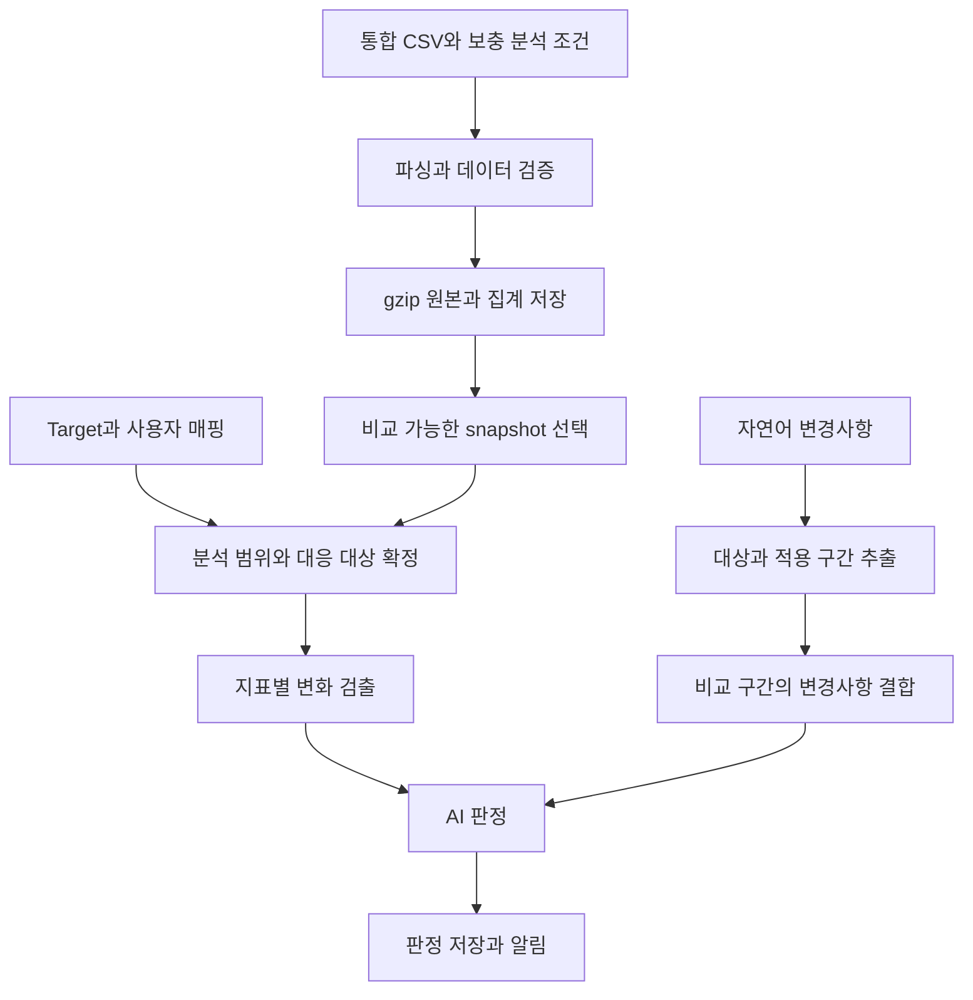

# inst_area_tracking 제품 설계

Block별 CSV를 gzip으로 압축해 DB에 보관하고 area, Vth ratio, drive strength 분포와 power를 추적한다. 수치 비교로 변화 후보를 찾고, AI는 사용자의 자연어 변경사항과 비교 조건을 대조해 예상된 변화인지 판정한다. 설명되지 않는 변화와 판단 근거가 부족한 항목은 알림으로 연결한다.

## 요구사항과 설계 제안

| 구분 | 내용 |
| --- | --- |
| 사용자 요구 | Block마다 CSV를 DB에 적재하며 원본 약 15 MB, gzip -6 압축 시 약 0.5 MB라는 크기를 전제로 한다. |
| 사용자 요구 | 이전 버전 및 이전 프로젝트 대비 area, Vth ratio, drive strength 등의 이상을 판별한다. |
| 사용자 요구 | 사용자가 자연어로 입력한 변경사항을 AI 판단에 반영한다. |
| 사용자 요구 | 특정 instance를 target으로 지정하고 이전 프로젝트·버전과의 instance 매핑 정보를 입력할 수 있어야 한다. |
| 입력 확인 | Power는 all·logic·sram·io·others별 internal·switching·leakage·total을 mW로 제공한다. Logic power에 CTS가 포함된다. |
| 입력 확인 | 각 분류의 total은 internal + switching + leakage이며, all은 logic + sram + io + others다. |
| 실행 환경 확인 | 사내 PostgreSQL 18.6 DBaaS를 사용하며 주소·계정은 사내에서 설정한다. |
| 권한 확인 | ADD는 INSERT를 뜻한다. SELECT·INSERT·UPDATE·DELETE 권한이 확인되었다. |
| 운영 방식 확인 | DBA 권한은 없다. 테이블은 사용자가 웹페이지에서 결재를 올려 생성하며 초기 컬럼 정의 SQL은 여러 줄로 작성 가능하다. 이후 웹 SQL 실행용 문장은 한 줄씩 제공한다. |
| 설계 제안 | 압축 원본과 조회용 집계를 저장하고, 상세 비교가 필요할 때 원본을 해제한다. |
| 설계 제안 | 수치 계산과 이상 후보 검출은 코드가 수행하고, AI가 변경 설명의 적용 범위와 설명 가능성을 판단한다. |
| 서버 구성 확인 | 사용자 PC의 vwp(report_export) → vwp_server(CSV 검증·적재·비교·AI). oa_server는 Dashboard·사용자 메일을 담당하고 vwp_server와 DB로만 연동한다. |
| 입력 확인 | [CSV 컬럼 구조](csv_structure)는 hierarchy별 집계다. `hier_name`은 전체 경로이며 부모 수치에는 자식이 포함된다. |
| 입력 확인 | `level=0`은 design 이름이 들어가는 루트이고 `level=1`부터 자식 노드다. |
| 입력 확인 | `*_pct`의 scale은 0~100이고 logic cell을 기준으로 한다. LLP는 일반 Vth와 별도 범주다. |
| 입력 대기 | Area 단위, 실제 값의 정밀도와 결측 표현, 일부 집계의 포함 관계 및 실행 메타데이터는 확인 후 확정한다. |
| 입력 확인 | CSV에 `process_label`, `voltage_v`, `temp_c`, `pex`가 있으며 파일 하나에는 단일 corner만 포함한다. |
| 저장 설계 | 현재 통합 CSV 원본은 한 번 저장하고 동일 구현의 구조 snapshot과 조건별 power 실행을 DB 안에서 분리한다. Exporter에 파일 분리를 요구하지 않는다. |
| 운영 제약·설계 확정 | 업무 테이블은 `di_area_power_csv`, `tracking_record` 두 개다. 두 테이블 생성 신청은 완료했으며 초기 컬럼 정의와 생성 후 제약·인덱스 적용을 분리한다. Power 없는 cell usage 단독 업로드는 제외한다. |

제품명은 유지하되 추적 대상은 area에 한정하지 않는다. 추가 지표는 원본에서 계산할 수 있고 단위·집계 범위·비교 의미가 정의될 때 포함한다.

## 현재 구현

Design Atlas 저장소의 `area_power.vwp` CLI, `area_power.vwp_server` 업로드 API·분석/AI worker, `area_power.oa` DB API·추상 메일 worker와 호스트 Dashboard의 Area/Power 업무 모듈을 구현했다. 회사 메일 전송은 [MailSender Protocol](../../oa/MAIL_INTEGRATION.md)에 사내 AI가 어댑터를 연결하며 고정 SMTP 구현은 없다. Dashboard는 shadcnstudio 공식 무료 registry 컴포넌트를 사용하며 실행·설정 방법과 출처는 [README](../../area_power/README.md)에 있다. 매핑·target·변경 설명은 Dashboard의 JSON 편집 폼으로 입력하고 서버가 계약을 검증한다.

로컬 PostgreSQL 18.6에서 실제 API·worker·화면과 이전 SMTP 구현의 수락을 확인한 기록이 있다. 현재 SMTP 구현은 제거됐으며 실제 사내 메일 연결 검증은 아니다. AI 미설정은 수치 결과를 보존한 채 needs_review로 남긴다. 실제 사내 DB·report_export·AI 제공자·메일 서비스·실데이터 연결을 완료했다고 간주하지 않는다. Area/Power API는 호스트의 인증 세션·서버 측 프로젝트 권한을 사용한다. 사내 SSO 어댑터 미설정 보호는 유지하며, 명시적인 local_token 개발 모드는 운영 SSO의 대체 경로가 아니다.

## 개발 구성과 DBaaS 운영

### 서버 역할과 DB 연결

사용자 PC의 vwp는 report_export로 통합 CSV를 생성해 vwp_server에 업로드한다. vwp_server가 검증·적재·수치 비교·AI 호출을 수행하고 oa_server가 Dashboard와 메일 발송을 담당한다. 두 서버는 PostgreSQL 18.6 DBaaS를 직접 사용하며 **oa_server ↔ vwp_server는 DB를 통한 요청·조회·결과 전달만 가능**하다. 서버 간 API를 전제로 하지 않는다. 주소·계정·연결 옵션과 스키마는 사내 환경에서 지정한다.

DB 드라이버는 Psycopg 3을 사용한다. 로컬 PostgreSQL 18.6에서 Psycopg 3.3.8의 `bytea` 저장·복원과 트랜잭션을 확인했다. 사내 네트워크·인증서·계정 연결은 별도 확인이 필요하다. 의존 범위는 [requirements.txt](../../requirements.txt)을 따른다. [Psycopg 지원 범위](https://www.psycopg.org/psycopg3/docs/basic/install.html#supported-systems)

SQL과 테이블 정의는 PostgreSQL 18.6에서 사용할 수 있는 기능을 기준으로 작성한다. ID는 애플리케이션에서 UUID를 생성해 PostgreSQL의 `uuid` 컬럼에 저장한다. 이 방식은 별도 UUID 생성 확장이나 시퀀스 사용 권한을 요구하지 않는다. [PostgreSQL 18 UUID](https://www.postgresql.org/docs/18/datatype-uuid.html)

OA가 설정·분석 요청을 DB에 등록하면 vwp_server가 자기 대상의 pending 작업을 점유한다. vwp_server는 결과·알림·메일 요청을 DB에 저장하고 OA가 조회·발송한다. vwp_server는 알림 내용과 수치·판정을, OA는 사용자 읽음·확인·해소와 메일 발송 상태를 담당한다. 상세한 작성 주체·상태·동시 갱신 규칙은 [두 테이블 설계](database.md)를 따른다.

### 데이터 권한과 구조 변경

| 구분 | 확인된 범위와 필요한 작업 |
| --- | --- |
| SELECT | Snapshot·매핑·분석 결과·알림 조회에 사용 |
| INSERT | 원본 적재, target·매핑 등록, 분석 요청 및 결과 저장에 사용 |
| DELETE | 데이터 삭제 권한이 확인됨. 실제 삭제는 참조 관계와 보존 규칙을 따라 수행 |
| UPDATE | 변경 가능한 설정, 작업 상태, target·매핑의 현재 적용 상태 및 알림 읽음·해소 처리에 사용 |
| 테이블·인덱스·제약조건 정의 | 두 테이블 생성 신청 완료. 실제 생성·컬럼 확인 후 미적용 제약·인덱스를 별도 적용 |

확인된 UPDATE 권한으로 매핑 편집, worker의 작업 점유·상태 갱신 및 알림 상태 변경을 수행한다. PostgreSQL 18의 `SELECT ... FOR UPDATE` 계열에 필요한 UPDATE 권한도 이 범위에 포함된다. 원본 snapshot과 완료한 비교의 불변 데이터는 기존 보존 계약을 유지한다. [PostgreSQL 18 행 잠금 권한](https://www.postgresql.org/docs/18/sql-select.html)

테이블 생성은 사용자가 사내 웹페이지에서 결재를 올리는 방식이며 사용자 계정의 직접 CREATE 권한을 전제로 하지 않는다. 생성 후 앱 계정에 필요한 스키마 USAGE와 테이블 SELECT·INSERT·UPDATE·DELETE 권한이 적용되었는지 확인한다. 기존 테이블의 `ALTER TABLE`은 일반 데이터 권한과 다른 소유 권한이 필요하므로, 후속 구조 변경의 신청 절차와 실행 주체·소유권은 별도로 확인한다. 확장 설치나 서버 설정 변경을 필수 조건으로 두지 않는다. [PostgreSQL 18 스키마 권한](https://www.postgresql.org/docs/18/ddl-schemas.html#DDL-SCHEMAS-PRIV), [PostgreSQL 18 ALTER TABLE](https://www.postgresql.org/docs/18/sql-altertable.html)

### 웹페이지에서 SQL 적용

초기 신청에는 컬럼·자료형·NOT NULL·기본값만 제공하고 REFERENCES·PK·UNIQUE·CHECK·인덱스는 두 테이블 생성 후 적용한다. 두 테이블은 신청 완료이므로 재신청하지 않는다. 후속 SQL은 한 문장당 한 줄이며 스키마가 필요한 테이블 참조는 `<schema>.테이블명`으로 명시한다. 사내에서 `<schema>`를 실제 값으로 일괄 치환한 후 실행한다. 실제 스키마명은 요청·저장하지 않는다. 이전 SET·세션 유지·일괄 트랜잭션에 의존하지 않고 앱 자동 DDL·확장 설치·서버 설정 변경을 전제하지 않는다.

사내에서 실제 테이블·컬럼·기존 PK·제약·인덱스와 권한을 확인한 뒤 빠진 정의만 적용한다. 후속 SQL은 PK·UNIQUE → CHECK → FK → 인덱스 순서이며 중간 단계는 설치 완료가 아니다. 이미 동등한 정의가 있으면 재실행하지 않고 기존 데이터가 제약을 위반하면 자동 보정·삭제 없이 원인을 해결한다. 전체 DDL의 일괄 실행·일괄 트랜잭션을 가정하지 않으며 각 서버의 데이터 트랜잭션은 DB 드라이버에서 관리한다.

## CSV 입력과 내부 저장 분리

입력은 [현재 컬럼 목록](csv_structure)의 구조·corner·power 통합 CSV다. 이전의 구조/power 파일 분리 제안 대신 현재 exporter의 파일을 그대로 수용한다. 파일 하나에는 단일 corner만 들어가며 파일 내 `hier_name` 중복은 적재 오류다. `process_label`, `voltage_v`, `temp_c`, `pex`는 모든 행에서 동일한 조건인지 검증한다.

| 저장 단위 | 내용 |
| --- | --- |
| 원본 `di_area_power_csv` | 통합 CSV gzip, checksum, 프로젝트·버전·block·snapshot, 조건·검증 결과를 업로드별 한 행에 보관 |
| 구조 snapshot | `tracking_record`의 snapshot 레코드로 구현 기준·구조 원본을 연결. Corner는 구조 키가 아님 |
| Power 분석 실행 | `di_area_power_csv.id`로 구분하며 동일 snapshot의 다른 corner·같은 조건 재실행은 별도 행 |

같은 netlist·cell 구성과 area 기준의 다른 corner 파일은 기존 snapshot을 명시적으로 선택해 연결한다. 원본의 전체 구조 행과 조건을 확인하고, 구조가 다르면 별도 snapshot으로 등록한다. 같은 버전·이름이거나 루트·target 수치가 같다는 이유로 자동 병합하지 않는다. 같은 조건의 power 재실행도 별도 분석 실행이다.

파일명과 scenario 이름은 표시용이며 조건 추정에 사용하지 않는다. PVT·PEX는 CSV에서 읽고 같은 내용을 사용자에게 다시 입력하게 하지 않는다. 나머지 분석 조건은 적재 요청에 한 번 연결한다.

| 적재 정보 | 출처·의미 |
| --- | --- |
| 프로젝트·버전·block·설계 단계·구현 실행 | 업로드 요청에서 신규 snapshot 또는 재사용 snapshot을 명시 |
| Scenario·분석 실행 이름 | 사람이 결과를 구분할 표시 이름과 재실행 식별 정보 |
| PVT·PEX | CSV의 `process_label`, `voltage_v`, `temp_c`, `pex`. PEX 원문 의미·RC 대응은 실제 제공값으로 확인 |
| 동작 모드·RC 보충 조건 | 업로드 요청에서 제공하고 모르는 값은 미확인으로 유지 |
| Clock | 이름별 주파수를 기록하며 여러 clock을 임의의 하나로 대표하지 않음 |
| Activity | 방식·workload·분석 구간·적용 범위 |
| 도구·분석 방식 | 도구·버전과 결과의 의미에 영향을 주는 조건 |
| 전압 영역 | 여러 영역이 있으면 영역별로 연결. 단일 `voltage_v`가 전체를 대표한다고 추정하지 않음 |

Power는 `logic_cells`로 나누지 않는 mW 절대값이다. 모든 corner를 모아야 적재 가능한 구조로 만들지 않는다. Power 없는 cell usage 단독 입력은 이번 범위에서 제외한다. 다만 비교할 이전 조건·실행이 없는 경우에는 해당 power 비교를 `unavailable`로 남긴다. [DB 설계](database.md)에 두 테이블의 파일·snapshot·작업 연결을 정의했다. 원본 컬럼 목록은 변경하지 않는다.

## 데이터 수집과 압축 저장



### Snapshot의 식별

Snapshot은 특정 프로젝트·버전·block·설계 단계·구현 실행에서 나온 구조 결과다. 같은 버전이라도 구현을 다시 실행해 구조가 달라지면 별도 snapshot으로 구분한다. 기존 snapshot을 덮어쓰지 않으며 비교에는 선택한 양쪽 snapshot을 고정한다.

Power 분석 결과는 snapshot에 연결한 별도 실행 결과다. 각 결과에는 통합 CSV 원본과 분석 조건을 연결한다. 같은 조건을 재실행한 결과도 구분하고 power 비교에는 양쪽 분석 실행을 각각 선택한다. Corner나 activity만 다른 동일 구현은 구조의 전체 일치를 검증한 뒤 같은 snapshot을 사용한다.

비교에 필요한 메타데이터는 CSV 또는 적재 시 입력한 실행 조건에서 얻는다. 프로젝트, 버전, block, 설계 단계, 실행 구분, area 단위, area 산출 기준, 공정과 library, 관련 constraint 조건을 연결한다. CSV에 없는 값을 AI가 추측해 채우지 않는다. 실제 비교 의미에 영향을 주는 조건만 필수 입력으로 정한다.

현재 컬럼 목록에는 프로젝트·버전·구현 실행 식별자가 없으므로 적재 요청에 이 정보를 연결한다. PVT·PEX는 CSV에서 읽고 mode·clock·activity·분석 도구 등 나머지 조건은 별도로 연결한다. 통합 CSV의 `level=0` 행에서 design 이름과 전체 구조 수치를 읽고 적재 block에 연결한다. 기존 snapshot 재사용 시 power 경로뿐 아니라 전체 구조 행이 연결한 snapshot과 일치해야 한다. 파일명만으로 프로젝트·버전·corner를 추측하지 않는다.

### 원본과 집계의 역할

애플리케이션은 원본 CSV bytes를 gzip level 6으로 압축해 binary 컬럼에 저장한다. CSV.gz 입력은 압축 해제와 CSV 내용 검증을 거쳐 전달받은 gzip bytes를 보관한다. 검증용 파싱과 별개로 원본 CSV의 bytes를 유지한다. 업로드와 압축 해제에는 각각 크기 제한을 적용한다. 제한값은 실제 입력 규모와 실행 환경에 맞춰 정한다.

압축 원본은 PostgreSQL 18.6의 `bytea`에 저장한다. gzip을 저장하는 컬럼의 `STORAGE EXTERNAL`은 소유자 또는 권한 있는 운영자가 적용할 선택 설정이다. 이 설정은 큰 값을 행 밖에 저장하면서 PostgreSQL의 추가 압축은 수행하지 않는다. 기본 저장 설정에서도 gzip bytes를 적재할 수 있으며, EXTERNAL 적용 여부와 데이터 적재 가능 여부를 구분한다. 목록과 요약 조회에서는 binary 컬럼을 선택하지 않는다. [PostgreSQL 18 TOAST](https://www.postgresql.org/docs/18/storage-toast.html)

현재 원본은 이미 hierarchy별로 집계되어 있다. 상시 조회용으로는 design 루트와 target 등 조회 대상 hierarchy의 area·count와 분석 조건별 power를 저장하고, 상세 hierarchy 비교는 양쪽 압축 원본의 행을 읽어 수행한다. 비교 작업은 선택한 분석 범위의 모든 hierarchy를 검토하며, 상시 조회용 저장 범위가 검출 범위를 제한하지 않는다. 모든 행을 관계형 테이블에 중복 적재하면 압축 원본 외의 저장 공간이 증가하므로 즉시 조회가 필요한 범위에 맞춰 정한다.

원본의 `*_pct`는 gzip 안에 보존한다. 검증된 count와 분모에서 다시 계산할 수 있는 비율은 조회 시 계산하고 별도 파생 상태로 중복 저장하지 않는다. 개별 cell instance 목록은 없으므로 원본을 해제해도 개별 cell 교체 이력은 얻을 수 없다.

약 0.5 MB는 사용자가 기존 CSV에 대해 제시한 압축 크기다. 같은 통합 CSV는 구조와 power가 참조하더라도 원본을 한 번만 보관한다. 실제 수집한 모든 corner·재실행 파일의 크기를 합쳐 저장량을 산정한다. 집계·인덱스·WAL·백업 공간은 별도이며 실제 압축률을 측정하기 전 추정값을 보장하지 않는다.

파싱·필수 검증이 끝난 통합 원본·조건·집계를 확정하고 업로드를 `ready`로 표시한다. 새 구조라면 snapshot 레코드를 함께 확정하고, 재사용 구조라면 전체 구조 일치를 검증한다. 비교 요청 job도 트랜잭션으로 연결한다. 수집한 corner의 준비 상태와 아직 요청·수집하지 않은 조건을 구분하고 준비되지 않은 파일을 비교 기준으로 사용하지 않는다.

## 지표별 계산과 비교 계약

### 제공된 컬럼과 확정된 의미

컬럼명은 [원본 목록](csv_structure)을 따른다. 각 행은 `hier_name`이 가리키는 hierarchy의 누적 집계이며, 일반 Vth와 LLP는 서로 다른 범주다. 사용자가 확인한 logic cell 기준을 수치 단위에 맞춰 count 비율은 `logic_cells`, area 비율은 `logic_area`에 대응시킨다.

| 컬럼 | 의미와 사용처 |
| --- | --- |
| `hier_name`, `level` | 전체 경로와 깊이. `level=0`은 design 루트, `level=1`은 루트의 자식이다. |
| `process_label`, `voltage_v`, `temp_c`, `pex` | 파일 전체에 공통인 단일 corner 조건. 전압은 V, 온도는 °C이며 PEX의 구체적인 의미는 제공값으로 확인 |
| `total_cells`, `total_area` | 해당 hierarchy 전체의 cell 수와 area |
| `logic_cells`, `logic_area` | Logic cell 수와 area. 비율 계산의 기준 집합 |
| `cts_cells`, `cts_area`, `cts_area_pct` | CTS cell 수·area와 logic area 대비 비율 |
| `sram_cells`, `sram_area` | SRAM cell 수와 area |
| `io_cells`, `io_area` | IO cell 수와 area |
| `others_cells`, `others_area` | 원본에서 others로 분류한 cell 수와 area |
| `vt_{slvt,lvt,rvt,hvt}_{cnt,pct}` | 일반 Vth 네 범주의 count와 logic cell 대비 비율 |
| `vt_{slvt,lvt,rvt,hvt}_llp_{cnt,pct}` | LLP 네 범주의 count와 logic cell 대비 비율 |
| `drv_D1`~`drv_D8`, `drv_D10`, `drv_D12`, `drv_D14`, `drv_D16`의 `_cnt`, `_pct` | 제공된 drive 범주별 count와 logic cell 대비 비율 |
| `drv_other_cnt`, `drv_other_pct` | 원본의 other drive 범주. 분류 누락과 구분해 유지 |
| `pwr_all_{internal,switching,leakage,total}_mw` | 해당 hierarchy 전체의 성분별 전력과 총전력 |
| `pwr_logic_{internal,switching,leakage,total}_mw` | CTS를 포함한 logic 분류의 성분별 전력과 총전력 |
| `pwr_sram_{internal,switching,leakage,total}_mw` | SRAM 분류의 성분별 전력과 총전력 |
| `pwr_io_{internal,switching,leakage,total}_mw` | IO 분류의 성분별 전력과 총전력 |
| `pwr_others_{internal,switching,leakage,total}_mw` | Others 분류의 성분별 전력과 총전력 |

Vth는 여덟 범주, drive는 제공된 D 범주들과 `other`를 각각 추적한다. 목록에 없는 D9 등의 컬럼을 만들어내지 않는다. 프로젝트·버전·library 조건, 개별 cell의 이름과 속성, Vth별 area 및 Vth×drive 교차 집계는 현재 컬럼에 없다.

Power의 단위는 mW다. Logic power에 CTS가 포함되므로 all에 CTS 전력을 다시 더하지 않는다. 이 포함 관계를 area와 cell 수의 분류 관계에도 자동 적용하지 않는다.

### 입력 품질

통합 CSV의 구조 검증에서는 파일 내 `hier_name` 중복, 필수 수치의 파싱 오류, 음수 area·count, 음수 또는 비정수 level, 비정수 count와 무한대·NaN을 적재 오류로 처리한다. Snapshot마다 `level=0`인 design 루트가 하나 있어야 한다. `level`과 전체 경로의 깊이 관계는 실제 경로 표기 규칙에 맞춰 확인한다.

Corner 컬럼이 포함된 CSV는 모든 행의 `process_label`, `voltage_v`, `temp_c`, `pex`가 같은 조건인지 검증한다. 서로 다른 조건이 섞인 파일은 적재 오류로 처리하며 여러 corner로 자동 분할하지 않는다. 파일 단위 단일 corner이므로 경로 중복 검사에 corner를 추가해 중복을 허용하지 않는다.

`*_pct`는 0~100 scale로 읽고 각각의 count 또는 area와 대조한다. 반올림 허용 오차는 실제 CSV의 소수점 정밀도에 맞춘다. Logic 분모가 0일 때의 비율은 계산 불가로 표시하며, 원본의 0 또는 빈 값 표현 규칙은 예시 데이터로 확인한다.

별도 Vth 여덟 범주의 count 합과 drive 범주의 count 합은 각각 `logic_cells`를 넘을 수 없다. 합이 부족하면 부족한 수를 집계 누락으로 표시하고, 기존 `drv_other_cnt`에 임의 합산하지 않는다. 분류 완전성과 percentage 일치 검사를 구분하며, 비율 합계를 억지로 100으로 재정규화하지 않는다.

`logic_*`와 `cts_*` 등이 중복 없는 분할인지 확인되기 전에는 이 컬럼들을 더해 `total_*`와 일치해야 한다고 강제하지 않는다. 부모와 자식 행의 값도 누적 집계이므로 합계 검증에 함께 더하지 않는다. 결측을 실제 0으로 바꾸지 않는다.

통합 CSV의 power 검증에서는 파일 내 경로 중복, 수치 파싱 오류와 무한대·NaN을 거부한다. 기존 snapshot에 연결할 때 경로와 전체 구조 일치를 검증한다. 각 분류의 `total = internal + switching + leakage`와 각 성분의 `all = logic + sram + io + others`를 실제 출력의 반올림 정밀도에 맞춰 확인한다. 불일치를 임의로 재계산해 원본에 덮어쓰지 않는다.

Power가 수집되지 않은 snapshot이나 경로는 해당 power 비교를 `unavailable`로 표시한다. 결측은 0 mW로 바꾸지 않으며, 기존 area·Vth·drive의 비교는 계속한다. 음수 전력값의 허용 여부는 보고서를 생성하는 도구의 출력 계약에 맞춰 정한다.

### Area

Area는 현재 값, 기준 값, 절대 증감량과 증감률을 함께 표시한다.

```text
증감량 = 현재 area - 기준 area
증감률 = (현재 area - 기준 area) / 기준 area × 100
```

기준 area가 0이면 증감률은 정의하지 않는다. 현재 값이 양수면 신규 발생 및 절대량으로 판단하고 양쪽 값이 0이면 변화 없음으로 처리한다. 감소도 검출 대상이다. 기능 누락이나 집계 범위 축소가 원인일 수 있으므로 감소를 무조건 개선으로 분류하지 않는다.

`total_area`, `logic_area`, `cts_area`, `sram_area`, `io_area`, `others_area`를 각각 비교한다. `total_cells`와 각 종류의 cell 수도 함께 확인해 area 증가가 cell 수 변화와 동반되는지 설명한다. 현재 CSV에는 core area가 없으므로 이를 대신하는 값으로 사용하지 않는다.

부모 hierarchy의 수치에는 자식이 포함된다. Design 전체 값은 `level=0` 행에서 읽고, 하위 행 전체를 합산하지 않는다. 상위 변화의 위치를 좁힐 때는 직접 자식들의 변화를 보되, 누적 수치를 여러 깊이에서 중복 기여량으로 계산하지 않는다.

`cts_area_pct`는 `100 × cts_area / logic_area`로 대조하고 `%p` 변화로 비교한다. CTS area와 비율을 함께 보여줘 분모인 logic area 감소 때문에 비율만 커진 경우를 구분한다.

### Vth ratio

`slvt`, `slvt_llp`, `lvt`, `lvt_llp`, `rvt`, `rvt_llp`, `hvt`, `hvt_llp`의 여덟 count와 비율을 독립적으로 비교한다. LLP를 일반 Vth count의 부분집합으로 간주하지 않는다. Library가 다른 비교에서는 같은 범주명이 같은 조건을 뜻하는지 확인한다.

```text
Vth 비율(v, %) = 100 × 해당 vt_*_cnt / logic_cells
비율 변화(%p) = 현재 vt_*_pct - 기준 vt_*_pct
```

현재 제공되는 Vth 비율은 count 기준이다. Vth별 area가 없으므로 area 가중 Vth ratio는 계산하지 않는다. `total_cells`를 분모로 사용하지 않고, 부모·자식 비율을 평균하지 않는다. 서로 겹치지 않는 hierarchy를 합칠 때만 Vth count와 `logic_cells`를 합쳐 비율을 계산한다.

`logic_cells - Σ(vt_*_cnt)`가 양수면 분류되지 않은 수로 별도 표시한다. 분모를 이미 분류된 cell 수로 줄여 누락을 숨기지 않는다.

예를 들어 LVT 비율 20%에서 30%로의 변화는 `+10%p`이고 상대 변화율은 `+50%`다. 기본 비교와 알림은 `%p`를 사용하고 양쪽 Vth count 및 `logic_cells`를 함께 보여준다. LVT count 증가와 다른 Vth 감소에 따른 구성비 상승을 구분한다.

### Drive strength

`D1`~`D8`, `D10`, `D12`, `D14`, `D16`, `other`의 count와 구성비를 비교한다. `drv_other_cnt`는 제공된 범주이며, count 합에서 확인한 분류 누락 수와 구분한다.

```text
Drive 비율(d, %) = 100 × 해당 drv_*_cnt / logic_cells
비율 변화(%p) = 현재 drv_*_pct - 기준 drv_*_pct
```

전체 평균 하나로 판단하지 않고 범주별 `%p` 변화와 count 변화를 확인한다. `D16`을 library와 무관한 물리적 구동 능력 16배로 해석하지 않는다. 강한 drive 비중은 library 내 순서와 경계가 정의된 경우에만 계산한다.

현재 데이터의 비교 단위는 hierarchy 전체 logic cell의 drive 구성이다. 기능 계열별 분포나 Vth를 고정한 drive 분포는 제공되지 않는다. 특정 cell이 upsize되었다고 확정하는 대신 D 범주의 비중이 바뀌었다고 설명한다. 다른 library와의 비교는 범주 대응이 확인되어야 한다.

분포 전체의 변화 크기가 필요하면 두 snapshot의 범주 합집합에서 다음 값을 보조 지표로 사용한다. CSV의 percent 값을 100으로 나눈 0~1 비율을 사용한다. 분류 누락이 있으면 그 잔여 비중도 별도 범주로 포함해 각 snapshot의 합이 1이 되게 한다.

```text
분포 변화량 = 0.5 × Σ |현재 범주 비율(k) - 기준 범주 비율(k)|
```

이 값은 0에서 1 사이이며 어느 범주가 원인인지 별도 증감표로 설명한다. 단독으로 알림을 결정하지 않는다. 원본 범위가 완전해 실제 부재가 확인된 범주만 count 0으로 채운다.

### Power

`pwr_{all,logic,sram,io,others}_{internal,switching,leakage,total}_mw`를 각각 비교한다. 증감량은 현재 값에서 기준 값을 뺀 mW이며, 증감률은 area와 같은 방식으로 계산한다. 기준 값이 0이면 증감률을 정의하지 않고 절대량으로 판단한다. 증가와 감소 모두 검토한다.

Design 전체 전력은 구조 snapshot의 `level=0` 경로에 대응하는 `pwr_all_*` 행에서 읽는다. Internal·switching·leakage와 분류별 power를 보고 변화 위치를 좁힌다. Total은 성분의 합계이므로 성분과 다시 더하지 않으며, 부모와 자식 hierarchy의 전력도 중복 합산하지 않는다.

기본 power 비교는 실제 분석 조건이 같은 기준·현재 결과를 연결한다. 선택한 corner나 조건의 기준 결과가 없으면 해당 비교는 `unavailable`로 표시한다. 다른 조건의 결과를 명시적으로 비교하거나 조건이 미확인이면 수치와 조건 차이를 함께 보여주는 `contextual` 비교로 처리한다. 이 경우 설계 회귀를 확정하려면 같은 조건의 결과가 필요하다.

조건에는 PVT뿐 아니라 mode·clock·activity·RC·분석 방식이 포함된다. 같은 corner 이름만으로 같은 조건이라고 판단하거나 전압·주파수 차이를 임의의 비례식으로 환산하지 않는다. 예를 들어 power 분석에 입력하는 activity 자체도 결과의 조건이다. [OpenSTA power activity 입력 예](https://github.com/The-OpenROAD-Project/OpenSTA/blob/master/doc/Examples.md)

사용자의 자연어 설명이 clock이나 동작 모드 변경을 포함하면 해당 비교의 power 판단에 연결한다. 변경 이유가 설명되어도 다른 분석 조건을 동일 조건으로 바꾸어 표시하지 않는다. 전력 성분의 증감과 LVT·drive 구성 변화는 함께 검토하되 원인을 확정하는 정보와 구분한다.

현재 컬럼에는 Vth별·drive별 power와 CTS 전용 power가 없다. Cell 수나 area 비율로 전력을 배분하지 않는다. CSV 수치는 도구가 보고한 분석값으로 표시하며 실제 장비의 전력 측정 결과로 간주하지 않는다.

### 지표를 함께 해석하는 범위

Area가 비슷해도 Vth나 drive 구성이 바뀌면 독립적으로 이상 후보가 될 수 있다. 현재 CSV에는 두 분포가 별도로 있으므로 같은 hierarchy에서 함께 변했는지까지 설명한다. Vth×drive 교차 분포, 기능 계열별 drive 분포, 개별 cell 교체는 복원할 수 없다.

Area 증가, LVT 비중 증가, 강한 drive 비중 증가와 power 변화가 같은 hierarchy에 나타나면 하나의 관련 변화로 묶어 설명한다. Leakage 증가량은 제공된 `pwr_*_leakage_mw`의 보고값 차이로 제시하되 LVT 변화가 유일한 원인이라고 단정하지 않는다. Timing 지표는 현재 CSV에 없으므로 timing 개선을 관측 사실로 제시하지 않는다.

## 비교 기준과 대상 연결

### 이전 버전과 이전 프로젝트

이전 버전 비교는 프로젝트의 명시적인 버전 연결을 따른다. 업로드 시각이나 버전명 문자열 정렬로 이전 버전을 결정하지 않는다. 서로 다른 branch의 최신 결과를 자동으로 섞지 않는다. 이전 프로젝트 비교는 사용자가 정한 기준 프로젝트·버전·block을 별도 연결한다.

양쪽 snapshot의 설계 단계, area 산출 기준과 단위, library와 분류 규칙, 관련 constraint 조건을 지표별로 확인한다. 공정·library가 달라도 물리적 면적 차이를 참고할 수는 있으나, 같은 조건의 설계 회귀나 drive 변화로 바로 판정하지 않는다. 근거 없는 공정 환산 계수를 적용하지 않는다.

| 비교 상태 | 의미 | 처리 |
| --- | --- | --- |
| `comparable` | 지표 정의와 대상 대응이 확인되어 직접 비교 가능 | 수치 검출과 AI 판정을 수행한다. |
| `contextual` | 수치 차이는 볼 수 있으나 조건 차이가 판단에 영향을 줌 | 조건 차이를 함께 제시하며 정상 판정의 근거를 별도 확인한다. |
| `unavailable` | 기준 데이터, 분모 또는 대상 매핑 등이 부족함 | 계산 불가 사유를 표시하고 정상으로 처리하지 않는다. |

이 상태는 지표마다 다를 수 있다. Area는 비교 가능해도 drive 분류는 비교 불가일 수 있다. 이전 버전과 이전 프로젝트의 결과도 따로 유지하며, 한쪽에서 예상된 변화라고 다른 쪽 결과를 지우지 않는다.

Power 조건만 다르거나 필요한 power 결과가 없어도 area·Vth·drive의 비교 가능 여부는 각각 유지한다. Corner별 결과는 조건별로 비교하며 서로 다른 corner의 전력을 합산하지 않는다.

### 추적 대상 instance

Target은 사용자가 관심 대상으로 지정한 hierarchy instance다. 현재 CSV의 `hier_name`으로 식별할 수 있는 행을 연결한다. CSV에 없는 개별 cell instance를 target으로 입력해도 해당 수치를 만들어낼 수는 없다.

Target에는 표시 이름, 현재 프로젝트·버전·block의 전체 경로, 추적 지표와 분석 범위를 입력한다. 경로가 바뀌어도 같은 관심 대상을 조회할 수 있도록 target의 식별자는 경로와 분리하고, 버전별 실제 경로 및 이전 대상과의 매핑에 연결한다. 매핑이 없는 신규 target도 등록할 수 있다.

기존 target이 여러 instance로 분할되면 그 target의 비교는 대응 그룹 단위로 연결할 수 있다. 분할된 각 instance를 따로 추적할 때는 각각의 target을 지정하며, 과거 개별 값이 없는 구간은 그룹 추이와 구분한다.

분석 범위는 전체 hierarchy 또는 지정 target으로 선택한다. Target 분석에서는 선택한 노드만 비교할지 하위 노드의 행도 함께 비교할지 명시한다. 노드만 선택해도 그 행의 수치는 이미 자식을 포함한 누적 값이다. 하위 노드 포함은 분석할 행을 늘리는 설정이며 area 합산 방식이 아니다. Target 분석 결과를 전체 design 분석 완료로 표시하지 않는다.

### 사용자 매핑 입력

사용자는 매핑 입력 화면에서 기준 프로젝트·버전·block과 현재 프로젝트·버전·block을 선택하고 대응 경로를 등록한다. 표에서 직접 입력하거나 같은 필드를 가진 CSV를 일괄 입력할 수 있게 한다. 원본 area CSV와 매핑 입력은 별도로 관리한다.

| 입력 항목 | 의미 |
| --- | --- |
| 기준과 현재의 프로젝트·버전·block | 어느 비교에 적용할 대응인지 지정 |
| 이전 `hier_name`과 현재 `hier_name` | 원본 전체 경로로 양쪽 대상을 연결 |
| 대응 유형 | 일대일, 분할, 병합, 신규 또는 삭제 |
| 적용 범위 | 입력한 노드만 연결하거나 해당 subtree의 경로 대응까지 적용 |
| 적용 버전 구간 | 경로 대응이 유효한 버전 구간. 다른 branch나 구간에 자동 확대하지 않음 |
| Target 연결 | 해당 대응을 사용할 관심 target을 연결. 일반 hierarchy 매핑에도 사용 가능 |
| 자연어 변경 설명 | 이름·위치 변경, 기능 추가·수정 등 실제 달라진 내용을 연결 |

버전 구간은 버전의 명시적 연결을 따라 해석하며 버전명 문자열로 범위를 판단하지 않는다. 초기에는 선택한 버전 쌍에 적용하고, 사용자가 지정한 구간에 재사용할 때는 양쪽 경로와 조건을 다시 확인한다. 원본 CSV를 적재하기 전에도 매핑을 입력할 수 있으나, 경로의 존재를 확인하기 전에는 적용 대기로 표시한다.

아래 경로는 입력 형태를 설명하기 위한 예시다.

| 이전 경로 | 현재 경로 | 대응 유형 | 변경 설명 |
| --- | --- | --- | --- |
| `prev_design/u_cpu` | `curr_design/u_core` | 일대일 | Instance 이름 변경 |
| `prev_design/u_bus/u_dma` | `curr_design/u_io/u_dma` | 일대일 | Hierarchy 이동 및 채널 수 변경 |
| `prev_design/u_cache` | `curr_design/u_cache0`, `curr_design/u_cache1` | 분할 | 이전 한 영역을 두 영역으로 분리 |
| `prev_design/u_a`, `prev_design/u_b` | `curr_design/u_ab` | 병합 | 두 영역을 하나로 통합 |
| 없음 | `curr_design/u_accel` | 신규 | 새 기능 추가 |
| `prev_design/u_old` | 없음 | 삭제 | 이전 기능 제거 |

분할·병합의 여러 경로는 하나의 대응 그룹에 속한 멤버로 입력한다. 일대일 행을 중복 작성해 같은 이전 값이 여러 비교에 전체 복제되는 방식으로 표현하지 않는다.

### 매핑 적용과 비교

매핑은 어느 대상을 비교할지 정한다. 같은 기능인지, 기능이 달라졌다면 어떤 변화까지 설명하는지는 자연어 변경사항과 수치로 별도 판단한다. 경로 대응이 등록되었다는 이유만으로 area·Vth·drive·power 변화를 정상 처리하지 않는다. Instance 매핑은 구조 snapshot의 경로에 적용하고, 연결한 power 결과에도 같은 대응을 사용한다. Corner마다 동일한 instance 매핑을 반복 입력할 필요는 없다.

명시적인 노드 매핑을 먼저 적용한다. Subtree 매핑은 확인된 경로 구분자 경계에서 상대 경로를 유지하는 대응이며, 별도 노드 매핑이 있으면 그 노드를 우선한다. 여러 subtree 규칙이 겹치면 더 구체적인 경로 규칙을 사용하고, 같은 구체성의 충돌은 해결 필요로 표시한다. 원본의 대소문자와 구분자를 임의로 바꾸거나 비슷한 이름으로 대상을 확정하지 않는다.

Subtree의 상대 경로 대응은 일대일 매핑에 적용한다. 분할·병합 그룹의 하위 노드까지 대응시키려면 별도 매핑을 입력해야 한다. 그룹 멤버는 각쪽에서 선택한 snapshot 안의 경로로 확인한다.

일대일은 이름이나 위치가 바뀌어도 연결된 두 행을 비교한다. 분할·병합은 한쪽 그룹 안에 부모와 자식을 함께 넣지 않고, 겹치지 않는 영역들의 count·area를 더해 그룹끼리 비교한다. Vth·drive 비율은 각 범주의 count 합을 `logic_cells` 합으로 나누고, CTS area 비율은 `cts_area` 합을 `logic_area` 합으로 나눠 다시 계산한다. 비율을 평균하거나 이전 area를 새 자식에게 임의 배분하지 않는다.

Power는 같은 분석 조건에서 겹치지 않는 hierarchy 멤버의 성분별 mW를 더해 그룹끼리 비교한다. 그룹 멤버의 필요한 값이 누락되면 해당 power 비교를 불완전으로 표시한다. 서로 다른 corner·mode·activity의 결과를 한 그룹의 전력으로 더하지 않는다.

개별 새 노드의 이전 수치가 없는 분할은 그룹 비교까지 가능하며, 각 새 노드의 과거 추이를 만들어내지 않는다. 신규·삭제 대응도 없는 쪽을 가상의 area 0인 snapshot으로 만들지 않고, 이전 대비 비율 계산이 없는 구조 변화로 표시한다. 선언한 변경 설명과 현재 값의 운영 한도는 계속 확인한다.

사용자가 일대일 연결, 그룹 구성, 적용 구간을 수정하면 실제 비교 대상이나 기준 수치가 달라질 수 있으므로 수치 비교부터 다시 수행한다. 완료한 비교에는 사용한 대응 경로·그룹·매핑 정보를 고정해 이전 판정의 의미를 유지한다. 변경사항 설명만 바뀌면 관련 AI 판정을 다시 수행한다.

### 매핑 검증과 미해결 대상

적용 전에 양쪽 snapshot의 경로 존재, 적용 구간, 대응 유형에 맞는 멤버 수와 충돌을 확인한다. 같은 비교 안에서 동일 경로를 서로 다른 일대일 대상으로 연결한 경우는 명시적인 분할·병합 그룹으로 정리해야 한다. 그룹 내부의 중복 경로 및 부모·자식 중복 합산은 거부한다. 독립적인 루트 비교와 자식 비교는 함께 수행할 수 있으며 알림을 관련 변화로 묶는다.

Snapshot 안의 대상은 전체 경로인 `hier_name`과 `level`로 확인한다. `level=0` 루트 이름이 다르면 등록한 루트 또는 subtree 매핑을 사용한다. 매핑이 해결되지 않은 경로를 이름 차이만으로 신규·삭제 처리하지 않는다. 같은 프로젝트에서 경로가 유지된 대상은 명시적인 변경 매핑과 충돌하지 않는 경우 같은 경로로 연결하고, 이전 프로젝트의 대응은 설정한 기준과 사용자 매핑을 따른다.

Target의 경로가 없거나 매핑이 불완전하면 그 target을 비교 불가 또는 매핑 필요로 표시한다. 미해결 target을 분석 목록에서 조용히 제외하지 않으며, 독립적으로 비교 가능한 다른 target의 처리는 계속한다. CSV에 행이 없는 것과 실제 기능 삭제는 입력의 완전성과 삭제 대응을 확인한 뒤 구분한다.

부모 값에서 직접 자식들의 합을 뺀 값을 직접 소유분으로 해석하려면 자식 목록이 완전하고 집계 범위가 같아야 한다. 이 조건이 없으면 잔여량을 직접 소유 cell로 단정하지 않는다.

## 자연어 변경사항 처리

### 원문과 적용 범위

사용자는 변경 내용을 자연어로 입력한다. AI는 원문을 보존하면서 비교에 필요한 다음 사실을 추출한다. 모든 입력을 구조화 양식으로 다시 작성하게 요구하지 않는다.

| 추출 정보 | 사용처 |
| --- | --- |
| 변경 전후 프로젝트와 버전 구간 | 어느 비교에 적용할지 결정 |
| Block·hierarchy·기능 대상 | 설명 가능한 변화 위치를 제한 |
| 영향 지표 | Area·Vth·drive·power 중 설명이 적용되는 지표와 범위를 연결 |
| 변경 내용과 예상 방향 | 기능 추가, 최적화 조건 변경, 교체 등의 맥락 |
| 명시된 예상 범위와 단위 | 증감률, %p, 목표 비율 등을 구분 |
| 근거가 된 원문 구절과 해석되지 않은 부분 | 판정 이유 표시와 필요한 추가 정보 확인 |

명확하게 식별되는 대상과 구간은 자동 연결한다. 대상이 모호하거나 범위가 충돌하면 적용 미확정으로 남기고 판정에 그 한계를 전달한다. 수치가 없는 설명에서 예상 증가율을 만들어내지 않는다. “LVT 5% 증가”처럼 상대 변화율인지 `%p`인지 불명확하면 임의로 선택하지 않는다.

변경 설명에 이전 프로젝트의 instance 이름이 나오면 해당 비교에 적용한 매핑을 통해 현재 대상과 연결한다. 등록된 target의 표시 이름도 실제 경로로 해석한 뒤 사용한다. 구조화해 입력한 매핑과 자연어 설명의 대응이 충돌하면 사용자 매핑을 임의 수정하지 않고 충돌을 표시한다. AI가 이름 유사성으로 제안한 연결은 실제 사용자 매핑과 구분한다.

변경 대상이 자식 hierarchy라면 그 자식과 조상들의 누적 지표에 영향을 줄 수 있다. 자식의 예상 증가율을 조상 전체의 허용 증가율로 그대로 적용하지 않고 실제 기여량을 본다. 자식의 크기 변화로 조상의 Vth·drive 구성비가 달라질 수도 있으므로 count와 분모 변화를 함께 설명한다. 형제 hierarchy까지 같은 설명을 자동 적용하지 않는다.

일반 Vth와 LLP를 구분하는 원본 구조를 자연어 해석에도 유지한다. 일반 LVT 설명을 LVT_LLP의 변화까지 자동으로 설명하는 근거로 사용하지 않으며, 둘을 포함한 의미인지 불명확하면 해석 범위를 표시한다.

사용자가 예상 수치를 매번 입력할 필요는 없다. 같은 조건의 과거 변경 사례나 입력에서 계산할 수 있는 구조 변화가 있으면 별도 근거로 제시할 수 있다. 예를 들어 “채널을 두 배로 늘렸다”는 설명은 채널 부분과 고정 부분을 구분할 수 있을 때 그 범위에서 해석하며, block 전체 area가 두 배가 된다고 가정하지 않는다. 사용자가 명시한 기대와 데이터에서 추정한 범위는 판정 이유에서 구분한다.

예를 들어 다음 입력은 변경 방향과 수치 범위가 다르게 주어진 경우다.

> v12에서 u_dma 버퍼를 늘려 해당 hierarchy의 logic area는 20~30% 증가 예상. setup 개선을 위해 u_cpu의 LVT 사용은 늘렸음.

첫 문장은 해당 area의 수치 범위를 제공한다. 두 번째 문장은 u_cpu의 LVT 증가 방향만 설명하며, 허용되는 LVT 비율·drive 변화·timing 개선 결과까지 확정하지 않는다.

### 비교 구간의 변경사항 결합

v10과 v13을 비교하면 v10 이후 v13까지 적용된 변경을 모은다. v12와 v13을 비교할 때는 v12 이전에 이미 반영된 변경을 새 변화의 설명으로 사용하지 않는다.

이전 프로젝트 비교에는 기준 프로젝트에서 현재 프로젝트로의 차이와, 이후 현재 버전까지의 변경을 함께 적용한다. 이 연결이 없는 변경 설명은 자동으로 유효하다고 간주하지 않는다. 되돌린 변경, 같은 변경의 중복 입력, 서로 모순되는 예상값을 구분하며 여러 증감률을 단순 합산하지 않는다.

변경사항을 수정하거나 추가하면 영향을 받는 비교를 다시 판정한다. 원본 snapshot과 관측 수치는 유지하고, 현재 판정 및 알림이 어떤 변경사항을 적용했는지 연결한다.

## 이상 후보 검출과 AI 판정

### 수치 검출

최초 데이터에서는 이전 snapshot과의 차이를 계산한다. 두 개의 결과만으로 통계적 이상치라고 단정하지 않는다. 지표별 조건은 서로 다르게 정의한다.

| 지표 | 후보 검출에 사용하는 값 |
| --- | --- |
| Area와 cell 수 | `total_*`, `logic_*`, `cts_*`, `sram_*`, `io_*`, `others_*`의 절대·상대 변화, hierarchy별 변화 위치 |
| CTS area ratio | `cts_area_pct`의 %p 차이와 분자·분모의 area 변화 |
| Vth ratio | 일반 Vth와 LLP 각각의 %p 차이, count·`logic_cells` 변화, 분류 누락 비중 |
| Drive strength | 제공된 D 범주와 other 각각의 %p 차이, count·`logic_cells` 변화 |
| Power | 분류·성분별 mW 증감량·증감률, 총전력과 성분 변화의 관계, 분석 조건 차이 |
| 공통 | 신규·삭제 대상, 비교 조건 변화, 수치 누락과 분류 불일치 |

Area와 power는 절대량과 상대량을 함께 고려해 작은 기준 값에서 생기는 과도한 증감률을 구분한다. Ratio와 drive는 분모 및 변화에 관련된 cell 수를 함께 본다. 초기 임계값은 사용자의 운영 기준과 실제 CSV를 확인한 뒤 정하며, 모든 지표에 동일한 고정 백분율을 적용하지 않는다.

자연어로 명시된 예상 구간을 벗어난 변화도 후보에 포함한다. 이력이 쌓이면 같은 조건의 과거 분포를 보조 근거로 사용할 수 있다. 중앙값과 MAD를 사용하는 방법 등은 분포와 표본 조건을 확인한 후 적용하며, MAD가 0이거나 이력이 부족하면 통계 판정으로 대체하지 않는다. [NIST 이상치 판별 설명](https://www.itl.nist.gov/div898/handbook/eda/section3/eda35h.htm)

부모·자식과 여러 지표에 걸친 관련 후보는 알림을 묶되 각 수치와 비교 기준을 남긴다. AI 입력은 전체 CSV 대신 target, 해석된 양쪽 경로 또는 그룹, 매핑 상태, 계산된 변화, 분모, power 분석 조건을 포함한 비교 조건, 관련 변경사항과 필요한 상세 집계로 구성한다. 후보가 많으면 나누어 처리하고 상위 몇 개만 검토한 결과를 선택한 지표·hierarchy·분석 조건 전체의 완료로 표시하지 않는다.

### AI의 역할과 결과

AI는 대상이 맞는지, 변경사항이 해당 비교 구간에 적용되는지, 관측된 지표·방향·규모를 얼마나 설명하는지 판단한다. 계산된 수치와 비교 가능 상태를 수정하지 않는다. 변경사항 텍스트는 설계 설명 데이터로 취급하며, 그 안의 지시문이 계산·알림 정책을 바꾸게 하지 않는다.

| 판정 | 의미 | 알림 |
| --- | --- | --- |
| `expected` | 적용 가능한 변경사항과 수치 근거가 관측 변화를 충분히 설명함 | 판정 이력과 비교 화면에 표시 |
| `unexpected` | 적용할 설명이 없거나 대상·방향·규모가 설명과 어긋남 | 이상 알림 |
| `needs_review` | 방향만 설명되거나 비교 조건·입력·AI 응답이 부족해 판단을 끝낼 수 없음 | 확인 필요 알림 |

방향 설명만으로 큰 변화의 크기까지 정당화하지 않는다. 별도로 명시된 운영 한도를 넘으면 AI가 예상된 변화라고 설명해도 한도 초과 알림은 유지한다. 운영 한도는 자연어의 기대 설명과 구분해 관리한다.

판정 결과에는 대상 후보, 적용한 변경사항, 설명되는 부분, 설명되지 않는 부분, 이유와 필요한 추가 정보를 포함한다. AI가 반환한 대상과 변경사항 연결 및 결과 형식을 코드가 확인한다. 임의의 확신 점수만으로 정상 처리하지 않는다.

AI 호출 실패나 잘못된 응답은 성공으로 바꾸지 않는다. 후보는 남기고 판정 실패 사유와 확인 필요 상태를 표시한다. 입력이 유효하지 않아 비교 자체가 불가능한 경우는 데이터 오류로 구분하며, outlier 판정으로 꾸미지 않는다.

### 동작 예시

아래 수치는 설명용이며 제품 임계값이 아니다. 각 행의 지표 정의와 비교 조건이 같고 후보로 검출되었다고 가정한다.

| 관측 | 적용 가능한 변경사항 | 처리 |
| --- | --- | --- |
| u_dma area 100 → 125 | 해당 area 20~30% 증가 예상 | `expected` |
| u_dma area 100 → 165 | 해당 area 20~30% 증가 예상 | `unexpected`, 예상 범위 초과 알림 |
| u_cpu area 변화가 작고 LVT 20% → 35% | u_dma 버퍼 확장만 설명 | Vth 후보를 독립 판정하고 `unexpected` 알림 |
| u_cpu LVT 20% → 35% | u_cpu의 LVT 사용을 늘렸다는 설명만 있음 | 방향은 설명되지만 +15%p의 규모는 `needs_review` |
| Drive D1·D4 비중 변화 | 다른 library로 교체되었고 대응 규칙이 없음 | Drive 비교를 `unavailable`로 표시하고 매핑 필요 안내 |
| Area 정상 범위, Vth count 합과 `logic_cells`의 차이가 급증 | 관련 변경사항 없음 | 집계·분류 확인 필요 알림 |

## DB의 논리 구조

[두 테이블 설계](database.md)에 초기 컬럼 정의와 생성 후 제약·인덱스 적용 순서를 정의했다. 두 테이블의 생성 신청은 완료했으며 컬럼 정의 파일은 사내 대조용 참고본이다. 실제 생성·정의 확인 후 미적용 [제약](../../db/area_power/03_constraints.sql) → [인덱스](../../db/area_power/04_indexes.sql)를 적용한다. 별도 snapshot·매핑·알림·작업 테이블은 만들지 않는다.

| 테이블 | 저장 내용 |
| --- | --- |
| `di_area_power_csv` | 통합 CSV 원본 gzip, 업로드 실행·프로젝트·버전·block·snapshot, corner·보충 분석 조건, 루트 요약·검증 결과 |
| `tracking_record` | 종류별 설정·원문 revision·매핑·파일 선택·계산 결과·AI 판정·알림·메일·작업. 객체·결과·작업별로 행을 분리하고 상세는 JSONB에 저장 |

루트 요약은 `root_summary`, 분석한 hierarchy·target·매핑 그룹은 `metric_result`에 지표별 현재/기준 값·분자·분모·조건을 저장한다. 별도 `scope_result` 캐시는 생성하지 않는다. 원본 pct는 gzip에 남기고 비율은 검증한 분자·분모로 계산한다. 구조의 논리 키는 `(snapshot_id, hier_name)`, power는 `(upload_id, hier_name)`이며 업로드 시 원본 전체를 관계형 행으로 복제하지 않는다.

수치 비교 key는 양쪽 업로드·조건·범위·지표·검출 정책·매핑 revision과 실제 대응을 정규화해 산출하고 종류별 dedupe UNIQUE로 중복을 막는다. 설명만 수정하면 기존 수치 결과에 새 AI 실행을 연결한다. JSON 내부 참조·수치·범위 검증과 완료 데이터 불변성은 공통 모델과 각 서비스가 검증한다.

조건별 현재 파일은 selection 레코드가 명시적으로 선택한다. 수정본 업로드로 자동 교체하지 않으며 완료 비교는 당시의 업로드·원문·매핑 revision을 고정한다. OA의 동시 선택 변경은 `row_version` 조건 갱신으로 충돌을 검출한다.

작업도 `tracking_record`에 저장한다. 적재·비교·추출·판정은 vwp_server, 메일은 oa_server가 소비하며 자기 서버의 pending job만 짧은 트랜잭션에서 행 잠금으로 점유한다. AI·사내 메일 호출 중 DB 잠금을 유지하지 않는다. 전체 요청 범위를 처리하기 전에는 완료로 표시하지 않으며 실패 이유·명시 재실행 이력을 보존한다.

## 조회와 알림 흐름

사용자는 프로젝트·버전·block을 선택해 적재 상태를 확인하고, target 및 매핑을 입력·편집한다. 매핑 화면에서는 이전 경로, 현재 경로, 대응 유형, 적용 구간, 변경 설명과 경로 확인 상태를 함께 보여준다. 미해결 target과 매핑 충돌은 해당 항목에서 수정할 수 있게 한다.

전체 또는 target 분석을 선택한 뒤 이전 버전 및 이전 프로젝트 비교를 각각 확인한다. Target 추이에서는 이름·위치가 달라진 구간의 대응 경로를 볼 수 있게 한다. 분할·병합 비교는 그룹 구성과 그룹 수치를 표시하고 개별 instance 비교와 구분한다. 선택한 비교 기준과 분모는 화면에서도 유지한다.

Power는 corner·mode·activity 등 조건과 분석 실행을 선택해 추이를 조회한다. 같은 구현의 구조 지표는 공통으로 표시하고, 전력은 조건별로 유지한다. 요청한 조건과 수집된 조건, 기준 결과가 없는 항목을 구분해 전체 분석의 완료 범위를 보여준다.

알림에는 연결된 target, 프로젝트·버전·block·hierarchy, 비교 기준과 매핑한 이전 경로 또는 그룹, 대상 지표, 이전/현재 값, 증감량과 단위, 관련 변경사항, 판정 이유와 확인에 필요한 정보를 포함한다. Power 알림에는 양쪽 분석 조건과 분석 실행을 함께 연결한다. 설명이 붙어 있는 정상 변화와 아직 검토하지 못한 항목을 구분한다.

알림 읽음·확인·해소는 AI 판정과 별도 상태다. 사용자가 알림을 닫았다고 해당 수치를 정상 데이터로 학습하거나 이후 기준에서 자동 제외하지 않는다. 판정 변경 시에는 변경된 이유를 기존 알림과 연결한다.

vwp_server가 알림·mail job을 DB에 저장하고 OA가 읽어 `MailSender`로 사내 메일을 요청한다. OA는 접수 상태를 DB에 남기며 판정 완료·서비스 접수·수신/열람을 구분한다. Protocol과 명시적 주입만 제공하며 실제 SDK/인증/발신 계정은 OA 회사 어댑터에 연결한다. 메일 서비스와 DB는 단일 트랜잭션이 아니므로 정확히 한 번 전달을 보장하지 않는다. 일부 거부·응답 불명·접수 후 DB 기록 실패를 숨기거나 자동 재발송하지 않는다. 미연결은 job 점유 전 실패한다.

## 남은 입력 계약과 실행 조건

| 항목 | 결정에 필요한 내용 |
| --- | --- |
| 경로와 파일 범위 | 실제 전체 경로 표기법, 중간 노드 누락이나 깊이 제한 여부, 분할 파일 여부 |
| Area와 cell 분류 | Area 단위·산출 기준, `logic_*`와 `cts_*`의 겹침 여부, total과 종류별 집계의 관계 |
| Vth와 drive | Count 합이 logic 전체를 완전히 분류하는지, library별 D 범주의 해석 |
| Power 분석 조건 | CSV의 실제 PVT·PEX 값과 `pex`의 의미·RC 대응, 여러 전압 영역 표현 여부, 별도로 제공할 mode·clock·activity·도구 정보와 보고서 정밀도 |
| 입력 품질 | 인코딩, 소수점 정밀도, 결측 표현, 분모가 0일 때 원본 pct 표현 |
| 비교 조건 | 설계 단계, 재실행 선택 방식, 기준 프로젝트·버전 및 실제 instance 대응 정보 |
| 조회 규모 | Block·버전·프로젝트 수, 적재 주기, 즉시 이력 조회가 필요한 hierarchy 범위 |
| DB 운영 | 실제 스키마는 사내에서만 관리. 신청한 테이블의 실제 생성·컬럼·기존 제약 확인, 후속 DDL 실행 권한·인덱스·DML 권한·웹 실행 컨텍스트 |
| 실행 환경 | vwp_server·oa_server의 실제 계정·DB 연결·실행 방식, AI에 전달 가능한 데이터, OA 메일 서버·수신자·전송 권한 |
| 판정 정책 | 지표별 의미 있는 변화량, 비율의 최소 분모, 명시적 운영 한도와 알림 우선순위 |

제공된 컬럼과 확인된 hierarchy·분모·LLP·power 합계·단일 corner 규칙을 입력 계약으로 구현했다. 두 테이블 신청 결과의 실제 생성·컬럼 일치를 사내에서 확인하고 미적용 제약·필수 인덱스를 추가한다. 실제 데이터 정밀도·집계 관계는 사내 보고서로 확인한다. 구현된 vwp_server의 적재·비교·AI와 OA의 Dashboard·설정·메일은 DB로만 연동한다. 신청 완료나 로컬 검증을 사내 생성·적용·운영 완료로 표시하지 않는다.
