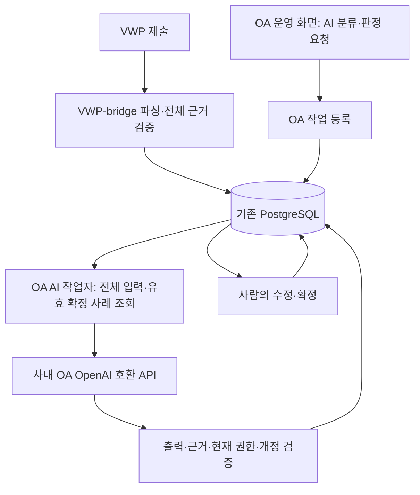

# OA AI 분류·판정 실행과 사내 연결

최우선 목표는 **AI가 report A를 분류·판정하고, 사람이 정정·확정한 근거를 다음 report B의 판단에 사용하는 것**이다. [AI 판단 설계](../AI_DECISION_DESIGN.md)의 첫 순환을 실행하는 공통 코드를 제공한다. 사내 API·실제 report에 대한 호출 성공과 판단 품질은 사내에서 별도로 검증한다.

기본 실행은 **한 번의 모델 입력에 전체 대상이 들어가는 report 또는 확정 그룹**이다. 선택형 [배치 실행](BATCHED_CLUSTERING.md)은 새 분류·확정 그룹 판정과 보존 본문을 예산별로 나누어 처리한다. 전체 partition/판정 범위·본문 coverage·근거와 반례/보류를 검증한 뒤 제안 하나를 공개한다. 기존 단일 호출 이력과 사람 확정은 유지한다. 실제 모델 품질은 별도로 검증한다.

## 1. 동작과 서버 역할



- 운영 화면은 기존 SSO 세션의 `/?page=workbench`, 업무 API는 `/api/workbench/*`다. 합성 `/workspace`를 운영에 마운트하지 않는다.
- 기존 OA 웹 프로그램은 권한 검사·작업 등록·조회·사람의 편집/확정을 담당한다. 모델 호출을 HTTP 요청 완료까지 기다리게 하지 않는다.
- `oa.ai_worker`는 같은 OA 배포 환경에서 별도 관리 프로세스로 실행한다. DB 입력을 읽고 자기 사내 AI API를 호출하며 검증된 제안을 저장한다. 별도 AI용 HTTP 서버나 장비는 필수가 아니다.
- VWP-bridge는 원본 수집·파싱·근거 전달을 맡는다. OA AI를 사용할 때 VWP 모델 호출을 거치지 않는다. 모델과 브라우저에 DB 계정이나 서버 모델 비밀을 전달하지 않는다.
- `oa.submission_receiver`의 운영 진입점은 SSO와 같은 계정 매핑 및 운영 프로젝트/블록 권한을 사용한다. 실제 입력·신원/승인·parser 어댑터와 현장 배포는 별도 준비가 필요하다.

## 2. 모델 설정

[설정 예제](.env.example)의 키를 저장소 루트의 비공개 `.env` 또는 관리되는 프로세스 환경에 설정한다. `oa/.env`는 설정 위치가 아니다. 웹 프로그램과 AI 작업자가 같은 설정·release를 사용해야 한다. 실제 설정과 기준 파일은 사내에 보관하고 공개 Git·로그에 기록하지 않는다. 주소·토큰은 브라우저에 보내지 않으며 모델명과 적용 기준은 권한 있는 검토 화면의 판단 이력에 표시한다.

| 키 | 의미와 기본값 |
|---|---|
| `SANITY_OA_AI_ENABLED` | 기본 `false`. 사용자가 승인한 사내 모델 연결에만 `true` |
| `SANITY_OA_AI_URL` | API 메서드까지 포함한 전체 HTTPS URL. base URL만 입력하지 않음 |
| `SANITY_OA_AI_FALLBACK_URL` | 선택형 보조 HTTPS 메서드 URL. 기본 빈 값. 같은 모델·API·인증을 제공하며 요청 전 연결 실패에만 1회 전환 |
| `SANITY_OA_AI_TOKEN` | 해당 OA API의 Bearer 토큰 |
| `SANITY_OA_AI_TOKEN_SOURCE` | 기본 `server`. `user`는 SSO 사용자별 등록 토큰을 사용하며 서버 공용 토큰을 무시 |
| `SANITY_OA_AI_TOKEN_STORE_SECRET` | `user` 모드의 서버 전용 Fernet 암호화 키. 웹과 worker에 동일한 비공개 값 주입 |
| `SANITY_OA_AI_TOKEN_ISSUE_URL` | 선택형 개인 JWT 발급 페이지의 절대 HTTPS 주소. OA 웹 서버의 실행 환경에서 읽어 개인 토큰 입력창에 링크로 표시 |
| `SANITY_OA_AI_MODEL` | 사내에서 확인한 기본 모델 ID |
| `SANITY_OA_AI_MODELS` | 선택형 모델 ID의 JSON 배열. 1~100개, 중복·공백 없는 ID이며 기본 모델을 포함. 빈 값은 기존 모델 하나만 허용 |
| `SANITY_OA_AI_API` | `chat_completions`(기본) 또는 `responses`; 실제 지원 API를 선택 |
| `SANITY_OA_AI_JSON_MODE` | 기본 `false`. JSON object 출력 옵션을 실제 지원할 때만 `true` |
| `SANITY_OA_AI_TIMEOUT` | 기본 120초, 1~600초 |
| `SANITY_OA_AI_MAX_INPUT_BYTES` | 전체 직렬화 HTTP 요청의 한도. 기본 1,048,576바이트 |
| `SANITY_OA_AI_MAX_OUTPUT_BYTES` | 전체 HTTP 응답의 한도. 기본 2,097,152바이트 |
| `SANITY_OA_AI_CA_PATH` | 필요 시 사내 CA 파일의 절대 경로. 빈 값은 기본 TLS 신뢰 저장소 |
| `SANITY_OA_AI_CRITERIA_FILE` | 운영 담당자가 승인한 점검 기준 JSON 파일의 절대 경로. 빈 값은 기준 목록 없음 |

입출력 바이트 설정은 각각 최대 64MiB의 자원 보호 한도이며 **모델의 토큰/context 한도와 같지 않다.** 실제 모델 한도에 맞게 설정한다. 요청에는 prompt·전체 현재 로그·선정 사례·점검 기준·JSON 포장 크기가 포함된다. 값만 높이는 것으로 대용량 AI 지원이 완료되지 않는다.

공통 연결은 HTTPS·Bearer·단일 완료 JSON 응답을 사용한다. 응답 압축은 바이트 한도 검사 전에 대량 해제되는 것을 막기 위해 거부하며 `Accept-Encoding: identity`를 요청한다. 아래 고정 게이트웨이 계약 이외의 임의 인증 header, HTTP, stream, tool call이나 미지원 API 형식이 필요하면 설정으로 추정하지 말고 비식별 계약을 Codex에게 전달한다. TLS·오류/참조 검사를 해제하지 않는다.

### 2.1. 사내 게이트웨이의 추가 인증과 클라이언트 식별

2026-10-26 비식별 현장 계약에 맞춰 **기존 Bearer + 고정 `x-client-api-key` 헤더**와 본문의 **`extraData={clientName,clientVersion,sessionId}`**를 선택적으로 지원한다. 기존 `messages`, `model`, `stream=false`, 선택형 `response_format`은 유지한다. 이 게이트웨이 경로는 확인된 `chat_completions`에서만 지원하며 `responses`와 함께 설정하면 `AI_CONFIG`다. 임의 헤더 이름이나 임의 JSON 본문을 받는 설정은 없다.

| 추가 키 | 의미와 기본값 |
|---|---|
| `SANITY_OA_AI_CLIENT_API_KEY` | 고정 `x-client-api-key`의 값. 기본 빈 값. 공백/제어문자 없는 ASCII 1~8192자 |
| `SANITY_OA_AI_CLIENT_NAME` | `extraData.clientName`. 기본 빈 값. 출력 가능한 1~200자, 앞뒤 공백 불가 |
| `SANITY_OA_AI_CLIENT_VERSION` | `extraData.clientVersion`. 기본 빈 값. 출력 가능한 1~200자, 앞뒤 공백 불가 |
| `SANITY_OA_AI_SESSION_MODE` | 기본 `disabled`. 게이트웨이 사용 시 `per_request` 또는 `fixed`를 명시적으로 선택 |
| `SANITY_OA_AI_SESSION_ID` | `fixed`일 때만 필수인 정확한 `extraData.sessionId`. 출력 가능한 1~200자, 앞뒤 공백 불가 |

게이트웨이를 사용하지 않으면 추가 값은 모두 비우고 mode는 `disabled`로 둔다. 기존 요청과 설정 지문은 그대로다. 모델이 활성화된 상태에서 추가 값 중 일부만 설정하거나 세션 방식을 선택하지 않으면 호출 전에 `AI_CONFIG`로 실패한다. 누락된 키를 생략한 Bearer 전용 요청으로 자동 전환하지 않는다. `clientName`, `clientVersion`과 세션 정책/고정 ID의 변경은 대기 작업의 기존 설정 지문 검사에 반영하고, Bearer/클라이언트 키 교체는 자격증명 회전으로 처리한다.

- `per_request`: 실제 모델 호출마다 새 UUID v4를 `sessionId`로 생성한다. 고정 ID를 함께 설정하면 오류다. UUID는 게이트웨이의 중복 호출 방지 계약을 대신하지 않으며, 기존 결과 불명 자동 재호출 금지는 유지한다.
- `fixed`: 현장에서 고정값 재사용이 허용됨을 확인한 경우에만 private `SESSION_ID`를 설정한다. 자동으로 사용자·report별 세션으로 해석하거나 분리하지 않는다.
- **2026-10-26 현장 회신:** 같은 `sessionId`를 재사용해도 이전 대화가 포함되지 않는 stateless 동작과 요청별 UUID 허용을 확인했다. 이번 게이트웨이는 `per_request`를 선택한다. sessionId의 정확한 과금/통계 용도는 현장 회신에서도 추정이므로 확정 계약으로 표시하지 않는다.
- JWT는 발급 후 1년 유효한 정적 토큰이며 refresh flow 없이 수동 재발급한다는 현장 회신을 반영한다. 기존 `server` 모드는 `SANITY_OA_AI_TOKEN`을 사용하고, 사용자별 입력 요구는 아래 `user` 모드로 연결한다. 브라우저의 SSO JWT를 모델 인증에 자동 전용하지 않는다. 401은 인증 실패로 끝내며 자동 갱신·재호출하지 않는다. 클라이언트 키도 401의 원인일 수 있으므로 개인 JWT만 잘못됐다고 단정하지 않는다.
- 실제 키·클라이언트 값·고정 세션 ID는 private 설정에만 두며 공개 설정 예제에는 값을 쓰지 않는다. 설정 객체의 repr·공개 모델 메타데이터에 추가 값을 내보내지 않는다. 클라이언트 키는 기존 자격증명 보호에 포함해 입력/응답의 키 반사를 차단한다. `extraData`는 prompt의 메시지에 섞지 않고 별도 본문 필드로 전달하며 전체 입력 바이트 한도에 포함한다.
- 회사 root CA가 기본 trust store에 설치돼 있으면 기존 기본 TLS 검증을 사용하고, 별도 파일이 필요하면 `SANITY_OA_AI_CA_PATH`를 설정한다. 게이트웨이 확장 때문에 TLS 검증이나 기존 압축·strict JSON·근거/개정 검사를 완화하지 않는다.

웹과 AI worker에 같은 release와 private 게이트웨이 설정을 배치한다. 사내 AI는 위 지원 설정·현장 확인 결과만 준비하며 공통 클라이언트·설정 loader·기존 보호 코드를 직접 수정하지 않는다. 실제 API 연결과 판단 품질은 사내에서 별도 검증한다.

### 2.2. SSO 사용자별 개인 JWT 등록

이번 사내 배포에서 사용자별 호출을 사용할 때는 `SANITY_OA_AI_TOKEN_SOURCE=user`와 `SANITY_OA_AI_SESSION_MODE=per_request`를 설정한다. 운영 담당자가 `SANITY_OA_AI_TOKEN_STORE_SECRET`에 **URL-safe base64로 인코딩한 32바이트 Fernet 키**를 비공개로 발급·보관하고 웹/worker에 동일하게 주입한다. 기존 `cryptography` 의존성의 `Fernet.generate_key()`로 생성할 수 있다. 키는 DB·Git·로그·브라우저에 저장하지 않으며 재시작마다 재생성하지 않는다. 배포 시 기존 키를 보존해야 등록된 JWT를 복호화할 수 있다. [Fernet 키와 암호화 계약](https://cryptography.io/en/latest/fernet/).

1. 운영 SSO 사용자는 포털 또는 workbench 상단의 **개인 AI 토큰**에서 게이트웨이가 본인에게 발급한 JWT를 등록·교체·연결 해제한다. `Bearer ` 접두어를 포함하지 않는다.
   OA 웹 서버에 `SANITY_OA_AI_TOKEN_ISSUE_URL`을 설정하면 같은 입력창에 **JWT 토큰 발급받기** 링크가 표시된다. 새 탭으로 이동해 발급받은 뒤 원래 창에서 붙여넣는다. 주소는 실행 시 `/api/ai/credentials` 응답으로 제공하므로 주소 변경에 프런트엔드 재빌드가 필요 없다. Docker도 기존 `OA_ENV_FILE`에 이 키를 넣고 OA 웹 컨테이너를 재생성해 적용한다. 빈 값·잘못된 주소·HTTP·상대 주소·사용자명/비밀번호가 포함된 URL은 링크를 표시하지 않으며 기존 토큰 저장/교체/해제는 유지한다. 링크 주소는 로그인 사용자에게 공개되므로 비밀값·JWT가 포함된 URL을 넣지 않는다. 입력 중인 JWT나 SSO 정보를 주소에 붙이지 않으며 자동 발급·자동 입력을 수행하지 않는다.
2. `/api/ai/credentials`는 로그인한 활성 SSO 사용자 자신의 상태 조회/저장만 제공한다. `/remove`는 자신의 연결을 해제한다. 다른 사용자 ID·임의 헤더를 받지 않으며 변경 요청은 기존 Origin·클라이언트 표식 검사를 통과해야 한다. 토큰 값을 다시 조회하는 API는 없다.
3. JWT는 OA private 테이블의 기존 `WS_CONFIG`에서 `oa-ai-user-token-v1` namespace의 암호문으로 보관한다. 암호문 내부에 사용자와 개정을 결합하며 다른 사용자의 행으로 복사한 암호문은 거부한다. **추가 테이블·DDL은 필요 없다.** 기존 불변 저장 계약 때문에 교체 전 암호문은 이력에 남고 연결 해제는 tombstone을 추가한다. 연결 해제가 게이트웨이의 토큰 자체를 폐기하는 것은 아니다.
4. AI 작업자는 요청자의 서버 확정 `user_id`로 현재 토큰을 읽어 해당 호출에만 주입한다. 사용자 모드에서는 서버 공용 토큰이나 다른 사용자의 토큰으로 fallback하지 않는다. JWT는 AI 작업/판정 payload, 모델 prompt, 공개 메타데이터와 로그에 넣지 않는다. 클라이언트 키·clientName/version은 서버 공통 설정을 사용한다.
5. 등록 누락·알려진 만료·복호화 실패는 모델 호출 전에 차단한다. 호출 중 교체/해제된 토큰으로 받은 결과는 현재 개정 검사에서 적용하지 않으며, 저장된 결과의 복구 때도 재확인한다. 이미 진행한 외부 호출 자체를 되돌렸다고 표시하지 않는다.
6. 토큰의 `exp`를 해석할 수 있으면 개인 설정 화면에서 만료일·30일 이내 만료 경고를 표시한다. **서명 검증 전의 exp는 만료 참고 정보이며 인증 성공 근거가 아니다.** 실제 인증은 게이트웨이가 판단한다. 등록 성공도 게이트웨이 호출 성공을 뜻하지 않는다. 만료 시 본인이 새로 발급받아 교체한다.

사용자별 JWT 선택은 호출 계정의 분리다. 실제 rate limit이 사용자 JWT·클라이언트 키·모델 중 무엇을 기준으로 하는지는 별도 현장 확인 항목이며 처리량 증가를 보장하지 않는다. 사용자 토큰 저장소 키가 없으면 `AI_TOKEN_STORE_NOT_CONFIGURED`, 개인 JWT가 없으면 `AI_USER_TOKEN_REQUIRED`, 만료되면 `AI_USER_TOKEN_EXPIRED`, 게이트웨이가 401을 반환하면 `AI_AUTH_FAILED`로 처리한다.

### 2.3. 사용자 모델 선택과 보조 URL — 2026-10-29

운영 담당자가 허용할 모델을 `SANITY_OA_AI_MODELS='["synthetic-model-a","synthetic-model-b"]'`처럼
등록하고 `SANITY_OA_AI_MODEL=synthetic-model-a`로 기본값을 정한다. 실제 값은 비공개 환경에만 둔다.
분류 화면의 **분류 AI 모델**, 그룹 판정 화면의 **판정 AI 모델**에서 사용자가 실행할 모델을 각각
고른다. 작업 등록 API의 선택형 `model_id`는 서버 목록 안의 ID만 허용한다. 생략하면 기본 모델이다.
목록은 로그인·대상 조회 권한 검사 후 제공하며 브라우저가 URL·키·기준·임의 모델을 추가하지 않는다.
외부 `/models` 자동 조회나 사용자별 영속 기본값 설정은 제공하지 않는다.

선택한 모델은 부모 작업에 고정하며 단일 호출·보존 본문 분석·분할 분류/그룹 판정·통합·재개와
결과 복구까지 유지한다. 동일 요청 ID에 다른 명시적 모델을 넣으면 `REQUEST_CONFLICT`다.
허용 목록·보조 URL·호출 설정이 바뀌거나 선택 모델이 제거되면 기존 작업은 STALE로 중단한다.
같은 허용 목록에서 서버 기본 모델만 바뀌어도 등록된 작업의 모델은 바뀌지 않는다. 이력의
`requested_model`과 응답의 실제 `model`을 보존하며, 배치 중 실제 모델 버전이 달라지면 거부한다.

보조 URL은 같은 API 형식·전체 모델 목록·Bearer/게이트웨이 인증·TLS 신뢰·처리 한도를 제공하는
승인된 주소여야 한다. 별도 보조 토큰이나 모델 자동 변경은 없다. 개인 토큰 모드는 동일 요청자의
토큰을 그대로 사용한다. 모든 선택 모델에 공통 설정을 적용하므로 가장 작은 실제 context/출력
한도에 맞추고, 로컬 tokenizer를 쓰면 모든 모델에서 같은 계수가 유효함을 확인한다. 서로 다른
API/인증/토크나이저 계약의 모델을 한 목록에 등록하지 않는다.

주 URL의 `ConnectError`/`ConnectTimeout`처럼 **POST를 전송하기 전 연결 수립 실패가 확인된 경우**에만
보조 URL을 한 번 시도한다. 실제 요청 byte·모델·인증·게이트웨이 sessionId는 동일하며 두 연결에
하나의 전체 timeout 예산을 적용한다. 주 URL의 연결 수립에는 남은 예산의 최대 절반만 사용해
보조 연결 시간을 남긴다. HTTP 401/403/429/5xx·redirect, 읽기/쓰기 timeout·전송 오류,
불완전/잘못된 응답·출력 초과에는 전환하지 않는다. 결과가 불명확하면 UNKNOWN으로 남기고 자동
재호출하지 않는다. 두 주소 모두 연결할 수 없으면 `FAILED / AI_CONNECT_FAILED`이며 해당 호출의
`model_called=false`다. 앞서 완료한 배치 자식의 호출 이력은 그대로 보존한다.

주소는 공개 메타데이터에 남기지 않는다. 성공한 호출은 `routing.endpoint=primary|fallback`과
`attempted_endpoints` 역할 목록을 기록한다. 배치 자식에도 같은 이력을 남기고 최종 결과의
`routing_summary`에 주/보조 호출 수와 연결 실패 수를 합산한다. 한 배치 step의 논리 모델 호출은
최대 하나이며, 전송 전 실패한 주 연결을 보조 연결로 대체한 경우에도 같은 입력 hash 예약을 사용한다.
보조 URL이 없는 기존 설정·작업의 config hash와 이력 읽기는 유지한다. 새 설정은 웹과 worker에
같은 release로 반영한다. 이 설정 추가에는 DDL/GRANT가 없다.

### 2.4. 관리 화면에서 여러 AI 연결 등록

SSO 서비스 관리자의 **프로젝트·권한 관리 → AI 연결·모델 관리**에서 연결을 추가·수정·사용 중지한다.
연결 이름, 전체 HTTPS API URL, 선택형 보조 URL, API 종류, 인증 방식, 모델 ID 목록·기본 모델,
개인 인증값 발급 URL과 처리 한도를 연결마다 등록한다. 최대 100개 연결·연결당 100개 모델이며,
사용 중지한 연결도 이력 보존 대상이다. 모델별 발급 경로가 다르면 같은 API URL이라도 연결을 나누어
등록할 수 있다. 주소와 공통 클라이언트 정보는 관리자에게만 반환하며 일반 사용자에게는 연결 이름·
모델·인증 방식·발급 링크와 본인의 등록 상태만 전달한다.

| 인증 방식 | 개인 입력값을 보내는 위치 | 관리자 공통 설정 |
|---|---|---|
| Bearer | `Authorization: Bearer <개인 토큰>` | x-client 키·extraData 불필요 |
| Bearer + x-client | 개인 토큰은 Authorization, 공통 키는 `x-client-api-key` | 공통 클라이언트 키·이름·버전·세션 정책. 기존 사내 Chat Completions 게이트웨이 계약 |
| x-client-api-key 단독 | `x-client-api-key: <개인 API 키>` | Authorization·extraData 불필요 |

관리 연결의 인증값은 사용자별로 입력한다. 화면 상단 **개인 AI 토큰**에서 등록된 각 연결의 발급
링크를 열어 개인 토큰/API 키를 등록·교체·해제한다. 사용자 간·연결 간 인증값은 공유하거나 대체하지
않는다. 등록된 비밀값은 재표시하지 않으며 공통 클라이언트 키도 등록 여부만 표시한다.

초기 운영 준비에는 웹·AI worker의 기존 SSO/DB 설정과 동일한 비공개
`SANITY_OA_AI_TOKEN_STORE_SECRET`이 필요하다. 이것은 모델의 x-client 키와 다른 서버 암호화 키다.
필요한 사내 CA는 기존 `SANITY_OA_AI_CA_PATH`로 운영 담당자가 설정한다. 브라우저에서 임의 인증
헤더·CA 파일 경로·TLS 검증 해제를 입력하는 기능은 없다. 이 초기 준비 후 연결·모델 추가는 DB에서
반영하며 프로세스 재시작이 필요하지 않다. `SANITY_OA_AI_ENABLED=false`여도 관리자 등록 연결을
사용할 수 있고 AI worker가 작업을 처리한다. 이 플래그와 기존 URL/모델/토큰 설정은 기존 환경 연결을
제어한다. 기존 연결을 켜 둔 경우 사용자 선택 목록의 **기존 서버 연결**로 함께 제공한다.

연결별 공통 키와 사용자별 개인 인증값은 기존 OA private의 `WS_CONFIG`에 암호화된 불변 개정으로
보존한다. 새 연결은 `oa-ai-connections-v1`, 연결별 개인 인증값은 `oa-ai-user-token-v2`이며 기존
`oa-ai-user-token-v1` 이력은 그대로 읽는다. 새 테이블·DDL·GRANT나 기존 토큰 자동 이전은 없다.
사용 중지는 기록·토큰 삭제가 아니며, 사용자는 중지된 연결의 개인 인증값도 해제할 수 있다.

개인 인증값은 사용자·연결 ID와 주소/보조 주소·API 종류·인증 방식·발급 링크·클라이언트 이름/키에
결합한다. 이 경계가 바뀌면 **새 연결에 맞는 개인 인증값 재등록**을 요구하며 기존 토큰을 새 주소나
다른 인증 헤더로 보내지 않는다. 모델 목록·표시 이름·처리 한도만 바뀌면 개인 토큰은 유지한다.
모든 연결 설정 개정은 진행 작업의 config hash를 바꾸며 이전 작업은 STALE로 중단한다.

분류·그룹 판정 화면에서 연결과 모델을 선택한다. 요청의 선택형 `connection_id`는 등록된 활성 연결의
UUID이며 생략은 기존 환경 연결이다. 서버는 현재 대상의 기존 권한과 해당 연결의 본인 인증값을
확인한 뒤 연결 ID·개정·모델을 작업/배치 전체에 고정한다. 다른 연결의 키 교체로는 이 작업을
중단하거나 다른 연결로 전환하지 않는다. 같은 작업 ID로 연결을 바꾸면 `REQUEST_CONFLICT`다.
실제 모델과 연결 ID·이름·개정·인증 모드 및 주/보조 사용 이력을 보존한다.

새 관리 연결은 기본 단일 호출이며, 필요하면 **처리 한도와 전체 로그 배치 설정**에서 배치를
명시적으로 켠다. 입력은 보수적인 UTF-8 byte 계수를 사용하며 모든 허용 모델에 안전한 공통
context·입출력·오버헤드·호출/라운드/기한을 확인한다. 기존 환경 연결의 offline tokenizer 설정은
유지한다. 현재 전체 로그·그룹·본문 coverage와 기준/사례·사람 확정 검사는 바뀌지 않는다.
보조 URL은 같은 연결의 동일 요청에만 2.3절의 전송 전 연결 실패 정책으로 사용한다.

관리 API는 `GET /api/admin/ai/connections`, `POST /api/admin/ai/connections/{connection_id}`이며
`expected_revision`, 고정 `config`와 선택형 비공개 `client_api_key`를 사용한다. 키 입력을 비우면 화면은
이 필드를 생략해 기존 공통 키를 유지한다. API의 생략/null은 유지, 빈 문자열은 게이트웨이에서 오류이며
새 게이트웨이에는 키를 입력해야 한다. 사용자 목록은 `GET /api/ai/connections`,
개인 인증값 상태/저장은 `/api/ai/connections/{connection_id}/credentials`, 해제는 그 아래 `/remove`다.
서버가 확정한 본인 ID만 사용하고 호출자는 다른 사용자나 임의 endpoint·헤더를 지정할 수 없다.

운영 반영은 사용자/승인 운영 담당자가 관리한다. 내부 개발 AI는 허용된 설정 자료와 검증 결과를
준비하며 관리 DB 이벤트 직접 작성이나 공통 코드·SQL·UI·기존 테스트 수정 권한을 새로 받지 않는다.
예상 밖 오류 시 기존 `WAITING_FOR_CODEX`·수정/재시도 중단 규칙을 유지한다.

## 3. 최초 판정을 위한 확인된 점검 기준

**점검 기준과 사람의 확정 사례는 서로 다른 입력이다.** 점검 기준은 해당 sanity item에서 무엇을 확인하고 어떤 조건으로 판단해야 하는지 운영 담당자가 승인한 규칙/설명이다. 확정 사례는 특정 report의 로그·AI 원안·사람의 최종 구성/판정·정정 이유를 DB에 보존한 기록이다. AI나 브라우저가 점검 기준을 자동 승인하지 않는다.

기준 파일의 정확한 상위 형식은 다음과 같다. 아래는 구조 설명용 합성 예제이며 사내 기준으로 사용하지 않는다.

```json
{
  "schema_version": 1,
  "criteria": [
    {
      "id": "synthetic-criterion-1",
      "version": "1",
      "text": "합성 점검 기준: 승인된 기대값과 관측값의 관계 및 예외 조건을 확인한다.",
      "scope": {
        "project_id": "synthetic-project",
        "block_id": "synthetic-block",
        "item_id": "synthetic-item",
        "family": "GCA",
        "parser": "synthetic-parser",
        "rule_version": "1",
        "layout": "POST"
      }
    }
  ]
}
```

- 각 기준은 `id`, `version`, `text`, `scope` 네 필드를 가진다. scope의 필수 키는 위 일곱 개이며 `eco`, `target_type`만 선택적으로 추가할 수 있다. 모든 값은 현재 대상 scope와 정확히 일치해야 한다.
- 실제 안정 ID·parser/rule 버전·layout을 승인된 원천과 대응한다. 이름이나 파일명에서 적용 범위를 추정하지 않는다.
- 파일은 UTF-8 strict JSON, 최대 4MiB·10,000개 항목이다. 한 대상에 적용되는 기준은 최대 100개이며 기준 설명은 각각 최대 20,000자다. 범위가 겹치는 중복 ID/개정이나 잘못된 항목은 거부한다.
- 경로를 설정하지 않으면 빈 목록이다. 설정한 파일이 읽히지 않거나 잘못됐으면 전체 처리를 실패시킨다. 빈 기준으로 조용히 대체하지 않는다.
- PASS/FAIL 제안은 **현재 그룹의 직접 근거**와 **제공된 기준 또는 확정 사례**를 모두 인용해야 한다. 과거 사례가 없어도 확인된 기준이 있으면 최초 판정을 제안할 수 있다. 둘 다 없거나 사실이 부족하면 DEFER로 부족한 조건을 설명한다.
- 선택한 기준 내용/개정은 작업 입력에 결합하고 반영 전에 재확인한다. 기준 변경은 운영 담당자가 승인한 비공개 파일로 관리하며 진행 중 결과를 새 기준에 맞는 결과로 재해석하지 않는다.

## 4. 확정 사례 검색과 피드백

분류와 판정은 각각 현재 유효한 사람 확정 기록을 검색한다. `reusable=false`도 참고 사례 후보가 된다. `reusable`은 기존 규칙의 자동 적용 승인 의미를 유지하며 모델 참고 허가와 구분한다.

판정 화면은 기본 판정·근거에 선택형 규칙 예외를 추가한다. `exception={rule,reason,conditions}`는 사람이 기록한 예외 대상 규칙·사유·성립 조건이며 일반 판정은 null이다. 필드가 없는 과거 기록은 그대로 보존한다. 예외 여부는 판정 불일치에서 추정하지 않으며 예외 사례도 다음 AI 참고 후보에 포함한다. 예외 문구는 검색과 모델의 공유 지식 입력에 포함하고, 모델은 이번에도 조건이 성립하는지 설명해야 한다. 예외 PASS의 일반화·자동 승인·점검 기준 catalog 변경은 허용하지 않는다.

2026-10-23 사용자 확정으로 **서비스 전체 블록·revision·ECO의 확정 지식**을 기본 후보로 검색한다. 현재 사용자의 원문 열람 범위에 없는 블록의 지식도 포함한다. 프로젝트·블록·item·family·parser·rule version·layout·버전·ECO 차이는 모델이 비교할 출처 정보이며, 동일 값이나 `compatible_versions=true`를 필수 후보 조건으로 삼지 않는다. 철회/정정 전 기록·미확정 초안·판단 대상 report 자신의 확정 답안은 계속 제외한다.

`reusable`·`compatible_versions`는 legacy 조건 적용 엔진의 승인 이력으로 남기며 OA AI 후보화의 스위치로 쓰지 않는다. 기존 false 값을 true로 다시 쓰거나 과거 실행 승인을 확대하지 않는다. AI 참고 허용 체크는 제거한다. 일반/예외 판정 모두 공유 후보이며 예외/보류 저장 시 legacy 규칙 적용 승인 해제는 이력으로 보존한다.

현재 검색 방식은 `lexical-shared-confirmed-knowledge-v3`의 단어·한글 n-gram 관련도다. 공유 지식 입력 계약의 prompt 버전은 분류 `oa-semantic-clustering-v3`, 판정 `oa-direct-evidence-review-v5`다. 확정 근거·그룹 이름·조건·예외와 공유 출처의 규칙 코드·scope 메타데이터를 검색 신호로 사용한다. 관련 사례를 한도 안에서 **공유 확정 지식 단위로** 선정하고, 관련된 반대 판정 사례도 가능한 범위에서 포함한다. 전체 지식을 매번 prompt에 넣지 않으며 선정/제외·검색 방식·실제 제공한 지식을 이력으로 남긴다. 이 검색 점수는 분류·판정을 대신하지 않고, 의미 검색 품질이 검증됐다는 근거도 아니다.

내부 유효성 검사는 원본/그룹/참조를 대조하지만 모델과 브라우저에는 공유 지식 DTO만 전달한다. 공유 내용은 사람이 확정한 그룹 이름·근거·개수, 판정·근거·예외·조건과 출처/개정이다. 과거의 원문·전체 로그·파싱 필드·record/evidence ID·중첩 command는 제외하고 공유 지식임을 표시한다. **현재 판단 대상의 전체 원문 근거는 기존 입력 계약대로 전달한다.** 과거 원문을 보지 못해 적용 조건이 불명확하면 모델이 부족한 내용을 설명해 보류한다. 직접 원문/로그/다운로드 API의 기존 RBAC와 승인된 점검 기준 catalog의 scope 검사는 유지한다. 자세한 저장/공유 경계는 [규칙 예외와 AI 참고 범위](WORKSPACE.md#규칙-예외와-ai-참고-범위)를 따른다.

모델은 제공된 사례만 인용할 수 있고, 분류에서는 과거 case/group ID와 적용/차이 이유를 설명한다. 사람의 그룹 이동·병합·분리·근거 수정, 판정 정정은 새 확정 이력으로 남긴다. 다음 report에서 그 현재 기록을 조회해 실제 모델 입력으로 공급하는 것이 첫 순환의 수용 기준이다.

## 5. 실행과 중단 상태

사용자/운영 담당자가 승인된 환경에서 기존 OA 웹 프로그램과 별도로 실행한다. 두 명령 중 실행 방식에 맞는 하나를 사용한다.

```bash
# 대기 작업 한 번 처리
.venv/bin/python -m oa.ai_worker --once

# 관리 프로세스로 주기 실행
.venv/bin/python -m oa.ai_worker --interval 2
```

`--once`는 최대 한 대기 작업을 처리하고 종료하며, 기본 실행은 1~300초의 `--interval`로 대기 작업을 확인한다. retry/resume 강제 옵션은 없다. 기존 `oa.main work`는 legacy 수신 경로이며 OA AI worker를 대신하지 않는다. V2 수신은 `oa.submission_receiver`를 별도로 사용한다. 프로세스 배포·재시작·비공개 설정은 현장 실행 환경에서 관리한다.

작업은 `sanity_oa_data`의 기존 `WS_CONFIG`, namespace `oa-ai-v1`에 불변 이벤트로 기록한다. 추가 AI 전용 테이블이나 브리지 간 HTTP 전송을 요구하지 않는다. 기존 적용 schema/권한 검사를 통과해야 하며 초기 설치 SQL을 반복하지 않는다.

| 상태 | 의미 |
|---|---|
| `PENDING` | 요청과 입력 개정을 등록하고 실행 대기 |
| `RUNNING` | 호출을 예약한 작업. 동일 작업을 다른 worker가 재호출하지 않음 |
| `RESULT_READY` | 결과를 기록했고 현재 권한·개정·사례 검증 후 반영 대기 |
| `COMPLETED` | 검증한 AI 제안을 저장. 사람의 확정과는 별개 |
| `FAILED` | 설정/입력/응답 검증 등으로 실패. 일부 결과를 제안으로 공개하지 않음 |
| `STALE` | 입력·분류/판정·사례·기준 등의 개정이 바뀌어 반영하지 않음 |
| `UNKNOWN` | 호출 결과가 불명확해 자동 재호출하지 않음 |
| `CANCELLED` | 취소된 작업. API가 실행 중이었다면 이미 발생한 외부 호출을 되돌렸다는 뜻은 아님 |

공개 작업 상태의 `model_attempted`·`model_called`와 최종 상태를 함께 확인한다. 호출 플래그가 있어도 검증된 응답이나 사람 확정이 완료됐다는 뜻은 아니다. 네트워크 호출 동안 DB 트랜잭션/잠금을 유지하지 않는다. `RESULT_READY` 복구는 저장된 결과를 검증·반영하는 작업이며 모델을 다시 호출하지 않는다. 기한이 지난 `RUNNING`이나 timeout의 결과 불명은 자동 재시도하지 않는다. 사용자가 새 요청을 내리는 경우에도 앞선 호출의 실행 여부를 확인한 뒤 판단하며 worker 상태를 수동으로 되돌리지 않는다.

입력 한도 초과는 호출 전에 `AI_INPUT_LIMIT`, 출력 한도 초과는 `AI_OUTPUT_LIMIT`로 거부한다. 미완료/거절 응답·잘못된 ID/근거·중복/누락 배정도 제안이 되지 않는다. 인간이 수정한 개정을 늦은 AI 결과로 덮어쓰지 않는다.

## 6. 사내 담당자의 작업과 검증 경계

OA 담당 개발 AI는 위 지원 환경변수, 승인된 비공개 기준 파일, API 호환/한도 확인 자료와 독립 평가 결과를 준비한다. OpenAI 호환 연결은 공통 코드로 제공하므로 새 회사 어댑터를 작성할 필요가 없다. `oa/sanity_ai_*.py`, `oa/ai_worker.py`, 공통 계약·검색·store/API/화면·기존 테스트는 읽기 전용이다. SSO/source 신원 연결의 기존 허용 메서드는 [작업 지시문](INTERNAL_AI_TASK.md)을 따른다.

검증은 다음 단위를 구분해 기록한다.

1. 합성 계약 검증: API 형식/한도·근거/참조·전체 배정·권한/개정·중복 호출 방지.
2. 합성 DB 순환: report A의 AI 제안 → 사람 정정/확정 → report B의 실제 요청에 현재 사례가 포함되는지 확인.
3. 사내 API 연결: 실제 모델·TLS·형식·한도·실패 동작 확인. 합성 검증이 이 단계를 대신하지 않음.
4. 사내 판단 품질: 독립 정답/반례에서 사례 미제공/제공을 비교하고 잘못된 병합/분리, 판정·근거 일치, FAIL 누락, 보류, 사람 수정량을 측정. 아직 COMMON-06의 사내 실측 대상.

2026-10-22 공통 구현 검증은 격리 PostgreSQL 12.1에서 변경 전용 92개와 `quick` 172개가 각각 통과했으며 skip은 없다. 변경 전용 시험에는 실제 `OAAdvisor`의 HTTP 경계를 합성 `MockTransport`로 교체한 A→사람 정정→B 순환과 운영 SSO API 경유 검토가 포함된다. 신규 운영 브라우저 시나리오 6개, 기존 데모·내비게이션·권한 시나리오 17개 및 frontend 빌드도 통과했다. 이 수치는 사내 모델 호출이나 의미 판단 정확도의 실측값이 아니다.

2026-10-29 모델 선택·보조 URL은 Termux의 격리 PostgreSQL 18.6과 합성 HTTP로 전용 174개를 실행해
174개 통과·실패/오류/skip 0건을 확인했다. `quick`은 411개 실행, 404개 통과·5개 실패·2개 오류·skip 0건이다.
실패/오류 이름은 이전 검증과 같으며 PostgreSQL 18 포털 카탈로그 비교 5건과 Termux의 실제 하드링크/
root 소유 설정 준비 2건이다. 두 보안 항목은 사내 독립 Linux 실환경 검증 대기이며 PG18 호환 문제와
구분한다. 프런트엔드 타입 검사·production 빌드는 통과했지만 이번 브라우저 E2E는 실행 환경이 없어
실행하지 않았다. 실제 사내 API·모델 품질·배포 완료로 해석하지 않는다.

2026-10-29 관리자 등록 연결 후속 검증은 전용 197개 실행·197개 통과·실패/오류/skip 0건이다.
`quick`은 434개 실행·427개 통과·기존 5개 실패·2개 오류·skip 0건이며 실패/오류 이름은 이전과 같다.
연결별 토큰·암호화 경계, 인증 헤더 구분, 주소/공통 키 변경 시 재등록, 연결별 작업·배치 재개를
합성 PostgreSQL/HTTP로 검증했다. 타입 검사와 production 빌드는 통과했다. 브라우저 E2E·실제 사내 API·
모델 품질·배포는 미검증이며 사내 Linux 보안 2건과 PG18 호환 문제도 별도 미해결 상태로 유지한다.

일상 `quick`에는 최초 직접 근거 판정·A→B 순환의 대표 시험과 모델 선택·연결 전환의 합성 회귀를 포함한다. 전체 100,000건 회귀를 매번 실행하지 않는다. HTTP/기준 파일/순수 계약만 확인할 때는 다음 전용 명령을 사용할 수 있다.

```bash
.venv/bin/python -m unittest tests.test_ai_connections.ConnectionConfigurationTests tests.test_ai_connections.ConnectionApiTests tests.test_ai_routing.RoutingConfigurationTests tests.test_ai_routing.RoutingTransportTests tests.test_ai_gateway tests.test_ai_model tests.test_ai_criteria tests.test_ai_workbench_api tests.test_ai_credentials.CredentialConfigurationTests tests.test_ai_credentials.CredentialApiTests -v
```

일상 검증은 변경 전용 시험과 `quick`을 사용하고 실제 실행 수·skip을 보고한다. 선택형 분류·확정 그룹 판정·보존 본문 분할의 범위와 한도는 [배치 계약](BATCHED_CLUSTERING.md)으로 구분한다. 분류·대용량 계약 변경은 full과 10만 건 검증도 수행한다. 오류·보호 파일 변경 필요는 [비식별 문의 절차](../INTERNAL_AI_GUIDE.md#6-디버깅이-필요하면-codex에게-문의)로 전달한다. 실제 URL·토큰·report·기준 원문·사람 계정은 외부 자료에 포함하지 않는다.
