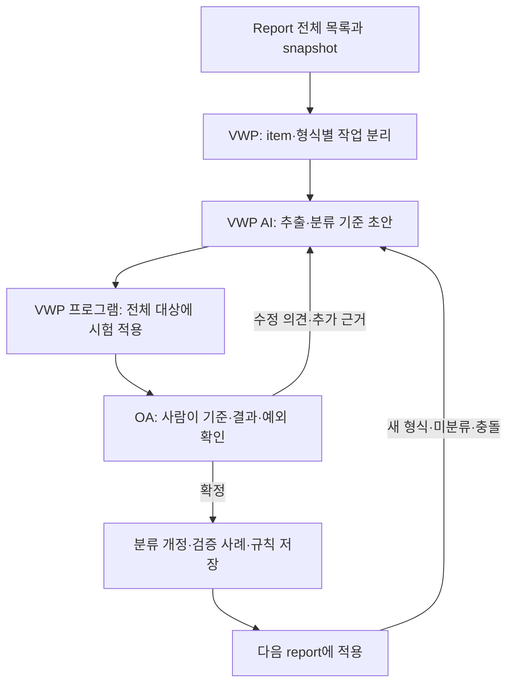
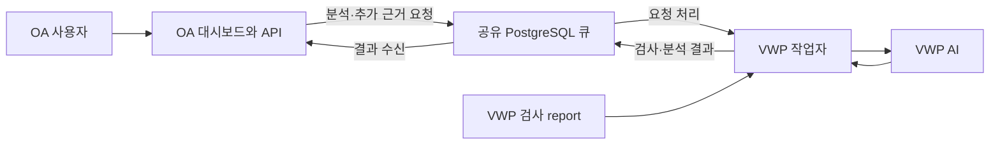

# Sanity Reviewer — 요구사항 및 구현 설계

## 1. 현재 기준과 범위

이 문서는 2026-10-14 기준 요구사항과 prototype의 경계를 정리한다. 사용자 결정에 따라 **Jira 조회·후보 연결·게시·시뮬레이터를 폐지**하고, oa-bridge/dashboard의 React·shadcn UI를 검토와 제어 화면으로 사용한다. 과거 Jira 맥락이 들어간 보고서의 렌더러 호환은 기존 기록 검증용이며 새 실행의 조회·게시 기능이 아니다.

2026-10-13 논의한 VWP AI 기반 clustering, 최초 report부터의 사람 검토 루프, 대량 처리와 evidence 추가는 [14절 확장 명세](#ai-clustering)에 정리한다. 1~13절의 현재 구현과 14절의 목표 동작을 구분한다. 추가로 확인한 AI 접속 방식·OA 원문 조회 범위·정보 제공 일정은 [14.13절](#integration-decisions)을 따른다. 요구사항 확정과 코드 구현·실환경 검증 완료를 구분한다.

2026-10-14 대시보드 논의의 최신 기준은 [15절 프로젝트·담당자·블록 버전·PoR 명세](#dashboard-domain-spec)를 따른다. **NET_VER·REVISION과 PoR은 블록별로 관리하며, PoR은 각 블록 담당자가 지정한다.** 이 절에는 합의한 업무 규칙, 운영 구현안, 현재 데모와 미확정 사항을 구분해 기록한다. 사용자·프로젝트·블록 권한과 PoR의 운영 DB/API는 아직 구현되지 않았으며, 기존 단일 사용자 API 설명을 다중 사용자 운영 기능으로 해석하지 않는다.

VWP와 OA는 망 분리 환경이다. 두 bridge는 같은 PostgreSQL DB의 4개 테이블로만 통신한다. SQLite, 브리지 사이 파일 전달, 직접 HTTP/RPC, 로컬 DB fallback은 사용하지 않는다. 대시보드 브라우저가 OA 로컬 API에 접속하는 것은 브리지 간 통신과 구분한다.

사용자가 **psycopg2로 PostgreSQL 직접 접속 가능**함을 확인했다. 기본 접근 모드는 `SANITY_DB_ACCESS=postgresql`이며 host·user_name·password는 비공개 `.env`/환경변수에서 설정한다. DB 이름·포트·스키마·TLS 정책도 같은 경로에서 설정한다. 기존 DBaaS HTTP 접근은 **임시 읽기 전용**으로만 유지하며 명시적으로 선택한 HTTP 모드에서 직접 접속으로 자동 전환하지 않는다. 실제 배포 DB의 DDL·권한·잠금·트랜잭션 검증 완료를 접속 방법 확인과 혼동하지 않는다.

사용자가 VWP AI를 API와 CLI로 호출할 수 있으며 API는 **OpenAI 호환 방식**, URL과 token은 **비공개 `.env`에서 설정**한다고 확인했다. 본 프로젝트의 sanity report 원문·객체 경로·측정값·관련 설정은 OA에서 전달받아 조회할 수 있는 범위로 정리했다. 실제 report 사례와 DB 접속값은 사용자가 현장에서 설정하고 제공할 예정이다. 실제 사내 report 계약, 전체 목록 자동 발견, 배포 DB 권한·접속 검증, AI의 세부 호환 규격·실제 파일 접근 기능·실제 연동, SSO의 세부 연동과 운영 RBAC·배포는 아직 구현·검증되지 않았다. 권한의 업무 기준은 15절을 따른다. 예시 데이터와 현장 지원 범위를 구분한다. 실행법은 [README.md](README.md), 현재 자료 계약은 [PROTOCOL.md](PROTOCOL.md), 검증 결과는 [REVIEW.md](REVIEW.md)를 따른다.

## 2. 환경별 책임과 흐름

아래 표와 실행 흐름은 현재 prototype 기준이다. VWP AI 작업자와 OA의 분류 제안 검토 화면은 14절의 확장 대상이다.

| 위치 | 책임 | 보관·표시 |
|---|---|---|
| vwp-dev | 예상 목록·완료된 실행 상태와 report snapshot 수집 | VWP 내부 원본 파일·크기·해시 |
| vwp-bridge | 목록 대조, item별 전체 파싱·판정, 동일 문제 집계, 근거 봉인 | sanity_vwp_data, VWP→OA 큐 |
| oa-bridge | 수신 검증, 검토 대장·개정별 보고서, 추가 근거 요청 | sanity_oa_data, OA→VWP 큐 |
| OA 대시보드 | 번들 선택, 단위·근거 확인, 사람 판정, 수신·요청 제어 | 인증된 API 응답과 명시적 demo |

VWP 내부 snapshot을 분석하여 공유 DB에 번들을 등록하고 OA가 수신한다. 대시보드에서 사람이 최종 판정한다. 추가 근거는 OA→VWP 요청과 VWP→OA 응답으로 전달한다. collector는 현재 sanity 도구를 실행하지 않으며 실제 실행기 연동은 추후 작업이다. 한 번의 수신 명령은 처리 가능한 한 건만 처리하며 상시 polling daemon이 아니다.

## 3. 내부 AI와의 개발 협업

코딩 도우미는 사내 원본 로그에 직접 접근하지 않으며 VWP·OA 내부 AI에 필요한 정보를 요청한다. VWP AI의 API·CLI 호출 가능 여부와 OpenAI 호환 API 사용, URL/token의 `.env` 설정은 사용자에게 확인했으나, 이 저장소에서 실제 호출을 검증한 것은 아니다. 세부 요청/응답 호환 규격·모델·AI가 실제로 report와 설정을 읽는 방법은 연동 시 확인해야 한다. OA 조회가 허용된 것과 AI의 파일 접근 기능이 준비된 것은 별개다. 운영 clustering에서는 VWP AI가 모든 AI 분석을 담당하며 OA AI는 필수 구성 요소가 아니다.

- VWP: 전체 sanity 정의의 원본, 활성화 조건, report 형식·판정 스크립트·예외, 같은 코드의 다른 문제와 같은 문제의 반복 사례, OpenAI 호환 API의 세부 계약·입력 한도·파일 접근 방법. CLI 상세는 필요 시 확인하며 API 우선 구현의 선행 조건으로 삼지 않는다.
- OA: 정식 DB 접근과 제한된 계정, 대시보드 인증·배포·검토 이력, 사람의 분석 요청·피드백 전달 조건.
- 양쪽: 다른 코드가 하나의 원인으로 연결된 사례와 실제 근거, 사람의 검토 기준과 현장 회귀 결과.

요청에는 ID·수신 대상·목적·확인 범위·원하는 짧은 응답 형식을 넣는다. 사실과 제안·추측·접근 불가를 구분하고 비밀이나 허용되지 않은 원문은 요구하지 않는다. 사용자 중계가 필요하면 출력은 한두 줄로 줄인다. 답변을 받기 전에는 현장 확인 완료로 표시하지 않는다.

## 4. 전체 sanity 목록과 입력 계약

검토 대상은 생성된 report 목록으로 역추정하지 않고 실행 설정의 예상 목록으로 정의한다. 검토 단위는 run_id + item_id + 대상 + 실행 조건이다. 같은 item의 모드·대상이 다르면 별도 review_unit_id를 부여한다. 목록의 출처·버전·해시·확정 여부를 보존한다.

- 실행 메타데이터: run_id, project, design, stage, tool, tool_version.
- 단위별 계약: report 경로, parser·규칙 버전, 실행 상태, 적용 여부, 조건, identity_fields, 판정 설정, 적용 제외 근거.
- 수집 결과: ready, 원본 파일 ID·크기·SHA-256, 예상 밖 파일 목록, inventory 해시.
- 누락 report는 목록에서 삭제하지 않는다. 예상 밖 report도 보존하고 범위 불명을 표시한다.
- 적용 제외에는 reason, approved_by, reference가 필요하다. 실행 실패나 누락을 사후 제외로 숨기지 않는다.
- 기준 목록 자체가 업무상 필요한 모든 검사를 포함하는지는 원본 설정과 담당자 확인으로 검증한다.

작성 완료된 report만 snapshot으로 수집한다. 원본을 변경하지 않으며 비어 있지 않은 출력은 거부한다. 경로 탈출·심볼릭 링크·수집 중 원본 변경을 검사하고 완성된 snapshot만 공개한다. 해시·크기·ready 불일치는 처리 오류이며 예상 목록에 있으나 없는 파일은 미완료 분석 결과다.

## 5. item별 parser registry와 판정

모든 report를 하나의 정규식으로 처리하지 않는다. item 또는 같은 report 계약을 공유하는 계열에 전용 어댑터를 두며 실행 메타데이터의 파서·버전을 우선한다. 파서는 값을 추출하고 판정 규칙은 의미를 해석한다. 기준의 출처는 기존 점검 설정·스크립트 또는 확인된 업무 규칙이다.

registry가 관리할 내용은 item·도구 버전 적용 범위, report 파일·필수 섹션·컬럼·종료 표시, 빈 report 의미, 파서 버전, 비교 방향·임계값·단위·예외, 동일성 규칙, 근거 요구사항과 기준 사례다. 현재 prototype은 plan의 명시적 설정·두 내장 파서와 `ReportParser` 추상 인터페이스/명시적 회사 registry를 제공한다. 회사 파서는 기본 미등록이며 실제 형식 구현·검증은 사내 AI가 수행한다. 자동 발견은 없다.

| 현재 파서 | 입력 계약 | 판정 |
|---|---|---|
| numeric_csv_v1 | 고정 컬럼과 마지막 # END rows=N | le/ge, 유한 수, 단위·모드 확인 |
| summary_json_v1 | format_version, complete, results, total | 개별 PASS/FAIL과 전체 건수 정합성 |

사내 구현은 [PARSER_INTEGRATION.md](vwp-bridge/PARSER_INTEGRATION.md)의 `parse` 이벤트와 회사 등록 함수를 사용한다. 공통 엔진은 item·도구/규칙 버전, 원문 span·EOF·미해석 구간·건수와 기존 판정을 검사하고 구현 버전을 분석 ID에 반영한다. 실제 report는 외부 Codex에게 전달하지 않는다. 명시적 위반 0건은 원문 근거를 가진 결과 기록으로 표현하며 0개 결과/빈 파일을 정상으로 간주하지 않는다. 새로운 판정 정책이나 공통 계약 변경은 Codex 담당이다.

숫자는 Decimal로 비교하며 소수 임계값은 JSON 실수가 아닌 정확한 문자열로 지정한다. 미지원 형식·빈 report·누락·잘린 종료·헤더 변경·건수 불일치를 조용히 PASS로 처리하지 않는다. 각 유효 행을 판정하거나 UNKNOWN으로 남기고, 미해석 내용·디코딩 실패 근거도 보존한다. 필수 정보가 없으면 임의 추정 대신 미완료로 남긴다.

개별 기록에는 실행·단위·item·record ID, 대상·조건·검사 지점, 실제값·기대값·단위, 코드·심각도·판정, 파일·줄 범위, 원문과 적용 규칙을 연결한다. 심각도는 PASS/FAIL과 별개다. PASS를 포함한 전체 기록을 VWP DB에 보존하고 전체를 판정한 뒤 표시용 집계를 만든다.

## 6. 같은 코드·같은 문제·같은 원인의 구분

현재 구현은 선언된 식별 키의 정확한 일치로 반복 기록을 집계한다. 별도 AI 분류 루프에서는 선언형 규칙 제안과 실행 간 지속 그룹 ID를 지원한다. 의미 유사도·임베딩 기반 후보 비교는 미구현이며, 14절에 확장 방법과 현재 구현 범위를 구분한다.

| 관계 | 판별 근거 | 처리 |
|---|---|---|
| 같은 유형 | item과 메시지/위반 종류 | 표시상 함께 볼 수 있음 |
| 같은 문제의 반복 | 해당 item의 유효한 식별 필드·조건 일치 | 동일 문제 그룹과 개별 근거 유지 |
| 같은 원인 | 여러 증상을 연결하는 원문·설정·수정 근거 | 사람의 추가 판단; 현재 자동 원인 병합 없음 |

같은 error/warning code나 비슷한 문장은 동일 문제의 충분조건이 아니다. 다른 코드도 하나의 원인을 가질 수 있다. 대상의 전체 경로, 객체 간 관계, 검사 지점, 모드, 설정 항목 등 실제 문제를 구분하는 필드를 item별로 정한다. 측정값·임계값도 item에 따라 식별 필드가 될 수 있다.

예를 들어 identity_fields=[object, check_point, mode]인 규칙에서 같은 코드의 A/M1/P1 측정값 12와 13은 같은 반복 후보이고 B/M1/P1, A/M2/P1은 별개다. 검사 시점까지 의미가 있다면 규칙에 포함해야 한다.

비교 가능한 규칙 범위에서 필드가 모두 일치하면 SAME_FINDING, 유효한 필드가 다르면 별개 그룹이다. 필요한 식별 정보가 누락·공백·잘못된 자료형이면 UNDECIDED로 독립 보존하고 null끼리 병합하지 않는다. 식별 정보만 부족해도 수치 판정 자체가 유효하면 그 결과는 유지한다. SAME_FINDING은 근본 원인 동일성 보증이 아니며 별개 그룹도 공통 원인이 있을 수 있다.

현재 키는 run_id, review_unit_id, item_id, code, severity, rule_version, 선언된 identity 필드 값이다. 정규 JSON의 SHA-256으로 그룹 ID를 만들고 실제 필드를 대조한다. 해시는 유사도나 확률이 아니다. 모든 기록의 쌍별 비교를 하지 않으며 실행·규칙 버전이 다르면 자동 병합하지 않는다. 숫자·경로·객체 이름을 일괄 제거하지 않는다. 시간·임시 경로도 item에서 의미가 없다고 확인된 경우에만 정규화한다. 최소·최대값은 의미와 단위가 같은 값끼리 비교한다.

요약과 상세 report의 중복은 확인된 대응 규칙으로만 제거하며 문제 수·발생 수·근거 수를 구분한다. 규칙 변경 시 새 번들로 재분석하고 이전 판정과 원문을 덮어쓰지 않는다. 현재 prototype에는 별도 원인 연결 테이블이나 자동 원인 확정 기능이 없다.

전송 그룹은 FAIL·UNKNOWN 기록을 담는다. 최초 예시 최대 3개·원문 2,048문자를 보여주고 생략량과 원본 위치를 표시한다. 전체 PASS·FAIL·UNKNOWN은 VWP에 남는다. 대표 예시만 읽고 전체 검토를 인정하지 않으며 단위별 전체 판정·집계를 대조한다. 근거가 부족하면 추가 요청하고 검토 완료를 보류한다.

## 7. DB 4개 테이블과 설치

아래 행 종류는 기존 기본 분석의 실행 계약이다. 최초 신청 form은 이미 신청한 원본으로 유지한다.
14절의 작업·분류 개정용 DB 종류·제약·인덱스는 별도 `db/004_clustering.sql`로 추가한다.
DB 확장과 AI 작업자·분류 화면의 구현 완료를 구분한다.

| 테이블 | 행 종류 |
|---|---|
| sanity_vwp_data | RUN, UNIT, FILE, GROUP, EVIDENCE |
| sanity_oa_data | RECEIVED_BUNDLE, REVIEW_UNIT, REVIEW_EVENT, REPORT |
| sanity_vwp_to_oa | PING, ANALYSIS_BUNDLE, EVIDENCE_RESPONSE |
| sanity_oa_to_vwp | PING, EVIDENCE_REQUEST |

테이블은 기존 `db/form/`으로 이미 신청한 상태다. **form 4개와 기존 `002`·`003`은 변경하지 않고 이후 변경은 증분 SQL로 작성한다.** 전체 준비 순서는 **신청한 form으로 생성 → db/002_indexes.sql → 역할 준비 → db/003_grants.sql → db/004_clustering.sql**이다. 완료한 단계는 반복하지 않으며 `002`·`003`까지 적용했다면 `004`만 실행한다. 테이블 재생성·기존 데이터 삭제는 하지 않는다. `004`는 owner/DBA가 점검 시간에 한 트랜잭션으로 실행하고, 원본 제약 불일치 시 변경 전체를 rollback한다. Jira 작업은 추가하지 않는다. 세부 절차는 [db/README.md](db/README.md)를 따른다.

두 앱은 별도의 제한된 로그인과 sanity_vwp_app/sanity_oa_app 역할을 사용한다. private 테이블은 상대 앱에 공개하지 않는다. 공유 큐는 송신 내용 INSERT와 수신 상태 UPDATE를 컬럼 권한으로 분리한다. owner·superuser·상대 역할 상속·과도한 유효 권한은 실행 시 거부한다. 앱은 DDL·DELETE·TRUNCATE를 수행하지 않는다. DBA 접근 가능성과 반출 정책 승인은 별개다.

DB는 타입·CHECK·고유 키·바이트 해시·parent/scope FK·lease 상태를 검사한다. 앱은 parent 종류·단위/파일/그룹 연결, inventory·전체 집계, 상태 전이·개정 연속성을 검사한다. 컬럼 생성만으로 준비 완료가 아니며 인덱스·권한 적용과 실제 앱 계정 검증까지 필요하다.

## 8. 분석·전달·복구의 원자성

원문 bytes와 JSONB를 구분한다. 개별 원문 해시는 raw_bytes, 전송 해시는 payload_gzip, 보고서 해시는 UTF-8 payload_bytes에 적용한다. JSONB 재직렬화로 원본 해시를 대신하지 않는다. 원문 전체는 현재 VWP private DB에 저장하므로 정책상 불허이면 배포 전에 다른 저장 어댑터가 필요하다. DDL의 local_evidence_ref가 있다는 사실만으로 파일 참조 저장을 지원한다고 보지 않는다.

동일 입력·규칙은 결정적인 분석 ID·번들 ID를 만든다. bundle_id는 자신을 제외한 payload의 정규 JSON SHA-256이며 gzip mtime은 0이다. 같은 ID 재등록은 전체 불변 내용을 대조한다. 최대 256행 또는 약 4MiB 배치로 저장하며 큰 개별 행은 이 목표보다 클 수 있다. checkpoint로 검증을 생략하지 않고 재시작 때 입력 전체를 재계산·대조한다. 봉인된 근거 변경·누락·추가는 EVIDENCE_CONFLICT로 중단한다. 봉인과 분석 메시지 등록은 한 트랜잭션이다.

큐는 짧은 FOR UPDATE SKIP LOCKED로 한 건을 점유하고 새 lease token·만료 시각을 기록한다. 처리 동안 긴 트랜잭션을 잡지 않는다. 완료는 동일 token·PROCESSING·미만료 조건일 때만 가능하며 0행 갱신이면 private 수신본까지 rollback한다. 수신본·전체 단위·개정 0·보고서와 공유 RECEIVED는 한 트랜잭션이다. 기본 lease는 300초다. 분류 작업자는 페이지 처리/AI 대기 중 heartbeat와 명시적으로 실행한 polling 루프를 사용한다. 기존 분석 번들/원문 수신은 별도 수동 처리한다. 무결성 오류는 거부하며 일시 장애는 lease 만료 후 명시적 재실행으로 복구한다. 같은 번들은 기존 검토를 유지하며 새 번들은 승인을 상속하지 않는다.

## 9. OA 대시보드와 로컬 API

UI는 React·shadcn 구성 요소를 사용하며 oa-bridge/dashboard_api.py의 FastAPI로 OA 저장 계층을 호출한다. npm ci와 npm run build로 생성한 dist를 API가 같은 origin으로 제공한다. Python 실행 주소는 127.0.0.1:8000이다. 개발 UI는 127.0.0.1:5173에서 /api를 8000으로 proxy한다. 브라우저가 DB나 VWP bridge에 직접 접근하지 않는다.

| 화면·동작 | 계약 |
|---|---|
| 로그인·세션 | 메모리 Bearer 토큰, 서버 고정 검토자와 읽기 전용 모드 확인 |
| 번들 목록·수동 수신 | 페이지 조회, 명시적 요청 때 다음 메시지 한 건 수신 |
| 단위·문제 그룹 | PASS·누락 포함 모든 단위·상태·근거, 각각 페이지 조회 |
| 사람 검토 | PASS/FAIL·사유·요청 UUID·기대 개정 제출 |
| 이력 | 최근 50개 개정과 전체 이력 수 표시; 전체 이력 삭제 아님 |
| 보고서 내려받기 | 현재 개정에 저장된 불변 보고서 확인·다운로드 |
| 추가 근거 | 요청, 상태 목록, 응답 명시적 수신과 제한된 원문 미리보기 |

페이지 크기와 예시 수가 coverage 분모를 줄여서는 안 된다. UI·통신 실패는 오류로 표시하고 예시 데이터로 자동 대체하지 않는다. demo는 사용자가 명시적으로 선택하는 브라우저 메모리의 예시 화면이며 새로고침 시 초기화한다. demo 조작은 실제 DB 저장·검토 완료·AI 실행 결과가 아니다.

## 10. 인증·비밀정보·접속 경계

본 프로젝트의 sanity 검토에 필요한 report 원문·객체 경로·측정값·관련 설정은 OA 전달·조회 허용 범위다. 일반 report 조회마다 별도의 VWP 수동 반출 승인을 요구하지 않으며, 현재 원문 응답 절차는 12절에 명시한다. 목록 요약과 상세 요청 조회는 대량 처리 성능을 위한 구분이지 원문 조회를 금지하기 위한 구분이 아니다. 이 합의는 임의 파일 접근·외부 서비스 전송·고객에게 자동 게시할 권한을 추가하지 않는다.

AI URL·token은 VWP 서버의 비공개 `.env`/환경변수에서 읽는다. API token·DB 비밀번호 등 접속 비밀정보는 report 조회 허용 범위에서 제외하고, OA 전송·화면·로그·공유 DB 작업 payload·Git에 포함하지 않는다. 설정 예시에는 변수 이름과 빈 값만 둔다. 원문에 접속 비밀정보가 섞인 경우에도 그대로 전송하지 않으며, 제외·마스킹했다는 사실과 조회 범위를 표시하고 원본 해시와 가공본 해시를 혼동하지 않는다.

현재 대시보드는 단일 사용자 로컬 prototype이다. private .env의 SANITY_DASHBOARD_TOKEN은 최소 32자, SANITY_DASHBOARD_REVIEWER는 서버가 고정하는 이름이다. 모든 데이터 조회·변경 API에 인증을 적용한다. health 확인과 정적 UI는 업무 데이터가 아니다. 브라우저 토큰은 메모리에만 두며 localStorage·URL·로그·VITE_*·번들에 넣지 않는다. 자유 입력으로 서버 검토자 이름을 바꾸지 않는다. DB 계정·DBaaS 토큰은 서버에만 둔다. 외부 bind는 금지하며 운영 인증으로 표현하지 않는다. 다중 사용자 SSO/RBAC·TLS proxy·운영 감사는 별도 구현·검증 대상이다. SSO 인증·내부 사용자 연결의 추상 인터페이스와 사내 구현 진입점은 15.14절에 추가했으며, 실제 사내 인증과 업무 범위 권한은 별도다.

PostgreSQL 설정은 `SANITY_DB_HOST`, `SANITY_DB_PORT`(기본 5432), `SANITY_DB_NAME`, `SANITY_DB_USER_NAME`, `SANITY_DB_PASSWORD`, `SANITY_DB_SCHEMA`(기본 public), `SANITY_DB_SSLMODE`(기본 verify-full), `SANITY_DB_SSLROOTCERT`(필요 시 절대 CA 파일 경로)를 사용한다. 호스트·DB 이름·계정·비밀번호가 없으면 실패하며 다른 로컬 DB를 사용하지 않는다. VWP/OA 각 실행 서버는 같은 키 이름으로 서로 다른 제한된 계정 값을 설정한다. 두 계정을 통합하거나 상대 private 테이블의 권한을 열지 않는다. 비어 있지 않은 해당 side의 `SANITY_VWP_DSN`/`SANITY_OA_DSN`은 기존 환경·테스트 호환용으로 연결 필드보다 우선하므로 필드 방식으로 바꿀 때 제거/비운다. 비밀번호는 psycopg2의 별도 인자로 전달하며 실패 시 다른 설정/TLS 수준으로 재시도하지 않는다. `.env`보다 환경변수가 우선하고 보간은 하지 않는다. 기존 `.env`의 HTTP 모드는 운영자가 직접 바꿔야 한다.

임시 DBaaS는 DBAAS_BASE_URL과 별칭 DBASS_BASE_URL이 다르면 중단한다. DBAAS_TOKEN과 절대 경로 DBAAS_CA_PATH를 사용하며 PEM/DER CA를 검증한다. 검증 끄기·redirect·환경 proxy는 사용하지 않는다. HTTPX timeout 30초는 각 I/O 대기 제한이며 요청 전체 시간 보장이 아니다. URL·토큰·CA 경로·서버 detail을 진단에 출력하지 않는다.

임시 클라이언트는 /api/v1/me, /api/v1/resources의 읽기 확인과 명시적 query 전송을 제공하지만 POST가 DB 쓰기 지원을 뜻하지 않는다. 요청/응답 한도는 각 8MiB이고 불확실한 POST 결과는 자동 재시도하지 않는다. 현재 HTTP 모드의 저장 계층은 DBAAS_SQL_CONTRACT_REQUIRED로 중단한다. 세션의 읽기 전용 표시는 저장 어댑터 준비 완료를 뜻하지 않는다. 정식 방식은 트랜잭션·rollback·잠금·역할 권한·자료형·크기 제한·DDL 적용 경로까지 확인해야 한다.

## 11. 사람 검토·이력·전체 완료 조건

검토는 bundle과 unit에 연결한다. API는 PASS/FAIL, 사유, request_id UUID, 화면에서 읽은 expected_revision을 받는다. 번들 잠금 아래 개정을 확인하며 다른 검토가 먼저 저장되면 충돌을 반환한다. 사용자가 최신 상태를 확인하고 다시 제출해야 한다. 같은 요청의 재시도는 같은 UUID·같은 내용을 사용하고 새 판단은 새 UUID를 사용한다. 다른 내용으로 UUID를 재사용하면 거부한다. A→B→A도 별도 REVIEW_EVENT다. 변경 이벤트·현재 개정·보고서 저장은 원자적이며 과거 이벤트·보고서는 수정하지 않는다.

blocker를 사람 판정으로 면제하거나 알려진 FAIL을 PASS로 바꾸지 않는다. FAIL을 설명한 사람의 FAIL 판정은 검토 완료가 될 수 있다. 수신·다운로드·근거 수신은 승인이 아니다.

**전체 예상 단위 = 검토 완료 + 근거가 확인된 적용 제외 + 미완료**이며 세 집합은 서로 겹치지 않는다. 한 단위의 여러 미완료 사유를 더해 단위 수로 사용하지 않는다. 전체 완료에는 다음이 필요하다.

1. 확정된 비어 있지 않은 목록과 예상·실제 단위의 일대일 대응.
2. 미확정 범위·예상 밖 report 등 global blocker 없음.
3. 적용 단위의 실행·파싱·평가 완료, 미지원·누락·UNKNOWN 없음.
4. 모든 적용 단위의 현재 번들에 대한 사람 판정.
5. 적용 제외의 확인된 사유·승인자·근거.

누락·미지원·미실행은 분모에 남는다. 동일성 UNDECIDED여도 독립 기록의 판정 근거가 충분하면 검토할 수 있지만 판정 근거 부족은 완료를 막는다. review=COMPLETE와 check=PASS를 분리한다. 전체 check는 FAIL 우선, 그 외 분석 미완료이면 UNKNOWN, 전부 승인된 적용 제외이면 NOT_APPLICABLE, 그 외 PASS다. 화면 일부만으로 전체 완료를 계산하지 않는다.

이 보증은 확정된 목록·규칙·파서에 대한 누락 검출이며 업무 기준이나 AI·사람 판단의 절대 정확성 보증이 아니다. 현장 기준 사례와 정상·경계값·예외·형식 변경 회귀로 판정 정확성을 별도로 평가한다. 표본 검증은 전체 발생 기록 판정을 대신하지 않는다.

## 12. 추가 근거 요청과 운영 AI

**현재 구현:** 일반 sanity report는 요청별 수동 반출 승인 없이 VWP 작업자가 범위와 무결성을 검증하여 응답한다. 명시적 거부도 지원한다.

OA는 단위와 서로 다른 record ID 1~100개, 사유, 요청 UUID를 공유 요청 테이블에 저장한다. TTL은 기본 3,600초, 최대 86,400초다. 임의 파일 경로·명령·SQL은 요청하지 않는다. VWP는 유효 기간·봉인 상태·단위/파일 연결·전체 원문 해시를 검증하며 일부만 성공으로 내보내지 않는다. 응답 등록과 요청 완료는 한 트랜잭션이다.

FULFILLED/REJECTED/EXPIRED는 최종 결과이며 거부·만료를 승인으로 덮어쓰지 않는다. OA도 요청 ID 집합과 원문 해시를 대조한다. 추가 근거는 원래 분석·사람 판정을 자동 변경하지 않는다. group/줄 범위 선택은 후속 범위다.

**반영한 동작:** `respond --request-id` 또는 VWP `work`가 일반 원문 요청을 처리한다. `--approve-export`는 호환용 선택 옵션이고 `--reject`는 명시적 거부다. 등록된 비밀값·명시적 자격증명 패턴은 원문 응답에서 마스킹하고 source_raw_sha256/raw_sha256/redacted를 보존한다. OA 미리보기는 4,000자이고 전체 상세는 기본 8,000자·최대 16,000자씩 조회한다. 인증·범위·무결성 검사와 사람의 sanity 검토는 그대로 유지한다. 비밀정보 검사는 범용 DLP가 아니며 분석 번들/분류 입력·출력에서 발견하면 identity를 변경하는 대신 전달을 중단한다.

VWP OpenAI 호환 API/선택 CLI 어댑터와 DB 작업자를 구현했다. 기본 AI 설정은 disabled이고 실제 사내 모델 검증은 대기 중이다. 합성 demo에는 실제 모델이 검토했다고 표시하지 않는다. **URL/token/model은 VWP의 비공개 `.env`에서 설정**하며 API 방식(chat_completions/responses)과 JSON 모드 지원을 명시적으로 선택한다. API 실패 시 CLI·합성 결과로 자동 우회하지 않는다. OA 자연어 요청도 DB를 통해 VWP AI에 전달한다. 없는 근거를 인용하거나 AI 결과만으로 최종 승인을 기록하지 않는다. 현재 구현 범위와 확장 명세의 차이는 14.14절, 직렬화 계약은 PROTOCOL을 따른다.

## 13. 검증과 남은 범위

- 범위: 미실행·누락·미지원·미확정 목록·예상 밖 report·제외 근거 누락이 전체 완료를 차단한다.
- 파싱·분류: 두 형식, 종료/건수 불일치, 숫자 경계·단위·모드, 같은 코드의 같은/다른 객체, 식별 정보 누락, 잘못된 원문 연결, PASS 포함 전체 근거 보존.
- DB: 역할/컬럼 권한, 동일 메시지 충돌, 봉인 손상, 중단 복구, 동시 점유, 만료 token rollback, 검토 UUID 재시도·개정 충돌·A→B→A·읽기 전용 조회·근거 승인/거부/만료.
- UI/API: 인증 실패·설정 누락·읽기 전용·페이지·수신 없음·검토 차단·개정 충돌·보고서 다운로드·근거 요청/응답·명시적 demo·오류 시 fallback 금지.
- schema: 신청 원본 4개·기존 설정 SQL 2개를 유지하고, 증분 변경 SQL의 기존 데이터 보존·제약 검증·rollback과 폐지된 Jira 스키마 부재를 검사.

DB 없는 순수 테스트와 실제 제한된 계정의 PostgreSQL 통합 결과를 구분한다. 테스트는 별도 sanity_test_* DB의 자신이 만든 임시 스키마만 정리하며 운영 DB를 초기화하지 않는다. run_tests.py --require-db는 DB 검증 조건이 없으면 실패한다. 테스트 수와 결과는 실제 실행 후 REVIEW.md에 기록하며 문서 설계만으로 통과를 주장하지 않는다.

10,000~100,000줄 입력에 반복/고유 그룹 분포, 입력 바이트, 최대 행 길이, 시간·메모리·DB 용량을 함께 측정한다. summary JSON 16MiB, 전송 압축 전후 각각 64MiB, 원문 한 건 64MiB 제한이 있다. 분류 결과는 분할 전송하지만 최초 분석 번들의 고유 그룹 전체 목록·초대형 행의 엄격한 메모리 상한, 보존/삭제 작업자는 미구현이다.

실데이터 성능 목표, 정식 DB 연결·운영 인증·사내 report 어댑터·기준 목록 자동 수집·운영 AI는 현장 정보와 별도 검증이 필요하다. 실제 사내 DB 연결은 사용자가 사내에 코드를 배포한 뒤 확인한다. 개발 측에서는 별도 로컬 PostgreSQL mock DB와 합성 데이터/모의 AI로 테스트한다. mock DB는 새 임시 인스턴스와 제한된 VWP/OA 계정을 사용하며 운영 `.env`·사내 endpoint·실제 AI를 사용하지 않는다. 계정 권한·SQL 제약·트랜잭션·큐 전달·분류/검토 상태 전이를 검증하되 실제 네트워크/TLS·모델 품질 검증과 구분한다. 과거 SQLite/16테이블 데이터 자동 이전은 제공하지 않는다.

<a id="ai-clustering"></a>

## 14. VWP AI와 사람이 함께 만드는 clustering — 확장 명세

### 14.1. 목적·역할·구현 상태

목표는 첫 report부터 사람이 분류 기준과 예외를 검토하고, VWP AI가 제안한 기준을 프로그램이 전체 기록에 적용하면서 개선하는 반복 절차다. 규칙이 백지·일부 존재·다수 존재하는 경우 모두 같은 처리 흐름을 사용한다. 수만 개 report 또는 그보다 많은 검사 기록을 사람이 하나씩 묶는 것을 기본 작업으로 삼지 않는다.

사용자는 VWP AI를 API·CLI로 호출할 수 있으며 OA AI보다 VWP AI를 우선 활용해야 한다고 설명했다. 최초 그룹 생성, 분류 규칙 제안, 사람의 자연어 해석, 예외·공통 원인 분석, 결과 설명은 모두 VWP AI가 담당한다. OA AI의 실행은 요구하지 않는다. OpenAI 호환 API를 기본으로 하고 URL/token은 비공개 `.env`에서 읽는다. CLI도 같은 논리적 요청·결과 계약으로 지원하되, 우선 API를 연결하고 실제 서비스의 세부 호환 규격은 별도로 검증한다.

| 담당 | 확장 후 책임 |
|---|---|
| VWP 프로그램 | 전체 목록·원문 보존, 파싱·판정, 규칙 시험 적용, 전체 구성원 검증, 작업 실행·복구 |
| VWP AI | 새로운 형식·미확정 기록 해석, 그룹·규칙 초안, 후보 비교, 피드백 해석과 재제안 |
| OA 대시보드와 사람 | 작업 시작, 분류 기준·결과·예외 확인, 그룹 편집, 적용 범위 선택과 확정 |
| 공유 DB | 분석 요청, 진행 상태, 제안, 사람 피드백, 결과·개정의 전달 |

VWP AI 호출은 VWP 내부에서 수행한다. OA 대시보드 → OA 로컬 API → 공유 DB → VWP 작업자 → VWP AI 순서로 요청하고, 결과는 공유 DB를 통해 OA가 수신한다. 브라우저나 OA bridge가 VWP AI/bridge를 직접 호출하지 않는다. sanity report 원문·객체 경로·측정값·관련 설정의 OA 조회는 허용된 것으로 두되, AI가 파일을 직접 읽는지 또는 호출 입력으로 전달받는지는 별도 확인한다.

| 구분 | 현재 구현 | 확장 대상 |
|---|---|---|
| 파싱·집계 | 명시적 plan, 두 내장 파서, 회사 추출 추상 계약/등록/검사, 정확한 식별 키, PASS 포함 전체 evidence 보존 | 사내 AI의 실제 item별 구현과 비공개 사례 검증 |
| AI | VWP OpenAI 호환 API/선택 CLI, 제안·피드백·전체 시험 작업자 | 실제 사내 API/모델 호환성·새 형식 추출 계약 검증 |
| OA 화면 | AI 분류 요청, 규칙 JSON 편집, 구성원/이전 소속/후보 조회, 적용·확정·저장 | 임의 구성원 이동·그룹 merge/split·고급 변경 요약 |
| 그룹 이력 | 실행별 봉인 finding_groups와 별도 지속 ID/소속 snapshot/분류 개정 | 의미 기반 그룹 연속성·독립 FAIL 태그 정책 |
| 대량 처리 | 분류 128건 단위 분할/체크포인트/페이지 조회, AI 표본 최대 64건 | 최초 번들 메모리 상한·대규모 report 성능·후보 retrieval 확장 |

### 14.2. 작업 단위와 자료 모델

| 단위 | 의미 |
|---|---|
| report 파일 | 수집·해시·완료 상태를 관리하는 원본 파일. 한 파일에 여러 문제가 있을 수 있음 |
| record / evidence | 원문 위치·추출 필드·개별 판정을 가진 검사 기록. 이 절의 발생 evidence는 record를 뜻함 |
| 분석 작업 묶음 | item·도구/형식 버전 등으로 나눈 처리 범위. 같은 묶음이라는 이유로 같은 문제는 아님 |
| 분류 규칙 | 적용 범위, 필수 필드, 같은/다른 문제의 기준, 예외와 검증 사례를 가진 버전 관리 대상 |
| 기본 문제 그룹 | 같은 문제의 반복으로 배정된 evidence 집합. 개별 발생과 판정은 유지 |
| 공통 원인 후보 | 여러 기본 그룹을 연결하는 가설과 근거. 기본 그룹의 구성원을 덮어쓰지 않음 |

파일 수, record 수, 그룹 수, AI 작업 수를 별도 집계한다. FAIL·UNKNOWN record를 기본 분류 대상으로 하고 PASS도 전체 판정·근거 대장에 보존한다. PASS/경계 사례는 파서·판정 규칙 검증에도 사용한다. 설정·스크립트 등 공통 판단 자료는 별도 근거 참조로 연결하며 발생 건수에 더하지 않는다.

분류 규칙에는 최소한 적용 item·project/design 범위·도구/형식 버전·실행 조건, 추출 계약 참조, identity 필드·허용된 정규화, 포함/제외 조건, 누락 처리, 버전, 근거 사례와 확정 이력을 둔다. 그룹에는 지속 group ID, 그룹 개정, 의미·포함/제외 기준, 적용 규칙 참조, 구성원과 제안/확정 이력을 둔다. 필드와 상태의 최종 직렬화 계약은 구현 시 PROTOCOL에 추가한다.

현재 finding_group_id에는 run_id와 review_unit_id가 포함된다. 실행 간 재사용할 지속 group ID는 별도 관리하고 기존 실행의 finding_group_id·bundle_id와 연결한다. 다른 실행·도구 버전의 기록은 재사용 규칙의 범위와 호환성을 확인한 뒤 배정한다. 문장·code만 같다는 이유로 실행 간 동일 문제나 동일 원인을 확정하지 않는다.

### 14.3. 규칙 수에 관계없는 단일 처리 흐름

| 해당 입력에서의 상황 | 처리 |
|---|---|
| 적용 가능한 검증된 규칙이 있고 결과가 일관됨 | 프로그램이 배정하고 사용 규칙·근거를 기록 |
| 규칙은 적용되지만 해당 identity의 그룹이 아직 없음 | 해당 기준으로 신규 그룹을 생성하고 발생 근거 연결 |
| 적용 가능한 규칙이 없음 | VWP AI가 형식별 규칙·그룹 초안을 제안하고 전체 시험 적용·사람 검토로 진행 |
| 여러 규칙이 서로 다른 결과를 내거나 사람의 확정 사례와 충돌 | 자동 확정을 보류하고 충돌·변경 영향을 검토 대상으로 제시 |
| 식별 정보가 부족하거나 형식을 해석할 수 없음 | 미분류·미해석 범위와 이유를 보존하고 추가 근거 요청 |

규칙이 백지이면 규칙 제안 경로에서 시작한다. 일부 존재하면 적용 가능한 부분을 처리하고 나머지는 같은 제안 경로로 보낸다. 규칙이 많아도 새 형식·조건은 같은 경로를 사용한다. 규칙 개수로 별도 운영 모드를 만들지 않으며 자동 처리 범위는 규칙의 적용 범위와 검증 품질로 결정한다.

필수 정보가 없는 record는 현재처럼 독립 보존할 수 있지만, 독립 보존 자체를 다른 문제라고 확정한 것으로 해석하지 않는다. 규칙·AI로 배정된 상태와 사람이 구성원·기준을 검토한 상태도 구분한다.

### 14.4. 최초 report부터 사람이 만드는 반복 절차



1. **범위와 추출 확인:** 예상 inventory와 report를 연결하고 모든 record에 원문 위치와 ID를 부여한다. 새 형식이면 AI가 추출 계약/어댑터 초안을 제안하고 샘플·종료/건수 조건·전체 입력 대조로 검증한다. 미해석 구간을 남기며, 잘못 추출한 객체·모드를 그룹 편집으로 보정한 것처럼 숨기지 않는다.
2. **최초 제안:** 기존 그룹이 없어도 AI에 개별 기록과 sanity 정의·허용된 설정을 제공한다. 그룹 이름, 구성원 ID, 공통점, 서로 다른 값, 포함/제외 기준, 미분류 이유와 분류 규칙 초안을 요구한다. 사람이 처음부터 identity_fields를 작성해야만 시작할 수 있는 구조로 만들지 않는다.
3. **전체 시험 적용:** 프로그램이 초안 규칙을 대상 전체에 적용한다. 적용/미적용 건수, 그룹 수, 조건별 분포, 예외, 근거와 검증 사례를 함께 보여준다. 표본에서 제안한 규칙이 전체에도 맞는지는 별도로 검증한다.
4. **사람의 편집:** OA에서 기준 수정, 선택 기록으로 새 그룹 만들기, 병합·분할·이동, 그룹 확정, 보류·근거 요청을 수행한다. 이번 기록의 일회성 결정과 이후에도 사용할 규칙 변경을 명시적으로 구분한다.
5. **재제안과 차이 확인:** VWP AI가 피드백과 새 근거를 반영하고 프로그램이 다시 시험 적용한다. 추가·제거·이동되는 기록, 바뀐 그룹, 기존 확정 사례와의 충돌을 보여준다. 확정 결과를 바꾸는 AI 응답은 변경 제안으로 남긴다.
6. **이번 결과 확정:** 사람의 결정과 전체 구성원 목록을 개정으로 저장한다. 보류 기록이 있으면 작업을 저장하고 이어갈 수 있지만 전체 그룹 확정으로 표시하지 않는다. 규칙으로 표현하기 어려운 판단도 record ID에 연결된 사람의 결정으로 남길 수 있다.
7. **재사용 기준 축적:** 재사용할 규칙은 적용 범위·버전·긍정/반례 사례·확정 이력을 저장한다. 다음 report에서 규칙을 적용하고, 새 형식·예외·충돌만 다시 같은 루프로 보낸다. 규칙 확정은 미래 record의 사람 검토를 미리 승인하는 것이 아니다.

예를 들어 r1·r2는 같은 대상/검사 지점/모드이고 측정값만 다르며, r3은 모드가 다르다고 하자. AI가 세 기록을 같은 그룹으로 제안했을 때 사람이 r3을 분리하면, r1·r2를 함께 두는 사례와 r1·r3을 분리하는 사례를 저장한다. AI는 모드를 식별 기준에 포함하는 규칙을 제안하고 프로그램은 같은 범위 전체에 재적용한다. 이후 규칙 수정이 이 사례들을 위반하면 충돌로 표시한다.

이 피드백은 DB의 확정 사례·규칙으로 저장해 다음 AI 호출에서 참조한다. 모델 가중치가 자동으로 재학습되었다고 표시하지 않는다. 한 report에서 확정된 규칙은 해당 범위에서 시작하며 다른 도구·형식·조건으로의 일반화는 별도 검증한다.

대량 입력에서 사람이 보는 주 화면은 다음과 같은 **분류 제안 검토**다. 숫자는 동작 설명용이며 처리량이나 축소 비율 보장이 아니다.

```text
대상: sanity_A / 지정된 도구·report 버전 / 이번 실행
대상 기록: 12,430건
규칙 적용: 12,400건 → 문제 그룹 86개
미분류: 30건
기준: 대상 객체·검사 지점·모드 일치, 측정값은 개별 발생 정보로 유지
확인할 사례: 모드 차이, 다른 객체, 경계값, 필드 누락, 기존 결정과의 충돌
동작: 적용 결과 보기 / 기준 수정 / 이번 결과 확정 / 재사용 규칙 저장 / 보류
```

### 14.5. 새 기록과 기존 그룹의 비교

새 report를 통째로 한 그룹에 넣지 않고 record별로 판단한다. 우선 검증된 규칙을 적용한다. 규칙으로 처리되지 않은 기록은 item·조건·객체 관계·형식 등으로 비교 후보를 조회하고, VWP AI가 새 기록의 문맥과 각 후보의 기준·여러 evidence·사람의 반례를 비교한다. 전체 record와 모든 그룹의 쌍별 비교를 기본으로 하지 않는다.

후보 검색 범위와 제외 이유를 기록한다. 같은 code만을 후보 검색의 유일한 경계로 삼지 않으며, 후보 누락·작업 분할 때문에 관련 문제를 놓치는지도 평가한다. 비교하지 않은 그룹까지 비교 완료로 표시하지 않는다.

AI 출력의 선택지는 기존 그룹 연결 제안, 신규 그룹 제안, 정보 부족에 따른 보류다. 가장 높은 점수의 그룹이라도 필수 조건이 맞지 않으면 배정하지 않는다. AI의 자기 평가 점수는 후보 순위 정보로 취급하며 실제 정답 확률로 표시하지 않는다. 자동 처리 기준은 사람이 확정한 사례와 반례에 대한 오병합·과분할·보류 결과로 검증한다.

AI 응답에는 대상 범위·record/group ID, 판단 종류, 일치/불일치 조건, 근거 참조, 부족한 정보, 제안 규칙과 실제 분석 범위를 포함한다. 프로그램은 ID 존재·범위·개정·스키마·구성원 정합성을 검증한다. 형식과 근거 위치 검증만으로 의미적 정확성을 확정하지 않는다. 임의 SQL·명령을 AI 응답으로 실행하는 방식 대신 검증 가능한 규칙과 편집 연산으로 표현한다.

기본 그룹 배정과 공통 원인 연결은 별도 결과다. 서로 다른 code·item의 증상이 한 원인과 관련될 가능성은 근거·차이점·추가 확인 사항을 갖춘 후보로 제시한다. A와 B, B와 C의 관련성만으로 A·B·C 전체를 자동 병합하지 않는다.

#### 14.5.1. FAIL 그룹 연관 후보의 필수 표시

**비교 대상 record가 FAIL로 태그된 기존 그룹에 포함될 가능성을 VWP 규칙 또는 AI가 발견하면, OA 대시보드에 반드시 `FAIL 그룹 연관 후보 · 검토 필요`로 표시한다.** 미확정이라는 이유로 표시를 생략하지 않는다. 이는 그룹 소속 검토를 위한 표시이며 개별 sanity 판정이나 waive 가능/must fix 결정을 대신하지 않는다. 이 기능은 현재 prototype의 그룹 조회에 추가할 확장 대상이다.

| 판단·처리 상태 | 대시보드 표시와 의미 |
|---|---|
| 검증된 분류 규칙 또는 사람 확인으로 FAIL 그룹 소속이 확인됨 | `FAIL 그룹 소속 확인`과 배정 방식·근거 표시 |
| FAIL 그룹에 포함될 가능성이 발견됐지만 소속은 미확정 | `FAIL 그룹 연관 후보 · 검토 필요`와 후보 그룹·일치 근거·차이 표시 |
| 비교에 필요한 필드·근거가 부족함 | `판단 보류 · 추가 근거 필요`와 부족한 정보 표시 |
| 지정된 비교 범위의 처리가 완료됐고 후보가 없음 | `비교 완료 · 후보 없음`과 실제 비교 범위 표시. sanity PASS를 의미하지 않음 |
| 비교 전·처리 중·실패·부분 완료 | 해당 진행 상태와 미처리 범위 표시. 후보 없음이나 비교 완료로 표시하지 않음 |

후보별로 대상 record ID, 후보 group ID와 개정, 그룹의 FAIL 태그 근거, 일치 조건, 불일치 조건, evidence 참조, 부족한 정보를 제공한다. 같은 code나 비슷한 문장만으로 소속을 확정하지 않으며, AI 점수는 실제 소속 확률로 표시하지 않는다. 여러 후보가 있으면 발견된 FAIL 그룹 후보를 최고 순위 하나로 축소해 숨기지 않고 전체 후보 수와 페이지 조회를 제공한다.

연관 후보와 비교 진행 상태는 함께 관리한다. 일부 범위에서 FAIL 후보를 발견한 뒤 나머지 비교가 실패하거나 보류되어도 발견된 후보 표시는 유지한다. 미비교 상태를 표시가 없는 정상 상태로 취급하지 않으며, `후보 없음`은 기록된 비교 범위에만 유효하다.

사람은 근거를 확인해 기존 그룹 소속을 확정하거나, 해당 후보와 별개 문제로 판단하거나, 추가 근거를 요청하고 보류할 수 있다. 별개 판단은 해당 후보와의 관계에 대한 결정이며 다른 후보까지 일괄 해소하지 않는다. 미해결 후보는 검토 필요 목록에 유지하고, 해소한 후보도 판단 사유·검토자·시각·대상 개정과 함께 이력으로 보존한다.

후보 발견만으로 원래 record의 PASS/FAIL/UNKNOWN이나 확정 그룹 소속을 변경하지 않는다. 비교 대상에 포함된 PASS 기록도 FAIL 그룹 후보가 발견되면 연관 표시를 추가하되 원래 판정을 유지한다. 소속 확인 이후에도 개별 판정과 waive 가능/must fix 판단은 각각의 규칙·검토 절차를 따른다.

### 14.6. 그룹별 여러 evidence와 신규 evidence 추가

그룹과 발생 evidence는 1:N 관계다. 1,000건이 배정되면 1,000건 모두 연결하고 발생 건수와 원문 위치를 보존한다. 한 분류 개정의 대상 record는 정확히 하나의 확정/규칙 배정 기본 그룹 또는 미분류 목록에 속한다. 여러 후보 그룹에 대한 AI 제안은 가능하지만, 제안 중복을 활성 구성원이나 발생 건수에 더하지 않는다. 공통 원인 후보·공통 설정 근거는 별도 참조 관계다.

신규 evidence는 다음 순서로 추가한다.

1. 실행·snapshot·파일·record 위치·추출 필드·판정·원문 해시와 함께 독립 저장한다. 같은 입력의 재처리는 중복 등록하지 않는다. 다른 실행의 재발생은 원문이 같아도 별도 발생 기록으로 보존한다.
2. 해당 범위의 규칙으로 그룹을 찾거나 AI가 추가 후보를 제안한다. 필수 조건 불일치·충돌은 신규 그룹/분할 검토로 보내고, 필드 부족은 보류한다.
3. 소속 연결에 evidence ID, source bundle, 지속 group ID와 개정, 규칙 버전, 배정 방식(규칙/AI 제안/사람), 판단 이유, 제안·확정 상태와 변경 요청 ID를 기록한다. 사람은 같은 기준의 여러 후보를 범위를 확인하고 함께 검토할 수 있다.
4. 배정이 적용되면 발생 건수·상태/조건 분포·요약과 대표 evidence를 갱신한다. 후보 대기 수와 배정된 수를 분리한다. 기존 구성원은 개정으로 남기고 제거·이동도 변경 이력으로 저장한다.

대시보드와 AI에는 일반적 사례뿐 아니라 조건 차이, 수치 경계, 드문 형태, 규칙과 충돌하는 evidence를 제공한다. 그룹의 전체 구성원은 페이지/조건 조회로 접근할 수 있어야 한다. 실제 AI에 제공한 ID·범위·잘림·생략을 기록하고 필요한 근거를 추가 요청한다. 대표 evidence를 읽은 것을 전체 원문 AI 검토와 동일하게 표시하지 않는다.

기존 prototype의 최초 3개 예시는 현재 표시 제한이다. 확장 시 대표 선택 방법을 보완하더라도 전체 연결·판정·원문 보존은 유지한다. 원본은 VWP에 보관하며, OA에서도 본 프로젝트 sanity report의 원문·객체 경로·측정값·관련 설정을 확인할 수 있게 한다. 목록에는 요약·대표 근거를 보내고 상세 조회 시 요청한 원문을 DB를 통해 전달한다. 일반 조회에 요청별 수동 반출 승인을 요구하지 않는다. 전체 원문을 매번 일괄 전송하는 것은 아니며 페이지·크기 한도와 비밀정보 제외는 유지한다. 추가 정책과 현재 구현 차이는 10절·12절·14.13절을 따른다.

그룹 개정 1이 100건이고 개정 2가 101건이면 과거 검토는 개정 1의 구성원과 기준을 참조한다. 추가된 evidence에 이전 사람 승인을 자동 확대하지 않는다. 새 자료·규칙으로 분석 내용이 바뀌면 새로운 분석/분류 개정으로 연결하고, 기존 봉인 bundle·사람 판정·보고서를 덮어쓰지 않는다.

### 14.7. OA 대시보드의 조작과 자연어 요청

기본 조작은 분석 시작, 제안·근거 조회, 선택 기록 이동, 병합·분할, 기준 수정, 확정, 보류, 재분석이다. 자연어는 복잡한 기준을 전달하는 추가 입력 수단이다. 예를 들어 선택한 제안에 “모드별로 나눠줘”, “측정값 차이는 식별 기준에서 빼줘”라고 입력하면 VWP AI가 해당 범위의 규칙/편집 초안으로 변환한다.

요청에는 화면에서 선택한 project/run/bundle, item·group·record 범위, 기준 개정, 이번 실행 한정/재사용 규칙 여부를 연결한다. 해석 결과와 전체 시험 적용의 영향을 미리 보여준 뒤 사람이 적용한다. 모호한 지시는 확인 대기로 두며 요청하지 않은 범위로 확대하지 않는다. 화면·입력 검증·사람 결정 저장에는 OA AI가 필요하지 않다.

검토 화면은 제안/그룹 목록, 전체 구성원 페이지, 필드 차이와 원문·근거, 분류 기준, 변경 전후 비교, 미해결 목록을 제공한다. 새 형식·필드 누락·상충 사례·영향이 큰 규칙 변경을 우선 보여주고 기존 규칙 적용 결과도 점검할 수 있게 한다. 실제로 서로 다른 문제가 많으면 많은 그룹을 유지하며 검토량 감소를 위해 강제로 병합하지 않는다.

로그 목록·상세에서 14.5.1의 FAIL 그룹 연관 상태와 비교 진행 상태를 확인할 수 있게 한다. 연관 후보에서 해당 그룹의 기준·FAIL 근거와 대상 로그의 차이를 열어볼 수 있어야 하며, 검토 필요 목록에는 미해결 FAIL 그룹 후보를 명시적으로 표시한다. 화면의 기본 표시에서 후보 존재를 생략하거나 그룹 소속 확정·개별 FAIL 판정과 같은 배지로 표현하지 않는다.

확정 버튼은 어떤 기준·개정·구성원 범위를 사람이 확인했는지 저장한다. 일부 예시 열람, 규칙 확정, 이번 그룹 구성원 확정, sanity 단위의 최종 PASS/FAIL 검토를 구별해서 표시한다.

### 14.8. 수만 개 report·대량 record 처리

보고서 파일 수와 내부 record 수를 구분하고 입력 바이트, 형식 수, 고유 그룹 수, 최대 record 크기도 함께 측정한다. AI의 입력은 토큰/바이트 한도에 맞게 나누고 원문 위치·범위를 유지한다. 처리 범위는 프로그램이 전체 대장으로 관리하며 AI에 전체 로그를 한 요청으로 전달하는 것을 전제로 하지 않는다.

- 검증된 파서·분류 규칙은 프로그램이 전체 대상에 적용한다. 같은 형식의 대량 기록에 대해 매 record마다 같은 AI 판단을 반복하지 않는다.
- 새로운 형식에는 변형·경계·누락·반례를 포함한 사례와 전체 분포를 제공해 기준을 제안받고 전체 시험 적용으로 확인한다. 규칙으로 다룰 수 없는 기록은 추가 AI 작업 또는 보류 대상으로 남긴다.
- 입력·저장·AI 호출·결과 전송을 분할하고 제한된 동시성으로 처리한다. 작업별 진행 상태와 완료된 범위를 영속화하여 실패한 작업을 재개한다. 처리 중인 브라우저가 닫혀도 VWP 작업자는 계속 실행한다.
- 분할 작업 사이의 중복·연관 그룹 비교를 별도 수행하고 미처리 범위를 표시한다. 국소 분류 완료를 전체 그룹 확정으로 간주하지 않는다.
- OA는 요약·진행률과 요청한 상세 페이지를 조회한다. 전체 원문·그룹 목록을 하나의 브라우저 응답이나 메모리 객체로 적재하는 구조에 의존하지 않는다.
- 새 규칙은 우선 해당 범위에서 검증하고 다음 report의 새로운 형식·충돌·예외를 같은 루프에 넣는다. 모든 기록이 서로 다르면 AI 호출·검토량도 커질 수 있으므로 일정한 압축 비율이나 사람 검토 건수를 보장하지 않는다.

AI 호출 수·입출력 토큰, 전체/작업별 시간, DB 크기, 메모리, 재처리량, 미해석/미분류 수와 오병합·과분할을 함께 측정한다. 대표 사례 검토와 전체 규칙 적용은 별도 실적이다. 현재 10만 건 합성 시험은 한 CSV 형식·100개 규칙 그룹의 분석/DB 저장 시험이며 AI·사람 루프나 수만 개 실파일의 성능 검증이 아니다.

### 14.9. 작업·개정·DB 전달 계약

이 절은 구현할 논리 계약이다. 4개 테이블과 이미 신청한 form은 유지하며 `db/004_clustering.sql`로 작업·개정의 종류·제약·인덱스를 추가한다. OA의 `entity_key`, `classification_revision` 두 컬럼을 추가하되 기존 행과 sanity 판정 개정은 보존한다. 기존 역할의 SELECT/INSERT와 제한된 UPDATE 범위를 유지하며, 세부 payload·상태 전이·구성원 정합성은 앱에서도 검증해야 한다. JSONB 컬럼이나 SQL 종류 추가만으로 기능이 완성되었다고 보지 않는다.

| 현재 테이블 | 확장할 자료/책임 |
|---|---|
| sanity_vwp_data | AI 작업·입력/결과 참조, 규칙 실행에 필요한 개정, 원문·배정 근거와 계산 결과 |
| sanity_oa_data | 사람이 확정한 그룹/규칙·피드백·소속 개정, 수신한 제안·결과와 검토 이력 |
| sanity_oa_to_vwp | 범위·개정이 있는 분석/재분석·상세 조회 요청과 사람의 피드백 |
| sanity_vwp_to_oa | 요청과 연결된 진행·제안·결과·근거 응답, 필요 시 분할 결과 |

사람의 확정·편집 이력은 OA가 관리하고 VWP는 지정된 개정의 입력을 받아 계산·제안한다. 양쪽에서 동일한 사람 결정의 최신 값을 독립적으로 수정하지 않는다. VWP가 만든 초안과 OA의 확정 결과를 구분한다. 분할 응답은 작업·개정·부분 순서·전체 범위·해시를 연결하고 빠진 부분이 있으면 완료로 처리하지 않는다.

분석 요청은 request ID, source bundle/input hash, 범위, 적용 규칙 버전, 기준 그룹·피드백 개정, 요청 종류, 선택한 record/group ID와 필요한 지시를 가진다. 결과에는 이 요청 참조, 모델·프롬프트 버전, 실제 분석 범위, 근거·제안·누락/실패 범위와 결과 해시를 보관한다. 사람이 자연어를 보낸 경우 그 입력과 해석한 구조화 요청도 함께 추적한다.

FAIL 그룹 연관 후보는 대상 record와 후보 group의 개정, 참조한 FAIL 태그 근거, 제안 출처(규칙/AI), 일치·불일치 조건, evidence 참조와 부족한 정보를 연결해 저장한다. 비교 범위·진행 상태와 후보별 제안/소속 확인/별개 판단/보류 이력을 보존하여 화면 재조회 시에도 필수 표시를 재구성할 수 있어야 한다. 후보 관계는 확정 구성원과 분리하고 발생 건수에 추가하지 않는다. 사람의 결정에는 검토자·사유·시각·요청 ID를 남기며, 참조 그룹·태그·규칙 개정이 바뀌면 기존 결과를 최신 확인으로 재사용하지 않고 재검토 필요로 표시한다.

동일 요청 ID의 동일 내용은 재시도해도 한 번만 반영하고 다른 내용으로의 재사용은 거부한다. 재실행/재사용 판별에는 입력 해시·규칙·모델/프롬프트·피드백 버전과 범위를 포함한다. AI 호출이 같은 응답을 다시 준다고 가정하지 않으며 완료된 응답을 보존한다. AI 출력은 결정적인 기본 분석 bundle에 나중에 덧써 넣지 않고 별도 작업 결과/분류 개정으로 연결한다.

응답이 도착하기 전에 사람이 그룹이나 규칙을 수정했으면 기준 개정을 대조해 오래된 결과로 표시하고 자동 적용하지 않는다. 그룹 구성원·규칙·피드백의 개정은 기존 sanity review_revision과 별도로 추적하고, 판정/보고서는 실제 참조한 버전에 연결한다.

AI 호출 동안 DB의 긴 트랜잭션을 유지하지 않는다. 작업 점유·기한·필요한 lease 갱신·재시도·부분 실패를 구현하고, AI/API 실패는 실패/재시도 대기로 표시한다. 기존 규칙 결과는 조회 가능하지만 AI 실패를 검토 완료로 바꾸지 않는다. API 결과가 불확실할 때 CLI로 자동 중복 실행하는 정책은 가정하지 않고 실제 호출 계약에 맞춰 정한다.

현재 분류 작업자는 직접 PostgreSQL 모드에서 별도 프로세스로 구현했으며 분류 처리 중 heartbeat와 체크포인트를 사용한다. 임시 HTTP 읽기 전용 접근에는 적용할 수 없고 정식 DB 쓰기·트랜잭션 접근 계약은 여전히 필요하다.

### 14.10. 누락 검출과 완료 조건

분류 대상 record ID 집합을 R, 활성 기본 그룹에 배정된 집합을 A, 명시적 미분류/보류 집합을 U라고 한다. 분류 개정별로 `R = A ∪ U`, `A ∩ U = ∅`를 검사하고 A의 각 record가 기본 그룹 하나에만 속하는지 검증한다. AI 후보들은 별도 집합이며 수신된 건수만 맞추는 것으로 구성원 검증을 대신하지 않는다. 파싱하지 못한 파일/구간은 이 분류 분모와 별도로 전체 입력 대장에 남겨 누락을 숨기지 않는다.

| 상태 | 완료 판단 |
|---|---|
| 입력·판정 처리 | 예상 목록 대조, 전체 파싱/평가 범위와 미처리·UNKNOWN을 표시 |
| 분류 처리 | 모든 대상 ID를 배정 또는 보류로 설명하고 중복·누락 없음 |
| 전체 그룹 확정 | 미해결 분류·충돌·필요한 재제안 검토가 없고 현재 구성원·기준 개정에 대한 사람 확인 |
| sanity 검토 완료 | 11절의 inventory·blocker·단위별 사람 판정 조건을 따름 |
| sanity 통과 여부 | 개별 수치/업무 판정에서 도출하며 그룹 병합·규칙 확정·AI 추천으로 PASS로 바꾸지 않음 |

분류 기록을 빠짐없이 처리했다는 것과 의미적으로 정확히 분류했다는 것을 구분한다. 정확성은 실제 형식과 사람이 확정한 긍정/반례로 평가한다. 동일성 정보만 부족한 경우와 판정 자체가 UNKNOWN인 경우도 구분하며 기존 11절의 검토 조건을 혼용하지 않는다.

모든 기록이 유효한 PASS이면 문제 그룹이 0개일 수 있다. report 누락·미지원·파싱 실패 때문에 그룹이 0개인 경우는 미완료 입력/판정으로 표시한다. 대표 evidence만 확인한 상태를 전체 원문을 AI나 사람이 읽었다고 표시하지 않는다.

### 14.11. 구현 시 확인할 수용 시나리오

| 시나리오 | 확인할 결과 |
|---|---|
| 규칙·기존 그룹이 모두 없음 | 개별 기록/작업 묶음에서 초안→전체 시험 적용→사람 수정→재제안→확정이 한 바퀴 동작 |
| 규칙 일부/다수 존재 | 동일 흐름에서 적용 가능한 기록만 규칙 처리하고 새 형식·예외는 최초와 같은 제안 경로 사용 |
| 같은 code의 다른 객체·모드 | 필수 식별 조건 차이를 무시해 최고 점수 후보에 합치지 않음 |
| AI 후보가 모두 부적합하거나 정보 부족 | 신규 그룹 또는 보류를 선택하고 기존 그룹 배정을 강제하지 않음 |
| FAIL 그룹 연관 후보 발견, 최고 순위가 아닌 FAIL 후보도 존재 | 로그 목록·상세·검토 필요 목록에 후보 존재를 표시하고 모든 발견 후보와 일치/차이 근거를 조회할 수 있음 |
| 비교 대상 PASS·UNKNOWN 기록에서 FAIL 그룹 후보 발견 | 연관 후보를 반드시 표시하되 원래 판정·확정 소속·발생 건수는 후보만으로 변경하지 않음 |
| 미비교·정보 부족·부분 실패와 비교 완료 후 후보 없음 | 상태·비교 범위를 구분하고 미처리를 후보 없음으로 표시하지 않음. 부분 처리에서 이미 발견한 후보도 유지 |
| 여러 FAIL 후보 중 하나를 별개로 판단하거나 소속 확정·보류 | 후보별 결정과 사유·검토자·시각을 저장하고 다른 미해결 후보 및 원래 판정을 유지 |
| 연관 후보 저장 후 화면 재조회 또는 참조 그룹·FAIL 태그 개정 변경 | 저장된 후보 표시·이력을 복원하고 변경된 개정에는 재검토 필요 표시 |
| 사람이 그룹을 분리한 뒤 규칙 재제안 | 이전 긍정/반례를 재검사하고 충돌·구성원 변경분을 표시 |
| 여러 evidence 중 예외가 대표 3개 밖에 있음 | 조건별/예외 사례 조회와 전체 시험 적용에서 발견하고 원본 연결 보존 |
| 같은 요청·입력 재처리와 다른 실행의 동일 문장 | 전자는 중복 저장/배정하지 않고 후자는 별도 발생으로 보존 |
| 확정 그룹에 새 evidence 추가·이동 | 새 구성원 개정과 배정 이유를 만들고 이전 검토 범위·보고서를 보존 |
| 사람 수정 중 늦은 AI 응답 도착 | 기준 개정 불일치로 최신 결과를 덮어쓰지 않음 |
| 누락/중복/외부 범위 ID·없는 근거를 포함한 AI 응답 | 반영을 거부하고 원래 대상과 미해결 상태를 유지 |
| 수만 개 파일·많은 고유 그룹·작업 중단·분할 응답 누락 | 자원/진행 상태와 재개 범위를 확인하고 일부 작업 성공을 전체 완료로 표시하지 않음 |
| 자연어의 범위 모호함·이번 실행 한정 수정 | 확인 대기 또는 지정 범위만 변경하며 자동으로 재사용 규칙을 수정하지 않음 |
| 모두 PASS와 파싱 실패로 그룹 0개인 두 경우 | 정상적인 그룹 없음과 미완료를 구분 |
| AI 점수와 실제 분류 정답이 다름 | 확률 보증으로 표시하지 않고 오병합·과분할·보류를 평가 자료로 남김 |
| 허용된 sanity report의 일반 원문 조회 | 별도 사람 반출 승인 없이 유효한 요청을 DB로 처리하고 원문·객체 경로·측정값·설정을 확인할 수 있음. sanity 사람 판정은 바꾸지 않음 |
| 원문 또는 작업 입력에 API token·DB 비밀번호가 포함됨 | 접속 비밀정보를 OA payload·화면·로그에 노출하지 않고 제외/마스킹 및 가공 범위를 표시 |
| AI URL/token 미설정 또는 실제 DB 접근 미준비 | 미설정/연동 대기를 명시하고 합성 성공을 실제 연동 성공으로 표시하지 않음 |

합성 테스트와 실제 VWP AI/현장 report 검증을 분리한다. 실제 호출 성공, 분류 품질, 운영 처리량은 수행한 검증 결과가 있을 때만 기록한다.

### 14.12. 구현 순서와 확인 대기 정보

1. 알려진 report 형식으로 작업·규칙·그룹·소속 개정 계약을 정의하고 4개 테이블/프로토콜을 함께 확장한다. 원문·기본 판정과 AI 제안의 불변 참조를 먼저 확보한다.
2. VWP AI 어댑터와 작업자, OA의 분류 제안 검토 화면을 연결해 최초 report에서 한 번의 수정·재제안·확정 루프를 구현한다. 실제 API가 준비되기 전 합성 응답을 사용하는 검증은 명시적으로 구분한다.
3. 새 evidence 배정, 재사용 규칙과 반례 검사, 다음 report의 예외 검토를 연결한다. 이후 입력·AI·전송 분할과 고유 그룹이 많은 부하를 검증한다.
4. 여러 기본 그룹의 공통 원인 후보 분석은 기본 분류 루프와 구분해 확장한다. 기준과 파서가 없는 실제 item은 확인된 report 계약부터 추가한다.

확인 대기 정보는 OpenAI 호환 API의 세부 엔드포인트·요청/응답 규격과 모델/버전·입력 한도·동시 호출/시간 제한·재시도 계약, AI의 실제 파일 접근 방법, sanity 정의·형식별 실제 사례와 반례, 파일/record/바이트 단위의 규모와 목표 시간, 그룹 FAIL 태그의 기준·담당자다. DB 접속 방법은 psycopg2로 확인했으며 실제 값·TLS 정책·트랜잭션/잠금·권한·크기 제한과 설치 상태는 현장에서 확인해야 한다. **실제 report 사례와 DB 접속값은 사용자가 설정하고 제공할 예정**이다. 그전에는 확보된 명세로 구현·합성 테스트를 진행하고 실환경 검증 완료를 주장하지 않는다. API·CLI 호출 가능 여부, OpenAI 호환 API와 `.env` 설정, AI 실행 위치(VWP), 본 프로젝트 report의 OA 조회 허용, psycopg2 접속 방식은 다시 미정으로 취급하지 않는다.

<a id="integration-decisions"></a>

### 14.13. 추가 합의 — AI 설정·자료 제공 일정·OA 원문 조회

2026-10-13 추가 대화에서 다음을 정리했다. 이는 구현 기준이며 실제 접속·운영 검증 결과가 아니다.

| 항목 | 확정한 내용 | 남은 확인·구현 |
|---|---|---|
| VWP AI 접속 | OpenAI 호환 API 우선 사용. URL/token은 VWP 서버의 비공개 `.env`에서 설정 | 세부 호환 규격·모델·호출 제한 확인과 어댑터 연결·실제 호출 검증 |
| 실제 report와 분류 사례 | DB 신청 승인 후 사용자가 설정·준비하여 제공 | 우선 item 1~2개의 report와 같은/다른 문제 사례로 회귀 기준 마련 |
| 정식 DB 접속 | psycopg2 직접 접속 확인, host·user_name·password 등은 비공개 env 설정 | DB 이름·포트·TLS 정책, 쓰기·트랜잭션·rollback·행 잠금·계정 권한·크기 제한과 실제 SQL 적용 상태 확인 |
| OA 조회 범위 | 본 프로젝트 sanity report 원문·객체 경로·측정값·관련 설정 전달·조회 허용 | 수동 승인 제거·범위/무결성 검사·마스킹·페이지 조회 구현. 현장 비밀정보 패턴 점검 필요 |
| 대량 원문 전달 | 목록 요약, 필요한 상세 원문 조회 | DB 요청/응답과 페이지·분할 전송으로 처리. 브리지 간 직접 통신은 계속 금지 |
| 접속 비밀정보 | API token·DB 비밀번호 등은 report 허용 범위에서 제외 | 비공개 서버 설정으로 관리하고 전송·화면·로그·Git 노출 방지 |
| 운영 조건 | 처리량·목표 시간·FAIL 태그 기준은 보안 질문과 별개 | 실제 규모와 업무 기준 제공 후 조정 |

사용자는 고객 보고 시 sanity report의 전체 screenshot을 활용하기도 한다고 설명했다. 이를 바탕으로 본 프로젝트 report의 OA 조회에 별도 제한을 두지 않는 방향을 정했다. 이 설명을 회사 전체 보안 정책의 검증 완료나 임의 외부 전송 허가로 확대하지 않는다.

OpenAI 호환이라는 확인만으로 특정 세부 API·구조화 출력 지원·파일 읽기 기능까지 검증된 것으로 보지 않는다. URL/token의 실제 값은 소스·명세서·공유 작업 데이터에 적지 않으며, 설정 누락 시 임의 서비스·모델·합성 응답으로 자동 대체하지 않는다. 기존 `sanity_ai.py` 초안 작성과 OpenAI 호환 연동의 완료도 구분한다.

일반 원문 조회의 승인 생략과 그룹 구성원 확정·규칙 재사용 승인·최종 sanity 판정은 서로 다른 절차다. 원문을 요청·수신·열람했다고 사람의 검토 완료나 PASS를 자동 기록하지 않는다. 기존 form 4개와 `002`·`003`은 유지하고 필요한 DB 변경은 `004` 이후의 증분 SQL로 관리한다. 이번 정리는 코드·SQL·실제 `.env`를 변경하거나 사내 DB에 실행했다는 의미가 아니다.

### 14.14. prototype 구현 범위 — 2026-10-13

14.13의 합의 이후 사용자의 구현 요청에 따라 다음 최소 반복 루프를 연결했다. 14.2~14.12의 모든 확장 요구를 완료했다는 의미는 아니다.

1. 기존 numeric_csv_v1/summary_json_v1의 정규화 기록을 사용한다. 규칙 0개/일부/다수 모두 같은 요청·시험·검토 경로다. AUTO는 적용 규칙으로 해결되지 않은 기록이나 피드백이 있을 때 AI를 호출하며 강제 AI/규칙 전용 모드도 있다.
2. AI는 최대 64개 대표 표본에서 선언형 identity 규칙을 제안한다. code/severity 외 식별 필드를 요구하고 표본 밖 근거 인용·실행 코드를 거부한다. 미분류 우선 표본 수/생략 수/방법과 모델·입출력 해시를 보존한다. AI가 모든 원문을 읽었다고 표시하지 않는다.
3. 전체 기록에 규칙을 적용하고 PASS를 포함해 결과를 분할 전송한다. 조각/record 중복·원본 ID·총건수·판정별 건수·누적 해시를 OA에서 검증한다. 분류 대상은 배정+미분류로 대조한다. 이는 파싱된 기록의 처리 누락 검사이지 미지원 report의 해석 정확성 보증은 아니다.
4. scope와 규칙 의미+identity로 지속 ID를 만든다. 동일 scope의 확정 규칙은 다음 run에서 재사용한다. 규칙의 의미가 달라지면 그룹 ID도 달라진다. 현재 화면의 합치기/나누기는 규칙 수정 후 재시험으로 수행하며 임의 구성원 이동·merge/split 명령은 아직 없다.
5. 다른 번들의 확정 분류 중 FAIL 구성원을 포함하는 그룹을 비교한다. 새 요청은 현재 참조가 유효하고 요청 대상에 직·간접 의존하지 않는 소스만 사용한다. 최신 소스가 오래되었거나 순환을 만들면 같은 지속 그룹의 다른 번들에서 이전 유효 소스를 찾고, 제외한 소스·개정·사유를 요청과 화면에 남긴다. 유효 소스가 없는 그룹은 비교 완료로 표현하지 않는다. 후보마다 기준·일치/누락·최대 3개 FAIL 근거 참조·원본 개정을 보여주고 개별 판단을 기록한다. 현재는 정확한 필드 대조이며 의미/확률 기반 AI 비교는 아니다. scope당 100그룹 또는 요청당 1,000개 소스 발생 확인 상한을 초과하면 명시적으로 실패하고 조용히 일부 후보만 완료 처리하지 않는다.
6. 원래 PASS인 기록에도 연관 후보를 표시한다. 후보 연관 확인/다른 문제/보류는 실제 소속·개별 판정을 바꾸지 않는다. 미해결 후보·미분류·입력 blocker·오래된 참조는 분류 확정을 막는다.
7. OA에서 자연어 요청 → 수신/전체 시험 결과 확인 → 적용 → 후보별 판단 → 분류 확정 → 규칙 재사용 저장을 각각 수행한다. 각 변경은 UUID/기대 개정/서버 검토자/사유와 별도 classification_revision으로 보존한다. 기존 봉인 번들·sanity review_revision·보고서는 수정하지 않는다.
8. AI 호출 중 긴 DB 트랜잭션을 열지 않는다. lease heartbeat, 작업별 advisory lock, 조각/체크포인트 원자 저장으로 중단을 복구한다. AI 호출 결과가 불확실하면 자동 재호출하지 않고 새 요청을 요구한다. 오류/불완전 전송을 READY/사람 확정으로 바꾸지 않는다.

2026-10-14 복구 보완: 참조가 오래되거나 순환하는 기존 작업의 적용·확정·규칙 저장은 계속 거부한다. 단, 현재 활성 READY 작업의 확정을 해제하는 보류는 기대 개정·사유·UUID 검증 후 허용하고 새 요청은 유효한 비교 소스로 다시 구성한다. 후속 분류가 이전 분류를 참조한다는 이유로 원래 분류의 재검토나 같은 scope의 새 보고서 요청 전체가 막히지 않아야 한다. 제외된 과거 확정본은 자동 재확정하지 않으며 화면에 비교 범위를 명시한다.

직접 PostgreSQL의 합성 통합 테스트와 OpenAI 형식 모의 응답 테스트로 검증한다. 실제 사내 URL/token/model은 설정하지 않았고 사내 DB SQL도 실행하지 않았다. 운영 접속·실제 report·분류 정답 사례·규모와 시간 목표가 제공되면 호환성/품질/성능을 추가 확인해야 한다.

<a id="dashboard-domain-spec"></a>

## 15. 프로젝트·담당자·블록 버전·PoR — 대시보드 명세

기준일: 2026-10-14. 이 절은 최근 대화에서 정리한 업무 흐름의 기준이다. **합의 사항**은 구현해야 할 동작이고, **운영 구현안**은 이를 저장·인증·전송하는 설계다. **데모 구현**은 브라우저 메모리의 동작이며 운영 연동 완료를 뜻하지 않는다. 1~14절의 파싱·판정·근거·분류 계약은 유지하고, 프로젝트·블록·버전 범위를 추가한다.

### 15.1. 핵심 합의

| 항목 | 기준 |
|---|---|
| 서버 구성 | OA 대시보드 서버와 VWP 요청 처리 작업자를 유지한다. 사용자별 DB 직접 접속 스크립트로 대체하는 안은 채택하지 않는다. |
| 프로젝트·블록 | 프로젝트 아래에 여러 블록이 있고 블록별 담당자·sanity item·버전·결과를 관리한다. |
| 사용자 범위 | 사용자는 배정된 프로젝트·블록을 확인한다. TOP은 자신이 담당하는 프로젝트의 모든 블록을 확인한다. |
| 프로젝트 생성 | 일반 사용자는 프로젝트 생성 화면을 볼 필요가 없다. 생성 권한이 있는 관리자에게만 제공한다. |
| NET_VER·REVISION | 프로젝트 공통 값이 아니라 **각 블록의 값**이다. 같은 문자열이어도 프로젝트·블록이 다르면 별도 버전이다. |
| PoR | **각 블록 담당자가 자기 블록의 NET_VER + REVISION 한 조합을 PoR로 지정한다.** 프로젝트 전체를 하나의 NET_VER·REVISION으로 통일하지 않는다. |
| PRE/POST | PRE layout과 POST layout의 버전을 구분하며 POST revision은 PRE 이름 뒤에 `_`와 postfix가 붙는 형태다. |
| ECO | POST의 해당 NET_VER·REVISION에 종속된다. 최초 이름은 `chip_finish`, 이후 보통 `eco01 → eco02 → …`로 진행한다. |
| ECO 변경·병합 | Timing ECO·Function ECO 등이 signoff까지 반복되고 분기·병합도 있을 수 있다. 실제 변경·병합은 사용자가 외부 작업 흐름에서 수행한다. |
| 검사 결과 | VWP에서 전송한 결과를 대시보드가 수신·조회·검토한다. 대시보드에서 검사 실행이나 PASS/FAIL을 만들어 넣지 않는다. |
| 용어 | 운영 데이터는 `검사 결과` 또는 `VWP에서 수신한 검사 결과`, 데모는 `예시 검사 결과`·`데모 데이터`라고 부른다. `합성 결과`로 통칭하지 않는다. |

### 15.2. 서버와 요청 흐름



- OA API는 로그인 사용자 확인, 권한 검사, 프로젝트·담당자·PoR 관리, 결과 조회와 요청 등록을 담당한다.
- VWP 작업자는 DB의 요청을 읽고 VWP 안에서 AI 호출·근거 조회를 수행한다. 결과는 DB를 통해 OA로 돌려준다. 브리지 간 직접 HTTP/RPC를 추가하지 않는다.
- OA 요청을 계속 처리하려면 VWP 작업자가 실행 중이어야 한다. DB 직접 접속이 가능해도 DB 자체가 AI 요청을 실행하지 않는다. VWP에 외부에서 호출할 HTTP 서버가 반드시 필요하다는 뜻은 아니며, 상시 DB polling 프로세스로 처리할 수 있다.
- 작업자가 멈추면 요청은 처리 대기 상태로 남는다. 수신·작업·오류 상태를 구분하며 접수만으로 완료를 표시하지 않는다.
- 현재 `vwp-bridge/main.py work`는 분류·추가 근거 요청을 처리하고, `oa-bridge/main.py work`는 분류 결과를 수신한다. 일반 분석 번들 수신까지 모두 자동화된 것으로 표시하지 않는다.
- 사용자 브라우저는 OA API를 이용한다. DB 계정과 VWP AI 접속값은 각 서버의 비공개 설정으로 유지한다.

### 15.3. 관리 단위와 식별 관계

```text
프로젝트
└─ 블록 ─ 담당 사용자, 해당 블록의 현재 PoR
   ├─ 예상 sanity item 목록
   └─ NET_VER + REVISION + layout 단계
      ├─ PRE: 해당 버전의 검사 실행
      └─ POST: chip_finish / eco01 / eco02 / …
         └─ 검사 실행 → sanity item별 결과 → report·근거·검토 이력
```

| 관리 단위 | 운영 구현안의 식별 기준 | 관계·보존 규칙 |
|---|---|---|
| 프로젝트 | 고정 `project_id`, 업무용 project key | 표시 이름 변경과 내부 ID를 분리 |
| 블록 | 고정 `block_id`, 소속 `project_id` | 다른 프로젝트의 같은 블록 이름을 별개로 관리 |
| 블록 버전 | 고정 버전 ID, `project_id + block_id + layout_stage + net_ver + revision` | 한 NET_VER 안에 여러 REVISION을 허용. 이름 전체를 원문대로 보관 |
| POST ECO | 해당 블록 버전 ID + `eco_version` | 다른 블록·버전의 같은 `eco01`을 합치지 않음. PRE는 ECO 없음 |
| 검사 실행 | 고정 `run_id`와 대상 블록 버전·ECO 참조 | 동일 버전의 재검사도 별도 실행. 이전 결과 덮어쓰기 금지 |
| sanity item | 정의 ID·적용 조건·목록 개정 | 같은 item 이름도 블록·실행·조건별 결과를 분리 |
| 검토 단위 | 실행 + item + 대상·실행 조건 | 기존 `review_unit_id`와 근거·사람 검토를 연결 |
| 블록 PoR | `project_id + block_id`에 대한 현재 버전 참조 | 해당 블록의 NET_VER·REVISION만 참조. ECO·검사 실행을 선택하지 않음 |

블록별 예상 item 목록은 생성된 report를 보고 역산하지 않는다. 등록 시 적용할 검사 목록을 정하고 실행 당시의 목록·조건을 보존한다. 블록마다 검사 목록이 다를 수 있으며 목록 변경으로 과거 실행의 미수신 항목을 없애지 않는다.

`REVISION`은 설계 버전 문자열이다. 기존 `review_revision`(사람 검토 개정), `classification_revision`(AI 분류 개정), PoR 지정 변경 이력과 서로 다른 값이다. 프로젝트 이름·블록 이름·담당자 이름만으로 연결하지 않고 고정 ID로 참조한다.

### 15.4. PRE/POST와 ECO 규칙

CPU 블록의 이름 예시는 다음과 같다. 이는 해당 블록의 예시이며 다른 블록에 같은 진행 상태를 강제하지 않는다.

| 종류 | 예시 |
|---|---|
| NET_VER 진행 | `EVT0_ML3_DEV00 → EVT0_ML3_DEV01 → EVT0_ML4_DEV00` |
| PRE REVISION | `M4D0S1-hakhyun-Wsaif-v00-Cktran` |
| POST REVISION | `M4D0S1-hakhyun-Wsaif-v00-Cktran_beaifs-m5ps-BE` |
| POST ECO 진행 | `chip_finish → eco01 → eco02 → …` |

PRE와 POST의 연결은 같은 프로젝트·블록 안에서 관리한다. 원본 PRE 참조와 POST 전체 revision을 함께 저장하는 방향이며, postfix를 제거한 값만으로 POST 결과를 연결하지 않는다. 이름에 포함된 `hakhyun` 같은 문자열을 담당 사용자 ID로 추정하지 않는다. REVISION의 특정 부분을 강조하거나 별도의 의미로 재해석하지 않는다.

Timing ECO·Function ECO는 외부 변경의 성격이며 대시보드가 각각 별도 카운터를 만들지 않는다. `chip_finish`는 최초 명칭으로 고정하되 후속 이름을 UI에서 자동 발급하지 않는다. VWP에서 전달한 실제 ECO를 해당 버전에 연결한다. 일부 이전 report가 수신되지 않아도 결과를 임의로 보충하지 않는다.

대시보드에는 ECO 생성·병합·브랜치 편집, 임의의 `ECO 변경 정보` 입력을 제공하지 않는다. 실제 변경이 끝난 뒤 해당 버전에 대한 검사 결과를 받는다. 이름의 숫자 크기나 문자열 정렬만으로 최신 실행·분기 관계를 추정하지 않는다. 분기·병합 관계를 나중에 조회할 필요가 생기면 원천 메타데이터 계약을 별도로 정한다.

### 15.5. PoR 지정과 변경

**PoR 지정의 주체는 해당 블록 담당자다.** TOP 조회 권한이나 프로젝트 관리 권한만으로 타인의 블록 PoR을 변경하지 않는다. 같은 사용자가 TOP이면서 블록 담당자로도 배정되었다면 담당 블록에서 지정할 수 있다.

다음은 Atlas 프로젝트의 데모 예시다. 각 행의 NET_VER·REVISION 조합이 해당 블록의 PoR이며, 세 행을 같은 버전으로 맞출 필요가 없다.

| 블록 | 담당자 | 현재 PoR의 NET_VER | 현재 PoR의 REVISION |
|---|---|---|---|
| CPU | 김철수 | `EVT0_ML4_DEV00` | `M4D0S1-hakhyun-Wsaif-v00-Cktran_beaifs-m5ps-BE` |
| GPU | 박민지 | `EVT0_ML3_DEV00` | `M3D0S2-minji-Wsaif-v01-Cktran_beaifs-m4ps-BE` |
| DDR | 박민지 | `EVT0_ML2_DEV00` | `M2D0S1-minji-Wsaif-v02-Cktran_beaifs-m3ps-BE` |

1. 사용자가 담당 블록을 연다.
2. 그 블록의 NET_VER·REVISION 목록에서 조합을 조회한다.
3. 담당자에게 표시되는 `이 버전을 PoR로 지정` 동작으로 해당 블록의 현재 PoR을 변경한다.
4. TOP 화면에 변경된 블록의 PoR이 반영된다. 다른 블록의 PoR과 모든 기존 ECO·검사 결과는 유지한다.

버전 목록을 클릭하거나 PRE/POST·ECO를 조회하는 동작 자체는 PoR 변경이 아니다. PoR에 ECO나 특정 검사 실행을 포함하지 않는다. 같은 PoR에 속한 ECO가 추가되거나 재검사를 해도 PoR 정의는 바뀌지 않는다. PoR 지정, 검사 PASS, 사람 검토 완료, signoff는 서로 다른 상태다. PoR 지정만으로 PASS·검토 완료·signoff를 기록하지 않는다.

운영 구현에서는 변경 전후 버전 ID, 지정 사용자 ID, 지정 시각, 변경 개정을 기록한다. 동시 변경은 기대 개정을 검사하고 충돌 시 다시 조회하게 한다. 과거 검사 결과는 PoR 변경 당시에도 원래 버전·실행에 연결된 상태로 보존한다. PoR을 지정하지 않은 새 블록은 `PoR 미지정`으로 표시하며 첫 report 수신만으로 자동 지정하지 않는다.

현재 데모는 블록당 현재 PoR 하나를 표시하며, PRE 또는 POST의 **전체 REVISION** 조합을 지정할 수 있다. 초기 값은 POST 조합이다. PRE·POST별 PoR을 각각 유지할지, PRE 기준으로 POST를 연결할지에 대한 최종 현장 정책은 15.13절의 확인 사항이다. 이 데모 선택을 프로젝트 공통 PoR이나 추가 PoR 번호 체계의 확정으로 해석하지 않는다.

### 15.6. 사용자 ID와 담당 범위

사내 SSO는 존재한다. 외부 개발 환경에서 사내 SSO를 직접 사용할 수 없으므로 개발에서는 예시 사용자로 흐름을 확인하고 실제 연결은 사내 배포 환경에서 검증한다. 별도 비밀번호 체계를 기본으로 만들지 않고 SSO 인증 결과와 업무 권한을 분리한다.

**운영 구현안:** SSO가 검증한 안정적인 계정 식별자를 내부 `user_id`에 연결하고, 내부 ID에 프로젝트·블록 담당 배정을 저장한다. 표시 이름과 이메일을 유일한 권한 키로 사용하지 않는다. SSO 방식과 claim 이름은 아직 미정이며 `issuer + subject` 또는 사내의 불변 계정 ID 중 실제 제공 규격을 확인한다.

```text
검증된 SSO 계정 → 내부 user_id → 프로젝트/블록 배정 → 조회·관리·PoR 지정 권한
```

담당자 설정에서는 등록된 사용자 계정을 검색해 선택한다. 이름을 자유 입력하여 권한을 부여하지 않는다. 최초 사용자 등록·사전 배정 방식은 SSO 사용자 조회 기능에 맞춰 확정한다. 로그인했어도 배정이 없으면 프로젝트 데이터 대신 미배정 안내를 보여준다.

| 역할·권한 | 조회 범위 | 프로젝트 생성 | 담당자·블록·검사 목록 설정 | PoR 지정 |
|---|---|---|---|---|
| 운영 관리자 | 관리 대상 전체 | 가능 | 가능 | 블록 담당자로도 배정된 경우만 |
| 프로젝트 관리 권한 보유자 | 지정 프로젝트 | 글로벌 생성 권한이 별도로 있을 때만 | 지정 프로젝트에서 가능 | 블록 담당자로도 배정된 경우만 |
| TOP | 담당 프로젝트의 모든 블록 | 없음 | 관리 권한이 별도로 있을 때만 | 블록 담당자로도 배정된 경우만 |
| 블록 담당자 | 배정된 프로젝트·블록 | 없음 | 관리 권한이 별도로 있을 때만 | 자기 담당 블록 |
| 미배정 사용자 | 업무 데이터 없음 | 없음 | 없음 | 없음 |

표의 관리자·프로젝트 관리 권한 분리는 현재 담당자 데모를 바탕으로 한 초기 구현안이다. TOP의 전체 조회와 블록 담당자의 PoR 지정은 합의한 업무 규칙이다. 사용자는 여러 프로젝트·블록에 배정될 수 있고, 같은 사용자도 프로젝트에 따라 TOP 또는 블록 담당자가 될 수 있다.

운영 API는 매 요청에서 로그인 사용자와 대상의 프로젝트·블록 범위를 확인한다. 버튼 숨김만으로 권한 검사를 대신하지 않는다. 보고서 다운로드·원문·AI 요청·작업 상태·검토 이력도 같은 범위를 적용한다. 브라우저가 보낸 담당자 ID나 토큰 밖의 사용자 이름을 신뢰하지 않으며, 배정 해제 후의 요청도 서버에서 차단한다.

### 15.7. 새 프로젝트 등록과 담당자 배정

1. 생성 권한이 있는 관리자가 `프로젝트 만들기`를 연다. 일반 사용자에게는 생성 메뉴와 화면을 제공하지 않으며 생성 API도 거부한다.
2. 프로젝트 key·이름·설명과 TOP 계정을 지정한다. 같은 프로젝트 key의 중복을 막는다.
3. 프로젝트 안의 블록을 등록하고 블록별 담당 계정과 예상 sanity item 목록을 설정한다. 다른 프로젝트에는 같은 블록 이름이 있을 수 있다.
4. 등록 내용을 확인해 프로젝트·블록·배정을 함께 저장한다. 관리자만 보이는 미완성 상태가 일반 사용자에게 부분 등록으로 노출되지 않도록 원자적으로 처리한다.
5. TOP은 전체 블록을, 블록 담당자는 자기 배정 범위를 확인한다. 아직 VWP 결과가 없으면 `미수신`, PoR이 없으면 `PoR 미지정`으로 표시한다.
6. VWP에서 받은 버전과 검사 결과가 블록에 연결되면 담당자가 확인 후 PoR을 지정한다.

현재 담당자 데모는 TOP을 한 명 이상 유지하고, 블록 담당자는 미배정 상태도 허용한다. 미배정 블록은 TOP에게 표시하되 PoR 지정 주체가 없는 상태를 숨기지 않는다. 관리자 또는 해당 프로젝트 관리 권한자가 담당자를 추가·해제하고 변경 사용자·시각·범위를 기록한다. 담당자 변경은 기존 검사 결과와 과거 검토·PoR 지정자의 이력을 덮어쓰지 않는다.

### 15.8. 저장 위치와 DB 확장안

**별도 DB 서버를 새로 두는 것을 전제로 하지 않는다.** 기존 PostgreSQL을 활용하며 업무 관리 정보는 OA가 소유한다. SSO는 로그인 신원을 제공하고, 프로젝트·담당 배정·PoR 같은 업무 정보는 애플리케이션 DB가 보관한다. 브라우저 메모리는 데모에만 사용한다.

| 논리 데이터 | 주요 내용 | 소유·저장 방향 |
|---|---|---|
| 사용자 연결 | 내부 사용자 ID, 외부 계정 식별자, 표시 이름·활성 상태 | OA 관리 정보 |
| 프로젝트·블록 | 고정 ID, 소속, 업무 key·이름 | OA 관리 정보 |
| 담당 배정 | 사용자, 프로젝트/블록, 역할·관리 권한, 변경 이력 | OA 관리 정보 |
| sanity 정의 | 블록별 예상 item·적용 조건·목록 버전 | OA 등록 정보와 VWP 실행 당시 inventory 연결 |
| 블록 버전·ECO | 원천 버전 ID, NET_VER, REVISION, PRE/POST 연결, ECO | VWP 전송 정보의 OA 수신본 |
| 현재 PoR·지정 이력 | 블록별 버전 참조, 지정자·시각·개정 | OA 관리 정보 |
| 검사·근거·검토 | 기존 실행·번들·item·원문·검토 개정 | 기존 VWP/OA 데이터와 큐 계약 유지 |

위 표는 **논리 모델이며 새 물리 테이블 7개를 만든다는 뜻이 아니다.** 기존 4개 테이블을 유지하는 저장 계약을 우선으로 OA 전용 관리 레코드의 종류·키·제약을 확장한다. 지금의 `sanity_oa_data`에는 `run_id`·`bundle_id` 필수 조건과 허용 `record_type`·`entity_key` 제약이 있으므로 관리 정보를 JSON에 넣는 것만으로 바로 저장할 수 없다. 가짜 실행·번들 ID로 제약을 우회하지 않는다.

운영 구현 전에 실행에 속하지 않는 관리 레코드, 프로젝트·블록·버전 참조 무결성, PoR 변경 트랜잭션과 조회 인덱스를 포함한 증분 SQL을 설계한다. 기존 신청 form과 `002`·`003`·`004`를 수정하거나 재신청·재생성하지 않는다. **이번 명세 작성에는 새 DDL 작성·실행과 실제 DB 변경을 포함하지 않는다.** 구체적인 물리 스키마는 후속 구현에서 확정한다.

### 15.9. 결과 수신과 버전 연결 — 운영 구현안

VWP 결과에는 기존 실행·item·report 정보와 함께 프로젝트·블록 식별자, NET_VER, 전체 REVISION, layout 단계, POST의 ECO, PRE/POST 원본 연결에 필요한 메타데이터가 있어야 한다. 실제 필드명·계약 버전은 송신·수신 측을 함께 수정할 때 [PROTOCOL.md](PROTOCOL.md)에 정의한다. 기존 `project/design/stage` 필드만으로 새로운 버전 계약이 구현된 것으로 보지 않는다.

- VWP 결과는 등록된 프로젝트·블록으로 연결한다. 알 수 없는 범위나 필수 버전 정보가 없으면 연결 대기·오류로 표시하고 다른 블록에 자동 배정하지 않는다.
- 결과 수신으로 새 버전·ECO를 목록에 추가할 수 있지만 담당자·권한·PoR을 자동으로 만들거나 변경하지 않는다.
- 같은 전송의 재수신과 같은 버전의 재검사를 구분한다. 전자는 기존 ID·내용으로 중복을 검증하고 후자는 새 실행 이력으로 보존한다.
- 결과와 원문·검토·AI 요청은 `프로젝트 → 블록 → 버전 → ECO 또는 PRE → 실행 → item·조건` 범위를 끝까지 유지한다. 최신 결과도 같은 범위 안에서만 계산한다.
- 분류 규칙 재사용의 scope에도 블록·버전·layout·ECO 호환 여부를 명시한다. 이름이 비슷하거나 PoR이 바뀌었다는 이유만으로 다른 실행의 판정·분류 확정을 승계하지 않는다.
- 대시보드의 분석 요청은 이미 수신한 결과에 대한 VWP AI 분석이다. 설계 sanity 도구의 새 실행을 대시보드에서 만들어내는 기능과 구분한다.

### 15.10. 화면 구성과 동작

| 화면 | 표시·동작 |
|---|---|
| 프로젝트 목록 | 로그인 사용자의 허용 프로젝트와 담당 범위. 생성 권한자에게만 프로젝트 생성 메뉴 |
| 프로젝트 현황 | 블록별 담당자·현재 PoR의 NET_VER·REVISION·검사 상태를 행별 표시. TOP은 전체 블록 확인 |
| 블록 버전 목록 | 해당 블록의 PRE/POST와 NET_VER·REVISION 조합, 현재 PoR 표시. 이름 전체 조회 가능 |
| 조회 중인 버전 | 정확한 블록·NET_VER·REVISION·layout, 담당자에게 PoR 지정 동작 |
| POST ECO 목록 | 해당 조합의 `chip_finish`, 후속 ECO와 item별 수신 결과. PRE에는 ECO 목록 없음 |
| sanity 상세 | 예상 item, 수신·실행·파싱 상태, PASS/FAIL/UNKNOWN, report·근거, 재실행 이력, 사람 검토 |
| 담당자 설정 | 허용된 관리자만 프로젝트 TOP·블록 담당·프로젝트 관리 권한 배정과 변경 이력 확인 |

화면 상태는 `조회 중인 버전`과 `현재 PoR`을 구분한다. 검색·페이지·버전 전환 후 이전 블록의 근거나 검토 상태를 남기지 않는다. 미수신을 PASS로 표시하지 않으며 수신 완료·검토 완료·검사 통과도 각각 표시한다. 모바일에서도 긴 REVISION을 전체 확인할 수 있어야 한다.

제공하지 않는 기능은 대시보드의 검사 실행 추가·결과 직접 작성, ECO 생성·병합, 프로젝트 공통 PoR 조합 편집, 자동 signoff 처리다. 외부 ECO 병합과 14절의 **검사 문제 그룹** 분류·병합은 서로 다른 기능 범위다.

### 15.11. GCA 예시와 현재 데모 범위

GCA는 이 프로젝트에서 PrimeTime 제약조건 검사를 다루는 **Galaxy Constraints Analyzer**를 뜻한다. 현재 예시는 공개 GCA 문서를 참고해 작성한 프로젝트·블록·item별 보고서이며 실제 사내 report나 실제 PrimeTime 실행 결과가 아니다. 참고 자료와 예시 구성은 [대시보드 안내](oa-bridge/dashboard/README.md)에 기록한다. 다운로드에도 예시 보고서임을 표시한다.

| 데모 | 경로 | 현재 확인 가능한 범위 |
|---|---|---|
| 프로젝트·담당자 | `/?demo=1&flow=access` | 역할 전환, 프로젝트 등록, 블록·검사 목록, 배정·해제·관리 권한, 변경 이력 |
| 블록 버전·PoR | `/?demo=1&flow=versions` | 블록별 독립 버전·PoR, 담당자의 지정, TOP 조회, PRE/POST·ECO·검사 결과 전환 |
| GCA 결과 | `/?demo=1&dataset=gca` | 프로젝트·블록·실행·item별 예시, 보고서·출처·다운로드·근거 조회 |

각 데모는 초기 예시를 사용하고 새로고침하면 초기화된다. 담당자 데모와 버전 데모는 초기 계정 배정을 공유하지만 변경 상태는 서로 연동되지 않는다. 운영 SSO, 사용자별 서버 권한, 프로젝트 등록·PoR DB 저장, 실제 VWP 버전 수신은 아직 연결하지 않았다. 화면이 있다는 이유로 해당 API·DB 기능이 구현됐다고 표현하지 않는다.

현재 Tailscale로 공유한 주소는 데모 확인용이다. 운영 서비스의 사내 SSO·접속 경로·배포 구성을 확정한 주소가 아니다. 버전 데모는 블록 분리·권한·PoR 변경·모바일을 포함한 관련 테스트 7개와 프런트엔드 빌드가 통과한 상태이며, 이 결과를 실제 사내 인증·DB 통합 검증으로 대신하지 않는다.

### 15.12. 수용 기준

| 시나리오 | 기대 결과 |
|---|---|
| TOP이 프로젝트를 열음 | 모든 블록의 담당자와 서로 다른 현재 PoR·검사 상태를 확인 |
| 블록 담당자 또는 미배정 사용자가 로그인 | 배정 범위만 보이거나 미배정 안내 표시. 프로젝트 생성 메뉴 없음 |
| 다른 블록·프로젝트 ID로 API/다운로드/AI 요청 시도 | 서버가 권한을 검사해 거부하고 해당 범위 데이터를 반환하지 않음 |
| 관리자가 새 프로젝트·블록을 등록 | TOP·블록 배정과 예상 검사 목록 저장. 결과는 미수신, PoR은 미지정 |
| 같은 NET_VER·REVISION·eco01이 여러 블록에 존재 | 결과·근거·검토 이력·PoR이 섞이지 않음 |
| 한 NET_VER 안에 서로 다른 REVISION이 존재 | 전체 조합을 기준으로 별도 버전과 결과 조회 |
| 버전·PRE/POST·ECO를 단순 조회 | 현재 PoR이 바뀌지 않고 조회 범위만 변경 |
| CPU 담당자가 CPU PoR을 변경 | CPU의 버전 참조만 변경. GPU·DDR PoR과 모든 기존 결과 유지 |
| TOP 단독 역할로 PoR 변경을 시도 | 조회는 허용, 지정은 거부. 해당 블록 담당 배정도 있는 경우만 허용 |
| 두 담당자가 동시에 같은 블록 PoR을 변경 | 기대 개정 충돌을 알리고 후속 요청이 조용히 덮어쓰지 않음 |
| PRE 조회 또는 POST 첫 ECO 조회 | PRE에는 ECO 없음. POST 최초 명칭은 chip_finish |
| 같은 전송을 재수신하거나 같은 버전을 재검사 | 중복 전송은 중복 저장하지 않고 재검사는 별도 실행으로 보존 |
| report 누락·미지원·VWP 작업자 중지 | 미완료·처리 대기로 남고 예시 데이터나 PASS로 대체하지 않음 |
| PoR을 변경하거나 담당자를 해제 | 과거 결과·검토자·지정 이력은 보존하고 이후 API 권한은 최신 배정 적용 |
| 실제 GCA report 미연동 상태에서 데모 조회·다운로드 | 예시임을 표시하고 실제 분석 성공으로 표현하지 않음 |

이 표는 운영 구현까지의 수용 기준이다. 현재 7개 버전 데모 테스트가 모든 운영 항목을 검증했다는 뜻은 아니다.

### 15.13. 남은 확인 사항

- **PoR과 PRE/POST 관계:** 데모의 블록당 현재 PoR 하나를 유지할지, PRE·POST별로 각각 지정할지, PRE 기준에 POST를 연결할지 최종 업무 규칙. 블록별 NET_VER·REVISION과 담당자의 지정 권한은 확정 사항이다.
- **사내 SSO:** 실제 연동 방식, 안정적인 사용자 식별자, 사용자 검색·최초 등록·비활성화 제공 방식. SSO 존재 여부를 다시 확인할 필요는 없다.
- **관리 역할 운영:** 초기 운영 관리자, 프로젝트 관리 권한 위임 범위, 담당자가 여러 명일 때의 배정 정책. TOP 조회 권한만으로 PoR 지정 권한을 부여하지 않는 기준은 유지한다.
- **원천 버전 메타데이터:** VWP의 project/block ID 대응, PRE→POST 명시적 연결, 실제 revision/ECO 전달 필드, 실행 순서·재검사 식별 방법. 외부 ECO 병합 구현은 요청 범위에 없다.
- **DB·API 확장:** 기존 4개 테이블에서 관리 레코드를 저장할 물리 제약·인덱스·증분 SQL과 SSO/RBAC·PoR API 계약. 현재 운영 저장 기능으로 간주하지 않는다.
- **현장 검증:** 실제 GCA report·sanity 목록·DB 접속 및 AI 호환성. 현재 예시와 공개 자료만으로 실제 파서·판정 정확성을 확정하지 않는다.


### 15.14. 사내 SSO 구현을 위한 추상 인터페이스

2026-10-14 요청에 따라 실제 회사 SDK에 의존하지 않는 연결 경계를 구현했다.
구현 인수인계는 [SSO_INTEGRATION.md](oa-bridge/SSO_INTEGRATION.md)를 기준으로 한다.

- `SSOIdentityProvider.authenticate(AuthRequest) → VerifiedIdentity(issuer, subject)`: 사내 인증을 검증하는 추상 메서드.
- `UserDirectory.resolve(VerifiedIdentity) → LocalUser | None`: 영속 내부 사용자 ID·표시 이름·활성 상태를 조회하는 추상 메서드.
- `AuthenticationService`: 로컬 토큰/SSO 모드 분리, 검증 결과 형식·미연결·비활성 확인, 고정 오류 코드 처리. SSO 실패 시 다른 인증으로 우회하지 않음.
- `create_app` 주입과 `sso_app.py`: 사내 어댑터 두 개를 연결하고 필요 시 `/auth`의 로그인·콜백·로그아웃 router 등록.
- `/api/session`: 내부 `user_id`·표시 이름·인증 방식 반환. 원본 토큰·쿠키·SSO claims는 반환하지 않음.

사내 AI는 `oa-bridge/corporate_sso.py`의 두 메서드와 허용된 회사 SDK/인증 router 연결만 구현한다.
승인된 영속 사용자 매핑 저장소가 없으면 Codex에게 저장 설계를 문의한다. 프런트엔드 연결·프로젝트/블록 RBAC·
DB 증분 저장과 감사 계약은 Codex 담당이며 내부 AI가 임의 수정하지 않는다. 현재의 미구현 메서드는 명시적인 오류를 반환한다.
기존 로컬 토큰 인증은 유지한다. SSO 사용자의 업무 API는 전체 번들 노출을 막기 위해
`AUTHORIZATION_NOT_IMPLEMENTED`로 차단하며, 목록·건수·상세·다운로드·AI 요청의 권한 필터가 준비된 뒤 교체한다.
사용자 ID 연결의 추상 계약이 있다는 사실과 실제 SSO·사용자 저장소·업무 권한 구현 완료를 구분한다.

## 16. 내부 AI 구현 범위와 디버깅 책임

사용자 결정에 따라 사내 연동 AI의 작업 범위를 [INTERNAL_AI_GUIDE.md](INTERNAL_AI_GUIDE.md)에 명시하고,
루트 [AGENTS.md](AGENTS.md)를 에이전트 진입 지침으로 둔다. 운영 VWP AI의 report 분석 역할과 개발 담당 AI의 수정 권한은 구분한다.

- 내부 AI: 실제 회사 SDK의 SSO 검증·승인된 영속 계정 조회, 허용된 인증 router/주입, 기존 plan 입력 어댑터,
  허용된 item별 report 추출/명시적 등록·전용 테스트, 실제 sanity 목록·기대값·원천 버전 필드 대응 수집.
  실제 env 값과 report 원문/현장 fixture는 사내에만 두며 Codex에는 합성 입력만 전달한다.
- Codex: DB/큐/무결성·판정/coverage·분류/규칙·기존 parser·서버 인증/권한 핵심·프로젝트/PoR 저장·UI/API 계약·기존 테스트의 변경과 디버깅.
- 새 parser는 Codex가 작성한 [추상 계약과 검사](vwp-bridge/PARSER_INTEGRATION.md)에 맞춰 내부 AI가 회사 파일에서 구현·등록한다.
  공통 parser/판정/등록 인터페이스 변경과 새 버전 전송 계약은 Codex가 수행한다. 현장 원문의 의미적 정확성은 사내 담당자가 검증한다.
- 예상 밖 오류는 허용 파일 안에서 발생해도 내부 AI가 수정/재시도를 멈추고 비식별 문의문을 작성한다.
  직접 연락 경로가 없으면 사용자가 현재 Codex 대화로 중계하며, 답변 전에는 `WAITING_FOR_CODEX`다.
- 사내 AI가 SSO 업무 API 차단·DB 권한 검사·제약·테스트를 완화하거나 문서 수정으로 자신의 권한을 넓혀서는 안 된다.
  실제 DB 설치·검증·운영 배포는 사용자 관리 아래 별도 승인한다. 작업 지침은 OS/Git 권한 강제 장치와 구분한다.
