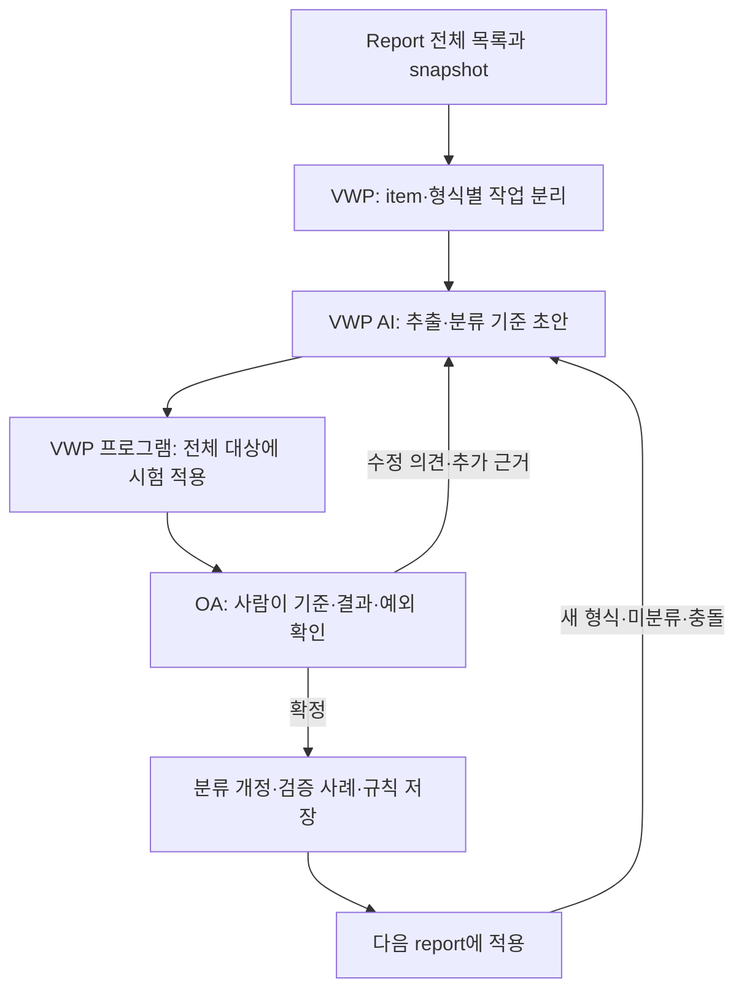
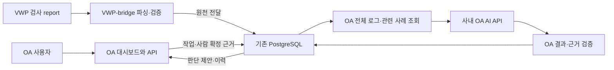
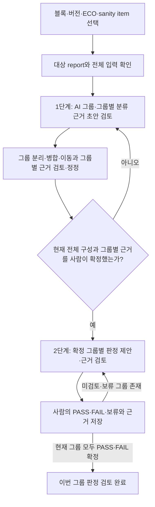

# Sanity Reviewer — 요구사항 및 구현 설계

## 1. 현재 기준과 범위

**2026-10-22 최우선 요구사항은 AI 판단 품질이다.** AI가 첫 report부터 전체 로그의 초기 그룹·이름·분류 근거를 만들고, 사람이 확정한 그룹에 PASS/FAIL/보류와 판정 근거를 제안한다. 사람이 수정·확정한 구성·판정·근거·반례를 DB에 축적하고 다음 AI가 관련 사례를 검색해 활용한다. 수집·파서·DB·SSO·화면은 이 순환을 지원하며 이들만 완료됐다고 핵심 AI 기능을 완료로 보고하지 않는다.

목표·우선순위·사례 조회·품질 수용 기준은 [AI 판단 설계](AI_DECISION_DESIGN.md)를 기준으로 한다. 이번 연동은 **사내 OA의 OpenAI 호환 AI API를 우선 사용**한다. 이전 VWP 전용 실행/OA 모델 금지 방침은 대체됐다. OA가 DB의 로그·관련 확정 사례를 읽어 자기 모델 API를 호출하고 결과를 검증·저장하도록 연결한다. 별도의 AI용 HTTP 서버는 필수가 아니다.

현재 OA OpenAI 호환 호출·영속 작업·현재 사람 확정 사례 검색/공급·직접 근거 판정 V2와 운영 SSO/V2 검토 연결을 제공한다. 첫 순환은 **전체 report 또는 확정 그룹이 설정된 모델 입력/출력 한도에 들어가는 경우**를 처리한다. 실제 사내 API·자료의 연결/정확도는 미검증이며 평균 10,000건·100,000건 이상의 실제 모델 분할/그룹 통합은 COMMON-05, 독립 품질 비교는 COMMON-06 후속이다. 기존 참고 엔진/합성 mock 성공을 실제 사내 판단 품질 완료로 보고하지 않는다. 설정·실행·실패/복구는 [OA AI 실행 안내](oa/AI_RUNTIME.md)를 따른다.

이 문서는 사용자 요구사항과 prototype의 경계를 정리한다. **Jira 조회·후보 연결·게시·시뮬레이터는 폐지**했으며 oa/dashboard의 React·shadcn UI를 검토와 제어 화면으로 사용한다. 과거 Jira 맥락의 렌더러 호환은 기존 기록 검증용이다.

사내 Q1 문의를 반영한 분산 수집·PRE/POST 원천 분리·예상 범위 승인·중복 처리는 [19절](#source-collection-design)과 [세부 설계](vwp/SOURCE_COLLECTION_DESIGN.md)를 따른다. 별도 V2 공통 경로를 구현했으며 기존 schema 1과 실제 회사 SDK/인프라 미연결 상태를 구분한다.

사용자 터미널의 제출 명령·설치·파일/DB 저장·접수 상태 확인은 [20절](#user-report-submission)과 [사용자 제출 설계](vwp/SUBMISSION_DESIGN.md)를 따른다. `bin/sanity`와 양쪽 source 작업자·증분 SQL을 제공한다. 실제 회사 어댑터·인프라 준비와 실행은 [SUBMISSION.md](vwp/SUBMISSION.md)를 따른다.

2026-10-13부터 논의한 clustering·사람 검토·대량 처리의 legacy 기반은 [14절](#ai-clustering)에 있다. AI 초기 그룹과 그룹별 판정의 현재 목표는 [17절](#human-judgment-learning)·[18절](#large-report-review-flow) 및 [AI 판단 설계](AI_DECISION_DESIGN.md)를 따른다. [14.13절](#integration-decisions)의 과거 VWP 접속 이력과 현재 OA 실행 결정을 구분한다. 요구사항 확정과 코드 구현·실환경 검증 완료를 구분한다.

2026-10-14 대시보드 논의의 최신 기준은 [15절 프로젝트·담당자·블록 버전·PoR 명세](#dashboard-domain-spec)를 따른다. **NET_VER·REVISION과 PoR은 블록별로 관리하며, PoR은 각 블록 담당자가 지정한다.** 이 절에는 합의한 업무 규칙, 운영 구현안, 현재 데모와 미확정 사항을 구분해 기록한다. 2026-10-15 독립 테스트 workspace에 서버 권한 검사와 PoR DB/API를 연결했다. 실제 회사 SSO·운영 연동 검증은 별도이며 기존 단일 사용자 API 설명을 다중 사용자 운영 기능으로 해석하지 않는다. 2026-10-22 운영 Welcome·관리·범위 권한은 [22절](#production-access-management)과 [운영 권한 계약](oa/ACCESS_MANAGEMENT.md)을 따른다.

2026-10-15 사용자가 확인한 최종 목표는 **사람이 내린 판정과 기준을 축적해 AI가 같은 조건에서 사람과 유사한 판정을 제안하도록 만드는 것**이다. [17절 판정 기준 축적](#human-judgment-learning)을 새 사용자 판정·AI review의 구현 기준으로 삼는다. 기존 문제 그룹 분류 기준과 sanity의 PASS/FAIL 판정 기준을 구분한다.

같은 날 사용자는 규모를 **한 sanity item의 report 안에 있는 로그·위반 항목 평균 약 10,000건이며 100,000건 이상도 가능**한 것으로 확인했다. 10,000건은 고정 크기나 상한이 아니다. [18절 대용량 report의 순차 검토](#large-report-review-flow)는 전체 로그 분류·사람 확정을 먼저 수행한 뒤 확정 그룹별 판정을 진행하는 최신 화면·처리 요구사항이다. 사용자의 요청에 따라 명세를 먼저 갱신한 뒤 공통 처리·화면을 구현하며, 합성 검증과 사내 운영 검증을 구분한다.

후속 사용자 확인에 따라 **1단계의 분류 근거는 그룹마다 별도로 제안·검토·저장**한다. 전체 분류 사유 하나나 2단계의 PASS/FAIL 사유로 대체하지 않는다. [18.10절 그룹별 분류 근거](#group-clustering-rationale)의 V2 저장·검증·화면을 구현했으며 사내 SDK/운영 연결은 별도다.

VWP와 OA는 망 분리 환경이다. 두 bridge는 같은 PostgreSQL DB의 4개 테이블로만 통신한다. SQLite, 브리지 사이 파일 전달, 직접 HTTP/RPC, 로컬 DB fallback은 사용하지 않는다. 대시보드 브라우저가 OA 로컬 API에 접속하는 것은 브리지 간 통신과 구분한다.

사용자가 **psycopg2로 PostgreSQL 직접 접속 가능**함을 확인했다. 기본 접근 모드는 `SANITY_DB_ACCESS=postgresql`이며 host·user_name·password는 비공개 `.env`/환경변수에서 설정한다. DB 이름·포트·스키마·TLS 정책도 같은 경로에서 설정한다. 기존 DBaaS HTTP 접근은 **임시 읽기 전용**으로만 유지하며 명시적으로 선택한 HTTP 모드에서 직접 접속으로 자동 전환하지 않는다. 실제 배포 DB의 DDL·권한·잠금·트랜잭션 검증 완료를 접속 방법 확인과 혼동하지 않는다.

사용자가 VWP AI의 API·CLI와 함께 **OA AI의 OpenAI 호환 API**가 있음을 확인했다. 모델 비밀값은 호출 서버의 비공개 환경에서 관리하며 OA의 설정 키·호출 계약은 [AI_RUNTIME.md](oa/AI_RUNTIME.md)에 제공한다. 본 프로젝트 report 원문·객체 경로·측정값·관련 설정은 OA가 DB 경계로 전달받아 조회하는 범위다. 사내 세부 형식·모델 호환성·한도·배포 검증은 현장에서 확인하고 실제 원문·접속값은 외부에 제공하지 않는다. 운영 RBAC는 22절, 업무 범위는 15절, 실행법은 [README.md](README.md), 현재 직렬화는 [PROTOCOL.md](PROTOCOL.md), 검증 결과는 [REVIEW.md](REVIEW.md)를 따른다.

## 2. 환경별 책임과 흐름

아래 표는 현재 공통 구현의 서버별 책임이다. 실제 사내 API/자료의 연결·판단 품질과 대량 모델 분할은 별도 검증/구현 대상으로 구분한다.

| 위치 | 책임 | 보관·표시 |
|---|---|---|
| VWP (`vwp/`) | 예상 목록·완료된 실행 상태와 report snapshot 수집 | VWP 내부 원본 파일·크기·해시 |
| VWP-bridge (`vwp_bridge/`) | 목록 대조, item별 전체 추출·규칙 판정, 근거 봉인·DB 전달 | sanity_vwp_data, VWP→OA 큐 |
| OA (`oa/`) | 수신 검증·현재 확정 사례 검색·OA AI 분류/판정·검증·사람 근거/피드백 저장 | sanity_oa_data의 기존 WS_CONFIG job 및 분류/판정 event, OA→VWP 큐 |
| OA 대시보드 | 번들 선택, 단위·근거 확인, 사람 판정, 수신·요청 제어 | 인증된 API 응답과 명시적 demo |

VWP 내부 snapshot을 분석하여 공유 DB에 번들을 등록하고 OA가 수신한다. 대시보드에서 사람이 최종 판정한다. 추가 근거는 OA→VWP 요청과 VWP→OA 응답으로 전달한다. collector는 현재 sanity 도구를 실행하지 않으며 실제 실행기 연동은 추후 작업이다. 한 번의 수신 명령은 처리 가능한 한 건만 처리하며 상시 polling daemon이 아니다.

## 3. 내부 AI와의 개발 협업

코딩 도우미는 사내 원본 로그에 직접 접근하지 않는다. 내부 AI는 실제 형식·점검 기준·정답/반례, OA OpenAI 호환 API의 요청/응답·모델·한도·실패 계약을 확인한다. 이번 실행 대상은 OA 모델이며 VWP 전용을 전제로 하지 않는다. 모델이 DB나 파일을 직접 읽어야 하는 것은 아니고, OA 서버가 범위에 맞는 원본·관련 확정 사례를 조회해 API 입력으로 제공한다. 조회 도구 확장은 지원 여부와 공통 계약을 확인한 뒤 연결한다.

- VWP: 전체 sanity 정의의 원본, 활성화 조건, report 형식·판정 스크립트·예외, 같은 코드의 다른 문제와 같은 문제의 반복 사례, OpenAI 호환 API의 세부 계약·입력 한도·파일 접근 방법. CLI 상세는 필요 시 확인하며 API 우선 구현의 선행 조건으로 삼지 않는다.
- OA: 사내 모델 API·JSON/도구 지원·입출력/동시성/timeout/조회·취소 한도, 정식 DB·인증·검토 이력, 판단 정답/반례와 사람 피드백의 적용 조건.
- 양쪽: 다른 코드가 하나의 원인으로 연결된 사례와 실제 근거, 사람의 검토 기준과 현장 회귀 결과.

요청에는 ID·수신 대상·목적·확인 범위·원하는 짧은 응답 형식을 넣는다. 사실과 제안·추측·접근 불가를 구분하고 비밀이나 허용되지 않은 원문은 요구하지 않는다. 사용자 중계가 필요하면 출력은 한두 줄로 줄인다. 답변을 받기 전에는 현장 확인 완료로 표시하지 않는다.

## 4. 전체 sanity 목록과 입력 계약

검토 대상은 생성된 report 목록으로 역추정하지 않고 실행 설정의 예상 목록으로 정의한다. 검토 단위는 run_id + item_id + 대상 + 실행 조건이다. 같은 item의 모드·대상이 다르면 별도 review_unit_id를 부여한다. 목록의 출처·버전·해시·확정 여부를 보존한다.

- 실행 메타데이터: run_id, project, design, stage, tool, tool_version.
- 단위별 계약: report 경로, parser·규칙 버전, 실행 상태, 적용 여부, 조건, identity_fields, 판정 설정, 적용 제외 근거.
- 수집 결과: ready, 원본 파일 ID·크기·SHA-256, 예상 밖 파일 목록, inventory 해시.
- 누락 report는 목록에서 삭제하지 않는다. 예상 밖 report도 보존하고 범위 불명을 표시한다.
- 적용 제외에는 reason, approved_by, reference가 필요하다. 실행 실패나 누락을 사후 제외로 숨기지 않는다.
- 기준 목록 자체가 업무상 필요한 모든 검사를 포함하는지는 원본 설정과 담당자 확인으로 검증한다.

작성 완료된 report만 snapshot으로 수집한다. 원본을 변경하지 않으며 비어 있지 않은 출력은 거부한다. 경로 탈출·심볼릭 링크·수집 중 원본 변경을 검사하고 완성된 snapshot만 공개한다. 해시·크기·ready 불일치는 처리 오류이며 예상 목록에 있으나 없는 파일은 미완료 분석 결과다.

## 5. item별 parser registry와 판정

모든 report를 하나의 정규식으로 처리하지 않는다. item 또는 같은 report 계약을 공유하는 계열에 전용 어댑터를 두며 실행 메타데이터의 파서·버전을 우선한다. 파서는 값을 추출하고 판정 규칙은 의미를 해석한다. 기준의 출처는 기존 점검 설정·스크립트 또는 확인된 업무 규칙이다.

registry가 관리할 내용은 item·도구 버전 적용 범위, report 파일·필수 섹션·컬럼·종료 표시, 빈 report 의미, 파서 버전, 비교 방향·임계값·단위·예외, 동일성 규칙, 근거 요구사항과 기준 사례다. 현재 prototype은 plan의 명시적 설정·두 내장 파서와 `ReportParser` 추상 인터페이스/명시적 회사 registry를 제공한다. 회사 파서는 기본 미등록이며 실제 형식 구현·검증은 사내 AI가 수행한다. 자동 발견은 없다.

| 현재 파서 | 입력 계약 | 판정 |
|---|---|---|
| numeric_csv_v1 | 고정 컬럼과 마지막 # END rows=N | le/ge, 유한 수, 단위·모드 확인 |
| summary_json_v1 | format_version, complete, results, total | 개별 PASS/FAIL과 전체 건수 정합성 |

사내 구현은 [PARSER_INTEGRATION.md](vwp_bridge/PARSER_INTEGRATION.md)의 `parse` 이벤트와 회사 등록 함수를 사용한다. 공통 엔진은 item·도구/규칙 버전, 원문 span·EOF·미해석 구간·건수와 기존 판정을 검사하고 구현 버전을 분석 ID에 반영한다. 실제 report는 외부 Codex에게 전달하지 않는다. 명시적 위반 0건은 원문 근거를 가진 결과 기록으로 표현하며 0개 결과/빈 파일을 정상으로 간주하지 않는다. 새로운 판정 정책이나 공통 계약 변경은 Codex 담당이다.

숫자는 Decimal로 비교하며 소수 임계값은 JSON 실수가 아닌 정확한 문자열로 지정한다. 미지원 형식·빈 report·누락·잘린 종료·헤더 변경·건수 불일치를 조용히 PASS로 처리하지 않는다. 각 유효 행을 판정하거나 UNKNOWN으로 남기고, 미해석 내용·디코딩 실패 근거도 보존한다. 필수 정보가 없으면 임의 추정 대신 미완료로 남긴다.

개별 기록에는 실행·단위·item·record ID, 대상·조건·검사 지점, 실제값·기대값·단위, 코드·심각도·판정, 파일·줄 범위, 원문과 적용 규칙을 연결한다. 심각도는 PASS/FAIL과 별개다. PASS를 포함한 전체 기록을 VWP DB에 보존하고 전체를 판정한 뒤 표시용 집계를 만든다.

<a id="collection-only-parser"></a>

### 5.1. 수집 전용 parser — 2026-10-28 공통 구현

VWP-bridge에서 새 판정 없이 로그를 수집하는 요구는 [parser 4.1절](vwp_bridge/PARSER_INTEGRATION.md#collection-only-parser)을 따른다. 원문에 명시적 PASS/FAIL이 있으면 기존 `reported`로 보존할 수 있다. 판정 없는 로그를 위한 registry `evaluation="none"`을 기존 `numeric`/`reported`와 함께 지원한다.

- `none`은 명시적 대상/버전 등록을 요구하고 수치 정책과 함께 사용하거나 평가 오류의 fallback으로 사용하지 않는다. plan의 `unit.evaluation`에 문자열 `"none"`을 넣지 않는다.
- 추출 필드·원문 위치·EOF·완료/전체 건수·해시·미해석/encoding 검증을 유지한다. 정상 추출의 **판정 미실행**과 실제 파싱 오류를 구분한다. 명시적 0건은 사실 근거로 보존하되 빈 파일·결과 기록 0개를 완료로 바꾸지 않는다.
- 수집/파싱 완료는 PASS/FAIL·AI 판단 완료·사람 검토 완료와 별도다. 정상 수집은 OA 두 단계 검토의 입력이 될 수 있어야 하며 권한·접수 범위·입력 개정·근거/기준/사례 검증은 유지한다. 원문 결과·AI 제안·사람 확정은 각각 보존한다.
- COMMON-02F는 결과/header의 `evaluation_mode="none"`과 `not_evaluated_count`, 정상 record의 `check_status="UNKNOWN"`/`evaluation_status="NOT_PERFORMED"`를 저장·검증한다. 기존 세 항목 집계와 legacy UNKNOWN 검토 차단을 유지하며 미평가 건수는 UNKNOWN의 부분집합으로 별도 표시한다. 새로운 테이블·migration이나 내부 AI 수정 권한 확대는 없다.

양쪽 공통 수정본을 반영한 뒤 기존 회사 추출/등록 지점에서 사용하며 실제 형식과 완료·건수 정확성은 사내에서 검증한다. 오류 시 기존 `WAITING_FOR_CODEX` 중단 규칙을 유지한다. 이번 수집 단계 요구는 OA AI 분류·그룹 판정과 사람의 정정·사례 활용 목표를 유지한다.

## 6. 같은 코드·같은 문제·같은 원인의 구분

현재 구현은 선언된 식별 키의 정확한 일치로 반복 기록을 집계한다. 별도 AI 분류 루프에서는 선언형 규칙 제안과 실행 간 지속 그룹 ID를 지원한다. 의미 유사도·임베딩 기반 후보 비교는 미구현이며, 14절에 확장 방법과 현재 구현 범위를 구분한다.

| 관계 | 판별 근거 | 처리 |
|---|---|---|
| 같은 유형 | item과 메시지/위반 종류 | 표시상 함께 볼 수 있음 |
| 같은 문제의 반복 | 해당 item의 유효한 식별 필드·조건 일치 | 동일 문제 그룹과 개별 근거 유지 |
| 같은 원인 | 여러 증상을 연결하는 원문·설정·수정 근거 | 사람의 추가 판단; 현재 자동 원인 병합 없음 |

같은 error/warning code나 비슷한 문장은 동일 문제의 충분조건이 아니다. 다른 코드도 하나의 원인을 가질 수 있다. 대상의 전체 경로, 객체 간 관계, 검사 지점, 모드, 설정 항목 등 실제 문제를 구분하는 필드를 item별로 정한다. 측정값·임계값도 item에 따라 식별 필드가 될 수 있다.

예를 들어 identity_fields=[object, check_point, mode]인 규칙에서 같은 코드의 A/M1/P1 측정값 12와 13은 같은 반복 후보이고 B/M1/P1, A/M2/P1은 별개다. 검사 시점까지 의미가 있다면 규칙에 포함해야 한다.

비교 가능한 규칙 범위에서 필드가 모두 일치하면 SAME_FINDING, 유효한 필드가 다르면 별개 그룹이다. 필요한 식별 정보가 누락·공백·잘못된 자료형이면 UNDECIDED로 독립 보존하고 null끼리 병합하지 않는다. 식별 정보만 부족해도 수치 판정 자체가 유효하면 그 결과는 유지한다. SAME_FINDING은 근본 원인 동일성 보증이 아니며 별개 그룹도 공통 원인이 있을 수 있다.

현재 키는 run_id, review_unit_id, item_id, code, severity, rule_version, 선언된 identity 필드 값이다. 정규 JSON의 SHA-256으로 그룹 ID를 만들고 실제 필드를 대조한다. 해시는 유사도나 확률이 아니다. 모든 기록의 쌍별 비교를 하지 않으며 실행·규칙 버전이 다르면 자동 병합하지 않는다. 숫자·경로·객체 이름을 일괄 제거하지 않는다. 시간·임시 경로도 item에서 의미가 없다고 확인된 경우에만 정규화한다. 최소·최대값은 의미와 단위가 같은 값끼리 비교한다.

요약과 상세 report의 중복은 확인된 대응 규칙으로만 제거하며 문제 수·발생 수·근거 수를 구분한다. 규칙 변경 시 새 번들로 재분석하고 이전 판정과 원문을 덮어쓰지 않는다. 현재 prototype에는 별도 원인 연결 테이블이나 자동 원인 확정 기능이 없다.

전송 그룹은 FAIL·UNKNOWN 기록을 담는다. 최초 예시 최대 3개·원문 2,048문자를 보여주고 생략량과 원본 위치를 표시한다. 전체 PASS·FAIL·UNKNOWN은 VWP에 남는다. 대표 예시만 읽고 전체 검토를 인정하지 않으며 단위별 전체 판정·집계를 대조한다. 근거가 부족하면 추가 요청하고 검토 완료를 보류한다.

## 7. DB 4개 테이블과 설치

아래 행 종류는 기존 기본 분석의 실행 계약이다. 최초 신청 form은 이미 신청한 원본으로 유지한다.
14절의 작업·분류 개정용 DB 종류·제약·인덱스는 별도 `db/004_clustering.sql`로 추가한다.
DB 확장과 AI 작업자·분류 화면의 구현 완료를 구분한다.

| 테이블 | 행 종류 |
|---|---|
| sanity_vwp_data | RUN, UNIT, FILE, GROUP, EVIDENCE |
| sanity_oa_data | RECEIVED_BUNDLE, REVIEW_UNIT, REVIEW_EVENT, REPORT |
| sanity_vwp_to_oa | PING, ANALYSIS_BUNDLE, EVIDENCE_RESPONSE |
| sanity_oa_to_vwp | PING, EVIDENCE_REQUEST |

테이블은 기존 `db/form/`으로 이미 신청한 상태다. **form 4개와 기존 `002`·`003`은 변경하지 않고 이후 변경은 증분 SQL로 작성한다.** 전체 준비 순서는 **신청한 form으로 생성 → db/002_indexes.sql → 역할 준비 → db/003_grants.sql → db/004_clustering.sql**이다. 완료한 단계는 반복하지 않으며 `002`·`003`까지 적용했다면 `004`만 실행한다. 테이블 재생성·기존 데이터 삭제는 하지 않는다. `004`는 owner/DBA가 점검 시간에 한 트랜잭션으로 실행하고, 원본 제약 불일치 시 변경 전체를 rollback한다. Jira 작업은 추가하지 않는다. 세부 절차는 [db/README.md](db/README.md)를 따른다.

기본 `restricted` 모드에서 두 앱은 별도의 제한된 로그인과 sanity_vwp_app/sanity_oa_app 역할을 사용한다. private 테이블은 상대 앱에 공개하지 않으며 공유 큐는 송신 내용 INSERT와 수신 상태 UPDATE를 컬럼 권한으로 분리한다. owner·superuser·상대 역할 상속·과도한 유효 권한은 실행 시 거부한다.

별도 제한 계정을 발급할 수 없는 환경에는 `SANITY_DB_ALLOW_SINGLE_ACCOUNT=true`로 명시적으로 선택하는 `single_account` 모드를 제공한다. 기본값은 `false`이며 이 두 소문자 문자열 외 값은 `DATABASE_CONFIG`로 거부한다. 역할 존재/소속은 요구하지 않고 네 테이블 모든 컬럼의 유효 SELECT/INSERT/UPDATE를 검사한다. DELETE는 보유 허용·필수 아님, TRUNCATE/REFERENCES/TRIGGER·관리자/상위 관리자 역할·테이블 소유/소유자 역할·앱/public 스키마 CREATE는 계속 금지한다. 기존 네 테이블·필수 UNIQUE 검사는 공통으로 적용한다. **단일 모드는 private 접근과 큐 송수신 컬럼을 DB 권한으로 분리하지 못한다.** 앱의 정상 side 사용·입력 필드·불변값·트랜잭션·lease·업무 권한 검사는 유지한다. 실패 후 자동 전환·새 GRANT/역할·원본 SQL/포털 계획 변경은 없다. 읽기 전용 check는 모드와 `db_isolation=enforced|not_enforced`를 출력하며 단일 계약 검사를 제한 계정 격리 통과로 표시하지 않는다. 상세 계약과 현장 점검은 [DB 연결 인계 3.1절](db/CONNECTION_HANDOFF.md#31-단일-계정-모드)을 따른다.

앱은 두 모드 모두 DDL·DELETE·TRUNCATE를 수행하지 않는다. DBA 접근 가능성과 반출 정책 승인은 별개다.

DB는 타입·CHECK·고유 키·바이트 해시·parent/scope FK·lease 상태를 검사한다. 앱은 parent 종류·단위/파일/그룹 연결, inventory·전체 집계, 상태 전이·개정 연속성을 검사한다. 컬럼 생성만으로 준비 완료가 아니며 인덱스·권한 적용과 실제 앱 계정 검증까지 필요하다.

## 8. 분석·전달·복구의 원자성

원문 bytes와 JSONB를 구분한다. 개별 원문 해시는 raw_bytes, 전송 해시는 payload_gzip, 보고서 해시는 UTF-8 payload_bytes에 적용한다. JSONB 재직렬화로 원본 해시를 대신하지 않는다. 원문 전체는 현재 VWP private DB에 저장하므로 정책상 불허이면 배포 전에 다른 저장 어댑터가 필요하다. DDL의 local_evidence_ref가 있다는 사실만으로 파일 참조 저장을 지원한다고 보지 않는다.

동일 입력·규칙은 결정적인 분석 ID·번들 ID를 만든다. bundle_id는 자신을 제외한 payload의 정규 JSON SHA-256이며 gzip mtime은 0이다. 같은 ID 재등록은 전체 불변 내용을 대조한다. 최대 256행 또는 약 4MiB 배치로 저장하며 큰 개별 행은 이 목표보다 클 수 있다. checkpoint로 검증을 생략하지 않고 재시작 때 입력 전체를 재계산·대조한다. 봉인된 근거 변경·누락·추가는 EVIDENCE_CONFLICT로 중단한다. 봉인과 분석 메시지 등록은 한 트랜잭션이다.

큐는 짧은 FOR UPDATE SKIP LOCKED로 한 건을 점유하고 새 lease token·만료 시각을 기록한다. 처리 동안 긴 트랜잭션을 잡지 않는다. 완료는 동일 token·PROCESSING·미만료 조건일 때만 가능하며 0행 갱신이면 private 수신본까지 rollback한다. 수신본·전체 단위·개정 0·보고서와 공유 RECEIVED는 한 트랜잭션이다. 기본 lease는 300초다. 분류 작업자는 페이지 처리/AI 대기 중 heartbeat와 명시적으로 실행한 polling 루프를 사용한다. 기존 분석 번들/원문 수신은 별도 수동 처리한다. 무결성 오류는 거부하며 일시 장애는 lease 만료 후 명시적 재실행으로 복구한다. 같은 번들은 기존 검토를 유지하며 새 번들은 승인을 상속하지 않는다.

## 9. OA 대시보드와 로컬 API

UI는 React·shadcn 구성 요소를 사용하며 oa/dashboard_api.py의 FastAPI로 OA 저장 계층을 호출한다. npm ci와 npm run build로 생성한 dist를 API가 같은 origin으로 제공한다. Python 실행 주소는 127.0.0.1:8000이다. 개발 UI는 127.0.0.1:5173에서 /api를 8000으로 proxy한다. 브라우저가 DB나 VWP bridge에 직접 접근하지 않는다.

| 화면·동작 | 계약 |
|---|---|
| 로그인·세션 | 메모리 Bearer 토큰, 서버 고정 검토자와 읽기 전용 모드 확인 |
| 번들 목록·수동 수신 | 페이지 조회, 명시적 요청 때 다음 메시지 한 건 수신 |
| 단위·문제 그룹 | PASS·누락 포함 모든 단위·상태·근거, 각각 페이지 조회 |
| 사람 검토 | PASS/FAIL·사유·요청 UUID·기대 개정 제출 |
| 이력 | 최근 50개 개정과 전체 이력 수 표시; 전체 이력 삭제 아님 |
| 보고서 내려받기 | 현재 개정에 저장된 불변 보고서 확인·다운로드 |
| 추가 근거 | 요청, 상태 목록, 응답 명시적 수신과 제한된 원문 미리보기 |

페이지 크기와 예시 수가 coverage 분모를 줄여서는 안 된다. UI·통신 실패는 오류로 표시하고 예시 데이터로 자동 대체하지 않는다. demo는 사용자가 명시적으로 선택하는 브라우저 메모리의 예시 화면이며 새로고침 시 초기화한다. demo 조작은 실제 DB 저장·검토 완료·AI 실행 결과가 아니다.

## 10. 인증·비밀정보·접속 경계

본 프로젝트의 sanity 검토에 필요한 report 원문·객체 경로·측정값·관련 설정은 OA 전달·조회 허용 범위다. 일반 report 조회마다 별도의 VWP 수동 반출 승인을 요구하지 않으며, 현재 원문 응답 절차는 12절에 명시한다. 목록 요약과 상세 요청 조회는 대량 처리 성능을 위한 구분이지 원문 조회를 금지하기 위한 구분이 아니다. 이 합의는 임의 파일 접근·외부 서비스 전송·고객에게 자동 게시할 권한을 추가하지 않는다.

AI URL·token은 VWP 서버의 비공개 `.env`/환경변수에서 읽는다. API token·DB 비밀번호 등 접속 비밀정보는 report 조회 허용 범위에서 제외하고, OA 전송·화면·로그·공유 DB 작업 payload·Git에 포함하지 않는다. 설정 예시에는 변수 이름과 빈 값만 둔다. 원문에 접속 비밀정보가 섞인 경우에도 그대로 전송하지 않으며, 제외·마스킹했다는 사실과 조회 범위를 표시하고 원본 해시와 가공본 해시를 혼동하지 않는다.

로컬 토큰 대시보드는 단일 사용자 prototype이다. private .env의 SANITY_DASHBOARD_TOKEN은 최소 32자, SANITY_DASHBOARD_REVIEWER는 서버가 고정하는 이름이다. 모든 데이터 조회·변경 API에 인증을 적용한다. health 확인과 정적 UI는 업무 데이터가 아니다. 브라우저 토큰은 메모리에만 두며 localStorage·URL·로그·VITE_*·번들에 넣지 않는다. 자유 입력으로 서버 검토자 이름을 바꾸지 않는다. DB 계정·DBaaS 토큰은 서버에만 둔다. 외부 bind는 금지하며 운영 인증으로 표현하지 않는다. SSO 모드는 22절의 범위 권한·안정 감사 ID를 사용하며 실제 회사 SSO·TLS proxy·배포 검증과 구분한다. SSO 인증·내부 사용자 연결의 추상 인터페이스와 사내 구현 진입점은 15.14절에 추가했으며, 실제 사내 인증과 업무 범위 권한은 별도다.

PostgreSQL 설정은 `SANITY_DB_HOST`, `SANITY_DB_PORT`(기본 5432), `SANITY_DB_NAME`, `SANITY_DB_USER_NAME`, `SANITY_DB_PASSWORD`, `SANITY_DB_SCHEMA`(기본 public), `SANITY_DB_SSLMODE`(기본 verify-full), `SANITY_DB_SSLROOTCERT`(필요 시 절대 CA 파일 경로)를 사용한다. 호스트·DB 이름·계정·비밀번호가 없으면 실패하며 다른 로컬 DB를 사용하지 않는다. VWP/OA 각 실행 서버는 기본적으로 같은 키 이름으로 서로 다른 제한 계정을 설정한다. 명시적인 `SANITY_DB_ALLOW_SINGLE_ACCOUNT=true`에서는 7절의 공유 로그인 계약을 사용하며 private DB 격리를 보장하지 않는다. 비어 있지 않은 해당 side의 `SANITY_VWP_DSN`/`SANITY_OA_DSN`은 기존 환경·테스트 호환용으로 연결 필드보다 우선하므로 필드 방식으로 바꿀 때 제거/비운다. 비밀번호는 psycopg2의 별도 인자로 전달하며 실패 시 다른 설정/TLS 수준으로 재시도하지 않는다. `.env`보다 환경변수가 우선하고 보간은 하지 않는다. 기존 `.env`의 HTTP 모드는 운영자가 직접 바꿔야 한다.

임시 DBaaS는 DBAAS_BASE_URL과 별칭 DBASS_BASE_URL이 다르면 중단한다. DBAAS_TOKEN과 절대 경로 DBAAS_CA_PATH를 사용하며 PEM/DER CA를 검증한다. 검증 끄기·redirect·환경 proxy는 사용하지 않는다. HTTPX timeout 30초는 각 I/O 대기 제한이며 요청 전체 시간 보장이 아니다. URL·토큰·CA 경로·서버 detail을 진단에 출력하지 않는다.

임시 클라이언트는 /api/v1/me, /api/v1/resources의 읽기 확인과 명시적 query 전송을 제공하지만 POST가 DB 쓰기 지원을 뜻하지 않는다. 요청/응답 한도는 각 8MiB이고 불확실한 POST 결과는 자동 재시도하지 않는다. 현재 HTTP 모드의 저장 계층은 DBAAS_SQL_CONTRACT_REQUIRED로 중단한다. 세션의 읽기 전용 표시는 저장 어댑터 준비 완료를 뜻하지 않는다. 정식 방식은 트랜잭션·rollback·잠금·역할 권한·자료형·크기 제한·DDL 적용 경로까지 확인해야 한다.

## 11. 사람 검토·이력·전체 완료 조건

검토는 bundle과 unit에 연결한다. API는 PASS/FAIL, 사유, request_id UUID, 화면에서 읽은 expected_revision을 받는다. 번들 잠금 아래 개정을 확인하며 다른 검토가 먼저 저장되면 충돌을 반환한다. 사용자가 최신 상태를 확인하고 다시 제출해야 한다. 같은 요청의 재시도는 같은 UUID·같은 내용을 사용하고 새 판단은 새 UUID를 사용한다. 다른 내용으로 UUID를 재사용하면 거부한다. A→B→A도 별도 REVIEW_EVENT다. 변경 이벤트·현재 개정·보고서 저장은 원자적이며 과거 이벤트·보고서는 수정하지 않는다.

현재 초기 구현은 blocker를 사람 판정으로 면제하거나 알려진 FAIL을 PASS로 바꾸지 않는다. FAIL을 설명한 사람의 FAIL 판정은 검토 완료가 될 수 있다. 수신·다운로드·근거 수신은 승인이 아니다.

**2026-10-15 사용자 결정에 따른 후속 변경:** 원본 규칙 판정과 사용자의 업무 판정을 분리한다. 원본 FAIL을 보존하면서 사용자가 사유와 근거를 남겨 별도의 PASS를 확정할 수 있어야 한다. 판정 기준을 축적하는 계약은 [17절](#human-judgment-learning)을 따른다. legacy bundle의 `FAIL_CANNOT_PASS`는 해당 경로의 계약으로 남아 있다. 운영 workbench의 그룹 판정과 독립 workspace 판정은 원본을 보존하며 사람의 별도 PASS/FAIL을 저장한다. 내부 AI가 legacy 검사를 임의 해제하지 않는다. 누락·미지원 등 분석 미완료를 숨겨 전체 검사 완료로 표시하지 않는 기준은 유지한다.

**전체 예상 단위 = 검토 완료 + 근거가 확인된 적용 제외 + 미완료**이며 세 집합은 서로 겹치지 않는다. 한 단위의 여러 미완료 사유를 더해 단위 수로 사용하지 않는다. 전체 완료에는 다음이 필요하다.

1. 확정된 비어 있지 않은 목록과 예상·실제 단위의 일대일 대응.
2. 미확정 범위·예상 밖 report 등 global blocker 없음.
3. 적용 단위의 실행·파싱·평가 완료, 미지원·누락·UNKNOWN 없음.
4. 모든 적용 단위의 현재 번들에 대한 사람 판정.
5. 적용 제외의 확인된 사유·승인자·근거.

누락·미지원·미실행은 분모에 남는다. 동일성 UNDECIDED여도 독립 기록의 판정 근거가 충분하면 검토할 수 있지만 판정 근거 부족은 완료를 막는다. review=COMPLETE와 check=PASS를 분리한다. 전체 check는 FAIL 우선, 그 외 분석 미완료이면 UNKNOWN, 전부 승인된 적용 제외이면 NOT_APPLICABLE, 그 외 PASS다. 화면 일부만으로 전체 완료를 계산하지 않는다.

이 보증은 확정된 목록·규칙·파서에 대한 누락 검출이며 업무 기준이나 AI·사람 판단의 절대 정확성 보증이 아니다. 현장 기준 사례와 정상·경계값·예외·형식 변경 회귀로 판정 정확성을 별도로 평가한다. 표본 검증은 전체 발생 기록 판정을 대신하지 않는다.

[5.1절](#collection-only-parser)의 수집 전용 구현은 위 legacy 평가/검토 완료 조건을 해제하지 않는다. COMMON-02F는 정상 수집의 OA 준비 상태와 이후 판정/사람 확정을 별도로 연결한다. 판정 미실행을 자동 PASS로 세거나 실제 UNKNOWN 오류를 무시하지 않는다.

## 12. 추가 근거 요청과 운영 AI

**현재 구현:** 일반 sanity report는 요청별 수동 반출 승인 없이 VWP 작업자가 범위와 무결성을 검증하여 응답한다. 명시적 거부도 지원한다.

OA는 단위와 서로 다른 record ID 1~100개, 사유, 요청 UUID를 공유 요청 테이블에 저장한다. TTL은 기본 3,600초, 최대 86,400초다. 임의 파일 경로·명령·SQL은 요청하지 않는다. VWP는 유효 기간·봉인 상태·단위/파일 연결·전체 원문 해시를 검증하며 일부만 성공으로 내보내지 않는다. 응답 등록과 요청 완료는 한 트랜잭션이다.

FULFILLED/REJECTED/EXPIRED는 최종 결과이며 거부·만료를 승인으로 덮어쓰지 않는다. OA도 요청 ID 집합과 원문 해시를 대조한다. 추가 근거는 원래 분석·사람 판정을 자동 변경하지 않는다. group/줄 범위 선택은 후속 범위다.

**반영한 동작:** `respond --request-id` 또는 VWP `work`가 일반 원문 요청을 처리한다. `--approve-export`는 호환용 선택 옵션이고 `--reject`는 명시적 거부다. 등록된 비밀값·명시적 자격증명 패턴은 원문 응답에서 마스킹하고 source_raw_sha256/raw_sha256/redacted를 보존한다. OA 미리보기는 4,000자이고 전체 상세는 기본 8,000자·최대 16,000자씩 조회한다. 인증·범위·무결성 검사와 사람의 sanity 검토는 그대로 유지한다. 비밀정보 검사는 범용 DLP가 아니며 분석 번들/분류 입력·출력에서 발견하면 identity를 변경하는 대신 전달을 중단한다.

**현재 legacy 구현:** VWP OpenAI 호환 API/선택 CLI와 DB 작업자를 제공하며 기본 AI 설정은 disabled다. 이 경로의 URL/token/model은 VWP 비공개 `.env`에 두고 자연어 요청도 VWP 큐로 처리한다. 이는 새 OA 모델 실행·사례 검색·최초 직접 근거 판정의 완료가 아니다. OA 목표 연결은 [AI 판단 설계](AI_DECISION_DESIGN.md)를 따른다. API 실패 시 다른 모델·합성 결과로 자동 우회하거나 없는 근거를 인용하지 않으며 AI 제안만으로 사람의 확정을 기록하지 않는다. 현재 직렬화는 PROTOCOL을 따른다.

## 13. 검증과 남은 범위

- 범위: 미실행·누락·미지원·미확정 목록·예상 밖 report·제외 근거 누락이 전체 완료를 차단한다.
- 파싱·분류: 두 형식, 종료/건수 불일치, 숫자 경계·단위·모드, 같은 코드의 같은/다른 객체, 식별 정보 누락, 잘못된 원문 연결, PASS 포함 전체 근거 보존.
- DB: 역할/컬럼 권한, 동일 메시지 충돌, 봉인 손상, 중단 복구, 동시 점유, 만료 token rollback, 검토 UUID 재시도·개정 충돌·A→B→A·읽기 전용 조회·근거 승인/거부/만료.
- UI/API: 인증 실패·설정 누락·읽기 전용·페이지·수신 없음·검토 차단·개정 충돌·보고서 다운로드·근거 요청/응답·명시적 demo·오류 시 fallback 금지.
- schema: 신청 원본 4개·기존 설정 SQL 2개를 유지하고, 증분 변경 SQL의 기존 데이터 보존·제약 검증·rollback과 폐지된 Jira 스키마 부재를 검사.

DB 없는 순수 테스트와 실제 제한된 계정의 PostgreSQL 통합 결과를 구분한다. 테스트는 별도 sanity_test_* DB의 자신이 만든 임시 스키마만 정리하며 운영 DB를 초기화하지 않는다. run_tests.py --require-db는 DB 검증 조건이 없으면 실패한다. 테스트 수와 결과는 실제 실행 후 REVIEW.md에 기록하며 문서 설계만으로 통과를 주장하지 않는다.

10,000~100,000줄 입력에 반복/고유 그룹 분포, 입력 바이트, 최대 행 길이, 시간·메모리·DB 용량을 함께 측정한다. legacy summary JSON 16MiB, 전송 압축 전후 각각 64MiB, 원문 한 건 64MiB 제한이 있다. legacy 최초 분석 번들의 고유 그룹 전체 목록·초대형 행의 엄격한 메모리 상한, 보존/삭제 작업자는 별도 과제다. 새 V2 제출은 envelope 포함 압축 전/후 각 4MiB·최대 1,000건씩 분할하고 전체 수신을 검증한다. 전체 검토 context의 1,000,000건/256MiB 예산 초과는 명시적으로 차단하며 잘라 완료로 표시하지 않는다.

실데이터 성능 목표, 정식 DB 연결·운영 인증·사내 report 어댑터·기준 목록 자동 수집·운영 AI는 현장 정보와 별도 검증이 필요하다. 실제 사내 DB 연결은 사용자가 사내에 코드를 배포한 뒤 확인한다. 개발 측에서는 별도 로컬 PostgreSQL mock DB와 합성 데이터/모의 AI로 테스트한다. mock DB는 새 임시 인스턴스와 제한된 VWP/OA 계정을 사용하며 운영 `.env`·사내 endpoint·실제 AI를 사용하지 않는다. 계정 권한·SQL 제약·트랜잭션·큐 전달·분류/검토 상태 전이를 검증하되 실제 네트워크/TLS·모델 품질 검증과 구분한다. 과거 SQLite/16테이블 데이터 자동 이전은 제공하지 않는다.

<a id="ai-clustering"></a>

## 14. AI와 사람이 함께 만드는 clustering — legacy 기반과 확장

### 14.1. 목적·역할·구현 상태

목표는 첫 report부터 AI가 초기 그룹·이름·근거를 제안하고 사람이 정정·확정한 사례를 다음 판단에 활용하는 반복 절차다. 규칙이 없거나 과거 사례가 없어도 시작한다. 사람은 초안과 예외를 검토하며 전체 로그를 처음부터 하나씩 묶는 것을 기본 작업으로 삼지 않는다. 아래의 선언형 규칙·legacy worker 설명은 기존 코드/확장의 맥락이며, 현재 목표·우선순위는 18절과 [AI 판단 설계](AI_DECISION_DESIGN.md)를 따른다.

2026-10-22 사용자 결정으로 **사내 OA의 OpenAI 호환 AI API 연동을 우선한다.** AI가 이번 원본과 검색한 관련 확정 사례를 비교해 초기 그룹·근거, 그룹 판정·근거를 제안한다. 기존 VWP 모델 경로를 유지할 때도 같은 판단 원칙과 검증을 적용하며 모델을 자동 대체하지 않는다. 접속 비밀값은 호출 서버의 비공개 환경에 둔다.

| 담당 | 확장 후 책임 |
|---|---|
| VWP 프로그램 | 전체 목록·원문 보존, 추출·규칙 판정·근거 검증, DB 전달 |
| OA 프로그램·사내 OA AI | 관련 확정 사례 검색·원본 입력 준비, 초기 그룹·분류 근거와 그룹별 판정·근거 제안, 결과 검증·저장·실행 복구 |
| OA 대시보드와 사람 | 작업 시작, 분류 기준·결과·예외 확인, 그룹 편집, 적용 범위 선택과 확정 |
| 공유 DB | 분석 요청, 진행 상태, 제안, 사람 피드백, 결과·개정의 전달 |

OA 모델 호출은 **OA 작업 등록 → DB에서 전체 로그·관련 확정 사례 조회 → OA 사내 모델 API → 응답/근거 검증 → DB 저장 → 사람 검토** 순서로 연결한다. 별도 AI용 HTTP 서버는 필수가 아니다. 브라우저가 모델을 직접 호출하지 않으며 VWP↔OA 원천 전달은 기존 DB 경계를 유지한다. 원본 파일은 VWP에 남고 OA에 전달된 데이터로 판단한다.

| 구분 | 현재 구현 | 확장 대상 |
|---|---|---|
| 파싱·집계 | 명시적 plan, 두 내장 파서, 회사 추출 추상 계약/등록/검사, 정확한 식별 키, PASS 포함 전체 evidence 보존 | 사내 AI의 실제 item별 구현과 비공개 사례 검증 |
| AI | legacy VWP OpenAI 호환 호출·선택 CLI, 합성 workspace 참고 엔진/외부 mock | OA API·사례 검색·최초 직접 근거 판정·피드백 순환과 의미 판단 품질 검증 |
| OA 화면 | AI 분류 요청, 규칙 JSON 편집, 구성원/이전 소속/후보 조회, 적용·확정·저장 | 임의 구성원 이동·그룹 merge/split·고급 변경 요약 |
| 그룹 이력 | 실행별 봉인 finding_groups와 별도 지속 ID/소속 snapshot/분류 개정 | 의미 기반 그룹 연속성·독립 FAIL 태그 정책 |
| 대량 처리 | 분류 128건 단위 분할/체크포인트/페이지 조회, AI 표본 최대 64건 | 최초 번들 메모리 상한·대규모 report 성능·후보 retrieval 확장 |

### 14.2. 작업 단위와 자료 모델

| 단위 | 의미 |
|---|---|
| report 파일 | 수집·해시·완료 상태를 관리하는 원본 파일. 한 파일에 여러 문제가 있을 수 있음 |
| record / evidence | 원문 위치·추출 필드·개별 판정을 가진 검사 기록. 이 절의 발생 evidence는 record를 뜻함 |
| 분석 작업 묶음 | item·도구/형식 버전 등으로 나눈 처리 범위. 같은 묶음이라는 이유로 같은 문제는 아님 |
| 분류 규칙 | 적용 범위, 필수 필드, 같은/다른 문제의 기준, 예외와 검증 사례를 가진 버전 관리 대상 |
| 기본 문제 그룹 | 같은 문제의 반복으로 배정된 evidence 집합. 개별 발생과 판정은 유지 |
| 공통 원인 후보 | 여러 기본 그룹을 연결하는 가설과 근거. 기본 그룹의 구성원을 덮어쓰지 않음 |

파일 수, record 수, 그룹 수, AI 작업 수를 별도 집계한다. FAIL·UNKNOWN record를 기본 분류 대상으로 하고 PASS도 전체 판정·근거 대장에 보존한다. PASS/경계 사례는 파서·판정 규칙 검증에도 사용한다. 설정·스크립트 등 공통 판단 자료는 별도 근거 참조로 연결하며 발생 건수에 더하지 않는다.

분류 규칙에는 최소한 적용 item·project/design 범위·도구/형식 버전·실행 조건, 추출 계약 참조, identity 필드·허용된 정규화, 포함/제외 조건, 누락 처리, 버전, 근거 사례와 확정 이력을 둔다. 그룹에는 지속 group ID, 그룹 개정, 의미·포함/제외 기준, 적용 규칙 참조, 구성원과 제안/확정 이력을 둔다. 필드와 상태의 최종 직렬화 계약은 구현 시 PROTOCOL에 추가한다.

현재 finding_group_id에는 run_id와 review_unit_id가 포함된다. 실행 간 재사용할 지속 group ID는 별도 관리하고 기존 실행의 finding_group_id·bundle_id와 연결한다. 다른 실행·도구 버전의 기록은 재사용 규칙의 범위와 호환성을 확인한 뒤 배정한다. 문장·code만 같다는 이유로 실행 간 동일 문제나 동일 원인을 확정하지 않는다.

### 14.3. 규칙 수에 관계없는 단일 처리 흐름

| 해당 입력에서의 상황 | 처리 |
|---|---|
| 적용 가능한 검증된 규칙이 있고 결과가 일관됨 | 프로그램이 배정하고 사용 규칙·근거를 기록 |
| 규칙은 적용되지만 해당 identity의 그룹이 아직 없음 | 해당 기준으로 신규 그룹을 생성하고 발생 근거 연결 |
| 적용 가능한 규칙이 없음 | AI가 형식별 규칙·그룹 초안을 제안하고 전체 시험 적용·사람 검토로 진행 |
| 여러 규칙이 서로 다른 결과를 내거나 사람의 확정 사례와 충돌 | 자동 확정을 보류하고 충돌·변경 영향을 검토 대상으로 제시 |
| 식별 정보가 부족하거나 형식을 해석할 수 없음 | 미분류·미해석 범위와 이유를 보존하고 추가 근거 요청 |

규칙이 백지이면 규칙 제안 경로에서 시작한다. 일부 존재하면 적용 가능한 부분을 처리하고 나머지는 같은 제안 경로로 보낸다. 규칙이 많아도 새 형식·조건은 같은 경로를 사용한다. 규칙 개수로 별도 운영 모드를 만들지 않으며 자동 처리 범위는 규칙의 적용 범위와 검증 품질로 결정한다.

필수 정보가 없는 record는 현재처럼 독립 보존할 수 있지만, 독립 보존 자체를 다른 문제라고 확정한 것으로 해석하지 않는다. 규칙·AI로 배정된 상태와 사람이 구성원·기준을 검토한 상태도 구분한다.

### 14.4. 최초 report부터 사람이 만드는 반복 절차



1. **범위와 추출 확인:** 예상 inventory와 report를 연결하고 모든 record에 원문 위치와 ID를 부여한다. 새 형식이면 AI가 추출 계약/어댑터 초안을 제안하고 샘플·종료/건수 조건·전체 입력 대조로 검증한다. 미해석 구간을 남기며, 잘못 추출한 객체·모드를 그룹 편집으로 보정한 것처럼 숨기지 않는다.
2. **최초 제안:** 기존 그룹이 없어도 AI에 개별 기록과 sanity 정의·허용된 설정을 제공한다. 그룹 이름, 구성원 ID, 공통점, 서로 다른 값, 포함/제외 기준, 미분류 이유와 분류 규칙 초안을 요구한다. 사람이 처음부터 identity_fields를 작성해야만 시작할 수 있는 구조로 만들지 않는다.
3. **전체 시험 적용:** 프로그램이 초안 규칙을 대상 전체에 적용한다. 적용/미적용 건수, 그룹 수, 조건별 분포, 예외, 근거와 검증 사례를 함께 보여준다. 표본에서 제안한 규칙이 전체에도 맞는지는 별도로 검증한다.
4. **사람의 편집:** OA에서 기준 수정, 선택 기록으로 새 그룹 만들기, 병합·분할·이동, 그룹 확정, 보류·근거 요청을 수행한다. 이번 기록의 일회성 결정과 이후에도 사용할 규칙 변경을 명시적으로 구분한다.
5. **재제안과 차이 확인:** AI가 피드백과 새 근거를 반영하고 프로그램이 다시 시험 적용한다. 추가·제거·이동되는 기록, 바뀐 그룹, 기존 확정 사례와의 충돌을 보여준다. 확정 결과를 바꾸는 AI 응답은 변경 제안으로 남긴다.
6. **이번 결과 확정:** 사람의 결정과 전체 구성원 목록을 개정으로 저장한다. 보류 기록이 있으면 작업을 저장하고 이어갈 수 있지만 전체 그룹 확정으로 표시하지 않는다. 규칙으로 표현하기 어려운 판단도 record ID에 연결된 사람의 결정으로 남길 수 있다.
7. **재사용 기준 축적:** 재사용할 규칙은 적용 범위·버전·긍정/반례 사례·확정 이력을 저장한다. 다음 report에서 규칙을 적용하고, 새 형식·예외·충돌만 다시 같은 루프로 보낸다. 규칙 확정은 미래 record의 사람 검토를 미리 승인하는 것이 아니다.

예를 들어 r1·r2는 같은 대상/검사 지점/모드이고 측정값만 다르며, r3은 모드가 다르다고 하자. AI가 세 기록을 같은 그룹으로 제안했을 때 사람이 r3을 분리하면, r1·r2를 함께 두는 사례와 r1·r3을 분리하는 사례를 저장한다. AI는 모드를 식별 기준에 포함하는 규칙을 제안하고 프로그램은 같은 범위 전체에 재적용한다. 이후 규칙 수정이 이 사례들을 위반하면 충돌로 표시한다.

이 피드백은 DB의 확정 사례·규칙으로 저장해 다음 AI 호출에서 참조한다. 모델 가중치가 자동으로 재학습되었다고 표시하지 않는다. 한 report에서 확정된 규칙은 해당 범위에서 시작하며 다른 도구·형식·조건으로의 일반화는 별도 검증한다.

대량 입력에서 사람이 보는 주 화면은 다음과 같은 **분류 제안 검토**다. 숫자는 동작 설명용이며 처리량이나 축소 비율 보장이 아니다.

```text
대상: sanity_A / 지정된 도구·report 버전 / 이번 실행
대상 기록: 12,430건
규칙 적용: 12,400건 → 문제 그룹 86개
미분류: 30건
기준: 대상 객체·검사 지점·모드 일치, 측정값은 개별 발생 정보로 유지
확인할 사례: 모드 차이, 다른 객체, 경계값, 필드 누락, 기존 결정과의 충돌
동작: 적용 결과 보기 / 기준 수정 / 이번 결과 확정 / 재사용 규칙 저장 / 보류
```

### 14.5. 새 기록과 기존 그룹의 비교

아래는 기존 선언형 규칙 경로의 후보 비교 설명이다. 새 report를 통째로 한 그룹에 넣지 않고 record별로 판단하며 검증된 규칙과 미확정 기록의 후보를 구분한다. AI는 새 기록의 문맥과 후보의 조건·여러 evidence·사람의 반례를 비교한다. 전체 record와 모든 그룹의 쌍별 비교를 기본으로 하지 않는다. 현재 18절의 AI 초기 그룹 생성에서 기존 규칙·그룹 매칭을 필수 선행 조건으로 삼지는 않는다.

후보 검색 범위와 제외 이유를 기록한다. 같은 code만을 후보 검색의 유일한 경계로 삼지 않으며, 후보 누락·작업 분할 때문에 관련 문제를 놓치는지도 평가한다. 비교하지 않은 그룹까지 비교 완료로 표시하지 않는다.

AI 출력의 선택지는 기존 그룹 연결 제안, 신규 그룹 제안, 정보 부족에 따른 보류다. 가장 높은 점수의 그룹이라도 필수 조건이 맞지 않으면 배정하지 않는다. AI의 자기 평가 점수는 후보 순위 정보로 취급하며 실제 정답 확률로 표시하지 않는다. 자동 처리 기준은 사람이 확정한 사례와 반례에 대한 오병합·과분할·보류 결과로 검증한다.

AI 응답에는 대상 범위·record/group ID, 판단 종류, 일치/불일치 조건, 근거 참조, 부족한 정보, 제안 규칙과 실제 분석 범위를 포함한다. 프로그램은 ID 존재·범위·개정·스키마·구성원 정합성을 검증한다. 형식과 근거 위치 검증만으로 의미적 정확성을 확정하지 않는다. 임의 SQL·명령을 AI 응답으로 실행하는 방식 대신 검증 가능한 규칙과 편집 연산으로 표현한다.

기본 그룹 배정과 공통 원인 연결은 별도 결과다. 서로 다른 code·item의 증상이 한 원인과 관련될 가능성은 근거·차이점·추가 확인 사항을 갖춘 후보로 제시한다. A와 B, B와 C의 관련성만으로 A·B·C 전체를 자동 병합하지 않는다.

#### 14.5.1. FAIL 그룹 연관 후보의 필수 표시

**비교 대상 record가 FAIL로 태그된 기존 그룹에 포함될 가능성을 VWP 규칙 또는 AI가 발견하면, OA 대시보드에 반드시 `FAIL 그룹 연관 후보 · 검토 필요`로 표시한다.** 미확정이라는 이유로 표시를 생략하지 않는다. 이는 그룹 소속 검토를 위한 표시이며 개별 sanity 판정이나 waive 가능/must fix 결정을 대신하지 않는다. 이 기능은 현재 prototype의 그룹 조회에 추가할 확장 대상이다.

| 판단·처리 상태 | 대시보드 표시와 의미 |
|---|---|
| 검증된 분류 규칙 또는 사람 확인으로 FAIL 그룹 소속이 확인됨 | `FAIL 그룹 소속 확인`과 배정 방식·근거 표시 |
| FAIL 그룹에 포함될 가능성이 발견됐지만 소속은 미확정 | `FAIL 그룹 연관 후보 · 검토 필요`와 후보 그룹·일치 근거·차이 표시 |
| 비교에 필요한 필드·근거가 부족함 | `판단 보류 · 추가 근거 필요`와 부족한 정보 표시 |
| 지정된 비교 범위의 처리가 완료됐고 후보가 없음 | `비교 완료 · 후보 없음`과 실제 비교 범위 표시. sanity PASS를 의미하지 않음 |
| 비교 전·처리 중·실패·부분 완료 | 해당 진행 상태와 미처리 범위 표시. 후보 없음이나 비교 완료로 표시하지 않음 |

후보별로 대상 record ID, 후보 group ID와 개정, 그룹의 FAIL 태그 근거, 일치 조건, 불일치 조건, evidence 참조, 부족한 정보를 제공한다. 같은 code나 비슷한 문장만으로 소속을 확정하지 않으며, AI 점수는 실제 소속 확률로 표시하지 않는다. 여러 후보가 있으면 발견된 FAIL 그룹 후보를 최고 순위 하나로 축소해 숨기지 않고 전체 후보 수와 페이지 조회를 제공한다.

연관 후보와 비교 진행 상태는 함께 관리한다. 일부 범위에서 FAIL 후보를 발견한 뒤 나머지 비교가 실패하거나 보류되어도 발견된 후보 표시는 유지한다. 미비교 상태를 표시가 없는 정상 상태로 취급하지 않으며, `후보 없음`은 기록된 비교 범위에만 유효하다.

사람은 근거를 확인해 기존 그룹 소속을 확정하거나, 해당 후보와 별개 문제로 판단하거나, 추가 근거를 요청하고 보류할 수 있다. 별개 판단은 해당 후보와의 관계에 대한 결정이며 다른 후보까지 일괄 해소하지 않는다. 미해결 후보는 검토 필요 목록에 유지하고, 해소한 후보도 판단 사유·검토자·시각·대상 개정과 함께 이력으로 보존한다.

후보 발견만으로 원래 record의 PASS/FAIL/UNKNOWN이나 확정 그룹 소속을 변경하지 않는다. 비교 대상에 포함된 PASS 기록도 FAIL 그룹 후보가 발견되면 연관 표시를 추가하되 원래 판정을 유지한다. 소속 확인 이후에도 개별 판정과 waive 가능/must fix 판단은 각각의 규칙·검토 절차를 따른다.

### 14.6. 그룹별 여러 evidence와 신규 evidence 추가

그룹과 발생 evidence는 1:N 관계다. 1,000건이 배정되면 1,000건 모두 연결하고 발생 건수와 원문 위치를 보존한다. 한 분류 개정의 대상 record는 정확히 하나의 확정/규칙 배정 기본 그룹 또는 미분류 목록에 속한다. 여러 후보 그룹에 대한 AI 제안은 가능하지만, 제안 중복을 활성 구성원이나 발생 건수에 더하지 않는다. 공통 원인 후보·공통 설정 근거는 별도 참조 관계다.

신규 evidence는 다음 순서로 추가한다.

1. 실행·snapshot·파일·record 위치·추출 필드·판정·원문 해시와 함께 독립 저장한다. 같은 입력의 재처리는 중복 등록하지 않는다. 다른 실행의 재발생은 원문이 같아도 별도 발생 기록으로 보존한다.
2. 해당 범위의 규칙으로 그룹을 찾거나 AI가 추가 후보를 제안한다. 필수 조건 불일치·충돌은 신규 그룹/분할 검토로 보내고, 필드 부족은 보류한다.
3. 소속 연결에 evidence ID, source bundle, 지속 group ID와 개정, 규칙 버전, 배정 방식(규칙/AI 제안/사람), 판단 이유, 제안·확정 상태와 변경 요청 ID를 기록한다. 사람은 같은 기준의 여러 후보를 범위를 확인하고 함께 검토할 수 있다.
4. 배정이 적용되면 발생 건수·상태/조건 분포·요약과 대표 evidence를 갱신한다. 후보 대기 수와 배정된 수를 분리한다. 기존 구성원은 개정으로 남기고 제거·이동도 변경 이력으로 저장한다.

대시보드와 AI에는 일반적 사례뿐 아니라 조건 차이, 수치 경계, 드문 형태, 규칙과 충돌하는 evidence를 제공한다. 그룹의 전체 구성원은 페이지/조건 조회로 접근할 수 있어야 한다. 실제 AI에 제공한 ID·범위·잘림·생략을 기록하고 필요한 근거를 추가 요청한다. 대표 evidence를 읽은 것을 전체 원문 AI 검토와 동일하게 표시하지 않는다.

기존 prototype의 최초 3개 예시는 현재 표시 제한이다. 확장 시 대표 선택 방법을 보완하더라도 전체 연결·판정·원문 보존은 유지한다. 원본은 VWP에 보관하며, OA에서도 본 프로젝트 sanity report의 원문·객체 경로·측정값·관련 설정을 확인할 수 있게 한다. 목록에는 요약·대표 근거를 보내고 상세 조회 시 요청한 원문을 DB를 통해 전달한다. 일반 조회에 요청별 수동 반출 승인을 요구하지 않는다. 전체 원문을 매번 일괄 전송하는 것은 아니며 페이지·크기 한도와 비밀정보 제외는 유지한다. 추가 정책과 현재 구현 차이는 10절·12절·14.13절을 따른다.

그룹 개정 1이 100건이고 개정 2가 101건이면 과거 검토는 개정 1의 구성원과 기준을 참조한다. 추가된 evidence에 이전 사람 승인을 자동 확대하지 않는다. 새 자료·규칙으로 분석 내용이 바뀌면 새로운 분석/분류 개정으로 연결하고, 기존 봉인 bundle·사람 판정·보고서를 덮어쓰지 않는다.

### 14.7. OA 대시보드의 조작과 자연어 요청

기본 조작은 분석 시작, 제안·근거 조회, 선택 기록 이동, 병합·분할, 기준 수정, 확정, 보류, 재분석이다. 자연어는 복잡한 기준을 전달하는 추가 입력 수단이다. 예를 들어 선택한 제안에 “모드별로 나눠줘”, “측정값 차이는 식별 기준에서 빼줘”라고 입력하면 AI가 해당 범위의 규칙/편집 초안으로 변환한다.

요청에는 화면에서 선택한 project/run/bundle, item·group·record 범위, 기준 개정, 이번 실행 한정/재사용 규칙 여부를 연결한다. 해석 결과와 전체 시험 적용의 영향을 미리 보여준 뒤 사람이 적용한다. 모호한 지시는 확인 대기로 두며 요청하지 않은 범위로 확대하지 않는다. 화면·입력 검증·사람 결정 저장에는 OA AI가 필요하지 않다.

검토 화면은 제안/그룹 목록, 전체 구성원 페이지, 필드 차이와 원문·근거, 분류 기준, 변경 전후 비교, 미해결 목록을 제공한다. 새 형식·필드 누락·상충 사례·영향이 큰 규칙 변경을 우선 보여주고 기존 규칙 적용 결과도 점검할 수 있게 한다. 실제로 서로 다른 문제가 많으면 많은 그룹을 유지하며 검토량 감소를 위해 강제로 병합하지 않는다.

로그 목록·상세에서 14.5.1의 FAIL 그룹 연관 상태와 비교 진행 상태를 확인할 수 있게 한다. 연관 후보에서 해당 그룹의 기준·FAIL 근거와 대상 로그의 차이를 열어볼 수 있어야 하며, 검토 필요 목록에는 미해결 FAIL 그룹 후보를 명시적으로 표시한다. 화면의 기본 표시에서 후보 존재를 생략하거나 그룹 소속 확정·개별 FAIL 판정과 같은 배지로 표현하지 않는다.

확정 버튼은 어떤 기준·개정·구성원 범위를 사람이 확인했는지 저장한다. 일부 예시 열람, 규칙 확정, 이번 그룹 구성원 확정, sanity 단위의 최종 PASS/FAIL 검토를 구별해서 표시한다.

### 14.8. 수만 개 report·대량 record 처리

보고서 파일 수와 내부 record 수를 구분하고 입력 바이트, 형식 수, 고유 그룹 수, 최대 record 크기도 함께 측정한다. AI의 입력은 토큰/바이트 한도에 맞게 나누고 원문 위치·범위를 유지한다. 처리 범위는 프로그램이 전체 대장으로 관리하며 AI에 전체 로그를 한 요청으로 전달하는 것을 전제로 하지 않는다.

- 검증된 파서·분류 규칙은 프로그램이 전체 대상에 적용한다. 같은 형식의 대량 기록에 대해 매 record마다 같은 AI 판단을 반복하지 않는다.
- 새로운 형식에는 변형·경계·누락·반례를 포함한 사례와 전체 분포를 제공해 기준을 제안받고 전체 시험 적용으로 확인한다. 규칙으로 다룰 수 없는 기록은 추가 AI 작업 또는 보류 대상으로 남긴다.
- 입력·저장·AI 호출·결과 전송을 분할하고 제한된 동시성으로 처리한다. 작업별 진행 상태와 완료된 범위를 영속화하여 실패한 작업을 재개한다. 처리 중인 브라우저가 닫혀도 VWP 작업자는 계속 실행한다.
- 분할 작업 사이의 중복·연관 그룹 비교를 별도 수행하고 미처리 범위를 표시한다. 국소 분류 완료를 전체 그룹 확정으로 간주하지 않는다.
- OA는 요약·진행률과 요청한 상세 페이지를 조회한다. 전체 원문·그룹 목록을 하나의 브라우저 응답이나 메모리 객체로 적재하는 구조에 의존하지 않는다.
- 새 규칙은 우선 해당 범위에서 검증하고 다음 report의 새로운 형식·충돌·예외를 같은 루프에 넣는다. 모든 기록이 서로 다르면 AI 호출·검토량도 커질 수 있으므로 일정한 압축 비율이나 사람 검토 건수를 보장하지 않는다.

AI 호출 수·입출력 토큰, 전체/작업별 시간, DB 크기, 메모리, 재처리량, 미해석/미분류 수와 오병합·과분할을 함께 측정한다. 대표 사례 검토와 전체 규칙 적용은 별도 실적이다. 현재 10만 건 합성 시험은 한 CSV 형식·100개 규칙 그룹의 분석/DB 저장 시험이며 AI·사람 루프나 수만 개 실파일의 성능 검증이 아니다.

### 14.9. 작업·개정·DB 전달 계약

이 절은 구현할 논리 계약이다. 4개 테이블과 이미 신청한 form은 유지하며 `db/004_clustering.sql`로 작업·개정의 종류·제약·인덱스를 추가한다. OA의 `entity_key`, `classification_revision` 두 컬럼을 추가하되 기존 행과 sanity 판정 개정은 보존한다. 기존 역할의 SELECT/INSERT와 제한된 UPDATE 범위를 유지하며, 세부 payload·상태 전이·구성원 정합성은 앱에서도 검증해야 한다. JSONB 컬럼이나 SQL 종류 추가만으로 기능이 완성되었다고 보지 않는다.

| 현재 테이블 | 확장할 자료/책임 |
|---|---|
| sanity_vwp_data | AI 작업·입력/결과 참조, 규칙 실행에 필요한 개정, 원문·배정 근거와 계산 결과 |
| sanity_oa_data | 사람이 확정한 그룹/규칙·피드백·소속 개정, 수신한 제안·결과와 검토 이력 |
| sanity_oa_to_vwp | 범위·개정이 있는 분석/재분석·상세 조회 요청과 사람의 피드백 |
| sanity_vwp_to_oa | 요청과 연결된 진행·제안·결과·근거 응답, 필요 시 분할 결과 |

사람의 확정·편집 이력은 OA가 관리하고 VWP는 지정된 개정의 입력을 받아 계산·제안한다. 양쪽에서 동일한 사람 결정의 최신 값을 독립적으로 수정하지 않는다. VWP가 만든 초안과 OA의 확정 결과를 구분한다. 분할 응답은 작업·개정·부분 순서·전체 범위·해시를 연결하고 빠진 부분이 있으면 완료로 처리하지 않는다.

분석 요청은 request ID, source bundle/input hash, 범위, 적용 규칙 버전, 기준 그룹·피드백 개정, 요청 종류, 선택한 record/group ID와 필요한 지시를 가진다. 결과에는 이 요청 참조, 모델·프롬프트 버전, 실제 분석 범위, 근거·제안·누락/실패 범위와 결과 해시를 보관한다. 사람이 자연어를 보낸 경우 그 입력과 해석한 구조화 요청도 함께 추적한다.

FAIL 그룹 연관 후보는 대상 record와 후보 group의 개정, 참조한 FAIL 태그 근거, 제안 출처(규칙/AI), 일치·불일치 조건, evidence 참조와 부족한 정보를 연결해 저장한다. 비교 범위·진행 상태와 후보별 제안/소속 확인/별개 판단/보류 이력을 보존하여 화면 재조회 시에도 필수 표시를 재구성할 수 있어야 한다. 후보 관계는 확정 구성원과 분리하고 발생 건수에 추가하지 않는다. 사람의 결정에는 검토자·사유·시각·요청 ID를 남기며, 참조 그룹·태그·규칙 개정이 바뀌면 기존 결과를 최신 확인으로 재사용하지 않고 재검토 필요로 표시한다.

동일 요청 ID의 동일 내용은 재시도해도 한 번만 반영하고 다른 내용으로의 재사용은 거부한다. 재실행/재사용 판별에는 입력 해시·규칙·모델/프롬프트·피드백 버전과 범위를 포함한다. AI 호출이 같은 응답을 다시 준다고 가정하지 않으며 완료된 응답을 보존한다. AI 출력은 결정적인 기본 분석 bundle에 나중에 덧써 넣지 않고 별도 작업 결과/분류 개정으로 연결한다.

응답이 도착하기 전에 사람이 그룹이나 규칙을 수정했으면 기준 개정을 대조해 오래된 결과로 표시하고 자동 적용하지 않는다. 그룹 구성원·규칙·피드백의 개정은 기존 sanity review_revision과 별도로 추적하고, 판정/보고서는 실제 참조한 버전에 연결한다.

AI 호출 동안 DB의 긴 트랜잭션을 유지하지 않는다. 작업 점유·기한·필요한 lease 갱신·재시도·부분 실패를 구현하고, AI/API 실패는 실패/재시도 대기로 표시한다. 기존 규칙 결과는 조회 가능하지만 AI 실패를 검토 완료로 바꾸지 않는다. API 결과가 불확실할 때 CLI로 자동 중복 실행하는 정책은 가정하지 않고 실제 호출 계약에 맞춰 정한다.

현재 분류 작업자는 직접 PostgreSQL 모드에서 별도 프로세스로 구현했으며 분류 처리 중 heartbeat와 체크포인트를 사용한다. 임시 HTTP 읽기 전용 접근에는 적용할 수 없고 정식 DB 쓰기·트랜잭션 접근 계약은 여전히 필요하다.

### 14.10. 누락 검출과 완료 조건

분류 대상 record ID 집합을 R, 활성 기본 그룹에 배정된 집합을 A, 명시적 미분류/보류 집합을 U라고 한다. 분류 개정별로 `R = A ∪ U`, `A ∩ U = ∅`를 검사하고 A의 각 record가 기본 그룹 하나에만 속하는지 검증한다. AI 후보들은 별도 집합이며 수신된 건수만 맞추는 것으로 구성원 검증을 대신하지 않는다. 파싱하지 못한 파일/구간은 이 분류 분모와 별도로 전체 입력 대장에 남겨 누락을 숨기지 않는다.

| 상태 | 완료 판단 |
|---|---|
| 입력·판정 처리 | 예상 목록 대조, 전체 파싱/평가 범위와 미처리·UNKNOWN을 표시 |
| 분류 처리 | 모든 대상 ID를 배정 또는 보류로 설명하고 중복·누락 없음 |
| 전체 그룹 확정 | 미해결 분류·충돌·필요한 재제안 검토가 없고 현재 구성원·기준 개정에 대한 사람 확인 |
| sanity 검토 완료 | 11절의 inventory·blocker·단위별 사람 판정 조건을 따름 |
| sanity 통과 여부 | 개별 수치/업무 판정에서 도출하며 그룹 병합·규칙 확정·AI 추천으로 PASS로 바꾸지 않음 |

분류 기록을 빠짐없이 처리했다는 것과 의미적으로 정확히 분류했다는 것을 구분한다. 정확성은 실제 형식과 사람이 확정한 긍정/반례로 평가한다. 동일성 정보만 부족한 경우와 판정 자체가 UNKNOWN인 경우도 구분하며 기존 11절의 검토 조건을 혼용하지 않는다.

모든 기록이 유효한 PASS이면 문제 그룹이 0개일 수 있다. report 누락·미지원·파싱 실패 때문에 그룹이 0개인 경우는 미완료 입력/판정으로 표시한다. 대표 evidence만 확인한 상태를 전체 원문을 AI나 사람이 읽었다고 표시하지 않는다.

### 14.11. 구현 시 확인할 수용 시나리오

| 시나리오 | 확인할 결과 |
|---|---|
| 규칙·기존 그룹이 모두 없음 | 개별 기록/작업 묶음에서 초안→전체 시험 적용→사람 수정→재제안→확정이 한 바퀴 동작 |
| 규칙 일부/다수 존재 | 동일 흐름에서 적용 가능한 기록만 규칙 처리하고 새 형식·예외는 최초와 같은 제안 경로 사용 |
| 같은 code의 다른 객체·모드 | 필수 식별 조건 차이를 무시해 최고 점수 후보에 합치지 않음 |
| AI 후보가 모두 부적합하거나 정보 부족 | 신규 그룹 또는 보류를 선택하고 기존 그룹 배정을 강제하지 않음 |
| FAIL 그룹 연관 후보 발견, 최고 순위가 아닌 FAIL 후보도 존재 | 로그 목록·상세·검토 필요 목록에 후보 존재를 표시하고 모든 발견 후보와 일치/차이 근거를 조회할 수 있음 |
| 비교 대상 PASS·UNKNOWN 기록에서 FAIL 그룹 후보 발견 | 연관 후보를 반드시 표시하되 원래 판정·확정 소속·발생 건수는 후보만으로 변경하지 않음 |
| 미비교·정보 부족·부분 실패와 비교 완료 후 후보 없음 | 상태·비교 범위를 구분하고 미처리를 후보 없음으로 표시하지 않음. 부분 처리에서 이미 발견한 후보도 유지 |
| 여러 FAIL 후보 중 하나를 별개로 판단하거나 소속 확정·보류 | 후보별 결정과 사유·검토자·시각을 저장하고 다른 미해결 후보 및 원래 판정을 유지 |
| 연관 후보 저장 후 화면 재조회 또는 참조 그룹·FAIL 태그 개정 변경 | 저장된 후보 표시·이력을 복원하고 변경된 개정에는 재검토 필요 표시 |
| 사람이 그룹을 분리한 뒤 규칙 재제안 | 이전 긍정/반례를 재검사하고 충돌·구성원 변경분을 표시 |
| 여러 evidence 중 예외가 대표 3개 밖에 있음 | 조건별/예외 사례 조회와 전체 시험 적용에서 발견하고 원본 연결 보존 |
| 같은 요청·입력 재처리와 다른 실행의 동일 문장 | 전자는 중복 저장/배정하지 않고 후자는 별도 발생으로 보존 |
| 확정 그룹에 새 evidence 추가·이동 | 새 구성원 개정과 배정 이유를 만들고 이전 검토 범위·보고서를 보존 |
| 사람 수정 중 늦은 AI 응답 도착 | 기준 개정 불일치로 최신 결과를 덮어쓰지 않음 |
| 누락/중복/외부 범위 ID·없는 근거를 포함한 AI 응답 | 반영을 거부하고 원래 대상과 미해결 상태를 유지 |
| 수만 개 파일·많은 고유 그룹·작업 중단·분할 응답 누락 | 자원/진행 상태와 재개 범위를 확인하고 일부 작업 성공을 전체 완료로 표시하지 않음 |
| 자연어의 범위 모호함·이번 실행 한정 수정 | 확인 대기 또는 지정 범위만 변경하며 자동으로 재사용 규칙을 수정하지 않음 |
| 모두 PASS와 파싱 실패로 그룹 0개인 두 경우 | 정상적인 그룹 없음과 미완료를 구분 |
| AI 점수와 실제 분류 정답이 다름 | 확률 보증으로 표시하지 않고 오병합·과분할·보류를 평가 자료로 남김 |
| 허용된 sanity report의 일반 원문 조회 | 별도 사람 반출 승인 없이 유효한 요청을 DB로 처리하고 원문·객체 경로·측정값·설정을 확인할 수 있음. sanity 사람 판정은 바꾸지 않음 |
| 원문 또는 작업 입력에 API token·DB 비밀번호가 포함됨 | 접속 비밀정보를 OA payload·화면·로그에 노출하지 않고 제외/마스킹 및 가공 범위를 표시 |
| AI URL/token 미설정 또는 실제 DB 접근 미준비 | 미설정/연동 대기를 명시하고 합성 성공을 실제 연동 성공으로 표시하지 않음 |

합성 테스트와 실제 VWP AI/현장 report 검증을 분리한다. 실제 호출 성공, 분류 품질, 운영 처리량은 수행한 검증 결과가 있을 때만 기록한다.

### 14.12. 구현 순서와 확인 대기 정보

1. 알려진 report 형식으로 작업·규칙·그룹·소속 개정 계약을 정의하고 4개 테이블/프로토콜을 함께 확장한다. 원문·기본 판정과 AI 제안의 불변 참조를 먼저 확보한다.
2. OA AI API·관련 사례 검색과 실행/검증을 연결해 최초 분류·사람 확정 → 그룹별 AI 판정·사람 정정 → 다음 report의 사례 활용까지 구현한다. 직접 근거 판정 계약과 실제 API 연결 전의 합성 검증을 구분한다.
3. 새 evidence 배정, 재사용 규칙과 반례 검사, 다음 report의 예외 검토를 연결한다. 이후 입력·AI·전송 분할과 고유 그룹이 많은 부하를 검증한다.
4. 여러 기본 그룹의 공통 원인 후보 분석은 기본 분류 루프와 구분해 확장한다. 기준과 파서가 없는 실제 item은 확인된 report 계약부터 추가한다.

확인 대기 정보는 OA OpenAI 호환 API의 세부 요청/응답·모델/버전·JSON/도구 지원·입출력/동시성/timeout·조회/취소 계약, item별 점검 기준·실제 정답/반례, 규모 분포·목표 시간이다. API 존재와 OA 실행 방향을 다시 미정으로 취급하지 않는다. 원문·접속값은 사내에 보관하고 Codex에는 비식별 계약·합성 예제를 전달한다. 실제 DB·TLS·권한·설치와 모델 판단 품질은 현장에서 검증하며, 확보된 계약으로 공통 구현·합성 검증을 진행한다.

<a id="integration-decisions"></a>

### 14.13. 추가 합의 — AI 설정·자료 제공 일정·OA 원문 조회

2026-10-13의 접속 합의 이력이다. VWP 전용 실행 방침은 2026-10-22의 OA 모델 우선 연동으로 대체됐다. 세부 API·설정·운영 검증 완료를 뜻하지 않는다.

| 항목 | 확정한 내용 | 남은 확인·구현 |
|---|---|---|
| VWP AI 접속 | OpenAI 호환 API 우선 사용. URL/token은 VWP 서버의 비공개 `.env`에서 설정 | 세부 호환 규격·모델·호출 제한 확인과 어댑터 연결·실제 호출 검증 |
| OA AI 접속 — 2026-10-22 추가 | OpenAI 호환 API 존재 확인, 최초 분류·그룹 판정의 우선 연동 대상 | OA 모델 호출·사례 검색·직접 근거 판정·백그라운드 실행의 공통 구현, 설정 계약·현장 검증 |
| 실제 report와 분류 사례 | DB 신청 승인 후 사용자가 설정·준비하여 제공 | 우선 item 1~2개의 report와 같은/다른 문제 사례로 회귀 기준 마련 |
| 정식 DB 접속 | psycopg2 직접 접속 확인, host·user_name·password 등은 비공개 env 설정 | DB 이름·포트·TLS 정책, 쓰기·트랜잭션·rollback·행 잠금·계정 권한·크기 제한과 실제 SQL 적용 상태 확인 |
| OA 조회 범위 | 본 프로젝트 sanity report 원문·객체 경로·측정값·관련 설정 전달·조회 허용 | 수동 승인 제거·범위/무결성 검사·마스킹·페이지 조회 구현. 현장 비밀정보 패턴 점검 필요 |
| 대량 원문 전달 | 목록 요약, 필요한 상세 원문 조회 | DB 요청/응답과 페이지·분할 전송으로 처리. 브리지 간 직접 통신은 계속 금지 |
| 접속 비밀정보 | API token·DB 비밀번호 등은 report 허용 범위에서 제외 | 비공개 서버 설정으로 관리하고 전송·화면·로그·Git 노출 방지 |
| 운영 조건 | 처리량·목표 시간·FAIL 태그 기준은 보안 질문과 별개 | 실제 규모와 업무 기준 제공 후 조정 |

사용자는 고객 보고 시 sanity report의 전체 screenshot을 활용하기도 한다고 설명했다. 이를 바탕으로 본 프로젝트 report의 OA 조회에 별도 제한을 두지 않는 방향을 정했다. 이 설명을 회사 전체 보안 정책의 검증 완료나 임의 외부 전송 허가로 확대하지 않는다.

OpenAI 호환이라는 확인만으로 특정 세부 API·구조화 출력 지원·파일 읽기 기능까지 검증된 것으로 보지 않는다. URL/token의 실제 값은 소스·명세서·공유 작업 데이터에 적지 않으며, 설정 누락 시 임의 서비스·모델·합성 응답으로 자동 대체하지 않는다. 기존 `vwp_bridge/sanity_ai.py` 초안 작성과 OpenAI 호환 연동의 완료도 구분한다.

일반 원문 조회의 승인 생략과 그룹 구성원 확정·규칙 재사용 승인·최종 sanity 판정은 서로 다른 절차다. 원문을 요청·수신·열람했다고 사람의 검토 완료나 PASS를 자동 기록하지 않는다. 기존 form 4개와 `002`·`003`은 유지하고 필요한 DB 변경은 `004` 이후의 증분 SQL로 관리한다. 이번 정리는 코드·SQL·실제 `.env`를 변경하거나 사내 DB에 실행했다는 의미가 아니다.

### 14.14. prototype 구현 범위 — 2026-10-13

14.13의 합의 이후 사용자의 구현 요청에 따라 다음 최소 반복 루프를 연결했다. 14.2~14.12의 모든 확장 요구를 완료했다는 의미는 아니다.

1. 기존 numeric_csv_v1/summary_json_v1의 정규화 기록을 사용한다. 규칙 0개/일부/다수 모두 같은 요청·시험·검토 경로다. AUTO는 적용 규칙으로 해결되지 않은 기록이나 피드백이 있을 때 AI를 호출하며 강제 AI/규칙 전용 모드도 있다.
2. AI는 최대 64개 대표 표본에서 선언형 identity 규칙을 제안한다. code/severity 외 식별 필드를 요구하고 표본 밖 근거 인용·실행 코드를 거부한다. 미분류 우선 표본 수/생략 수/방법과 모델·입출력 해시를 보존한다. AI가 모든 원문을 읽었다고 표시하지 않는다.
3. 전체 기록에 규칙을 적용하고 PASS를 포함해 결과를 분할 전송한다. 조각/record 중복·원본 ID·총건수·판정별 건수·누적 해시를 OA에서 검증한다. 분류 대상은 배정+미분류로 대조한다. 이는 파싱된 기록의 처리 누락 검사이지 미지원 report의 해석 정확성 보증은 아니다.
4. scope와 규칙 의미+identity로 지속 ID를 만든다. 동일 scope의 확정 규칙은 다음 run에서 재사용한다. 규칙의 의미가 달라지면 그룹 ID도 달라진다. 현재 화면의 합치기/나누기는 규칙 수정 후 재시험으로 수행하며 임의 구성원 이동·merge/split 명령은 아직 없다.
5. 다른 번들의 확정 분류 중 FAIL 구성원을 포함하는 그룹을 비교한다. 새 요청은 현재 참조가 유효하고 요청 대상에 직·간접 의존하지 않는 소스만 사용한다. 최신 소스가 오래되었거나 순환을 만들면 같은 지속 그룹의 다른 번들에서 이전 유효 소스를 찾고, 제외한 소스·개정·사유를 요청과 화면에 남긴다. 유효 소스가 없는 그룹은 비교 완료로 표현하지 않는다. 후보마다 기준·일치/누락·최대 3개 FAIL 근거 참조·원본 개정을 보여주고 개별 판단을 기록한다. 현재는 정확한 필드 대조이며 의미/확률 기반 AI 비교는 아니다. scope당 100그룹 또는 요청당 1,000개 소스 발생 확인 상한을 초과하면 명시적으로 실패하고 조용히 일부 후보만 완료 처리하지 않는다.
6. 원래 PASS인 기록에도 연관 후보를 표시한다. 후보 연관 확인/다른 문제/보류는 실제 소속·개별 판정을 바꾸지 않는다. 미해결 후보·미분류·입력 blocker·오래된 참조는 분류 확정을 막는다.
7. OA에서 자연어 요청 → 수신/전체 시험 결과 확인 → 적용 → 후보별 판단 → 분류 확정 → 규칙 재사용 저장을 각각 수행한다. 각 변경은 UUID/기대 개정/서버 검토자/사유와 별도 classification_revision으로 보존한다. 기존 봉인 번들·sanity review_revision·보고서는 수정하지 않는다.
8. AI 호출 중 긴 DB 트랜잭션을 열지 않는다. lease heartbeat, 작업별 advisory lock, 조각/체크포인트 원자 저장으로 중단을 복구한다. AI 호출 결과가 불확실하면 자동 재호출하지 않고 새 요청을 요구한다. 오류/불완전 전송을 READY/사람 확정으로 바꾸지 않는다.

2026-10-14 복구 보완: 참조가 오래되거나 순환하는 기존 작업의 적용·확정·규칙 저장은 계속 거부한다. 단, 현재 활성 READY 작업의 확정을 해제하는 보류는 기대 개정·사유·UUID 검증 후 허용하고 새 요청은 유효한 비교 소스로 다시 구성한다. 후속 분류가 이전 분류를 참조한다는 이유로 원래 분류의 재검토나 같은 scope의 새 보고서 요청 전체가 막히지 않아야 한다. 제외된 과거 확정본은 자동 재확정하지 않으며 화면에 비교 범위를 명시한다.

직접 PostgreSQL의 합성 통합 테스트와 OpenAI 형식 모의 응답 테스트로 검증한다. 실제 사내 URL/token/model은 설정하지 않았고 사내 DB SQL도 실행하지 않았다. 운영 접속·실제 report·분류 정답 사례·규모와 시간 목표가 제공되면 호환성/품질/성능을 추가 확인해야 한다.

<a id="dashboard-domain-spec"></a>

## 15. 프로젝트·담당자·블록 버전·PoR — 대시보드 명세

최초 기준일: 2026-10-14. 2026-10-22의 관리자 env·Welcome 신청/승인·운영 bundle 범위에 관한 최신 결정은 15.6~15.7과 22절을 우선한다. 이 절은 업무 흐름의 기준이다. **합의 사항**은 구현해야 할 동작이고, **운영 구현안**은 이를 저장·인증·전송하는 설계다. **데모 구현**은 브라우저 메모리의 동작이며 운영 연동 완료를 뜻하지 않는다. 1~14절의 파싱·판정·근거·분류 계약은 유지하고, 프로젝트·블록·버전 범위를 추가한다.

### 15.1. 핵심 합의

| 항목 | 기준 |
|---|---|
| 서버 구성 | OA 대시보드 서버와 VWP 요청 처리 작업자를 유지한다. 사용자별 DB 직접 접속 스크립트로 대체하는 안은 채택하지 않는다. |
| 프로젝트·블록 | 프로젝트 아래에 여러 블록이 있고 블록별 담당자·sanity item·버전·결과를 관리한다. |
| 사용자 범위 | 사용자는 배정된 프로젝트·블록을 확인한다. TOP은 자신이 담당하는 프로젝트의 모든 블록을 확인한다. |
| 프로젝트 생성 | 일반 사용자는 프로젝트 생성 화면을 볼 필요가 없다. 생성 권한이 있는 관리자에게만 제공한다. |
| NET_VER·REVISION | 프로젝트 공통 값이 아니라 **각 블록의 값**이다. 같은 문자열이어도 프로젝트·블록이 다르면 별도 버전이다. |
| PoR | **각 블록 담당자가 자기 블록의 NET_VER + REVISION 한 조합을 PoR로 지정한다.** 프로젝트 전체를 하나의 NET_VER·REVISION으로 통일하지 않는다. |
| PRE/POST | PRE layout과 POST layout의 버전을 구분하며 POST revision은 PRE 이름 뒤에 `_`와 postfix가 붙는 형태다. |
| ECO | POST의 해당 NET_VER·REVISION에 종속된다. 최초 이름은 `chip_finish`, 이후 보통 `eco01 → eco02 → …`로 진행한다. |
| ECO 변경·병합 | Timing ECO·Function ECO 등이 signoff까지 반복되고 분기·병합도 있을 수 있다. 실제 변경·병합은 사용자가 외부 작업 흐름에서 수행한다. |
| 검사 결과 | VWP에서 전송한 결과를 대시보드가 수신·조회·검토한다. 대시보드에서 검사 실행이나 PASS/FAIL을 만들어 넣지 않는다. |
| 용어 | 운영 데이터는 `검사 결과` 또는 `VWP에서 수신한 검사 결과`, 데모는 `예시 검사 결과`·`데모 데이터`라고 부른다. `합성 결과`로 통칭하지 않는다. |

### 15.2. 서버와 요청 흐름

아래는 OA AI를 사용하는 공통 실행 흐름이다. 현재 한도 내 첫 판단 순환과 legacy 명령, 사내 검증이 필요한 API/자료·대량 모델 처리 범위를 구분한다.



- OA API는 로그인 사용자 확인, 권한 검사, 프로젝트·담당자·PoR 관리, 결과 조회와 요청 등록을 담당한다.
- OA의 백그라운드 실행 코드가 작업·전체 로그·관련 확정 사례를 DB에서 읽고 자기 사내 모델 API를 호출한다. 결과의 원본·범위·근거·개정을 검증해 저장한다. 모델에 DB 계정을 주거나 새 AI용 HTTP 서버를 필수로 배치하지 않는다.
- VWP-bridge는 원천 파싱·검증·DB 전달과 원천 보충 요청을 담당한다. OA 모델 실행마다 VWP AI나 큐 왕복을 거칠 필요는 없다. OA의 자기 모델 API 호출과 VWP↔OA 간 DB-only 경계를 구분한다.
- 작업자가 멈추면 요청은 처리 대기 상태로 남는다. 수신·작업·오류 상태를 구분하며 접수만으로 완료를 표시하지 않는다.
- 현재 `vwp_bridge/main.py work`는 legacy 분류·추가 근거 요청을 처리하고 `oa/main.py work`는 legacy 분류 결과를 수신한다. 이 명령은 OA 모델 실행을 대신하지 않는다. 새 OA 판단 작업은 `python -m oa.ai_worker`, V2 수신은 `python -m oa.submission_receiver`를 별도로 실행하며 [AI_RUNTIME.md](oa/AI_RUNTIME.md)를 따른다.
- 사용자 브라우저는 OA API를 이용한다. DB 계정과 모델 비밀값은 실제 호출 서버의 비공개 설정으로 유지한다.

### 15.3. 관리 단위와 식별 관계

```text
프로젝트
└─ 블록 ─ 담당 사용자, 해당 블록의 현재 PoR
   ├─ 예상 sanity item 목록
   └─ NET_VER + REVISION + layout 단계
      ├─ PRE: 해당 버전의 검사 실행
      └─ POST: chip_finish / eco01 / eco02 / …
         └─ 검사 실행 → sanity item별 결과 → report·근거·검토 이력
```

| 관리 단위 | 운영 구현안의 식별 기준 | 관계·보존 규칙 |
|---|---|---|
| 프로젝트 | 고정 `project_id`, 업무용 project key | 표시 이름 변경과 내부 ID를 분리 |
| 블록 | 고정 `block_id`, 소속 `project_id` | 다른 프로젝트의 같은 블록 이름을 별개로 관리 |
| 블록 버전 | 고정 버전 ID, `project_id + block_id + layout_stage + net_ver + revision` | 한 NET_VER 안에 여러 REVISION을 허용. 이름 전체를 원문대로 보관 |
| POST ECO | 해당 블록 버전 ID + `eco_version` | 다른 블록·버전의 같은 `eco01`을 합치지 않음. PRE는 ECO 없음 |
| 검사 실행 | 고정 `run_id`와 대상 블록 버전·ECO 참조 | 동일 버전의 재검사도 별도 실행. 이전 결과 덮어쓰기 금지 |
| sanity item | 정의 ID·적용 조건·목록 개정 | 같은 item 이름도 블록·실행·조건별 결과를 분리 |
| 검토 단위 | 실행 + item + 대상·실행 조건 | 기존 `review_unit_id`와 근거·사람 검토를 연결 |
| 블록 PoR | `project_id + block_id`에 대한 현재 버전 참조 | 해당 블록의 NET_VER·REVISION만 참조. ECO·검사 실행을 선택하지 않음 |

블록별 예상 item 목록은 생성된 report를 보고 역산하지 않는다. 등록 시 적용할 검사 목록을 정하고 실행 당시의 목록·조건을 보존한다. 블록마다 검사 목록이 다를 수 있으며 목록 변경으로 과거 실행의 미수신 항목을 없애지 않는다.

`REVISION`은 설계 버전 문자열이다. 기존 `review_revision`(사람 검토 개정), `classification_revision`(AI 분류 개정), PoR 지정 변경 이력과 서로 다른 값이다. 프로젝트 이름·블록 이름·담당자 이름만으로 연결하지 않고 고정 ID로 참조한다.

### 15.4. PRE/POST와 ECO 규칙

CPU 블록의 이름 예시는 다음과 같다. 이는 해당 블록의 예시이며 다른 블록에 같은 진행 상태를 강제하지 않는다.

| 종류 | 예시 |
|---|---|
| NET_VER 진행 | `EVT0_ML3_DEV00 → EVT0_ML3_DEV01 → EVT0_ML4_DEV00` |
| PRE REVISION | `M4D0S1-hakhyun-Wsaif-v00-Cktran` |
| POST REVISION | `M4D0S1-hakhyun-Wsaif-v00-Cktran_beaifs-m5ps-BE` |
| POST ECO 진행 | `chip_finish → eco01 → eco02 → …` |

PRE와 POST의 연결은 같은 프로젝트·블록 안에서 관리한다. 원본 PRE 참조와 POST 전체 revision을 함께 저장하는 방향이며, postfix를 제거한 값만으로 POST 결과를 연결하지 않는다. 이름에 포함된 `hakhyun` 같은 문자열을 담당 사용자 ID로 추정하지 않는다. REVISION의 특정 부분을 강조하거나 별도의 의미로 재해석하지 않는다.

Timing ECO·Function ECO는 외부 변경의 성격이며 대시보드가 각각 별도 카운터를 만들지 않는다. `chip_finish`는 최초 명칭으로 고정하되 후속 이름을 UI에서 자동 발급하지 않는다. VWP에서 전달한 실제 ECO를 해당 버전에 연결한다. 일부 이전 report가 수신되지 않아도 결과를 임의로 보충하지 않는다.

대시보드에는 ECO 생성·병합·브랜치 편집, 임의의 `ECO 변경 정보` 입력을 제공하지 않는다. 실제 변경이 끝난 뒤 해당 버전에 대한 검사 결과를 받는다. 이름의 숫자 크기나 문자열 정렬만으로 최신 실행·분기 관계를 추정하지 않는다. 분기·병합 관계를 나중에 조회할 필요가 생기면 원천 메타데이터 계약을 별도로 정한다.

### 15.5. PoR 지정과 변경

**PoR 지정의 주체는 해당 블록 담당자다.** TOP 조회 권한이나 프로젝트 관리 권한만으로 타인의 블록 PoR을 변경하지 않는다. 같은 사용자가 TOP이면서 블록 담당자로도 배정되었다면 담당 블록에서 지정할 수 있다.

다음은 Atlas 프로젝트의 데모 예시다. 각 행의 NET_VER·REVISION 조합이 해당 블록의 PoR이며, 세 행을 같은 버전으로 맞출 필요가 없다.

| 블록 | 담당자 | 현재 PoR의 NET_VER | 현재 PoR의 REVISION |
|---|---|---|---|
| CPU | 김철수 | `EVT0_ML4_DEV00` | `M4D0S1-hakhyun-Wsaif-v00-Cktran_beaifs-m5ps-BE` |
| GPU | 박민지 | `EVT0_ML3_DEV00` | `M3D0S2-minji-Wsaif-v01-Cktran_beaifs-m4ps-BE` |
| DDR | 박민지 | `EVT0_ML2_DEV00` | `M2D0S1-minji-Wsaif-v02-Cktran_beaifs-m3ps-BE` |

1. 사용자가 담당 블록을 연다.
2. 그 블록의 NET_VER·REVISION 목록에서 조합을 조회한다.
3. 담당자에게 표시되는 `이 버전을 PoR로 지정` 동작으로 해당 블록의 현재 PoR을 변경한다.
4. TOP 화면에 변경된 블록의 PoR이 반영된다. 다른 블록의 PoR과 모든 기존 ECO·검사 결과는 유지한다.

버전 목록을 클릭하거나 PRE/POST·ECO를 조회하는 동작 자체는 PoR 변경이 아니다. PoR에 ECO나 특정 검사 실행을 포함하지 않는다. 같은 PoR에 속한 ECO가 추가되거나 재검사를 해도 PoR 정의는 바뀌지 않는다. PoR 지정, 검사 PASS, 사람 검토 완료, signoff는 서로 다른 상태다. PoR 지정만으로 PASS·검토 완료·signoff를 기록하지 않는다.

운영 구현에서는 변경 전후 버전 ID, 지정 사용자 ID, 지정 시각, 변경 개정을 기록한다. 동시 변경은 기대 개정을 검사하고 충돌 시 다시 조회하게 한다. 과거 검사 결과는 PoR 변경 당시에도 원래 버전·실행에 연결된 상태로 보존한다. PoR을 지정하지 않은 새 블록은 `PoR 미지정`으로 표시하며 첫 report 수신만으로 자동 지정하지 않는다.

현재 데모는 블록당 현재 PoR 하나를 표시하며, PRE 또는 POST의 **전체 REVISION** 조합을 지정할 수 있다. 초기 값은 POST 조합이다. PRE·POST별 PoR을 각각 유지할지, PRE 기준으로 POST를 연결할지에 대한 최종 현장 정책은 15.13절의 확인 사항이다. 이 데모 선택을 프로젝트 공통 PoR이나 추가 PoR 번호 체계의 확정으로 해석하지 않는다.

### 15.6. 사용자 ID와 담당 범위

사내 SSO는 존재한다. 외부 개발 환경에서 사내 SSO를 직접 사용할 수 없으므로 개발에서는 예시 사용자로 흐름을 확인하고 실제 연결은 사내 배포 환경에서 검증한다. 별도 비밀번호 체계를 기본으로 만들지 않고 SSO 인증 결과와 업무 권한을 분리한다.

**운영 계약:** 검증된 SSO 신원을 영속 내부 user_id에 연결한다. 현재 배포는 단일 issuer·불변/비재사용 LoginId 원문을 user_id로 사용하며 [009 계정 계약](oa/SSO_IDENTITY.md)을 따른다. 표시 이름·이메일은 권한 키가 아니다.

```text
검증된 활성 SSO 계정 → 내부 user_id → Welcome 요청·관리자 승인 → 현재 TOP/OWNER 범위
```

OA의 비공개 `SANITY_ADMIN_USER_ID`에 정확한 user_id 한 명을 지정한다. 관리자도 SSO 로그인과 활성 계정이 필요하며 프로젝트·블록 등록·권한 요청 승인/거절·회수만 관리 권한으로 받는다. report 접근 권한은 자동 부여하지 않는다. 본인도 TOP/OWNER를 요청하고 자기 요청을 승인할 수 있다. 환경변수 누락/빈 값이면 기존 `AUTHORIZATION_NOT_IMPLEMENTED` 차단을 유지한다.

사용자는 Welcome에서 등록된 프로젝트·블록을 선택해 본인 권한을 신청한다. 미배정은 로그인 실패가 아니며 타인의 배정·report 대신 신청용 목록과 본인 신청 상태를 보여준다. 요청은 활성 SSO user_id에 서버가 연결하고 승인 때 계정 상태를 다시 확인한다. 관리자 없이 표시 이름 자유 입력이나 synthetic 사용자 배정으로 권한을 만들지 않는다.

| 역할·권한 | report 조회 | 검토·분류·근거 변경 | 프로젝트·블록 등록/권한 관리 | PoR |
|---|---|---|---|---|
| env 관리자 | 별도 TOP/OWNER 배정이 있을 때만 | 별도 OWNER 배정이 있을 때만 | 가능 | 별도 OWNER 배정이 있는 자기 블록만 |
| TOP | 담당 프로젝트의 모든 등록 블록 | 없음 | 없음 | TOP 단독으로 지정 불가 |
| OWNER(블록 담당자) | 담당 블록 | 담당 블록 | 없음 | 운영 workbench에서 자기 블록 지정 |
| 미배정 사용자 | 없음 | 없음 | 본인 신청·결과 확인만 | 없음 |

사용자는 여러 프로젝트·블록에 배정되거나 TOP과 OWNER를 함께 가질 수 있다. 프로젝트 관리 권한의 위임·별도 관리 역할은 이번 운영 계약에 추가하지 않는다. 블록 담당자의 PoR 지정과 버전 조회는 운영 `/api/workbench/*`에 연결한다. legacy bundle API와 독립 합성 `/workspace/api`는 별도 경로다. report 수신은 PoR을 자동 지정하지 않는다.

운영 API는 매 요청에서 로그인 사용자와 대상의 프로젝트·블록 범위를 확인한다. 버튼 숨김만으로 권한 검사를 대신하지 않는다. 보고서 다운로드·원문·AI 요청·작업 상태·검토 이력도 같은 범위를 적용한다. 브라우저가 보낸 담당자 ID나 토큰 밖의 사용자 이름을 신뢰하지 않으며, 배정 해제 후의 요청도 서버에서 차단한다.

### 15.7. 새 프로젝트 등록과 담당자 배정

1. 검증된 env 관리자가 `/?page=admin`을 연다. 일반 사용자는 관리 API에서 거부된다.
2. 고정 프로젝트 ID·이름·설명을 등록한다. ID는 표시 이름과 별도이며 대소문자를 구분한다.
3. 해당 프로젝트에 고정 블록 ID·이름을 등록한다. 블록의 부모 프로젝트를 고정하고 ID 충돌을 거부한다.
4. 사용자가 `/?page=welcome`에서 TOP 프로젝트 또는 OWNER 블록과 사유를 선택해 신청한다. 프로젝트 생성이 담당 배정을 자동 생성하지 않으며, 초기 미배정도 허용한다.
5. 관리자가 현재 개정과 사유로 승인·거절한다. 승인된 TOP은 프로젝트 전체, OWNER는 해당 블록의 수신 결과에 접근한다. 자기 요청 승인도 가능하다.
6. 담당 해제는 기존 승인 삭제가 아닌 회수 이벤트로 저장한다. 다음 요청부터 새 범위를 검사하고 기존 report·사람 판정·작성자·관리 이력은 보존한다.

프로젝트 등록, 블록 등록, 요청, 승인/회수는 각 명령의 트랜잭션으로 처리한다. 같은 UUID의 동일 요청은 중복 기록하지 않고 다른 내용 재사용·기대 개정 충돌은 거부한다. 최소 TOP 1명 강제·sanity item 목록 관리·PoR 지정은 이번 관리 API 범위에 포함하지 않는다. 기존 담당자 데모의 일괄 생성/배정 동작은 운영 API 계약과 구분한다.

### 15.8. 저장 위치와 DB 확장안

**별도 DB 서버를 새로 두는 것을 전제로 하지 않는다.** 기존 PostgreSQL을 활용하며 업무 관리 정보는 OA가 소유한다. SSO는 로그인 신원을 제공하고, 프로젝트·담당 배정·PoR 같은 업무 정보는 애플리케이션 DB가 보관한다. 브라우저 메모리는 데모에만 사용한다.

| 논리 데이터 | 주요 내용 | 소유·저장 방향 |
|---|---|---|
| 사용자 연결 | 내부 사용자 ID, 외부 계정 식별자, 표시 이름·활성 상태 | OA 관리 정보 |
| 프로젝트·블록 | 고정 ID, 소속, 업무 key·이름 | OA 관리 정보 |
| 담당 배정 | 사용자, 프로젝트/블록, 역할·관리 권한, 변경 이력 | OA 관리 정보 |
| sanity 정의 | 블록별 예상 item·적용 조건·목록 버전 | OA 등록 정보와 VWP 실행 당시 inventory 연결 |
| 블록 버전·ECO | 원천 버전 ID, NET_VER, REVISION, PRE/POST 연결, ECO | VWP 전송 정보의 OA 수신본 |
| 현재 PoR·지정 이력 | 블록별 버전 참조, 지정자·시각·개정 | OA 관리 정보 |
| 검사·근거·검토 | 기존 실행·번들·item·원문·검토 개정 | 기존 VWP/OA 데이터와 큐 계약 유지 |

위 표는 **논리 모델이며 새 물리 테이블 7개를 만든다는 뜻이 아니다.** 2026-10-14 최초 설계에서는 기존 4개 테이블을 유지하고 OA 전용 관리 레코드의 종류·키·제약을 확장하기로 했다. 당시 `sanity_oa_data`에는 `run_id`·`bundle_id` 필수 조건과 허용 `record_type`·`entity_key` 제약이 있으므로 관리 정보를 JSON에 넣는 것만으로 바로 저장할 수 없다. 가짜 실행·번들 ID로 제약을 우회하지 않는다.

최초 명세 단계에서는 실행에 속하지 않는 관리 레코드, 프로젝트·블록·버전 참조 무결성, PoR 트랜잭션/인덱스를 후속 증분 SQL로 설계하기로 했다. 기존 신청 form과 `002`·`003`·`004`의 재신청·재생성을 뜻하지 않았다. 이후 제공한 005~009 구조와 현재 Welcome·관리의 추가 DDL 없음은 다음 문단을 따른다.

2026-10-15 후속 구현으로 [005_workspace.sql](db/005_workspace.sql)을 추가했다. 기존 네 테이블 중 OA의 종류·키·참조 제약을 확장하며, 가짜 실행/번들 ID 없이 관리 정보를 저장한다. 2026-10-22 운영 Welcome·관리는 이미 있는 불변 `WS_PROJECT`/`WS_BLOCK`과 namespaced `WS_CONFIG` 이벤트를 사용한다. 엄격한 009 계정 JSON에 역할을 추가하지 않으며 **추가 DDL·기존 설치 재실행이 필요하지 않다.** 상세 물리 계약은 [운영 권한 계약](oa/ACCESS_MANAGEMENT.md)을 따른다.

### 15.9. 결과 수신과 버전 연결 — 운영 구현안

VWP 결과에는 기존 실행·item·report 정보와 함께 프로젝트·블록 식별자, NET_VER, 전체 REVISION, layout 단계, POST의 ECO, PRE/POST 원본 연결에 필요한 메타데이터가 있어야 한다. Q1 이후 논리 필드 배치와 ID 정책은 [19절](#source-collection-design)에 정의한다. 실행 가능한 wire schema/계약 버전은 송신·수신 측을 함께 구현할 때 [PROTOCOL.md](PROTOCOL.md)에 반영한다. 기존 `project/design/stage` 또는 임의 condition 필드만으로 새로운 버전 계약이 구현된 것으로 보지 않는다.

- VWP 결과는 등록된 프로젝트·블록으로 연결한다. 알 수 없는 범위나 필수 버전 정보가 없으면 연결 대기·오류로 표시하고 다른 블록에 자동 배정하지 않는다.
- 결과 수신으로 새 버전·ECO를 목록에 추가할 수 있지만 담당자·권한·PoR을 자동으로 만들거나 변경하지 않는다.
- 같은 전송의 재수신과 같은 버전의 재검사를 구분한다. 전자는 기존 ID·내용으로 중복을 검증하고 후자는 새 실행 이력으로 보존한다.
- 결과와 원문·검토·AI 요청은 `프로젝트 → 블록 → 버전 → ECO 또는 PRE → 실행 → item·조건` 범위를 끝까지 유지한다. 최신 결과도 같은 범위 안에서만 계산한다.
- 분류 규칙 재사용의 scope에도 블록·버전·layout·ECO 호환 여부를 명시한다. 이름이 비슷하거나 PoR이 바뀌었다는 이유만으로 다른 실행의 판정·분류 확정을 승계하지 않는다.
- 대시보드의 분석 요청은 이미 수신한 결과에 대한 VWP AI 분석이다. 설계 sanity 도구의 새 실행을 대시보드에서 만들어내는 기능과 구분한다.

### 15.10. 화면 구성과 동작

| 화면 | 표시·동작 |
|---|---|
| 프로젝트 목록 | 로그인 사용자의 허용 프로젝트와 담당 범위. 생성 권한자에게만 프로젝트 생성 메뉴 |
| 프로젝트 현황 | 블록별 담당자·현재 PoR의 NET_VER·REVISION·검사 상태를 행별 표시. TOP은 전체 블록 확인 |
| 블록 버전 목록 | 해당 블록의 PRE/POST와 NET_VER·REVISION 조합, 현재 PoR 표시. 이름 전체 조회 가능 |
| 조회 중인 버전 | 정확한 블록·NET_VER·REVISION·layout, 담당자에게 PoR 지정 동작 |
| POST ECO 목록 | 해당 조합의 `chip_finish`, 후속 ECO와 item별 수신 결과. PRE에는 ECO 목록 없음 |
| sanity 상세 | 예상 item, 수신·실행·파싱 상태, PASS/FAIL/UNKNOWN, report·근거, 재실행 이력, 사람 검토 |
| 담당자 설정 | 허용된 관리자만 프로젝트 TOP·블록 담당·프로젝트 관리 권한 배정과 변경 이력 확인 |

대용량 sanity item의 주 검토 동선은 [18절](#large-report-review-flow)의 **항목 선택 → 전체 로그 분류·확정 → 그룹별 판정·확정**을 따른다. 개별 로그나 원문 조회는 이 작업 화면의 상세 조회이며 로그마다 별도 보고서를 여는 절차를 주 작업으로 요구하지 않는다. 이 순차 작업 화면은 독립 합성 환경과 운영 SSO workbench에 제공한다.

화면 상태는 `조회 중인 버전`과 `현재 PoR`을 구분한다. 검색·페이지·버전 전환 후 이전 블록의 근거나 검토 상태를 남기지 않는다. 미수신을 PASS로 표시하지 않으며 수신 완료·검토 완료·검사 통과도 각각 표시한다. 모바일에서도 긴 REVISION을 전체 확인할 수 있어야 한다.

제공하지 않는 기능은 대시보드의 검사 실행 추가·결과 직접 작성, ECO 생성·병합, 프로젝트 공통 PoR 조합 편집, 자동 signoff 처리다. 외부 ECO 병합과 14절의 **검사 문제 그룹** 분류·병합은 서로 다른 기능 범위다.

### 15.11. GCA 예시와 현재 데모 범위

GCA는 이 프로젝트에서 PrimeTime 제약조건 검사를 다루는 **Galaxy Constraints Analyzer**를 뜻한다. 현재 예시는 공개 GCA 문서를 참고해 작성한 프로젝트·블록·item별 보고서이며 실제 사내 report나 실제 PrimeTime 실행 결과가 아니다. 참고 자료와 예시 구성은 [대시보드 안내](oa/dashboard/README.md)에 기록한다. 다운로드에도 예시 보고서임을 표시한다.

| 데모 | 경로 | 현재 확인 가능한 범위 |
|---|---|---|
| 프로젝트·담당자 | `/?demo=1&flow=access` | 역할 전환, 프로젝트 등록, 블록·검사 목록, 배정·해제·관리 권한, 변경 이력 |
| 블록 버전·PoR | `/?demo=1&flow=versions` | 블록별 독립 버전·PoR, 담당자의 지정, TOP 조회, PRE/POST·ECO·검사 결과 전환 |
| GCA 결과 | `/?demo=1&dataset=gca` | 프로젝트·블록·실행·item별 예시, 보고서·출처·다운로드·근거 조회 |

기존 각 데모는 초기 예시를 사용하고 새로고침하면 초기화된다. 담당자 데모와 버전 데모는 초기 계정 배정을 공유하지만 변경 상태는 서로 연동되지 않는다.
2026-10-15 별도 `/workspace`에 테스트 계정 로그인·프로젝트/블록 범위 검사·버전/검사 조회·PoR DB 저장/이력을 연결했다.
이는 독립 PostgreSQL에 저장하는 서버 기능이며 기존 메모리 데모와 구분한다. 새로고침·다른 계정·서버 재시작에도 유지한다.
물리 계약은 `db/005_workspace.sql`, 사용/검증 범위는 [WORKSPACE.md](oa/WORKSPACE.md)를 따른다.
2026-10-22 프로젝트 등록·권한 신청/승인의 운영 공통 API는 22절을 따른다. 실제 회사 SSO/DB 현장 검증과 VWP 버전·PoR의 운영 SSO 연결은 별도다. 합성 workspace의 예시 자료를 운영 자료로 표시하지 않는다.

현재 Tailscale로 공유한 `/workspace`는 독립 테스트 DB를 사용하는 확인 환경이다. 운영 서비스의 사내 SSO·접속 경로·배포 구성을 확정한 주소가 아니다. 기존 메모리 데모와 새 서버 통합의 검증 결과는 [REVIEW.md](REVIEW.md)에 구분해 기록하며, 이 결과를 실제 사내 인증·운영 DB 검증으로 대신하지 않는다.

### 15.12. 수용 기준

| 시나리오 | 기대 결과 |
|---|---|
| TOP이 프로젝트를 열음 | 모든 블록의 담당자와 서로 다른 현재 PoR·검사 상태를 확인 |
| 블록 담당자 또는 미배정 사용자가 로그인 | 배정 범위만 보이거나 미배정 안내 표시. 프로젝트 생성 메뉴 없음 |
| 다른 블록·프로젝트 ID로 API/다운로드/AI 요청 시도 | 서버가 권한을 검사해 거부하고 해당 범위 데이터를 반환하지 않음 |
| 관리자가 새 프로젝트·블록을 등록 | 고정 ID와 부모 관계 저장. 권한은 별도 신청/승인, 결과·PoR 자동 생성 없음 |
| 같은 NET_VER·REVISION·eco01이 여러 블록에 존재 | 결과·근거·검토 이력·PoR이 섞이지 않음 |
| 한 NET_VER 안에 서로 다른 REVISION이 존재 | 전체 조합을 기준으로 별도 버전과 결과 조회 |
| 버전·PRE/POST·ECO를 단순 조회 | 현재 PoR이 바뀌지 않고 조회 범위만 변경 |
| CPU 담당자가 CPU PoR을 변경 | CPU의 버전 참조만 변경. GPU·DDR PoR과 모든 기존 결과 유지 |
| TOP 단독 역할로 PoR 변경을 시도 | 조회는 허용, 지정은 거부. 해당 블록 담당 배정도 있는 경우만 허용 |
| 두 담당자가 동시에 같은 블록 PoR을 변경 | 기대 개정 충돌을 알리고 후속 요청이 조용히 덮어쓰지 않음 |
| PRE 조회 또는 POST 첫 ECO 조회 | PRE에는 ECO 없음. POST 최초 명칭은 chip_finish |
| 같은 전송을 재수신하거나 같은 버전을 재검사 | 중복 전송은 중복 저장하지 않고 재검사는 별도 실행으로 보존 |
| report 누락·미지원·VWP 작업자 중지 | 미완료·처리 대기로 남고 예시 데이터나 PASS로 대체하지 않음 |
| PoR을 변경하거나 담당자를 해제 | 과거 결과·검토자·지정 이력은 보존하고 이후 API 권한은 최신 배정 적용 |
| 실제 GCA report 미연동 상태에서 데모 조회·다운로드 | 예시임을 표시하고 실제 분석 성공으로 표현하지 않음 |

이 표는 운영 구현까지의 수용 기준이다. 현재 7개 버전 데모 테스트가 모든 운영 항목을 검증했다는 뜻은 아니다.

### 15.13. 남은 확인 사항

- **PoR과 PRE/POST 관계:** 데모의 블록당 현재 PoR 하나를 유지할지, PRE·POST별로 각각 지정할지, PRE 기준에 POST를 연결할지 최종 업무 규칙. 블록별 NET_VER·REVISION과 담당자의 지정 권한은 확정 사항이다.
- **사내 SSO:** 단일 issuer·불변/비재사용 LoginId·검증된 전사 계정 등록은 009 계약으로 확정했다. 실제 SDK·콜백·비활성화·프록시의 사내 검증과 운영 반영을 별도 확인한다.
- **관리 역할 운영:** env 관리자 한 명, 본인 신청/자기 승인 허용, TOP/OWNER 범위는 22절로 확정했다. 관리 권한 위임은 이번 범위 밖이며 TOP 단독으로 PoR 지정 권한을 부여하지 않는다.
- **원천 버전 메타데이터:** VWP의 project/block ID 대응, PRE→POST 명시적 연결, 실제 revision/ECO 전달 필드, 실행 순서·재검사 식별 방법. 외부 ECO 병합 구현은 요청 범위에 없다.
- **DB·API 확장:** Welcome·관리·legacy scope 권한은 기존 005~009 구조를 쓰며 추가 DDL이 없다. PoR/V2의 운영 SSO 연결은 `/api/workbench`와 운영 source receiver에 제공하며 합성 workspace와 구분한다.
- **현장 검증:** 실제 GCA report·sanity 목록·DB 접속 및 AI 호환성. 현재 예시와 공개 자료만으로 실제 파서·판정 정확성을 확정하지 않는다.


### 15.14. 사내 SSO 구현을 위한 추상 인터페이스

2026-10-14 요청에 따라 실제 회사 SDK에 의존하지 않는 연결 경계를 구현했다.
구현 인수인계는 [SSO_INTEGRATION.md](oa/SSO_INTEGRATION.md)를 기준으로 한다.

- `SSOIdentityProvider.authenticate(AuthRequest) → VerifiedIdentity(issuer, subject)`: 사내 인증을 검증하는 추상 메서드.
- `UserDirectory.resolve(VerifiedIdentity) → LocalUser | None`: 영속 내부 사용자 ID·표시 이름·활성 상태를 조회하는 추상 메서드.
- `AuthenticationService`: 로컬 토큰/SSO 모드 분리, 검증 결과 형식·미연결·비활성 확인, 고정 오류 코드 처리. SSO 실패 시 다른 인증으로 우회하지 않음.
- `create_app` 주입과 `sso_app.py`: 사내 어댑터 두 개를 연결하고 필요 시 `/auth`의 로그인·콜백·로그아웃 router 등록.
- `/api/session`: 내부 `user_id`·표시 이름·인증 방식 반환. 원본 토큰·쿠키·SSO claims는 반환하지 않음.
- 2026-10-20 `/api/auth-config`와 쿠키 SSO 인증 UI를 연결했다. 서버가 로그인 방식을 선택하고, SSO는 토큰 없이 세션을 확인하며 `POST /auth/logout`의 성공 응답 후 종료한다. 401·계정 연결/비활성 403·설정/장애 503을 구분하고, SSO의 업무 권한 준비 전에는 연결 확인 화면에서 업무 요청을 막는다. `/workspace`의 회사 SSO/RBAC 연결 완료를 뜻하지 않는다.

사내 AI는 `oa/integration/corporate_sso.py`의 두 메서드와 허용된 회사 SDK/인증 router 연결만 구현한다.
승인된 영속 사용자 매핑 저장소가 없으면 Codex에게 저장 설계를 문의한다. 프런트엔드 공통 코드·프로젝트/블록 RBAC·
DB 증분 저장과 감사 계약은 Codex 담당이며 내부 AI가 임의 수정하지 않는다. 현재의 미구현 메서드는 명시적인 오류를 반환한다.
기존 로컬 토큰 인증은 유지한다. 운영 권한 엔진 미설정 시 SSO 업무 API의 `AUTHORIZATION_NOT_IMPLEMENTED`를 유지한다. 설정된 경우에는 22절의 봉인된 scope와 SQL 목록/건수·상세·다운로드·AI 요청의 대상별 최신 권한을 검사한다. 내부 AI가 차단만 제거해서 공개하지 않는다.
사용자 ID 연결의 추상 계약이 있다는 사실과 실제 SSO·사용자 저장소·업무 권한 구현 완료를 구분한다.

## 16. 내부 AI 구현 범위와 디버깅 책임

사용자 결정에 따라 사내 연동 AI의 작업 범위를 [INTERNAL_AI_GUIDE.md](INTERNAL_AI_GUIDE.md)에 명시하고,
루트 [AGENTS.md](AGENTS.md)를 에이전트 진입 지침으로 둔다. 운영 모델의 report 판단 역할과 개발 담당 AI의 수정 권한은 구분한다.

- 내부 AI: 실제 회사 SDK의 SSO 검증·승인된 영속 계정 조회, 허용된 인증 router/주입, 기존 plan 입력 어댑터,
  허용된 item별 report 추출/명시적 등록·전용 테스트, 회사 VWP clustering/review SDK 어댑터,
  실제 sanity 목록·기대값·원천 버전 필드 대응 수집.
  실제 env 값과 report 원문/현장 fixture는 사내에만 두며 Codex에는 합성 입력만 전달한다.
- Codex: DB/큐/무결성·판정/coverage·분류/규칙·기존 parser·서버 인증/권한 핵심·프로젝트/PoR 저장·UI/API 계약·기존 테스트의 변경과 디버깅.
- 새 parser는 Codex가 작성한 [추상 계약과 검사](vwp_bridge/PARSER_INTEGRATION.md)에 맞춰 내부 AI가 회사 파일에서 구현·등록한다.
  공통 parser/판정/등록 인터페이스 변경과 새 버전 전송 계약은 Codex가 수행한다. 현장 원문의 의미적 정확성은 사내 담당자가 검증한다.
- 예상 밖 오류는 허용 파일 안에서 발생해도 내부 AI가 수정/재시도를 멈추고 비식별 문의문을 작성한다.
  직접 연락 경로가 없으면 사용자가 현재 Codex 대화로 중계하며, 답변 전에는 `WAITING_FOR_CODEX`다.
- 사내 AI가 SSO 업무 API 차단·DB 권한 검사·제약·테스트를 완화하거나 문서 수정으로 자신의 권한을 넓혀서는 안 된다.
  실제 DB 설치·검증·운영 배포는 사용자 관리 아래 별도 승인한다. 작업 지침은 OS/Git 권한 강제 장치와 구분한다.

### 16.1. 사내 AI 작업 패키지와 추상 계약 — 2026-10-16

사용자 요청에 따라 [INTERNAL_AI_HANDOFF.md](INTERNAL_AI_HANDOFF.md)를 통합 작업 진입 문서로 둔다. 각 작업은 선행 회사 사실·허용 파일/메서드·입출력·정상/오류 수용 기준·검증 명령·인계 상태를 명시한다. INT-01 SSO, INT-02 예상 목록, INT-03 item parser, INT-04 AI 초기 분류, INT-05 그룹 판정, INT-06 실제 원천/권한/버전 대응 자료를 구분한다.

- 기존 SSO·파서 추상 모델을 유지하고 `common/sanity_integration_contracts.py`에 기존 AI context/case/V2 분류/판정 dict의 타입을 제공한다. 인자 순서·출력 키·JSON/DB schema는 변경하지 않는다. 타입 선언은 런타임 검증이나 자동 연결이 아니다.
- `SanityPlanProvider.get_plan(run_reference) → CollectionPlan`과 회사 `CorporatePlanProvider` 기본 stub을 제공한다. 사내 원천 조회는 VWP의 허용된 회사 wrapper에 구현하며, 기존 `validate_plan`과 collector를 명시적으로 사용한다. 파일 목록에서 예상 목록을 만들거나 조회 성공으로 승인 여부를 true로 바꾸지 않는다. 세부 계약은 [PLAN_INTEGRATION](vwp/PLAN_INTEGRATION.md)이다.
- `common/sanity_integration_examples.py`는 작은 비식별 합성 입력/기대 응답만 제공한다. 최초 사례 0건/과거 사람 정정 포함 분류, 선택 그룹 판정, 미확인 plan을 공통 validator로 검사할 수 있다. 이 예제의 승인 기록을 운영 사례로 저장하거나 대규모 모델 성능 검증으로 해석하지 않는다.
- `ADAPTER_VERIFIED`와 운영 연결/실환경 검증 완료를 구분한다. legacy `/api` SSO와 합성 `/workspace/api`는 별도 진입점이고, 기존 VWP legacy worker와 새 workspace V2의 운영 job도 같은 계약이 아니다.
- 공통 legacy SSO/RBAC는 22절을 따른다. V2/PoR의 운영 SSO 연결과 OA 모델 실행·현재 확정 사례 검색/피드백·직접 근거 V2는 공통 코드로 제공한다. 대량 모델 분할/그룹 통합과 사내 품질 비교는 Codex의 COMMON-05/06 후속 범위다. 회사 어댑터에 이 공통 기능을 자체 구현하거나 보호 상태를 해제하지 않는다.
- 기존 VWP `ReviewAdvisor`의 PASS/FAIL은 제공된 사람 확정 사례 참조가 필요하며 사례가 없으면 DEFER다. 운영 OA의 별도 V2는 현재 그룹의 직접 근거와 승인된 점검 기준 또는 확정 사례를 검증해 최초 판정을 지원한다. 사내 AI가 가짜 참조를 만들거나 검사를 완화하지 않는다.

이 정리는 기존 검토 UI·초록색 테마·사람 확정/불변 이력·네 테이블·SSO 및 `CORPORATE` 보호 상태를 유지한다. 내부 AI의 허용 목록은 Codex가 `corporate_plan.py`/`company_plan/`로 구체화했으며, 지침/공통 코드 수정 권한을 내부 AI에게 주지 않는다. 실제 회사 report와 접속/SDK 사실은 계속 사내에서만 검증한다.

### 16.2. 세 사내 개발 AI와 서버별 소스 분리 — 2026-10-16 사용자 정정 반영

각 서버는 Git을 사용한다. 전달용 묶음 생성이 아니라 **실제 소스·import·실행 진입점을 서버별로 분리**한다. 개발 AI의 담당과 운영 추론 모델을 구분한다.

| 개발 담당 / 코드 | 구현·확인 범위 | DB / 회사 구현 위치 |
|---|---|---|
| VWP / `vwp/` | INT-02 plan, INT-06 실행·버전·item/report 원천·정답 자료 | 앱 DB 없음 / `vwp/integration/` |
| VWP-bridge / `vwp_bridge/` | INT-03 parser·등록·원본 검증·전달 준비, INT-06 source 신원/승인. 기존 VWP SDK는 그 경로 유지 시만 담당 | VWP 로그인·`sanity_vwp_app` / `vwp_bridge/integration/` |
| OA / `oa/` | INT-04·05 OA API·한도/판정 정답 자료 준비, INT-01·06 SSO/source 사용자 연결. OA 모델 호출·사례 조회·영속 작업은 Codex 공통 코드 제공; 사내 API·기준/정답 검증 담당 | OA 로그인·`sanity_oa_app` / 기존 허용 `oa/integration/`, 비공개 인계 자료 |

공통 계약·설정·DB·추상 타입·순수 검증은 `common/`, 합성 report·외부 모델 mock·시험 진입점은 `devtools/`에 둔다. `tools/`는 개발 실행/seed 도우미, `tests/`는 공통 회귀, `db/`는 기존 SQL·form·DBA 인계다. 공통 코드는 서버 앱/시험 코드를 import하지 않고, 각 서버 worker는 자기 side만 import한다. OA의 외부 Codex 시험은 명시적으로 활성화한 합성 환경에서만 지연 import한다.

각 서버는 [소스·실행 명세](DEPLOYMENT.md)에 따라 저장소 루트에서 `python -m vwp.main`, `python -m vwp_bridge.corporate_analyze`, `python -m oa.sso_app` 등 자기 진입점을 사용한다. 각 서버의 `requirements.txt`로 필요한 의존성을 설치한다. UI는 `oa/dashboard/`에서 빌드하며 출력 `dist/`는 Git 제외다. 비공개 설정 위치는 각 서버 checkout의 **저장소 루트 `.env`**로 유지한다. `vwp_bridge/.env.example`과 `oa/.env.example`은 키를 안내하는 역할별 예제다.

각 [VWP](vwp/INTERNAL_AI_TASK.md)·[VWP-bridge](vwp_bridge/INTERNAL_AI_TASK.md)·[OA](oa/INTERNAL_AI_TASK.md) 지시문과 scoped `AGENTS.md`를 따른다. 소유권·허용 메서드·비식별 문의·`WAITING_FOR_CODEX` 경계는 유지한다. 공통 코드·SQL·UI·기존 테스트 변경/디버깅은 설계 담당 Codex가 맡는다. 사내 회사 구현·원문·비밀값을 덮어쓰거나 공개하지 않는다.

[DB 연결 인계](db/CONNECTION_HANDOFF.md)에 지원 키·우선순위·TLS·모드별 권한·읽기 전용 check·설치 단계·비공개 인계 양식을 둔다. 두 bridge는 같은 논리 DB/스키마를 기본적으로 서로 다른 제한 로그인으로 사용하며 명시적 단일 계정 모드는 별도 계약이다. 실제 값·설치 상태는 현장 확인 대상이다. 소스 분리와 공통 SSO/V2·OA 모델 실행·사례 검색 제공은 회사 SDK/실제 API·판단 품질 검증의 완료를 뜻하지 않는다. 대량 모델 처리·품질 비교 후속 작업과 사람 확정·보호 상태를 유지한다.

<a id="human-judgment-learning"></a>

## 17. 사람의 판정 기준을 축적하는 AI review — 2026-10-15 사용자 결정

### 17.1. 목표와 판정의 구분

최종 목표는 사람이 검토하며 확정한 결과·이유·조건을 지속적으로 축적하고, 다음 report의 AI review에 재사용해 AI의 제안이 사람의 실제 판정 기준에 가까워지도록 하는 것이다. 원본을 보존하는 규칙과 사용자의 판단을 일률적으로 제한하는 정책은 구분한다.

| 정보 | 의미와 변경 주체 |
|---|---|
| 원본 규칙 판정 | parser/검사 규칙이 산출한 PASS/FAIL/UNKNOWN. 원문·규칙 버전과 함께 불변 보존 |
| AI review 제안 | 근거·적용 조건·과거 확정 사례를 참고한 제안. 판단 이유와 참조 사례/기준 개정을 표시 |
| 사용자 판정 | 담당자가 확정하는 PASS/FAIL/보류와 사유·근거. 원본 FAIL과 다른 PASS도 별도 저장 가능 |
| 재사용 판정 기준 | 확정 사례에서 도출한 적용 조건·제외 조건·범위·버전. 이번 한 건의 승인과 구분 |

예를 들어 규칙 결과가 FAIL인 보고서라도 사람이 확인한 특정 모드/구성에서는 허용 가능한 조건이면 `규칙 FAIL / AI 제안 / 사용자 PASS`를 각각 보관한다. 이후 같은 조건의 report에서 AI는 승인된 조건과 참조 사례를 제시하고 PASS를 제안할 수 있다. 모드나 필수 조건이 달라지면 그 승인을 자동 확대하지 않는다. AI 분류의 같은 그룹 연결만으로 PASS나 예외 승인을 확정하지 않는다.

### 17.2. 축적과 재사용 흐름

1. AI가 해당 블록·버전·ECO의 확정 그룹 전체와 점검 기준·관련 사례로 판정과 이유를 먼저 제안한다. 담당자가 검토·정정·확정하고 AI 제안과 최종 판정의 차이를 남긴다. 과거 사례가 없는 첫 판정도 직접 근거로 시작할 수 있어야 한다.
2. 확정 판정마다 원본 분석/보고서·record ID·해시, item, 프로젝트/블록, 도구/parser/검사 규칙 버전, NET_VER/REVISION/PRE·POST/ECO, 판정에 필요한 모드/구성/측정값, 판정자·시각·판정 개정을 연결한다. 사유만 저장하고 판단 당시 조건을 잃지 않는다.
3. 사람의 확정 사례를 범위에 맞춰 조회해 다음 AI review의 참고 자료로 전달한다. 이번 사례의 결론과 미래에도 재사용할 일반 조건은 별도 데이터로 구분한다.
4. AI가 사유·근거에서 일반화할 수 있는 기준을 제안하면 포함/제외 조건과 긍정/반례 사례를 함께 제시한다. 사람이 기준을 검토·수정·확정한 뒤 버전이 있는 재사용 기준으로 저장한다.
5. 다음 report에서 관련 확정 사례·정정 이유·반례·기준을 검색한다. AI는 조건의 일치/불일치와 실제 참조 개정을 설명한다. 새 조건도 확인된 직접 근거로 판단할 수 있으면 제안하고, 근거 부족·해소되지 않은 충돌은 이유를 명시해 보류한다.
6. 사람이 AI를 수정한 사례와 이유를 다시 축적한다. 원래 AI 제안·과거 사용자 판정·과거 기준을 덮어쓰지 않고 새로운 개정과 변경 이력으로 남긴다.

AI 참고 사례는 모든 프로젝트·블록·revision·ECO의 현재 확정 지식에서 찾는다. 출처·도구/규칙·실행 조건의 차이를 AI가 비교하며 과거 판정이나 점검 기준의 적용 승인을 자동 확대하지 않는다. 승인된 점검 기준 catalog와 legacy 규칙 실행의 적용 범위는 별도로 검사한다. 철회·대체된 기준과 정정 전 판정은 현재 승인 기준으로 사용하지 않고 정정 이력과 반례로 보존한다. 공유 확정 지식과 원문 권한의 구분은 17.6절을 따른다.

### 17.3. 검증과 역할

사용자가 확정한 사례 중 검증용으로 분리한 사례에 AI 제안을 적용해 item/조건별 사람과의 일치율, 사람이 PASS 제안을 FAIL로 정정한 경우, 반대 방향의 정정, 보류율과 신규 조건을 기록한다. 참고 입력으로 제공한 정답 사례의 재현과 별도 사례에 대한 평가를 구분한다. 기준 개정별로 정답 사례와 반례가 깨지는지 검사하고 같은 입력을 반복했다고 학습 성능이 개선되었다고 주장하지 않는다.

초기 구현의 재사용은 DB에 쌓인 확정 사례·기준을 찾아 다음 AI 입력으로 전달하는 방식이다. 모델 가중치가 자동으로 재학습되는 기능으로 표시하지 않는다. 실제 모델 학습은 향후 사내 환경의 별도 작업이며 이 구현의 선행 조건은 아니다.

원천 파싱·검증은 VWP-bridge, 이번 모델 연동·사례 검색·결과 검증과 사람 검토는 OA가 맡는다. VWP↔OA 전달은 기존 DB 경계를 유지한다. 실제 사례·접속값은 사내에 보관한다. 사내 AI는 허용된 회사 구현·계약/정답 검증 자료를 준비하고, 사례 검색·prompt·최초 판정 계약·실행/저장·권한·UI/API·품질 비교는 Codex가 구현한다.

현재 `/workspace`에는 독립 사용자 PASS/FAIL/보류, 사유·불변 이력, 명시적 조건 확정, 사례 조회와 참조 제안·최종 판정 비교를 연결했다. [실행/저장 계약](oa/WORKSPACE.md#사용자-판정과-사례-재사용)을 따른다. PR #6 원본 테스트 화면/구형 승인 API와 별도의 경로다.

### 17.4. 두 단계 검토의 연결 — 사용자 확정

1단계는 AI의 로그 clustering·그룹별 분류 근거 제안 → 사람의 소속·이름·근거 수정·확정 → DB에 원본 evidence/그룹 구성/그룹별 근거/개정 저장 → 다음 clustering의 참고 사례 재사용이다.
2단계는 **1단계에서 확정된 각 그룹**의 AI PASS/FAIL/보류와 근거 제안 → 사람의 검토·정정·확정 → 그룹 판정/근거/조건/이력 저장 → 다음 그룹 판정의 참고 사례 재사용이다.
같은 그룹 이름이나 원래 report 판정만으로 두 단계를 합치지 않는다. 판정은 그룹 ID, 원본 해시, 확정 분류 event/개정과 구성 해시에 연결한다.

현재 `/workspace`의 [두 단계 화면/API](oa/WORKSPACE.md#두-단계의-그룹-검토)에 분류 초안·소속 편집/확정과 그룹별 판정·이력/사례 참조를 연결했다.
분류 개정 변경·확정 해제·원천 참조 변경은 이전 그룹 판정을 재검토 대상으로 표시하며, 제거된 그룹의 과거 판정도 보존·조회한다.
그룹 판정을 기존 보고서 전체 판정에 자동 승계하지 않는다. 다음 분류와 판정은 각각 현재 유효한 사람 확정 사례만 참고한다.

독립 합성 참고 엔진은 확정 조건의 정확한 일치만 적용하며 사내 AI 결과로 표시하지 않는다. 기존 [VWP ReviewAdvisor 계약](vwp_bridge/REVIEW_INTEGRATION.md)의 사람 사례 없는 PASS/FAIL 거부는 유지한다. 운영 OA는 직접 근거 V2·공통 모델 호출·현재 확정 사례 검색·다음 판단 입력 공급을 별도로 제공하며 미설정은 `AI_NOT_CONFIGURED`다. 실제 사내 API·독립 품질 비교는 검증 대상이다. DB 사례 활용을 모델 가중치 학습으로 표현하지 않는다.

### 17.5. 규칙 예외의 기록 — 2026-10-23 사용자 결정

판정 화면은 PASS/FAIL/보류와 판정 근거를 기본으로 받고, 기존 **동일 조건의 참고 엔진에 판정 규칙 적용 허용** 입력을 제거한다. 사람의 확정 사례는 별도 선택 없이 다음 AI의 참고 후보가 된다.

- 선택형 **이번 판정을 규칙 예외로 기록**을 켜면 예외 대상 규칙·예외 사유·성립 조건을 필수로 기록한다. 최종 PASS/FAIL에만 적용하며 보류는 예외 확정으로 저장하지 않는다.
- 예외는 `exception={rule,reason,conditions}`로 판정 event에 저장한다. 일반 판정은 null이며 과거 필드 없는 기록을 임의로 일반/예외로 분류하지 않는다. 도구·AI·사람의 판정 차이만으로 예외를 자동 생성하지 않는다.
- 예외 사례도 검색·모델 입력에 포함한다. AI는 이번 로그에서 해당 조건의 성립 여부를 재검토하며 과거 예외 PASS를 보편적인 허용 기준으로 확대하지 않는다. 필요한 정보가 없으면 보류한다. 예외 기록은 점검 기준 catalog의 수정이나 자동 승인 명령이 아니다.
- AI 참고는 예외 여부와 기존 `reusable`·`compatible_versions` 승인에서 분리한다. 모든 블록·revision·ECO의 유효한 확정 지식이 기본 후보이며 별도 호환 체크는 없다. 원문 열람 권한과 현재 사례 유효성 검사는 유지한다.
- 기존 조건 일치 승인 이력은 보존한다. 일반 판정 편집은 승인 필드를 유지한다. 예외·보류로 바꿔 저장할 때는 현재 조건 적용 승인을 해제하고 이전 승인은 불변 이력에 남긴다. 조건 일치 엔진은 구조화된 예외 사례를 일반 규칙으로 적용하지 않는다.
- 미수신/미완료 원문, 분류 미확정, scope·권한·개정 검사와 원본 판정 보존은 예외 선택으로 우회할 수 없다.

API·저장·과거 요청 재전송의 호환 계약은 [워크스페이스 판정 계약](oa/WORKSPACE.md#규칙-예외와-ai-참고-범위)을 따른다.

### 17.6. 모든 블록·revision·ECO의 공유 확정 지식 — 2026-10-23 사용자 확정

사용자 결정: **AI는 모든 블록의 확정 사례를 참고하고, 원문 조회 권한은 그대로 유지한다.** 사용자가 원문을 열 수 없는 블록의 사람 확정 지식도 AI의 참고 후보에 포함한다. 현재 사용자의 담당 블록이나 `compatible_versions` 체크로 검색을 제한하지 않는다.

공유 대상은 사람이 확정한 그룹 이름·그룹별 근거·구성원 수, 판정·근거·예외·적용 조건과 출처/개정이다. 서버는 원본·partition·참조 유효성을 검증한 뒤 별도 공유 DTO로 모델과 브라우저에 전달한다. 과거 원문 문자열·파싱 fields·전체 record/evidence ID·원본 파일·중첩 command는 이 DTO에 포함하지 않는다. 과거 전체 원문을 모델이 검토한 것처럼 표시하지 않는다. 기존 저장 이력의 중첩 참고 사례도 응답 시 같은 경계로 변환한다.

현재 report/확정 그룹의 전체 로그 입력 보장은 유지한다. AI는 이번 전체 로그와 과거 공유 지식의 출처·조건 차이를 비교하고 적용/불일치 이유를 설명한다. 공유 지식만으로 필요한 조건을 확인할 수 없으면 보류한다. 원문·파싱 로그·다운로드 endpoint 및 다른 블록의 판정 수정은 기존 권한 검사를 유지한다. 사례 공유가 원문 열람이나 수정 권한을 새로 주지 않는다.

검색은 전체 공유 catalog에서 관련된 지식·반례·예외를 한도 안에서 선정한다. 모든 기록을 매번 모델에 넣지 않으며 현재 유효한 최신 확정 기록만 사용한다. 프로젝트·블록·item·도구·parser/규칙 버전·layout·revision·ECO는 비교 정보로 제공하고 단순 이름 일치로 그룹이나 판정을 승계하지 않는다. 실제 기준 catalog의 scope 검사, 자기/미래 정답 배제, 개정/원본 해시·구성 검사와 늦은 응답 차단은 유지한다.

기존 `reusable`·`compatible_versions` 값을 일괄 true로 바꾸지 않는다. 이 값과 과거 승인은 legacy 조건 일치 엔진의 실행 계약으로 보존하며, OA AI의 공유 후보 정책만 별도로 전역화한다. 운영 분류·판정에는 AI 참고 허용 체크를 노출하지 않는다.

<a id="large-report-review-flow"></a>

## 18. 평균 10,000건·100,000건 이상인 단일 report를 순서대로 검토 — 2026-10-15 사용자 확정

### 18.1. 입력 규모와 작업 범위

사용자가 확인한 분류 대상은 **한 sanity item의 report 안에 들어 있는 로그·위반 항목**이다. 평균 규모는 약 10,000건이고 100,000건 이상도 가능하다. 10,000건으로 고정하거나 100,000건을 업무상 최대값으로 정의하지 않는다. report 파일 10,000개나 로그 한 건짜리 report 10,000개를 의미하지 않는다. 원문 행 수, 추출 record 수, report 파일 수, 분류 그룹 수와 AI 작업 수는 각각 집계한다. 헤더·요약 행이나 여러 행으로 구성된 로그 때문에 원문 행 수와 record 수가 같지 않을 수 있다.

검토 작업은 프로젝트·블록·NET_VER/REVISION·PRE/POST·ECO·검사 실행·sanity item·원본 report snapshot으로 식별한다. 같은 item에 여러 실행/report가 있으면 사용자가 대상 실행과 report를 확인할 수 있어야 하며, 파일 이름 정렬이나 검색 결과의 첫 행만으로 검토 대상을 바꾸지 않는다. 다른 item·블록·버전·ECO의 로그를 이번 분류에 자동 합치지 않는다.

추출된 모든 record는 고유 ID, 원문 위치와 원본 참조를 유지한다. 이 두 단계 작업에서는 원본 PASS/FAIL/UNKNOWN을 포함한 전체 record를 보존·대조하며, 파싱하지 못한 구간과 미수신은 별도 입력 대장에 남긴다. 문제가 있는 일부 record만 화면에서 보더라도 전체 분모를 줄이지 않는다. 예시의 그룹 수나 축소 비율은 보장하지 않는다.

### 18.2. 사용자의 주 작업 동선



sanity item에서 시작하는 전용 작업 화면에 **1. 로그 분류 → 2. 그룹별 판정**과 현재 단계를 표시한다. report 원문·개별 로그·과거 이력은 이 화면에서 필요할 때 조회한다. 사용자가 대량의 로그를 각각 열고 판정하거나 먼저 보고서 전체 PASS/FAIL을 입력해야만 분류를 시작하는 구조로 만들지 않는다. 기존 보고서 전체 판정은 과거 이력을 가진 별도 기능으로 보존하며 새 그룹 판정의 선행 조건으로 삼지 않는다.

### 18.3. 1단계 — 전체 로그를 그룹으로 분류하고 확정

**초기 그룹을 만드는 주체는 AI다. 이번 연동은 사내 OA API를 우선 사용한다.** 매 report마다 AI가 이번 로그 전체와 허용된 범위에서 검색한 관련 확정 사례를 참고해 initial groups를 제안하고, 사람이 수정·확정한 결과·그룹별 근거·정정 이유를 DB에 축적한다. 다음 AI는 이 사례를 찾아 새 report의 initial groups를 만든다. 이 순환이 기본 동작이며 사람이 고정 유형 목록이나 매칭 규칙을 먼저 등록할 필요는 없다.

과거 그룹은 분류의 참고 사례다. AI는 이번 report의 내용에 따라 새로운 그룹 생성·분리·병합과 이름 제안을 할 수 있다. 과거 그룹 ID/이름과의 일대일 매칭이나 기존 그룹 목록 안에서의 선택을 초안 생성의 선행 조건으로 삼지 않는다. 첫 report처럼 과거 사례가 없어도 AI가 initial groups를 만들 수 있어야 한다. 이전 대화에서 제안한 별도의 공통 분류 유형 ID/고정 그룹 사전은 이 흐름의 필수 설계가 아니다.

1. 대상 report의 수신·파싱 상태, 원문 규모, 전체 추출 건수와 현재 분류 개정을 확인한다. 최초 report도 기존 사례 없이 초안을 시작할 수 있어야 한다.
2. AI는 이번 report의 로그 내용·패턴·실행 맥락과 같은 범위의 유효한 사람 확정 분류 사례를 참고해 **각 그룹의 구성·이름·분류 근거**를 제안한다. 근거에는 공통 패턴·적용 조건, 다른 그룹과 구분한 이유와 원본 로그 참조를 연결한다. 프로그램은 표본뿐 아니라 전체 대상에 적용한 배정 결과를 검증한다. 고정 필드의 정확한 일치만으로 그룹을 만드는 현재 참고 엔진은 개발 검증용이며 이 AI 동작의 완료를 의미하지 않는다. 실제 모델이 없는 개발 환경에서는 참고 엔진과 모델 미연결을 명확히 표시한다.
3. 주 화면은 그룹 이름·로그 건수·분류 이유/기준·대표 근거·차이점·미해결 상태를 요약한다. 전체 로그/배정/미분류/중복/충돌 건수와 그룹 수, AI 작업 진행·실패를 구분해 표시한다. 대표 근거 열람을 전체 원문 검토로 표시하지 않는다.
4. 사용자는 그룹을 선택해 원문과 구성원을 조회하고 선택 로그 이동, 새 그룹 분리, 그룹 병합, 이름·기준·사유 수정을 수행한다. 페이지를 넘겨 선택한 범위와 그룹 전체 선택 범위를 구분해 건수를 보여주며, 보이지 않는 로그를 암묵적으로 선택하지 않는다.
5. 수정 중인 초안을 저장하고 다시 이어갈 수 있어야 한다. 저장과 **분류 확정**은 별도 동작이다. 확정 시에는 현재 전체 구성·미해결 상태·그룹별 분류 근거와 적용 범위를 확인한다. 근거의 채택/정정·소속 변경 후 재검토와 확정 조건은 [18.10절](#group-clustering-rationale)을 따른다.
6. 전체 대상 ID 집합을 `R`, 그룹에 배정된 집합을 `A`, 명시적 미분류/보류 집합을 `U`로 두고 항상 `R = A ∪ U`, `A ∩ U = ∅`와 각 record의 단일 소속을 검사한다. 중복 배정·원본에 없는 ID·`A`와 `U` 양쪽에서 사라진 ID가 있는 결과는 유효한 분류로 저장하지 않는다. 미분류/보류·의미상 충돌·실패한 작업·필수 근거 누락은 미완료 상태로 보존할 수 있지만 전체 분류 확정은 불가하다.

같은 code만으로 동일 원인이라고 확정하지 않는다. 구분 근거가 부족한 로그를 임의로 묶어 그룹 수를 줄이지 않는다. 과거 사람 확정 사례를 AI 입력으로 참고하는 것과, 과거 그룹 구성/이름/조건을 새 report에 그대로 적용하는 것은 구분한다. 새 report의 구성도 사람이 검토·확정한다.

### 18.4. 단계 전환과 2단계 — 확정 그룹별 판정

**현재 분류 전체의 사람 확정이 2단계의 선행 조건이다.** 화면에서 단순히 탭 두 개를 나열하는 것으로 이 순서를 구현했다고 보지 않는다.

| 현재 상태 | 사용자에게 허용하는 진행 | 차단·미완료 표시 |
|---|---|---|
| 원문 미수신·파싱 미완료·필수 근거 누락 | 입력 상태/근거 조회, 가능한 초안 보존 | 분류 확정과 2단계의 새 그룹 판정 확정 불가 |
| 분류 중·분류 검토 중·미해결 항목 존재 | 초안 조회·수정·저장·재제안 | 2단계 시작 불가, 원인·남은 건수 표시 |
| 그룹별 분류 근거 미기록·미채택·재검토 또는 잘못된 근거 참조 존재 | 해당 그룹 근거 작성·채택·정정, 초안 저장 | 전체 분류 확정과 2단계 새 판정 저장 차단; 전체 메모로 대체 불가 |
| 화면에 미저장 구성 변경 존재 | 저장하거나 변경을 취소하고 현재 DB 개정 재조회 | 해당 화면의 2단계 전환 차단 |
| 현재 분류 전체 확정 | `분류 확정 후 그룹 판정으로` 진행 | 확정된 분류 개정·그룹 수 표시 |
| 그룹 판정 중 | 그룹별 제안·사람 확정·다음 미검토 그룹으로 이동 | 전체/확정/미검토/보류/재검토 건수 표시 |
| 분류 정정·확정 해제·참고한 분류 무효화 | 1단계 재검토, 이전 판정 이력 조회 | 이전 그룹 판정을 현재 완료 건수에서 제외 |

위 표는 논리적인 화면/업무 상태이며 새로운 DB 상태 문자열이나 API 직렬화 형식을 확정한 표가 아니다. 서버도 저장된 현재 분류 개정과 확정 여부를 검사하여 직접 호출로 순서를 우회하지 못하게 한다. 미저장 브라우저 편집은 서버에 저장된 개정을 대신하지 않는다. 이전 판정 이력의 읽기는 새 판정 확정과 구분한다.

2단계의 판정 단위는 **1단계에서 확정한 그룹**이다. AI는 해당 그룹의 구성원·근거·적용 조건과 유효한 사람 판정 사례를 참고하여 PASS/FAIL/보류, 이유, 참고 사례/기준을 제안한다. 사용자는 원본 규칙 결과·AI 제안·사람의 최종 판정을 구분해 보고 제안을 채택하거나 정정하며 근거를 남긴다. 원본 FAIL 그룹에도 사용자 PASS를 저장할 수 있다.

**과거 판정 사례가 없는 첫 report도 AI가 이번 그룹의 직접 원본·확인된 점검 기준으로 판정을 제안해야 한다.** 필요한 사실이 부족하면 부족한 조건을 설명해 보류한다. 기존 `validate_advice`의 사람 사례 참조 필수 제한은 유지하고, 운영 OA의 `validate_review_v2`가 현재 직접 근거와 제공된 기준 또는 사례를 검증한다. 가짜 사례나 단순 보호 검사 삭제로 대체하지 않는다.

화면은 그룹을 기준으로 탐색하고 `다음 미검토 그룹`으로 이어간다. 특정 그룹의 원문을 전부 화면에 펼칠 필요 없이 검색·페이지 조회로 필요한 근거를 확인할 수 있어야 한다. AI가 대표 표본만 분석했다면 실제 분석 범위와 빠진 근거를 표시하고 전체 그룹을 확인한 것처럼 표현하지 않는다.

전체 그룹 수를 `G`, 현재 개정에서 사람이 PASS/FAIL로 확정한 그룹 수를 `J`, 미검토·보류·재검토 그룹 수를 `P`라 할 때 `G = J + P`를 유지한다. 현재 전체 분류가 유효하고 입력/처리 차단 사유가 없으며 `P = 0`일 때 이번 그룹 판정 검토 완료로 표시한다. FAIL 확정도 검토 완료 건수에는 포함하지만 검사 PASS를 뜻하지 않는다. 보류 사유를 저장했다고 전체 판정 완료로 표시하지 않는다. 그룹 0개는 명시적인 정상 무발생과 누락/실패를 구분한다.

### 18.5. DB 축적·개정·다음 report 재사용

- **분류 사례:** 원본 report/record 참조·해시, 전체 구성원, 그룹 이름/분류 개정, AI 초안과 사람 수정 후 구성, 변경 전후 소속을 보존한다. **각 그룹의 AI 분류 근거·대표 로그 참조·참고 사례와 사람의 채택/정정 근거·수정 이력**을 당시 구성·출처·확정자·시각·범위와 함께 보존한다. 사람 확정 시 사례를 DB에 축적하고, 허용된 범위의 현재 유효한 사례를 다음 AI 초기 분류의 참고 입력 후보로 제공하는 것이 기본 동작이다. 전체 분류 메모는 그룹별 근거를 대신하지 않는다.
- **사례 활용의 기본 동작:** 사용자가 별도 `재사용` 체크를 하거나 실행 가능한 분류 기준을 작성해야만 사람 확정 결과가 다음 AI의 참고 사례가 되는 구조로 만들지 않는다. 기준 설명은 사람이 수정한 이유·예외를 이해하는 보조 자료다. 모든 사례를 매번 전체 prompt에 넣는 대신 관련 사례를 조회할 수 있으나, 조회 결과가 이번 report의 그룹 수/이름/구성을 고정하거나 원본 로그 처리 범위를 줄이지 않는다. 사례가 없는 새 패턴도 AI가 초안을 제안한다.
- **개정과 범위:** 확정 사례의 정정/철회·현재 유효성·원본 무결성은 계속 검사한다. 미확정 AI 초안이나 사람이 확정하지 않은 편집을 확정 참고 지식으로 승격하지 않는다. 운영 검색은 모든 블록·revision·ECO의 현재 확정 지식을 `reusable`·`compatible_versions`와 무관하게 후보로 포함한다. 두 필드는 legacy 조건 실행 승인 이력으로 보존한다. 출처·조건 차이는 모델이 비교하며 직접 원문 API의 권한은 그대로 유지한다.
- **판정 사례:** 그룹 ID, 확정 분류 event/개정·전체 구성 해시, 판정 당시 구성원 참조, AI 제안·근거·참조 사례와 사람 최종 판정·정정 이유·적용 조건·규칙 예외·판정 개정을 보존한다. 다음 그룹 판정은 현재 유효한 일반/예외 판정 사례와 기준을 참고한다.
- 분류가 바뀌면 같은 그룹 이름/ID라도 과거 판정을 자동 승계하지 않는다. 새 개정의 재검토 상태로 전환하고 제거된 그룹의 과거 판정도 보존한다. 새 AI 응답이 도착했을 때 참조 개정이 바뀌었으면 오래된 결과로 표시하고 자동 적용하지 않는다.
- 재사용 사례·기준의 추가/정정/철회와 원본 무결성을 확인한다. 사례 자신의 소속·버전은 검증하고, 현재 대상과 다른 소속·버전은 AI에 비교 정보로 제공한다. 승인된 점검 기준의 적용 scope는 계속 검사한다. 자기 자신을 참고 정답으로 쓰거나 순환 참조로 확인을 대신하지 않는다. 사람 확인 전에 AI 제안을 확정 사례로 재사용하지 않는다.
- 원본 규칙 판정, 그룹 판정 검토 완료, 보고서 전체의 별도 사용자 판정, PoR과 signoff는 각각 유지한다. 두 단계의 완료가 다른 상태를 자동 변경하지 않는다. DB 사례 참조를 모델 가중치 학습으로 표현하지 않는다.

기존 네 테이블과 VWP/OA의 DB 전달 경계를 유지한다. 이번 운영 AI 연동은 OA에서 사례 조회·자기 사내 API 호출·검증·저장으로 구현한다. 한도 내 첫 순환은 기존 `WS_CONFIG`의 `oa-ai-v1` 불변 job ledger와 기존 분류/그룹 판정 event·FK를 사용하며 추가 DDL/GRANT가 없다. `/api/workbench`의 작업 등록과 `oa.ai_worker` 실행 계약은 [AI_RUNTIME.md](oa/AI_RUNTIME.md)에 있다. 실제 모델 분할·그룹 통합과 누적 queue/index 성능은 후속 공통 검토 대상이다. 실제 회사 형식·API·정답 검증은 사내 AI, 공통 검색·prompt·실행·검증·DB·화면·디버깅은 Codex가 담당한다.

### 18.6. 평균·대규모 입력 처리와 화면의 필수 조건

지원 기준은 **평균 약 10,000건과 100,000건 이상의 개별 report를 같은 분할·재개·페이지 처리 구조로 누락 없이 분류하고 그룹별 판정까지 연결하는 것**이다. 단순히 상수나 요청 크기 한도만 높이는 것으로 완료하지 않는다. 검증은 10,000건과 100,000건을 각각 포함하고, 더 큰 입력은 실제 바이트·분포와 배포 자원에 따라 추가 측정한다. 기술적 자원 보호 한도는 업무상 크기 상한과 구분하여 문서화한다.

1. 전체 원본을 끝까지 처리하고 record ID/원문 위치·건수·해시를 대조한다. 한도를 넘겨 처리할 수 없으면 실제 범위와 사유를 표시해 중단하며 앞부분만 처리해 완료시키지 않는다.
2. AI 입력은 실제 모델의 문맥/바이트/호출 제한에 맞춰 작업을 분할할 수 있어야 한다. 작업별 범위·기준 개정·진행·오류·재개 지점을 보존하고 전체 결과를 합친 뒤 누락/중복과 서로 다른 작업 사이의 분류 충돌을 검증한다. 단일 prompt에 전체 원문을 넣는 것을 전제로 하지 않는다.
3. OA의 그룹 목록, 그룹 구성원과 원문 구간, 변경 이력/과거 구성은 필요한 페이지나 구간만 조회·렌더링한다. 초기 화면에서 전체 로그 행·전체 원문·모든 과거 개정의 구성원을 동시에 펼치지 않는다. 검색·페이지 범위와 전체 처리 범위를 구분한다.
4. 그룹당 기본 원문 50건, 그룹 목록 25개 수준의 제한된 페이지를 기준으로 화면을 설계하고 페이지 변경·검색·상세 조회로 전체에 접근할 수 있게 한다. 현재 요청/응답 상한·offset 페이지·개정 고정 방식은 [WORKSPACE.md](oa/WORKSPACE.md)의 API 계약을 따른다.
5. 그룹 수가 적을 것이라고 가정하지 않는다. 고유 그룹이 10,000개 또는 100,000개인 경우에도 임의 병합·생략 없이 처리·조회할 수 있어야 한다. 필드 부족/사례 충돌을 숨겨 고정된 그룹 수에 맞추지 않는다.
6. 화면에 보이는 페이지와 관계없이 전체 그룹 소속을 검증하며, 판정 조건도 해당 그룹 전체의 근거를 기준으로 확인한다. 표본/화면 필터에만 맞는 조건을 그룹 전체에 적용하지 않는다. 대량 선택·편집은 대상 ID와 기대 개정을 명시하고 재시도·동시 변경 때 중복/부분 적용을 방지한다.
7. 전체 record와 모든 그룹의 쌍별 비교나 로그마다 전체 목록을 다시 찾는 처리를 기본 경로로 삼지 않는다. 실제 입력 바이트·고유 그룹 분포와 함께 분석/DB/API/화면별 시간·메모리·응답 크기·초기 렌더 행 수를 측정한다. 운영 지연 목표는 현장 환경에서 정하며 측정 전 수치를 성능 보장으로 쓰지 않는다.

### 18.7. 수용 시나리오와 현재 미구현 범위

| 검증 시나리오 | 반드시 확인할 결과 |
|---|---|
| GCA·VC LP·SpyGlass 각각 단일 합성 report에 추출 로그 10,000건과 100,000건 | 헤더/요약과 record를 구분하고 마지막 record까지 원본 위치·ID·전체 건수 유지. 여러 개의 한 건짜리 report로 대체 불가 |
| 반복이 많은 입력과 10,000개·100,000개 고유 그룹 입력 | 전체 coverage 동일, 그룹 수에 따른 누락/강제 병합 없음, 마지막 페이지/그룹까지 조회 가능 |
| 분류 초안·수정·미해결 상태에서 2단계 클릭 또는 판정 API 직접 호출 | 단계 전환/새 판정 저장 차단, 사유·남은 건수 표시 |
| 페이지를 넘겨 로그 선택 후 분리·병합·이동·확정 | 선택 범위 명시, 전체 ID의 단일 소속, 초안 저장과 분류 확정 분리 |
| 분류 확정 후 그룹별 AI 제안·사람의 PASS/FAIL 정정 | 그룹 구성·개정·근거와 연결해 저장, 다음 미검토 그룹과 정확한 진행률 표시 |
| 원본 FAIL 그룹을 사용자 PASS로 확정, 다른 그룹은 보류 | 원본 규칙 결과 보존, 현재 사람 판정만 별도 저장, 보류 때문에 전체 검토 완료 아님 |
| 검토 중 재분류·참조 사례 철회·늦은 AI 응답·동시 수정 | 기존 판정 이력 보존, 현재 완료/재사용에서 제외, 오래된 결과 자동 적용 거부 |
| 분할 작업 실패/응답 누락과 저장 응답 유실 후 재시도 | 전체 완료 차단, 실제 진행 상태·재개 범위 확인, 중복/부분 확정 없음 |
| 새로고침·API/작업자 재시작·담당자/TOP의 별도 로그인 | 저장한 초안/확정 구성·판정/진행 상태·이력 복원, 담당자 수정/TOP 조회 범위 유지 |
| 다음 report에서 두 종류의 확정 사례 참조 | 분류 사례는 분류에, 그룹 판정 기준은 판정에 활용하고 출처·개정·범위 표시 |
| 과거 분류 사례가 없는 첫 report | 실제 AI가 이번 로그에서 초기 그룹·이름·근거를 제안. 기존 그룹 선택/유형 등록/매칭 규칙 입력을 요구하지 않음 |
| AI 초안을 사람이 분리·병합·이름 정정 후 확정하고 다음 report 분석 | 확정 구성·정정 이유가 DB에 남고 다음 AI 호출의 허용된 참고 사례 후보로 제공. 별도 재사용 체크/필수 기준 입력 없이 사례 축적 |
| 같은 report의 두 그룹을 서로 다른 이유로 분류 | 그룹별 AI 근거·원문 참조·사람의 채택/정정 근거를 각각 저장·재조회. 전체 분류 사유 하나를 모든 그룹의 근거로 복제하지 않음 |
| drag & drop으로 그룹 A의 로그를 B로 이동 | A/B의 현재 분류 근거를 재검토로 표시하고 누락/중복 없이 초안 저장. 근거 재확인 전 전체 분류 확정·새 그룹 판정 차단 |
| 과거 사례와 다른 패턴 또는 달라진 그룹 구성이 필요한 report | AI가 새 그룹·분리·병합을 제안할 수 있고 현재 report 전체 ID를 보존. 과거 그룹 사전에 강제로 배정하지 않음 |
| 브라우저의 초기 진입·그룹 선택·검색·마지막 페이지 | 렌더 행 수 제한, 전체 원문/구성의 동시 전개 없음, 페이지 이동과 입력 가능, 측정값 기록 |

명세 작성 시점의 `/workspace`는 report당 로그 1,000건·그룹 100개 한도와 개별 report 모달이었다. 이후 사용자 지시에 따라 Sanity item의 전용 순차 화면, 서버 편집·페이지 API, DB에 진행 상태를 저장하는 분할 작업을 구현했다. 평균 10,000건과 100,000건 입력은 같은 경로를 사용한다. 구현 계약과 명시적 자원 예산은 [WORKSPACE.md](oa/WORKSPACE.md), 완료한 검증의 규모·측정값·실행 환경은 [REVIEW.md](REVIEW.md)에 기록한다.

OA 모델 공통 호출·작업·검색은 제공하지만 실제 사내 API/자료·의미 판단 품질은 미검증이다. 위 대량 분할 검증은 합성 데이터/결정적 참고 엔진에 해당하며 실제 모델 분할/통합은 COMMON-05 후속이다. 더 큰 입력·실제 사내 형식/SDK·운영 지연/메모리 목표는 사내 검증 대상이며 이 문서의 100,000건 수용 시나리오를 무제한 처리 보장으로 표현하지 않는다.
위 수용 시나리오는 전체 목표이며 한도 내 OA 첫 순환 구현만으로 전부 완료한 것으로 표시하지 않는다. 기존 정확한 필드 참고 엔진과 합성 mock의 결과는 실제 사내 모델의 초기 분류·판단 정확도나 100,000건 모델 처리 보장이 아니다.

### 18.8. 저비용 Codex 모델의 합성 mock 검증

후속 사용자 요청에 따라 합성 mock에만 `gpt-6-luna` 실제 호출을 추가했다. 첫 report 사례 0건의 초기 분류,
테스트가 모사한 사람의 병합·이름/사유 정정·DB 확정, 다음 report의 AI 입력에 해당 사례 제공을 검증한다.
고정 그룹 사전·정확한 객체명 일치나 별도 재사용 체크를 AI 사례 제공의 필수 조건으로 사용하지 않는다. 새 패턴은 별도 그룹을 만들 수 있다.
전체 ID 단일 배정·참조/범위/개정·원본 불변 검사는 기존 공통 저장 계약으로 강제한다.

실행은 명시적 `--live` 도구 또는 서버가 `codex_mock_enabled=true`로 활성화한 합성 workspace의 **AI로 그룹 만들기** 버튼으로 시작한다.
전용 `POST /clustering/ai`는 로그인·담당 범위·Origin/CSRF·기대 개정·요청 UUID와 정확한 합성 fixture를 검사한다.
일반 회귀·기존 제안 API·회사 어댑터는 외부 모델을 호출하지 않는다. 기존 `MOCK_CODEX` HTTP mode를 허용한 것은 아니다.
사내 자료·회사 인증·DB 자격증명은 외부 모델로 전달하지 않는다. 실제 출력·모델·입력 해시·사용량을 보존하고,
AI 초안과 테스트에서 모사한 사람 확정을 구분한다. 불확실한 호출은 자동 재시도하지 않는다.
이번 8/12/12건 합성 실험으로 평균 10,000건·100,000건 이상의 모델 성능, 한국어 출력 품질이나 2단계 사내 AI 판정 완료를 주장하지 않는다.
운영 OA 모델·현재 확정 사례 검색·직접 근거 V2와 실행/저장은 별도 공통 경로로 제공하며 합성 mock의 보호 상태는 유지한다. 실행·결과·한계는 [WORKSPACE.md](oa/WORKSPACE.md#codex-모델을-사용하는-합성-mock-시험)를 따른다.

버튼 요청은 호출 전에 기존 DB head에 UUID·범위·고정 입력 해시와 진행 상태를 기록하며 동일 UUID를 다시 호출하지 않는다.
모델 호출 중 DB 쓰기 잠금을 유지하지 않고, 수동 분류 변경/그룹 판정 및 중복 AI 작업을 막는다. 새로고침 시 DB 상태를 조회하며 자동으로 AI 요청을 만들지 않는다.
받은 결과도 먼저 저장하고 현재 개정·사례를 재검사한 뒤 전체 초안을 적용한다. 저장 실패의 재시도는 보관된 결과를 사용한다.
서버 중단으로 호출 결과가 불명확하면 UNKNOWN으로 표시하며 자동 재호출하지 않는다. 이 공개 합성 mock은 전체 동시 1개·report별 이력 20개로 제한하고 UUID를 삭제하지 않는다.

### 18.9. 로그의 drag & drop 이동과 검토 화면 정리

사용자 요청에 따라 1단계의 로그 소속 변경은 손잡이를 그룹 목록으로 끌어다 놓는 방식으로 제공한다.
선택한 로그의 손잡이를 끌면 페이지를 넘겨 선택한 ID 전체를, 선택하지 않은 로그의 손잡이를 끌면 해당 한 건만 이동한다.
대상 그룹과 이동 건수를 표시하며, 새 그룹 영역에 놓으면 이름을 입력한 뒤 분리한다.
같은 그룹·화면 밖 드롭과 Escape/터치 취소는 저장하지 않는다. 키보드의 Space/Enter·방향키 이동과 선택 로그 이동 버튼도 제공한다.
터치 스크롤은 손잡이 바깥에서 유지하고 드래그 중 화면/그룹 목록 가장자리에서 자동 스크롤한다.

이동은 기존 `MOVE`·기대 분류 개정·요청 UUID 계약으로 저장하며 전체 원본 ID의 단일 배정을 서버에서 검증한다.
사용자가 사유를 입력하지 않은 개별 조작은 수행한 이동/이름 변경 내역을 이력으로 기록한다. 자동 조작 문장은 그룹별 분류 근거를 대신하지 않는다.
현재 구현은 전체 메모를 선택 입력으로 두며, 분류 확정 기준은 [18.10절](#group-clustering-rationale)의 **그룹별 근거 확인**이다. 현재 개정의 유효한 초안을 명시적으로 일괄 채택하며 확정할 수 있다. 구성 변경 후 근거를 재검토하고 다시 분류를 확정해야 2단계로 진행한다.
AI 실행·작업 진행·과거 구성 조회·조회 전용 권한에서는 이동할 수 없다. 개정 충돌은 반영하지 않고 최신 구성을 조회한다.

전용 검토 화면은 보고서·버전 맥락과 두 단계 진행, 왼쪽 그룹 목록·오른쪽 로그·하단 확정 동작을 중심으로 구성한다.
상위 화면의 블록/버전 선택과 통계·항목 선택을 반복하지 않고 검사 대장으로 돌아가면 다시 제공한다.
설정·모델 출처·원본 검색·이력과 참고 엔진 재사용 옵션은 필요할 때 펼친다. 기존 초록색 테마와 그룹 25개·로그 50건 페이지 계약을 유지한다.

<a id="group-clustering-rationale"></a>

### 18.10. 그룹별 분류 근거 — 구현된 V2 계약

**각 그룹에는 “왜 이 로그들을 함께 묶었는가”라는 분류 근거가 따로 있어야 한다.** AI가 그룹 구성·이름과 함께 근거를 제안하고 사람이 채택하거나 정정한다. 전체 분류 사유 한 개, 그룹 이름, 대표 로그의 원문 자체 또는 2단계의 판정 사유를 해당 설명의 대체물로 사용하지 않는다. 특정 원인이 입증되지 않았으면 공통 패턴과 미확인 사항을 설명하고 확정된 공통 원인으로 단정하지 않는다.

#### 18.10.1. 근거의 단위와 내용

| 구분 | 그룹별 보관 내용 | 확인 기준 |
|---|---|---|
| AI 분류 근거 | 공통 패턴·적용 조건, 다른 그룹과 구분한 이유, 예외·부족한 정보 | 이번 그룹 전체에 대한 설명. 차이/예외를 확인하지 못했으면 그 사실을 명시 |
| 대표 원본 근거 | 원본 record ID와 원문 위치를 확인할 수 있는 참조 | 해당 report snapshot의 해당 그룹 구성원만 참조. 위치/원문은 기존 파싱 결과에서 조회하며 AI가 생성하지 않음 |
| 과거 분류 사례 | 참조한 report·분류 event/개정·group ID와 참고한 이유 | 입력으로 허용된 현재 유효한 사례만 참조. 첫 report는 참조 사례 0건 허용 |
| 사람 검토 | AI 설명의 채택/정정, 현재 유효한 근거 본문·원본 참조, 수정 이유, 검토자·시각 | AI 원문과 사람의 최종 근거를 구분하고 둘 다 보존. AI가 사람 확정 상태를 반환하지 않음 |
| 근거의 적용 대상 | 원본 해시, 분류 event/개정, group ID·이름, 해당 그룹 전체 구성의 해시 | 같은 이름/ID만으로 다른 구성에 근거를 승계하지 않음 |
| 출처와 이력 | AI/참고 엔진/사람 등 실제 작성 출처, 제안·수정·채택의 이전 개정 참조 | 참고 엔진의 필드 비교 설명을 AI가 작성한 의미 분석으로 표시하지 않음 |

유효한 근거 본문은 공백이 아닌 1~2,000자이고, 해당 그룹의 원본 record를 적어도 1건 참조한다. 대표 참조는 최대 20건으로 제한하고 화면에는 기본 최대 3건을 보여 준다. 나머지 참조와 전체 구성원은 별도 조회한다. 대표 근거 1~20건이 전체 로그의 분석/열람 완료를 증명하는 것은 아니다. 전체 구성원은 기존 ID 집합으로 보존·검증한다.

서버는 그룹/record/사례 ID의 존재·소속·범위·개정을 검증한다. 참조가 존재한다는 것만으로 설명의 의미가 옳다고 판정하지 않으며, 실제 그룹 전체에 맞는지는 사람이 검토한다. 다른 그룹을 비교한 설명은 자신의 대표 로그 참조와 구분하며 다른 그룹의 로그를 구성원인 것처럼 넣지 않는다.

#### 18.10.2. 사람의 검토와 확정

1. AI 제안은 근거 초안이다. 사람은 내용을 다시 쓰지 않고 **채택**할 수 있고, 설명·대표 참조를 고치거나 별도 근거를 작성할 수 있다. 사람 정정에는 변경 이유를 남긴다. AI 설명과 다르다는 사실 때문에 저장을 막지 않는다.
2. 근거 미기록·미검토·재검토 그룹이 있어도 구성/편집 초안은 저장·재개할 수 있다. 잘못된 ID·다른 scope의 참조는 유효한 근거로 저장하지 않는다. 불완전한 결과를 완성된 AI 분류 또는 사람 확정으로 표시하지 않는다.
3. 그룹별 채택과 **현재 전체 개정의 유효한 근거를 명시적으로 일괄 채택**하는 동작을 제공한다. 모든 그룹에서 개별 확인 버튼을 누르는 것을 필수 절차로 두지 않는다. 일괄 동작은 전체 대상·건수와 미해결 그룹을 확인하고 기록한다. 현재 페이지 선택을 전체 그룹 확인으로 해석하거나 미기록/재검토 그룹을 자동 채택하지 않는다. 전체 분류 확정과 일괄 채택을 한 동작으로 제공하면 같은 기대 개정에서 채택 범위·유효성을 검사하고 원자적으로 확정한다. 일괄 채택을 로그 전수 열람으로 표시하지 않는다.
4. 전체 분류 확정은 전체 원본 ID의 단일 배정, 필수 입력 준비와 현재 모든 그룹의 유효한 근거에 대한 사람 확인을 함께 요구한다. 근거 미기록·미채택·재검토·미저장 편집·참조 무효가 남으면 서버도 확정과 2단계의 새 판정 저장을 거부한다.
5. **전체 분류 메모는 선택 입력**이다. 전체 작업의 보충 메모로 보관하며 그룹별 근거/정정 이유를 대체하지 않는다. 기존 자동 이동 문장이나 공통 사유를 그룹별 사람 근거로 자동 복제하지 않는다.

근거 검토 상태는 논리적으로 **미기록 / 초안·미검토 / 확인 완료 / 재검토 필요**를 구분한다. 전체 그룹 수는 이 네 상태의 합과 같아야 한다. 이 수치는 2단계의 PASS/FAIL/보류·재검토 집계와 별도로 표시한다. 여기의 상태 명칭은 업무 의미이며 기존 DB 상태 문자열이나 API enum을 변경한 선언이 아니다.

#### 18.10.3. 소속·이름·근거 변경에 따른 처리

| 변경 | 분류 근거 처리 |
|---|---|
| A에서 B로 로그 이동 | 남아 있는 A와 B의 근거를 재검토로 전환. 사용자는 변경된 전체 구성에 설명/참조가 맞는지 확인한 뒤 수정 또는 재채택 |
| 새 그룹 분리 | 새 그룹은 현재 구성에 맞는 새 근거 필요. 기존 설명을 참고할 수 있으나 자동 사람 확인 금지. 남은 원래 그룹도 재검토 |
| 그룹 병합 | 합쳐진 전체 구성을 설명하는 근거 필요. 이전 설명을 단순 연결하거나 한쪽의 근거만 복사해 확인 완료로 표시하지 않음 |
| 그룹이 비어 제거됨 | 활성 근거 대상에서 제외하되 삭제 전의 구성·근거·판정 이력 보존 |
| 구성/의미가 바뀌지 않은 다른 그룹 | 원본·전체 구성·참조의 유효성이 같으면 근거를 새 개정에 연결해 보존 가능. 어떤 이전 근거를 이어받았는지 기록 |
| 그룹 이름 변경 | 이름과 설명의 의미가 맞는지 확인. 설명이 여전히 맞으면 기존 본문 재채택 가능하고 분류 의미가 바뀌면 수정 |
| 근거만 정정 | 원본/소속을 바꾸지 않아도 새 분류 개정·불변 이력으로 저장하고 다시 분류 확정. 기존 그룹 판정의 개정 검사 유지 |
| 원본·필수 범위 변경, 참고 사례 정정/철회, 늦은 AI 결과 | 의존 근거를 재검토하고 오래된 결과를 자동 적용하지 않음. 기존 전체 분류/참조 무효화 정책을 완화하지 않음 |
| 같은 그룹/대상 밖 드롭·취소·같은 UUID의 동일 요청 재시도 | 실제 변경이 없으면 근거를 새로 무효화하거나 개정을 중복 생성하지 않음 |

drag & drop은 기존처럼 구성 초안을 저장하고 영향받은 근거의 재검토 상태를 보여 준다. 매번 긴 사유 입력 창을 강제로 열거나 자동으로 AI를 호출하지 않는다. 사용자는 분류 확정 전에 근거를 보완하며 2단계로 진행하기 전에 전체 분류를 다시 확정한다. 같은 개정에서 소속 변경과 근거 상태 변경을 함께 저장해 일부만 반영되지 않게 한다.

분류 개정이 바뀌면 과거 PASS/FAIL 판정을 현재 확정 판정으로 자동 승계하지 않는 기존 규칙을 유지한다. 근거 본문·참조·채택/정정도 기대 개정·요청 UUID·범위 권한·불변 이력으로 처리한다.

#### 18.10.4. 화면·대규모 처리·다음 AI 입력

그룹 목록에는 짧은 근거 요약과 검토 상태를 표시하고, 선택 그룹 상세의 로그 위에 **분류 근거**를 제공한다. AI 제안과 사람이 채택/정정한 현재 근거, 대표 로그 참조를 구분해 볼 수 있어야 한다. 상세 이력·예외·모델/사례 출처는 펼쳐서 조회한다. 로그·전역 메모·모델 설명을 모두 상시 전개해 화면을 복잡하게 만들지 않는다. 담당자는 수정·확정하고 TOP과 과거 개정 조회는 읽기 전용이다.

상단에는 그룹별 근거 미기록/미검토/확인/재검토 수를, 하단에는 전체 분류 확정 가능 여부와 남은 그룹으로 이동하는 동작을 제공한다. 2단계의 **판정 근거**는 PASS/FAIL/보류의 별도 이유다. 분류 근거를 판정 사유로 자동 복사하거나 “같이 묶였다”는 이유만으로 같은 판정을 자동 확정하지 않는다.

평균 10,000건·100,000건 이상의 로그와 다수 그룹에서도 그룹 25개·로그 50건의 페이지 구조를 유지한다. 초기 metadata에 모든 근거 본문/대표 참조/과거 이력을 싣지 않고 그룹 요약과 전체 상태 집계를 제공한다. 선택 그룹의 근거와 이력은 개정을 고정해 필요한 만큼 조회하며, 긴 설명/참조를 생략하면 실제 생략량을 표시한다. 바이트/참조 예산을 넘으면 명시적으로 중단하고 일부 근거만 확인된 것을 전체 완료로 처리하지 않는다.

사람이 전체 분류를 확정하면 **그룹 구성·이름·그룹별 최종 근거·원본 참조·AI 제안과 사람 정정 이력**을 함께 DB 사례로 남긴다. 다음 report의 AI 초기 분류에는 허용된 범위의 유효한 사례와 해당 그룹 근거를 제공한다. 현재 미확정/재검토 근거는 확정 정답으로 제공하지 않으며 정정 전 근거는 명시된 과거 이력/반례로 구분한다. 조회된 사례·개정·그룹과 실제 제공 범위를 기록하며 사례 하나의 전역 사유를 모든 그룹의 근거로 대체하지 않는다. 고정 그룹 사전·별도 재사용 체크·모델 가중치 재학습을 선행 조건으로 두지 않는다.

#### 18.10.5. 기존 데이터·구현 경계와 수용 기준

**현재 구현은 `WS_CLUSTER_EVENT.rationales[group_id]`에 그룹별 근거·원안·검토/정정·바인딩을 보관한다.** `groups`의 세 필드는 유지하고 AI 출력 V2에 `group_rationales`를 추가했다. 분류 event의 `reason`은 선택적인 전체 메모이며 2단계의 `reason`은 별도 판정 사유다. 구형 이벤트·모델 결과는 그대로 보존하며 새 기준의 확인으로 소급 취급하지 않는다.

기존 event/AI 원문/사람 확정/판정/PoR을 수정하거나 전체 사유·그룹 이름으로 누락 근거를 자동 생성하지 않는다. 근거가 없는 그룹은 **기존 자료·그룹별 근거 미기록**으로 구분해 과거 이력을 조회한다. 새 기준으로 분류 확정·새 그룹 판정을 저장하려면 현재 구성에 근거를 보완하고 새 개정으로 확정해야 한다. 과거 사례를 참고 자료로 제공할 때도 근거 미기록을 명시하고 그룹별 근거까지 사람이 확인한 사례인 것처럼 표시하지 않는다.

| 수용 시나리오 | 반드시 확인할 결과 |
|---|---|
| 과거 사례 없는 report에 두 개 이상의 AI 초기 그룹 | 서로 구분되는 그룹별 설명·자신의 원본 record 참조·초안 상태. 과거 사례 0건 허용 |
| AI 설명 채택 또는 사람의 설명/참조 정정 후 분류 확정 | AI 원문·최종 근거·수정 이유·작성자/시각·정확한 구성/개정 보존, 새로고침/TOP 조회에서 동일 |
| 한 그룹만 근거 미기록/미검토/재검토 | 전체 상태 집계에 포함. 전역 메모 입력·직접 API 호출로 확정/2단계 저장 우회 불가 |
| 다른 그룹/다른 report/다른 scope의 대표 원본 ID 또는 무효 사례 참조 | 유효 근거로 저장 거부. 원문 위치/내용을 새로 지어내어 보완하지 않음 |
| A→B 이동, 그룹 분리·병합·제거, 근거만 정정 | 위 표의 영향 범위·새 개정·불변 이력·다시 확정과 이전 판정 재검토 확인 |
| 자동 이동 문장·전역 사유만 존재 | 그룹별 의미 설명이나 사람의 근거 채택으로 취급하지 않음 |
| 저장 응답 유실·동시 수정·늦은 AI 결과 | UUID 재시도 중복 없음, 개정 충돌/오래된 참조 거부, 소속·근거 상태 원자 저장 |
| 확정 사례를 다음 AI에 제공 | 해당 그룹의 최종 근거/원본 참조/정정 이력이 사례와 함께 전달되고 미확정 근거를 정답으로 쓰지 않음 |
| 그룹별 근거가 없는 기존 실제 AI mock/확정 이력 | 원본 이력 불변·미기록 표시·새 확정 전 보완. 미수행 모델 호출/사람 검토를 소급 생성하지 않음 |
| 10,000/100,000건과 고유 그룹 다수, 일괄 채택·마지막 페이지 | 초기 전개/참조 수 제한, 전체 상태 집계/배정 검증, 명시적 전체 대상과 페이지 선택 구분 |

저장·페이지/편집 API·확정 검증·UI와 합성 모델 V2 입력/출력은 Codex가 구현했다. 구체적인 직렬화와 원안의 불변 참조는 [PROTOCOL](PROTOCOL.md), 회사 SDK 출력 V2는 [CLUSTERING_INTEGRATION](vwp_bridge/CLUSTERING_INTEGRATION.md)을 따른다. 과거 V1 응답/receipt의 검증은 유지하지만 그룹별 근거 없는 새 분류 확정은 허용하지 않는다. 내부 AI는 문서만 보고 공통 코드/SQL/UI를 변경하거나 허용 범위를 넓히지 않는다. 실제 report와 회사 SDK 검증은 계속 사내에서 수행하며 네 테이블·DB 전달·SSO 보호 경계를 유지한다.

### 18.11. 처음 방문한 사람을 위한 검토 화면

사용자 정정: ‘초등학교 5학년도 이해할 수 있게’는 **문장 수준을 낮추라는 뜻이 아니라 처음 방문해도 화면 구조와 작업 순서가 한눈에 보이게 하라는 요구**다. EDA 업무 용어와 전문적인 문체를 유지하며, 안내문을 크게 늘리는 방식으로 해결하지 않는다.

- 상단은 보고서 맥락, **1. 로그 분류 → 2. 그룹별 판정**, 핵심 진행률과 현재 단계의 주요 동작으로 압축한다. 중복된 단계 제목·대형 안내 영역을 제거한다.
- 데스크톱 작업 영역은 **분류 그룹 목록 / 선택 그룹의 로그 목록 / 분류 근거 또는 사용자 판정**을 나란히 배치한다. 선택 그룹 이름·전체 로그 수·도구 판정은 공통 헤더에서 표시한다. 첫 화면에서 로그와 근거를 함께 볼 수 있어야 한다.
- 좁은 화면에서는 작업 영역을 순차 배치하고 그룹 목록의 높이를 제한한다. 가로 넘침과 다른 제어를 가리는 고정 버튼을 만들지 않는다. 로그 손잡이·페이지 간 선택·키보드/터치 이동·새 그룹 분리와 병합 기능을 유지한다.
- 상태는 ‘근거 누락 / 검토 전 / 검토 완료 / 재검토’, 결과는 **PASS / FAIL / 보류**, 본문 제목은 **분류 근거 / 사용자 판정 / 판정 근거**로 표시한다. FAIL을 ‘수정 필요’로 재정의하지 않는다. AI/사용자 원안 본문은 임의 재작성하지 않는다.
- 핵심 진행 정보는 전체 로그/그룹 수와 근거 검토 또는 판정 완료 수다. ‘상세 현황’에서 세부 집계를 조회한다. 차단 상태는 미저장 내용·근거 누락·재검토·처리 중 등 실제 이유를 표시한다.
- 긴 분류 근거는 실제 생략량과 함께 전문을 펼칠 수 있다. 대표 원본, 이전 AI 원안, 참고 사례, 변경 이력 및 설정은 기본적으로 접되 항상 조회 가능해야 한다. 그룹 목록에서 긴 근거를 반복 표시하지 않는다.
- 주요 확정 버튼은 **분류 확정 · 판정 시작**이다. 버튼과 함께 전체 그룹 수 및 ‘유효한 근거 초안을 일괄 채택한다’는 범위를 명시한다. 유효한 초안의 일괄 채택과 누락/재검토 차단 계약은 18.10절과 같다. 전체 메모는 선택 사항이다.
- 2단계에서도 선택 그룹의 원문 로그를 계속 표시하며, 옆에서 AI review와 사용자 판정·판정 근거를 작성한다. 출처는 정확히 구분한다. 현재 참고 엔진과 사내 AI 미연결 상태를 실제 AI 추론처럼 표시하지 않는다. 보류는 검토 완료로 세지 않는다.
- ‘다음 미검토 그룹’을 요청한 동안 이전 그룹의 입력 양식을 보여 주지 않고, 새 그룹 맥락을 받은 뒤 입력을 허용한다. 그룹 이름·원본 규칙 결과·저장 대상이 어긋나지 않아야 한다. 마지막 미검토 근거를 다시 선택해도 현재 로그 맥락과 편집 기능을 유지한다.
- 보고서 목록의 시작 동작은 행의 **검토 시작**으로 통일한다. 상세 열과 재사용 조건·출처·이력은 필요할 때 조회한다. 실제 모델 호출은 사용자가 **AI로 그룹 만들기**를 눌렀을 때만 실행하며 기존 그룹의 재실행은 ‘설정과 이전 기록’에서 수행한다.

초록색 테마·현재 DB와 API·불변 근거·역할/범위·순차 확정·전체 배정/페이지 검증은 유지한다. 이 절은 내부 AI에게 공통 UI나 저장 계약을 수정할 권한을 추가하지 않는다. 검증에는 데스크톱 세 작업 영역의 동시 표시, 두 단계 실제 저장/보류/정정/완료, 모바일 미저장 보호·가로 넘침, 읽기 전용 및 기존 이동 동작을 포함한다.

<a id="source-collection-design"></a>

## 19. 분산 수집과 PRE/POST 인계 — 2026-10-16 Q1 설계 검토

### 19.1. 변경의 이유와 현재 상태

실제 운영은 N명의 사용자가 각 PC에서 자기 REVISION의 plan/export/collect를 준비해 VWP-bridge에 전달하는 형태다. 하나의 제출에는 PRE 대응 단위와 POST 슬롯×mode×item이 포함될 수 있다. 기존 단일 run 필드와 bundle 단위 중복만으로 이 자료를 workspace 버전에 정확히 연결했다고 볼 수 없다.

[분산 수집 세부 설계](vwp/SOURCE_COLLECTION_DESIGN.md)를 기준으로 별도 V2 validator·봉인/분할 전달·원자 import·사용자 제출 연결을 구현했다. 기존 `CollectionPlan`/collector/bridge의 schema 1·검증·봉인·네 테이블은 유지한다. COMMON-02A~E의 공통 코드 제공과 실제 회사 원천/신원·승인 SDK·운영 DB/마운트 연결 완료를 구분한다. 내부 AI는 허용된 회사 메서드만 구현한다.

### 19.2. 수집·원천 소속·필드

1. 제출 묶음과 원천 버전/실행을 분리한다. 같은 PRE가 여러 POST 제출에 포함되어도 PRE 버전의 한 원본을 참조하며 POST 결과로 복제하지 않는다.
2. 원천 root가 달라도 VWP 회사 launcher에서 별도 report 입력 root에 byte 동일 사본을 준비할 수 있다. `get_plan()`은 plan만 반환한다. 원본 완료·복사 전후 해시·경로 안전성·누락/예상 밖 report 보존을 검사하고 기존 collector를 사용한다.
3. GCA 수집 프로필의 공통 업무 stage는 `sanity`, design은 확인된 설계/블록 식별자다. NET_VER를 design으로, mode/REVISION을 stage로 대신 쓰지 않는다. 이 stage는 회사의 물리 실행 단계가 확인됐다는 뜻이 아니다.
4. 목표 V2의 `collection`은 제출 범위, `units[].source`는 report 자신의 NET_VER·전체 REVISION·PRE/POST·ECO·mode·실제 실행 ID·tool/version을 가진다. PRE의 ECO는 null이다. 해당 슬롯/실행의 source stage도 별도로 보존한다.
5. 현재 schema 1의 한 tool/version으로 표현하지 못하는 묶음은 한 값으로 위장하지 않는다. V2 필드를 condition이나 검증되지 않은 sidecar에 넣어 운영 연결로 취급하지 않는다.
6. 원천 소유 범위와 AI 공유 지식은 분리한다. 원천의 project/block·버전·parser·규칙·실행 조건은 계속 검증한다. OA AI가 참고하는 확정 지식은 다른 블록·revision·ECO도 포함하며 이 차이는 적용 조건을 비교할 정보다. 직접 원문 권한과 legacy 조건 엔진의 호환성 검사는 유지한다.

### 19.3. 중앙 예상 목록이 없을 때

디렉터리 스캔은 슬롯 후보를 발견하는 용도다. 실제 report가 있는 항목만으로 예상 단위를 정하지 않는다. 선언된 버전·PRE 관계·전체 POST 슬롯·mode·item·프로필로 예상 집합을 만들고, report가 없는 단위도 유지한다.

승인된 실행/기준 목록 외에 **담당자가 명시적으로 승인한 예상 범위 선언서**를 원천으로 사용할 수 있도록 설계한다. 승인에는 정확한 예상 집합 digest·프로필 개정·범위, 검증된 승인 주체와 해당 블록 권한·시각·참조를 결합한다. PC 사용자명이나 REVISION 안의 이름으로 권한을 추정하지 않는다. ECO 추가·PRE 관계·mode/item/프로필 변경 시 기존 승인을 자동 승계하지 않는다.

현재 승인 근거가 없으면 `inventory.confirmed=false`와 `INVENTORY_UNCONFIRMED`를 유지하며 기존 OA 판정 저장/완료 차단을 해제하지 않는다. 범위 승인과 수집·파싱·평가 기준·적용 제외 승인·사람 판정은 서로 다르다. scope를 승인해도 누락·실패·미지원·잘림·임계값 불명 상태는 성공이 아니다. 회사 승인 원천의 사실 대응과 새 V2 승인 검증/영속 연결을 구분한다.

### 19.4. ID·재전달·재검사

버전은 `source namespace + project + block + NET_VER + 전체 REVISION + PRE/POST`로 구분한다. 검사 단위에는 ECO 또는 null·item·mode, 실행에는 확인된 원천 실행 ID, 원문에는 raw bytes hash를 추가해 각각 구분한다. parser/규칙/evaluation 계약 변경의 분석 개정, 전체 제출 내용의 식별, 요청 UUID는 다른 계층이다. 정확한 canonical digest 식과 충돌 정책은 세부 설계를 따른다.

- 같은 snapshot의 다른 PC 재전달과 다른 POST 제출에 포함된 같은 PRE는 같은 원본을 참조한다. 제출/전달 감사는 남기되 발생/사례 수를 중복 계산하지 않는다.
- 같은 단위·실행 ID에 다른 원문이 오면 불변성 충돌로 보류한다. 기존 원문·판정을 덮어쓰지 않는다.
- 같은 버전에서 실제 재검사를 하면 새 원천 실행 ID로 별도 보존한다. 원문이 같아도 다른 실행이며 이전 판정을 자동 승계하지 않는다.
- 동일 원문의 parser/규칙 변경은 별도 분석 개정이다. report 내용 해시만으로 원천 실행을 결정하지 않는다.
- 원천 실행 ID/순서 정책이 없으면 내용까지 같은 재검사와 재전달을 구별할 수 있다고 추정하지 않는다. 해당 사실을 `FACTS_REQUIRED`로 인계한다.

### 19.5. 역할·검증 기준

VWP AI는 허용된 회사 launcher의 로컬 입력 준비/합성 시험, 회사 프로필·범위 선언·원천 ID/완료/버전 대응을 맡는다. VWP-bridge AI는 확인된 형식의 parser/등록·SDK 구현, OA AI는 검증된 신원/담당/범위 승인 권한의 원천 자료를 맡는다. 공통 V2 타입/validator(02A), 승인/권한 연결(02B), 봉인/DB/원자 import와 중복/충돌(02C), workspace 개정/감사/UI 연결(02D), 사용자 CLI/접수·보관·상태 응답(02E)은 Codex 작업이다.

후속 수용 기준에는 최소한 예상 9개 중 실제 8개의 누락 유지, 승인 후 ECO 추가의 승인 무효화, 서로 다른 root의 byte 동일 export·원본 변경 거부, 블록 간 동명 버전 분리, 여러 POST의 같은 PRE 참조, 다른 PC 재전달, 동일 실행 원문 충돌, 같은 바이트 재검사, parser 변경 개정, 서로 다른 PRE/POST tool version, 원천 실행 ID 미확정, 사용자명으로 권한 부여 금지를 포함한다. 실제 사내 원문/SDK/운영 DB 검증은 사내에서 수행하며 Codex에는 합성 재현만 전달한다.

<a id="user-report-submission"></a>

## 20. 사용자 report 제출 명령·저장·상태 확인

### 20.1. 사용자 진입점

사용자는 report를 읽을 수 있는 자기 VWP 터미널에서 `sanity submit --project PROJECT_A --block CPU --net-ver NET_01 --revision preA_postB-BE --layout post --eco eco02`를 실행한다. `bin/sanity`를 제공했으며 회사 SDK와 인증된 제출 파일시스템을 먼저 준비해야 한다. 배포 담당자가 `/opt/sanity/current/bin/sanity`를 PATH에 설치하며 일반 사용자가 Git 루트·Python 모듈·plan/export 경로를 조립하지 않게 한다.

회사 입력 어댑터가 원천 경로·예상 목록을 준비하고, 명령이 실제 제출 범위·연결 PRE·예상/발견/누락·프로필/승인 상태를 보여준 뒤 명시적 확인을 받는다. 제출 확인은 범위 승인이나 PASS가 아니다. `--eco`는 이번 추가/검토 대상이며 한 REVISION의 전체 선언된 예상 목록을 해당 ECO의 존재 파일만으로 축소하지 않는다. PRE 단독 제출에는 ECO를 받지 않는다.

### 20.2. 서버와 DB 저장 경로

| 단계 | 기본 저장 위치 | 의미 |
|---|---|---|
| 사용자 로컬 준비 | XDG state 또는 `$HOME/.local/state/sanity/submissions/<submission-id>/` | 계획/승인 참조·export·snapshot. 사용자 DB 계정 없음 |
| VWP 내부 인계 | `/srv/sanity/vwp-submit/inbox/<principal-key>/<submission-id>.ready/` | 동일 부모의 `.partial` 완성 후 atomic rename. VWP 사용자/bridge 전용 인증·ACL 파일시스템 |
| bridge 원본 보관 | `/var/lib/sanity/vwp-bridge/submissions/<submission-id>/` | service가 복사·해시 검증한 영속 원본. OA에는 마운트/복사하지 않음 |
| VWP 업무 저장 | `sanity_vwp_data` | 접수/원천·분석 참조·전체 개별 근거/진행 상태 |
| VWP→OA 전달 | `sanity_vwp_to_oa` | V2 원천/분석 manifest·전체 정규화 record 조각·최종 확정 |
| OA 수신/검토 저장 | `sanity_oa_data` | 접수/조각 staging, 검증 후 version/ECO/report·로그 페이지·분류/판정 이력 |
| OA→VWP 결과 응답 | `sanity_oa_to_vwp` | 제출 UUID/내용 digest에 결합한 저장 완료/거부 결과 |
| 사용자 상태 조회 | `/srv/sanity/vwp-submit/receipts/<principal-key>/<submission-id>.json` | service 작성·본인 읽기. DB 상태/검증된 응답에서 재생성 |

사용자 VWP와 bridge 사이의 제출 파일시스템을 배포 선행 조건으로 정한다. 실제 인증·ACL·마운트·영속 volume은 사내에서 확인하며, 없으면 설정 오류로 중단한다. VWP↔OA는 기존 DB 네 테이블만 사용하고 HTTP/SCP·공유 폴더나 개인 DB 계정으로 우회하지 않는다. 경로는 기본 배포 결정이며 실제 회사 주소·계정이 아니다.

### 20.3. 완료 의미와 복구

`submit` 성공은 `LOCAL_QUEUED`이며 OA 반영 전이다. 사용자는 `sanity status <submission-id>` 또는 `--wait`로 확인한다. delivery는 `LOCAL_QUEUED → VWP_ACCEPTED → PARSING → DB_QUEUED → OA_STORED`와 명시적 `REJECTED`로 구분한다. `OA_STORED`도 별도의 `review_readiness=BLOCKED`일 수 있으며 누락·미승인·미지원 사유를 유지한다. AI/사람 확정·PoR을 자동 변경하지 않는다.

`sanity retry <submission-id>`는 동일 UUID·봉인 내용의 재개다. 같은 UUID의 다른 내용은 충돌, 새 원문/실행은 새 제출로 구분한다. 파일 보관과 DB commit 사이 중단도 복구하며, 같은 PRE/과거 ECO의 중복 수신으로 원본·판정·사례 수를 늘리지 않는다.

전체 정규화 로그는 최대 4MiB/1,000 records의 조각으로 전달·저장·페이지 조회한다. 100,000건을 건수 상한으로 삼지 않는다. staging 전체의 scope·건수·해시·조각을 검증한 뒤 최종 참조·공개 상태와 OA 응답을 원자적으로 확정한다. 누락 조각이나 한도 초과 record를 절단해 완료 처리하지 않는다. 원본 보관본/DB 근거는 기본 자동 삭제 없이 보존하며 인계 사본 정리는 검증된 영속 보관/DB 접수 후에만 허용한다.

### 20.4. 구현과 검증 경계

COMMON-02A~E의 공통 제출 CLI/spool·영속 원본·분할 DB 전달/수신·receipt/상태 복구와 기존 두 단계 검토 연결을 제공했다. `008_submissions.sql`은 DBA 검토·적용용이며 운영 DB에는 실행하지 않았다. 세 사내 AI는 [SUBMISSION.md](vwp/SUBMISSION.md)의 허용된 원천/신원·승인·계정 매핑 어댑터와 현장 검증 자료를 제공한다. SSO 현재 권한을 쓰는 운영 V2 수신·workbench 공통 연결은 제공한다. 실제 mount/ACL·회사 원천/신원 SDK·모델 API와 운영 배포 검증은 별도다. 합성 10,000/100,000건 및 독립 PostgreSQL 결과는 [REVIEW.md](REVIEW.md)에 기록하며 운영 검증으로 대체하지 않는다.

## 21. SSO 영속 계정 저장 구조 — 009

기존 계정과 업무 데이터는 보존한다. 기존 계정 이전·whitelist 승계는 별도 검토하며 이번 변경이 자동 이관을 수행하지 않는다. 검증은 첫 SSO 로그인에 의한 신규 등록, 동시 중복 등록, DB/세션 발급 실패와 등록 후 비활성화 차단을 포함한다. 실제 배포 상태·계정 및 데이터 현황은 공개 문서에 기록하지 않는다.

2026-10-22 전달된 사내 확인은 단일 issuer, LoginId 불변·퇴사 후 비재사용, 검증된 전사 계정 등록이다. [고정 저장 계약](oa/SSO_IDENTITY.md)과 `db/009_sso_identity.sql`로 기존 OA 테이블에 `SSO_IDENTITY`를 허용한다. 외부 식별 `(issuer, subject)`는 유지하고 이 배포의 `workspace_key`와 `user_id`는 LoginId 원문을 사용한다. 저장/설정/검증 issuer 불일치를 거부하며 자동 재매핑하지 않는다. 기존 부분 UNIQUE와 제한 계정을 유지하고 추가 테이블·권한 확대는 없다.

계정 JSON은 issuer/subject/표시 이름/최초 시각과 enabled/최근 로그인 시각으로 제한한다. 활성 상태는 매 요청에서 확인하며 누락·잘못된 자료형을 활성으로 처리하지 않는다. 최근 로그인은 성공한 세션 발급 경로에서 갱신한다. 계정 등록은 프로젝트·블록·TOP 권한 부여와 별개다.

009는 저장 구조와 포털 실행/검증 도구를 제공하는 단계다. 실제 SSO/JIT 저장부·회사 callback 연결은 사내 구현 보고와 운영 검증을 구분한다. 업무 권한은 22절의 별도 관리 이벤트를 사용하고 미설정 시 `AUTHORIZATION_NOT_IMPLEMENTED`를 유지한다. 사내 AI의 수정 허용 범위는 확대하지 않는다. 원본 008까지의 54단계와 CHECK/FK/UNIQUE는 보존하고, 0행·쓰기 중지의 008 완료 DB에서 55번 단일 ALTER만 준비한다. 실제 운영 적용/회사 인증 검증은 사내에서 수행한다.


<a id="production-access-management"></a>
## 22. 운영 Welcome·관리·결과 범위 — 2026-10-22

최신 공통 계약은 [oa/ACCESS_MANAGEMENT.md](oa/ACCESS_MANAGEMENT.md)다. 운영 진입점은 `/`와 `/api/*`이며 `/workspace`와 `/workspace/api/*`는 마운트하지 않는다. 버전·PoR·두 단계 AI 검토는 별도 `/?page=workbench`·`/api/workbench/*`에서 같은 SSO/current grants로 제공한다. 기존 legacy bundle API와 실제 사내 배포 검증은 구분한다.

- **사용자:** SSO 로그인 후 Welcome에서 등록 프로젝트의 TOP 또는 등록 블록의 OWNER를 신청한다. 미배정은 정상 인증 상태이고 데이터 권한은 승인 후 생긴다.
- **관리자:** 비공개 `SANITY_ADMIN_USER_ID`의 활성 SSO user_id 한 명이 관리 화면에서 프로젝트·블록 등록과 승인·거절·회수를 수행한다. 관리자 report 접근은 별도 배정이며 자기 신청 승인도 허용한다.
- **고정 결과 소속:** 자유 문자열 `run.project`와 registry ID를 이름으로 매핑하지 않는다. 수집 전 선택형 `run.scope={schema_version:1,project_id,block_id}`를 넣고 분석·bundle 해시로 봉인한다. 수신은 등록 부모 관계를 확인하며, scope 없는 prototype 결과는 SSO에서 숨기고 개별 조회도 404다. 회사 어댑터가 실제 report 소속을 검증한다.
- **신원 경계:** legacy bundle에는 인증된 업로더가 없으므로 신뢰된 서비스 수신으로 취급한다. 전역 `/api/receive`는 SSO에서 관리자 포함 403이다. 별도 V2 source 수신은 SSO와 같은 계정 매핑 및 현재 프로젝트/블록 권한으로 검증한다. 실제 회사 신원/승인 SDK는 허용된 어댑터에서 연결하며 synthetic 계정/배정으로 대체하지 않는다.
- **저장:** 기존 불변 `WS_PROJECT`/`WS_BLOCK` 레지스트리와 `oa-rbac-v1` namespace의 append-only `WS_CONFIG` 관리 이력을 쓴다. `SSO_IDENTITY` 고정 JSON·synthetic `tops/owners`는 변경하지 않고 새 DDL·역할/권한·초기 설치 재실행 없이 기존 SSO 행을 보존한다.
- **실제 권한:** TOP은 프로젝트 조회, OWNER는 블록 조회·판정·분류·근거 변경이다. 최신 권한을 SQL count/페이지 전에 적용하고 report·근거·AI 작업/구성원 ID도 검사한다. canonical scope는 원본의 소속·조회·수정 권한을 구분한다. AI의 전역 공유 확정 지식은 17.6절의 별도 DTO를 사용하고 원문 조회 권한을 확대하지 않는다.
- **요청/동시성:** 관리 UUID·기대 개정·안정 actor user_id를 기록한다. 공유 업무 잠금과 배타 승인/회수 잠금을 같은 `READ COMMITTED` 트랜잭션에서 적용한다. SSO 쓰기는 JSON·`X-Sanity-Request: 1`과 명시적 cross-site 차단을 사용한다.

수용 기준은 관리자 자동 데이터 권한 없음·자기 승인, 일반 사용자 관리 거부, TOP 읽기 전용, OWNER의 타 블록 404, 미배정/미봉인 결과 차단, SQL 건수·페이지 누출 없음, 근거/AI ID 우회 차단, 회수 완료 이후 접근 차단, 기존 계정/불변 검토 이력 보존이다. 변경 전용 테스트와 기본 quick 프로필의 실제 실행 수를 보고하며 사내 실환경·전체 대용량 검증과 구분한다. 내부 AI의 공통 파일/SQL/UI 수정 권한은 확대하지 않는다.

## 23. 원본 14MB의 전체 DB 저장량 20MB 목표 — 2026-10-28

사용자는 원본 약 14MB 한 건이 저장될 때 **VWP private·OA private·양방향 전송 큐의 네 테이블 전체**를 20MB 이내로 줄이기로 확정했다. 각 `pg_total_relation_size`를 합해 본문·TOAST·인덱스를 포함하고 MB는 1,000,000 bytes로 측정한다. VWP 단독의 절감률을 전체 목표 달성으로 보고하지 않는다. 원문·전체 파싱 로그·ID·AI/사람의 판단·정정 근거를 버려 수치를 맞추지 않는다. 다른 report/과거 이력·WAL·백업·유지보수 중 임시 공간은 별도 용량 계획 대상이다. 최우선 AI 판단·사례 축적 목표와 인증/권한 경계는 유지한다.

선택형 [012 근거 묶음](db/EVIDENCE_PAGES.md)과 [013 공유 패킷](db/TOTAL_STORAGE.md)을 사용한다. private 근거는 최대 256건·4MiB씩 무손실 보관하고, 마스킹된 전체 source packet은 기존 공유 큐 한 곳에 보존해 VWP OUTBOX/OA part가 FK로 참조한다. 모든 개별 로그·원문 SHA256·전체 순번/건수·scope를 검증한다. 준비된 part는 최종 COMMIT 이전에 claim하지 않으며 OA의 전체 검증·OWNER 확정과 사람 이력을 유지한다. 기존 행별/inline 자료를 자동 합치거나 삭제하지 않고 네 테이블·기존 PK/FK/UNIQUE·제한 앱 권한을 유지한다.

합성 입력의 네 테이블 물리 합·원본 byte/hash·VWP/OA 전체 로그/OUTBOX 동일성으로 확인하고 실제 사내 입력의 압축률·용량·읽기 성능은 사내에서 검증한다. 모든 14MB 파일의 절대 상한이나 AI 의미 판단 품질 완료를 보장하는 것은 아니다. 양쪽 호환 코드 선배포와 승인 DBA의 migration 적용이 필요하고 참조된 큐 본문은 ACK 뒤에도 유지한다. 내부 AI의 수정 허용 범위는 기존 규칙을 따른다.


## 2026-10-28 — 비-unit 보존 근거와 AI 활용

사용자가 계약 수정과 AI 활용 검토를 요청했다. full.rpt/SDC를 명시된 역할·정확한 적용 단위/실행으로 선언하고 원본 전체 byte를 보관한다. 검증된 선언 파일만 예상 밖 목록에서 제외하며 기존 필수 검사/누락·미정 파일 차단과 OA SSO OWNER 범위 확정을 유지한다. 보존 파일 변경은 기존 사람 근거를 덮어쓰지 않는 별도 분석 개정이다.

공통 구현은 [plan 3 계약](vwp/PRESERVED_SOURCES.md)의 CLI·bridge·OA 목록 조회·실제 AI 요청 메타데이터 연결까지다. AI 본문 활용은 추출/마스킹/범위·개정/전체성·한도/인용 검증을 갖춘 후속 설계로 구분한다. 파일 존재를 판정 완료나 승인 기준으로 승격하지 않는다. 14MB→20MB 목표의 원본 예산과 네 테이블 용량 계산에는 보존 파일도 포함한다.


## 2026-10-28 — main 병합 후 보존 본문 개발

사용자 요청에 따라 PR #26의 plan 3을 main에 병합한 뒤 [plan 4 본문](vwp/PRESERVED_TEXT.md)을 개발한다. 명시한 UTF-8 전체 본문을 마스킹해 OA·AI에 전달하고 원문 위치/hash·실제 인용·사람 확정의 참조를 남긴다. OA 마스킹 본문 조회/다운로드와 같은 파일의 다중 대상 귀속을 제공한다. 실제 사내 형식/SDC 실행 의미·승인 기준·모델 품질과 COMMON-05 다중 모델 호출은 별도 후속이다.
