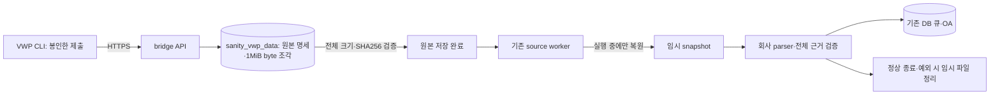

# 원본 report의 DB 보관

2026-10-26 사용자 결정으로 **HTTPS로 받은 원본 report의 영구 보관 위치를 PostgreSQL로 변경**했다. bridge의 영속 archive/upload/receipt 디렉터리는 필요 없다. 파서는 기존 회사 인터페이스를 유지하며 실행할 때만 임시 파일을 복원한다. 기존 filesystem 제출/보관 방식은 명시적 호환 경로로 남긴다.

## 저장과 처리



- 기존 VWP private 테이블에 `RAW_SUBMISSION`(불변 명세/진행), `RAW_FILE`(검증된 파일/조각 순서), `RAW_CHUNK`(원본 bytea)를 추가한다. 새 테이블·DB 로그인·GRANT·DELETE 권한은 추가하지 않는다. 원본 파일 내용은 OA private/공유 큐에 그대로 복제하지 않는다.
- 조각은 최대 **1MiB**이고 byte SHA256로 식별한다. 동일 byte 조각은 재사용한다. 파일 전체의 크기·SHA256와 명세를 대조한 뒤에만 파일을 등록하고, 모든 파일이 맞아야 제출 상태를 `VWP_UPLOADED`로 전환한다. 파일 전체를 bytea 한 필드에 넣지 않는다.
- 중간 전송의 조각만 저장된 상태는 파일 완료가 아니다. 끊긴 업로드를 재시도해도 잘못된 조각이 정상 원본을 덮어쓰지 않는다. 참조되지 않은 조각은 이후 동일 원본에서 재사용할 수 있으며 앱이 자동 삭제하지 않는다. 전체 파일 내부 offset 재개는 제공하지 않는다.
- 원문은 인코딩·개행·NULL/비 UTF-8 byte를 변환하지 않는다. 빈 파일·누락 파일·예상 밖 파일의 기존 의미를 유지한다. 파일을 JSON/base64로 통째 저장하지 않는다.
- 상태 조회는 원본 등록 상태와 기존 `SUBMISSION`의 현재 DB 상태를 읽는다. receipt 파일이 없거나 컨테이너가 재생성돼도 최종 OA 응답과 현재 처리 상태를 조회할 수 있다.
- VWP 사용자 CLI의 봉인 사본은 동일 UUID 재전송에 사용한다. **bridge의 영구 보관본이 DB**라는 결정이며 사용자 원래 report나 CLI의 재전송 사본을 자동 삭제하는 변경이 아니다.

## DB와 배포 순서

1. 양 서버의 새 공통 코드는 기존 008/009와 호환된다. 이전 설정으로 배포/검토한 뒤 DBA가 [010_raw_sources.sql](../db/010_raw_sources.sql)을 009 이후 검토·적용한다. 앱이 DDL을 실행하지 않는다.
2. 포털 설치는 기존 `plan.json`의 **55단계를 그대로 유지**하고 `raw-plan.json`의 010 단계 **56~59**를 명시적으로 선택한다. 빈 초기 DB의 전체 경로는 59단계다. 009까지 완료된 DB에는 나머지 4개 단일 문장만 준비한다. 기존 포털 도구의 0행/쓰기 중지·catalog 대조 조건은 유지한다. 데이터가 있는 DB는 DBA의 원본 migration 경로를 사용한다.
3. bridge 설정을 [schema 3 HTTPS 예제](../vwp_bridge/submission.https.example.json)로 바꾼다. `storage=postgresql`, `node_id`, `service_uid`, `allowed_hosts`, `temp_root`만 사용하며 `archive_root/upload_root`는 없다. 파일/HTTP 내용의 V2 schema는 바꾸지 않는다. **사용자 CLI 설정은 기존 schema 2**를 유지한다.
4. 기존과 같이 API·`submission_worker`·OA `submission_receiver`를 별도 관리 프로세스로 실행한다. DB migration이 없거나 private 권한 계약이 맞지 않으면 실패하며 filesystem으로 fallback하지 않는다.

포털 예시(실제 catalog/스키마/주소는 사내에서 관리):

```bash
python3 db/portal/runbook.py prepare --snapshot /private/after-009.json \
  --raw-sources --out /private/raw-storage-010
# DBA가 각 단일 문장 전후의 실제 catalog를 확인하며 실행한 뒤:
python3 db/portal/runbook.py verify --snapshot /private/after-010.json \
  --bundle /private/raw-storage-010
```

010은 기존 RUN/근거/제출·원문 크기/해시·불변성·부모/FK 제약과 제한 계정 격리를 유지하며 새 종류에만 엄격한 규약을 추가한다. 이미 실행한 migration을 재실행하지 않는다.

## 임시 파싱 공간과 Docker

`temp_root=null`이면 시스템 임시 공간을 사용한다. 선택한 임시 디렉터리는 존재하는 절대 경로여야 하며 parser가 복원하는 제출 전체를 담을 수 있어야 한다. 실행 전 여유 공간을 확인하고 부족하면 `SUBMISSION_TEMP_LIMIT`로 중단한다. DB 원본/진행 기록은 보존되므로 공간을 준비한 뒤 같은 제출을 재개한다. 저장된 자료를 잘라서 분석하지 않는다.

`compose.https.yaml`은 설정/서버 TLS만 읽기 전용으로 마운트한다. API는 원본용 영속 volume이 없고 worker의 `/tmp`는 기본 **512MiB tmpfs**다. 합성 시험 크기가 운영 원본 크기의 보장이 되는 것은 아니므로 실제 제출에 맞춰 `VWP_SUBMISSION_TMP_SIZE` 또는 승인된 임시 디스크 배치를 정한다. Docker의 read-only root·UID/GID 10001·capability 제한은 유지한다.

```bash
docker compose --env-file vwp_bridge/docker/.env \
  -f vwp_bridge/docker/compose.yaml -f vwp_bridge/docker/compose.https.yaml \
  --profile https --profile submission config --quiet
```

정상 종료·파서 예외에는 임시 디렉터리를 정리한다. 프로세스 강제 종료/호스트 장애 때 남은 scratch는 OS/컨테이너 수명 주기로 정리할 수 있고 재처리에 필요한 기준 원본은 DB에 있다. 이 임시 공간을 영구 원본이나 별도 백업 대상으로 사용하지 않는다. DB 용량·WAL·백업량은 원본 보관량만큼 함께 관리해야 한다.

## 기존 archive 이관

DBA가 010을 적용한 뒤 검토된 service 계정에서 기존 private archive 한 건을 명시적으로 가져올 수 있다.

```bash
.venv/bin/python -m vwp_bridge.submission_archive \
  --config /etc/sanity/vwp-bridge-submit.json \
  --bundle /private/old-archive/SUBMISSION_UUID
```

원본 디렉터리는 service 소유 0700이어야 한다. 같은 제출 UUID·명세·전체 byte·node ID를 보존하며 이미 등록된 내용은 정확히 대조한다. 잘못된 원본이나 같은 UUID의 다른 내용으로 기존 DB를 덮어쓰지 않는다. 기존 파일은 삭제하지 않으며 검증/백업 후의 보관 정리는 별도 운영 작업이다.

## 범위와 남은 연동

이번 변경은 원본의 DB 영구 보관·임시 파싱·재처리·상태 복구다. **제출 인증/신원·OWNER 범위 확정·SSO/RBAC 보호를 해제하지 않는다.** 개인 토큰을 필수로 하지 않는 개발용 접수 논의와 원본 저장은 구분한다. 사용자 이름만으로 검증된 제출자라고 기록하거나 미확정 입력을 OA 사람 확정/정답 사례로 공개하지 않는다.

실제 회사 SDK·report 형식/완료 의미·SSO/범위 연결·운영 DB 배포·모델 판단 품질은 사내 검증 대상이다. VWP private에 저장했다고 OA에 원본 직접 조회/다운로드 권한을 자동 부여하지 않는다. 기존 V2 원본 다운로드 API의 경계도 별도 구현 전까지 유지한다.

검증 기록은 [REVIEW.md](../REVIEW.md)에 남긴다. PostgreSQL 16.15의 최종 `quick` 230개와 PostgreSQL 12.1의 원본/migration/포털 전용 20개가 실패·오류·skip 없이 통과했다. 포털 59단계와 Docker의 DB 보관/재생성도 합성 입력으로 확인했으며 실제 사내 배포나 AI 판단 품질 검증을 대신하지 않는다.
