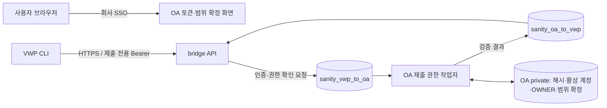

# VWP HTTPS 제출: 확정된 인증·범위·운영 정책

**후속 결정 반영:** 사용자가 개인 토큰 수동 관리의 번거로움과 개발용 업로드의 별도 인증 필요성을 재검토했다. 아래 개인 토큰 8시간/5개 정책은 현재 필수 요구로 추진하지 않는다. 최신 저장 결정은 [DB 원본 보관](DB_ORIGINALS.md)이며, 별도 개인 토큰 체계나 인증 해제를 이번 저장 변경에 포함하지 않는다. 아래 내용은 앞선 인증/범위 설계 기록으로 읽는다.

2026-10-26 사용자가 다음 세 가지를 확정했다.

1. **OA SSO 로그인 후 본인이 제출용 개인 토큰을 발급·폐기한다.** OA AI 모델용 JWT와 별개다.
2. **현재 블록 담당자(OWNER)가 예상 검사 범위를 직접 선언·확정한다.** 별도 타인 승인은 필수가 아니다.
3. **VWP CLI는 bridge에만 HTTPS 접속한다.** VWP → OA 접속을 요구하지 않는다. 사용자의 브라우저에서 OA를 이용하는 것은 별개다.

이는 정책 결정과 후속 공통 구현 계약이다. **현재 완료된 것은 HTTPS 전송·원본 보관·기존 source DB/OA 전달이다. OA 제출 토큰 발급/폐기·DB를 통한 인증/권한 확인·범위 선언/확정은 아직 미구현이다.** 기존 `SUBMISSION_AUTH_NOT_CONFIGURED`·권한/범위 차단을 유지한다. 사내 AI가 문서만 보고 공통 코드·SQL을 구현하거나 보호를 해제하지 않는다.

## 1. 함께 적용할 운영 기본값

| 항목 | 결정 / 기본값 |
|---|---|
| 계정 | 실제 회사 SSO로 검증된 OA 영속 사용자. 이름·CLI 사용자명·JWT decode로 계정 확정 금지 |
| 토큰 형식 | 서비스가 생성한 암호학적 난수 256bit 이상의 불투명 Bearer |
| 발급·폐기 | 본인 OA 화면에서 수행. 토큰 원문은 발급 응답에서 한 번만 제공. 다른 사용자의 토큰 발급/원문 조회 없음 |
| 만료 | 기본 8시간. 영구 토큰·자동 refresh 없음. 만료/분실 시 OA SSO에서 재발급 |
| 동시 사용 | 계정당 최대 5개 유효 토큰. 개별 이름·식별자·만료·폐기 상태를 관리하고 개별 폐기 가능 |
| 비밀 저장 | OA DB에는 해시만 저장. 로그·snapshot·공유 DB 큐·브라우저 영구 저장소에 원문 저장 금지. CLI는 기존 `SANITY_VWP_SUBMIT_TOKEN` 프로세스 환경 사용 |
| 제출 권한 | 현재 활성 계정 + 해당 블록 OWNER. TOP/관리자라는 이유만으로 제출 권한 자동 부여 없음 |
| 범위 확정 | OWNER 본인이 별도 OA 화면에서 예상 단위·누락·제외 근거·프로필을 확인하고 명시적으로 선언·확정 |
| 원본 보존 | bridge 로컬 영속 archive 유지. 자동 삭제 없이 시작하고, 백업·감사·재처리를 포함한 별도 보존 정책 전까지 자동 삭제 없음 |
| 전송 | 기존 HTTPS/TLS 1.2 이상·CA/호스트명 검증, 기본 8443. 실패 시 HTTP·공유 폴더·다른 계정으로 자동 전환 없음 |
| 재전송 | 동일 UUID/봉인본의 명시적 retry. 완료 파일 건너뛰기, 파일 내부 offset 재개 없음 |

8시간·동시 5개는 설계 담당자가 선택한 이 서비스의 초기 기본값이며 RFC 요구 수치가 아니다. 회사의 강제 보안·보존 규정이 따로 확인되면 그 사실과 변경 범위를 검토한다. 실제 주소·인증서·경로·개인 토큰 값은 비공개 배포 설정이며 외부 대화로 받지 않는다.

## 2. 네트워크와 DB 확인 경로

사용자는 OA SSO에서 발급한 토큰을 VWP CLI에 제공한다. bridge는 OA private 테이블을 직접 읽거나 OA 로그인/SSO 비밀을 갖지 않는다. 기존 방향별 DB 큐로 검증을 요청하고, OA가 자기 private 데이터에서 해시·만료·폐기·활성 계정·현재 OWNER를 확인한 결과를 반환한다. 토큰 원문은 큐에 넣지 않는다. 사용자 DB 계정·별도 OA↔bridge HTTP 통로·공유 로그인으로의 전환은 추가하지 않는다.

검증 요청/응답은 nonce·동작·대상 범위·입력 digest·유효 시간에 결합하고 요청별 일회용으로 처리한다. 오래된 성공 응답이나 다른 제출/파일의 응답을 재사용하지 않는다. 인증/권한 실패·기한 초과·OA 작업자 중단은 차단이며 로컬 인증 fallback은 없다. 구체적인 wire schema·예산·TTL·실패 코드는 공통 구현/시험에서 고정한다.

API는 매 요청과 긴 업로드 종료·commit에서 확인한다. worker는 분석 전 최신 계정·OWNER·범위 확정을, OA importer는 기존 최신 권한을 재확인한다. 토큰 폐기는 이후 토큰 인증을 차단하며 이미 정상 접수된 제출의 취소를 뜻하지 않는다. 이후 처리에도 계정/블록 권한 검사는 유지한다.

## 3. 범위 선언·확정 흐름

1. VWP provider는 예상 범위와 발견 파일을 분리한 V2 plan·원본 경로 대응을 반환한다. report 파일 존재만으로 필수 목록을 확정하지 않는다.
2. CLI는 bridge를 통해 정확한 plan·scope digest를 후보로 등록하고 OA 확인 링크/참조를 받는다. 이 단계는 승인이나 원본 업로드 완료가 아니다.
3. 사용자가 OA SSO로 본인 요청을 열면 현재 담당 블록의 NET_VER·revision·PRE 연결·layout·ECO·item/mode·예상/발견/누락·제외·프로필을 표시한다. 별도 확인으로 이 집합을 이번 예상 범위로 선언·확정한다.
4. OA는 검증된 확정자·정확한 `scope_sha256`·프로필/개정·시각·불변 참조를 저장하고 DB로 결과를 돌려준다. 원래 plan과 일치할 때만 CLI가 `approval` 참조를 결합한다.
5. worker/importer가 참조와 최신 권한을 검증한다. unit 추가/제외·ECO/PRE 연결·프로필 변경은 새 선언/확정이 필요하다. 같은 예상 집합의 누락 파일 도착이나 실행 ID 변경은 별도로 검증한다.

CLI의 `y`·PoR 선택·입력의 `confirmed=true`는 이 별도 확정을 대체하지 않는다. 이 기록은 중앙 필수 목록이 없는 경우 사람의 명시적 예상 범위에 대한 근거다. 회사 전체 필수 검사 수행이나 파싱/판정 PASS의 보증이 아니다. 미지원 parser·누락·미완료 실행·불명확한 점검 기준의 차단은 계속 유지한다.

## 4. DB 변경과 담당

현재 DB의 메시지 종류·scope는 CHECK allowlist다. 기존 `PING`·`SOURCE_RECEIPT`를 인증 용도로 위장하거나 제약을 끄지 않는다. 새 인증/범위 요청·응답을 위한 **후속 migration**이 필요하다. 기존 네 테이블과 제한 계정·UNIQUE·private 격리는 유지한다. 이전 HTTPS 전송 자체에는 새 DDL이 없었지만 이번 인증/범위 연동은 그 구현/검증에 포함되지 않았다.

009 이후 별도 migration과 포털 단일 문장 단계를 구현/시험한 뒤 제공한다. 운영 SQL은 DBA가 검토·적용하며 프로그램이나 사내 AI가 자동 실행하지 않는다. 아직 SQL 파일·새 메시지 처리·OA 토큰/범위 UI가 제공된 상태는 아니다.

| 담당 | 후속 작업 |
|---|---|
| 현재 대화의 Codex | OA 제출 토큰 API/화면·해시 ledger, DB 인증/권한 요청·응답/작업자, 범위 선언·확정 API/화면·영속 검증, bridge/CLI 연결, migration·포털 단계·회귀 |
| VWP 사내 AI | 기존 허용 provider에서 실제 예상 목록·원천/실행 ID·완료·도구/버전·report 경로를 대응. 공통 인증/DB 프로토콜 자체 구현 없음 |
| bridge 사내 AI | 허용 회사 parser와 실제 형식·정확성 검증. 자체 토큰 발급기·인증 서비스·권한 DB 구현 없음 |
| OA 사내 AI | 기존 허용 SSO 검증·영속 계정 대응과 실제 로그인/배정 확인. 모델 개인 JWT와 제출 토큰 구분 |
| 사내 배포 담당자/DBA | 실제 HTTPS 주소·회사 CA/서버 인증서·bridge 영속 공간/백업·DB 변경 검토/적용·프로세스 운영 |

미구현 HTTPS authority hook은 차단 상태로 두고 확정된 OA/DB 경로를 Codex가 공통 구현으로 연결한다. 내부 AI가 임의 SDK로 채워 이 결정을 대체하지 않는다. 기존 schema 1/회사 authority 경로의 권한도 넓히지 않는다.

후속 수용 시험은 실제 SSO 본인만 발급·폐기, 만료/폐기/비활성/OWNER 회수, 다른 nonce·범위·만료 응답 거부, VWP→OA 접속 차단 상태의 제출/범위 확정/OA 저장, 재시작·부분 업로드/DB 처리 복구, 기존 데이터/판정·DB 제한 권한 보존을 포함한다. 현재 전송 검증 222건을 이 미구현 기능의 통과로 표시하지 않는다.

Bearer 전달/권한 제한 참고: [RFC 6750](https://www.rfc-editor.org/rfc/rfc6750.html), [RFC 9700](https://www.rfc-editor.org/rfc/rfc9700.html). 회사 IdP의 OAuth 지원이나 OAuth Device Grant 구현을 가정하지 않는다.
