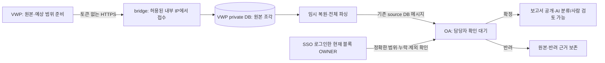

# 토큰 없는 VWP → bridge HTTPS 제출

2026-10-27 사용자 결정과 공통 구현: **VWP 제출용 토큰을 발급·입력·검증하지 않는다.** VWP와 bridge는 다른 서버이고 공유 폴더가 없으며 VWP에서 bridge로만 HTTPS 접속한다. CLI는 schema 3, bridge는 schema 4의 `submission_auth=internal_network` 설정을 사용한다. 원본은 [VWP private DB](DB_ORIGINALS.md)에 보관한다.

## 1. 접수와 OA 확정



VWP OS 계정은 **제출자 표시(신원 미확인)**로 기록한다. `UnverifiedSubmitter`는 회사 계정/권한을 가진 타입이 아니며 예약된 미확인 namespace를 사용한다. 제출 이름이나 actor 필드로 SSO 사용자를 확정하지 않는다. CLI는 `current/authorize/approval_valid` 등 회사 인증 어댑터를 호출하지 않고, provider의 V2 plan/원본 경로를 받는다. 입력의 `inventory.confirmed`와 `approval`은 미확정 상태로 정규화한다. CLI의 `y`는 전송 확인이며 OA 범위 확정을 대신하지 않는다.

OA 수신자는 기존 `WS_SUBMISSION/WS_SOURCE_PART`에 전체 파싱 결과를 staging하고 `AWAITING_CONFIRMATION`으로 둔다. **확정 전에는 WS_REPORT/WS_VERSION을 공개하지 않으며 AI·사람 판정 대상으로 등록하지 않는다.** 미확인 제출은 검증된 원천 실행의 SOURCE_RUN 키를 선점하지 않는다. 기존 source 메시지를 인증 확인 메시지로 재해석하지 않는다.

OA의 블록별 **버전·검사 대장 → VWP 제출 확인 → 범위 확인**에서 현재 OWNER가 전체 예상 범위, 프로필, PRE/POST/ECO, 누락·실행 미완료·적용 제외를 확인하고 사유를 기록한다. TOP은 자기 조회 범위에서 볼 수 있지만 확정/반려는 OWNER만 가능하다. 계정 활성·현재 권한·SSO 변경 요청 보호와 개정/내용 해시를 서버가 검사한다. 확정자·정확한 scope/manifest/content digest·시각·사유·요청 ID를 DB에 보존하며 같은 요청의 재시도는 중복 적용하지 않는다.

범위 확정은 검사 PASS나 AI/사람 판정 완료가 아니다. 예상 밖 파일·누락·미완료 실행·파서 오류 등 기존 차단 사유는 남는다. 반려 시 기존 원본/근거를 삭제하지 않는다. 정상 공개와 최종 receipt는 같은 OA 트랜잭션에 기록한다.

## 2. 설정과 회사 담당 작업

사용자 설정은 [CLI schema 3 예제](submission.https.example.json)를 `/etc/sanity/vwp-submit.json`에, bridge 설정은 [서버 schema 4 예제](../vwp_bridge/submission.https.example.json)를 `/etc/sanity/vwp-bridge-submit.json`에 배치한다. 두 파일은 root 소유, group/other 쓰기 금지다.

| 담당 | 준비할 내용 |
|---|---|
| VWP | 허용된 `CorporateSubmissionInput.prepare`와 명시적 factory, V2 plan/원본 Path, 정확한 HTTPS origin·CA·프로필 |
| bridge | 회사 parser/명시적 registry, 제한 DB 설정, TLS 인증서, 정확한 allowed_hosts, node_id·임시 공간, bridge 소켓에서 관측할 peer IP/CIDR의 allowed_client_networks |
| OA | 기존 SSO·영속 사용자·프로젝트/블록/OWNER 설정, 새 source receiver/API/UI 배포 |
| DBA | 기존 009 이후 010 원본 DB 보관 적용. 이번 토큰 없는 접수에는 추가 SQL/계정/권한이 없음 |

`allowed_client_networks`는 실제 접속 소켓의 peer IP/CIDR를 확인한다. 예제 `192.0.2.10/32`는 문서용 주소이므로 현장 값으로 바꾼다. NAT/LB가 있으면 VWP 호스트의 원래 IP와 bridge가 보는 peer가 다를 수 있다. 비어 있거나 모든 주소를 허용하는 `/0`은 거부한다. 사용자별 토큰·인증서를 배포하는 방식이 아니다. 주소를 확정하는 절차는 2.2절을 따른다.

TLS 1.2 이상과 서버 인증서/호스트명 검증을 유지한다. API는 직접 TLS로 실행하며 forwarded identity/IP/protocol 헤더를 신뢰하지 않는다. Origin·Cookie·Authorization이 있는 요청은 토큰 없는 endpoint에서 거부한다. TLS 종료 위치별 판단은 다음 표를 따른다.

`SANITY_VWP_SUBMIT_TOKEN`은 이 새 설정에서 읽지도 전송하지도 않는다. 제출 인증 SDK와 개인 토큰 발급 UI를 사내 AI가 구현할 필요가 없다. OA 모델 API의 개인 AI JWT는 별도 모델 연결 설정이며 이번 VWP 제출 변경의 대상이 아니다.

### 2.1. TLS 종료·패스스루·인그레스

현재 제공한 API 진입점은 `--tls-cert/--tls-key`가 필수이고 Uvicorn에 `proxy_headers=False`를 고정한다. HTTP 요청의 실제 scheme가 `https`가 아니면 `SUBMISSION_HTTPS_REQUIRED`로 거부한다. `X-Forwarded-Proto: https`나 `X-Forwarded-For`를 추가해 이 검사를 대신할 수 없다.

| 경로 | TLS가 끝나는 위치 / 현재 판단 |
|---|---|
| `VWP --TLS--> bridge API` | bridge에서 종료. 현재 기본 배치. CLI는 bridge 인증서 체인과 endpoint 호스트명을 검증한다. |
| `VWP --TLS--> L4 TCP 패스스루 --동일 TLS--> bridge API` | TLS는 bridge에서 종료. TLS 바이트를 바꾸지 않고 별도 PROXY protocol 헤더를 붙이지 않는 구성은 기존 직접 TLS 계약으로 배치할 수 있다. peer/Host·방화벽 조건은 현장에서 확인한다. |
| `VWP --TLS--> L7 인그레스 --HTTP--> bridge` | 인그레스에서 종료하고 뒷단은 평문 HTTP. **현재 계약에서 지원하지 않는다.** 같은 서버/사내망이어도 예외가 아니며 인증서·scheme 검사를 해제하지 않는다. |
| `VWP --TLS--> L7 인그레스 --별도 TLS--> bridge API` | 양쪽에서 별도로 TLS 종료. 구성별 추가 검토/검증 대상이며, 현재 검증된 배치로 간주하지 않는다. 아래 조건을 인프라 담당자가 확인해 Codex에 전달한다. |

TLS 재암호화가 필요하면 CLI→인그레스의 인증서/호스트 검증과 인그레스→bridge의 **서버 인증서/CA·호스트 검증**을 모두 확인한다. bridge는 이 경우 인그레스의 소켓 IP를 보므로 전용 출발 경로·허용 VWP 범위·backend 직접 접속 차단을 함께 검토한다. 원래 사용자 IP를 forwarded 헤더에서 복원해 권한으로 사용하지 않는다.

또한 Host와 `/v1/submissions/...` 경로, 정확한 Content-Length, 원본 bytes/해시, 업로드 크기·timeout이 보존되는지 확인한다. 인그레스의 chunked 전환·자동 압축/해제·redirect·인증 Cookie/Authorization 주입이 현재 요청 계약과 충돌할 수 있다. 제품명이 아니라 실제 frontend/backend protocol·인증서 검증·SNAT 동작을 기준으로 판단한다. HTTP backend만 제공하는 플랫폼에는 현재 API를 그대로 배치할 수 없으며 L4 패스스루/직접 HTTPS 경로를 확보하거나 별도 공통 설계 검토가 필요하다. 이 문서가 HTTP backend나 헤더 신뢰를 새로 허용하지 않는다.

### 2.2. 배포 전 peer IP/CIDR 확정

`allowed_hosts`는 HTTP Host 허용 목록이고 `allowed_client_networks`는 bridge가 보는 소켓 peer의 허용 목록이다. 서로 대신하지 않는다. 애플리케이션 access log는 기본 `access_log=False`이므로 **API 로그에 원래 VWP IP가 찍힐 것이라고 가정하지 않는다.**

1. 인프라 담당자에게 VWP→bridge의 실제 경로, NAT/SNAT 유무, LB의 backend 출발 IP/풀, IPv4/IPv6 및 장애 전환 시 사용 범위를 확인받는다. 배포 전에는 플랫폼의 네트워크 설정/예약 주소가 근거가 된다.
2. 관측 확인이 필요하면 승인된 VWP 호스트에서 내용 없는 TCP 연결 시도를 하고, 담당자가 bridge 측 방화벽/LB flow 기록이나 승인된 연결 메타데이터에서 peer를 대조한다. 앱을 열기 전에도 망의 연결 시도 기록으로 확인할 수 있다. 플랫폼상 별도 진단 수신이 필요하면 담당자가 실제 제출 API/DB와 분리해 좁은 방화벽 범위로 준비한다. report·토큰·요청 본문을 기록하지 않는다.
3. 단일 관측 IP만으로 전체 풀을 추정하지 않는다. 가능한 backend 출발 주소 전체와 범위의 관리 담당자를 확인해 `/32`·`/128` 또는 필요한 최소 CIDR을 설정한다. LB/NAT의 공용 egress를 여러 서비스가 공유하면 그 IP만으로 VWP를 구분할 수 없으므로 앞단 허용 범위와 backend 격리도 함께 확인한다.
4. 담당자가 root 소유 bridge JSON, 방화벽/LB 규칙, `allowed_hosts`, 인증서/CA를 대응한 뒤 API를 시작한다. peer를 모르면 배포 준비가 끝난 것이 아니며 문서 예제 주소를 운영 값으로 사용하지 않는다.
5. 실제 경로에서 TLS 검증을 유지한 **TLS handshake까지만** 수행해 인증서와 peer를 재확인할 수 있다. HTTP 제출을 보내지 않으면 원본/DB 접수는 발생하지 않는다. handshake 성공은 HTTP 허용 목록·DB·업무 처리 성공을 뜻하지 않는다. 이후 승인된 합성 제출로 별도 수용 검증한다.
6. 최종 경로·peer 풀·CIDR·관측 근거·TLS 종료 위치·확인일/담당자를 사내 배포 기록에 남긴다. 외부 문의에는 실제 주소/인프라 로그를 제거하고 경로 유형과 검사 결과만 전달한다.

`10.0.0.0/8`처럼 넓은 대역은 현재 설정 문법상 `/0`이 아니므로 입력될 수 있지만, 이를 **임시 기본 허용값이나 자동 승인 절차로 제공하지 않는다.** 토큰 없는 접수에서 허용 peer의 범위 자체가 접수 경계이기 때문이다. 전체 사내망을 먼저 열고 나중에 줄이는 방식 대신 위의 배포 전 확인을 따른다. 필요한 범위를 확정할 수 없거나 보호 방식 변경이 필요하면 기존 범위 변경/문의 절차로 인계한다.

## 3. 실행과 상태

OA의 업데이트된 source receiver/API/UI를 먼저 배포하고 기존 SSO/OWNER 연결을 확인한 뒤, bridge API/worker와 VWP CLI를 새 설정으로 전환한다. 예전 authenticated 제출이 남았다면 해당 설정/작업자로 처리하며 새 모드가 자동으로 권한을 완화하거나 이전 제출을 가져가지 않는다.

```bash
# bridge: 회사 parser·DB·TLS·허용 출발 IP 설정 후 별도 프로세스로 관리
.venv/bin/python -m vwp_bridge.submission_api \
  --config /etc/sanity/vwp-bridge-submit.json \
  --tls-cert /private/tls/server.crt --tls-key /private/tls/server.key
.venv/bin/python -m vwp_bridge.submission_worker \
  --config /etc/sanity/vwp-bridge-submit.json --interval 2

# VWP: 제출용 토큰 설정 없음
sanity submit --project PROJECT_A --block CPU --net-ver NET_01 \
  --revision preA_postB-BE --layout post --eco eco02
sanity status 11111111-1111-4111-8111-111111111111
sanity retry 11111111-1111-4111-8111-111111111111
```

`UPLOADING → VWP_UPLOADED → VWP_ACCEPTED → PARSING → DB_QUEUED` 뒤 OA 담당자의 확정을 기다린다. OA가 대기를 확인한 CLI receipt는 `DB_QUEUED/BLOCKED`와 `OA_CONFIRMATION_REQUIRED`, OA workbench 링크를 반환한다. 확정/반려 후 `OA_STORED/REJECTED`가 된다. `verified_oa_state`는 OA의 처리 응답을 확인했다는 뜻이며 제출자의 신원 인증이 아니다. 늦게 도착한 대기 receipt가 최종 결정을 덮어쓰지 않는다.

## 4. HTTP 계약·복구·호환

| 요청 | 내용 |
|---|---|
| `POST /v1/submissions/<UUID>` | 미확인 actor와 미확정 plan/manifest 등록. 같은 UUID의 다른 내용은 충돌 |
| `PUT /v1/submissions/<UUID>/files/<index>` | 정확한 Content-Length의 원본 bytes. 전체 크기/SHA256가 맞아야 파일 완료 |
| `POST /v1/submissions/<UUID>/commit` | 전체 명세/파일 검증 후 DB 원본 저장 완료 |
| `GET /v1/submissions/<UUID>` | 수신 순번·처리 상태·OA 확인 링크. 원본 다운로드/목록 검색은 제공하지 않음 |

허용된 내부 접속자는 알고 있는 새 모드 제출 UUID의 진행 상태를 조회할 수 있다. UUID와 제출자 표시는 사용자 인증/권한 증명이 아니다. 기존 authenticated 제출의 상태·수정은 새 모드로 접근할 수 없다. OA 목록·상세·확정은 SSO와 블록 권한을 검사한다.

같은 UUID/봉인 사본으로 명시적 retry를 수행하고 완료 파일은 건너뛴다. redirect·환경 proxy 탐색·자동 재시도·파일 내부 offset 재개는 제공하지 않는다. 원본 합계 16GiB/10,000파일·다음 byte 대기 60초·API 동시 연결 16과 기존 source 메시지 4MiB/1,000 records 한도를 유지한다.

기존 CLI schema 2·서버 schema 2/3의 Bearer 경로와 schema 1 폴더 경로는 명시적 호환 기능이다. 인증 실패 시 새 모드로 fallback하지 않는다. 새 배포에는 위 schema 3/4 예제를 사용한다.

## 5. Docker

`compose.yaml`에 `compose.https.yaml`을 합치고 https/submission profile을 사용한다. UID/GID 10001, 읽기 전용 root/설정/TLS, 원본용 영속 volume 없음, worker 기본 512MiB tmpfs를 유지한다. 실제 제출 전체 크기에 맞춰 `VWP_SUBMISSION_TMP_SIZE` 또는 승인된 임시 디스크를 준비한다.

```bash
docker compose --env-file vwp_bridge/docker/.env \
  -f vwp_bridge/docker/compose.yaml -f vwp_bridge/docker/compose.https.yaml \
  --profile https --profile submission config --quiet
```

환경변수는 `VWP_SUBMISSION_CONFIG_FILE`, `VWP_SUBMISSION_TLS_DIR`, `VWP_SUBMISSION_BIND_IP`와 기존 DB 설정이다. 기본 포트는 8443, 인증서 파일명은 server.crt/server.key다. 운영 DB/네트워크/실제 report 검증은 사내 담당자가 수행한다.
