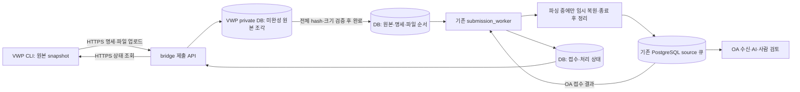

# 공유 폴더 없는 VWP → bridge HTTPS 제출

**현재 원본 보관은 [DB 방식](DB_ORIGINALS.md)이다.** 서버 설정은 schema 3이며 010 이후 원본·파일 조각·진행 상태는 PostgreSQL에 저장한다. HTTPS API/클라이언트의 V2 내용과 기존 검증은 유지한다. 현재 기본 Docker override에는 영구 원본 볼륨이 없다.

2026-10-26 사용자 확인: VWP와 bridge는 서로 다른 서버이며 공유 폴더가 없고, VWP에서 bridge로 HTTPS 접속할 수 있다. **CLI는 schema 2, DB 보관 서버는 schema 3** 설정으로 이 경로를 선택한다. 기존 schema 1 제출 폴더와 schema 2 HTTPS 파일 보관 서버는 호환 경로로 유지하며 장애 시 자동 전환하지 않는다. report의 V2 내용·원천 ID·파서·bridge↔OA PostgreSQL 네 테이블 경계는 유지한다.

**인증 방식은 후속 연결 대상이다.** [앞선 개인 토큰 설계](HTTPS_DECISIONS.md)는 사용자 재검토로 필수 요구에서 제외했다. OWNER 본인의 예상 범위 확정과 VWP → bridge만 접속하는 조건은 유지한다. 현재 전송 계층의 Bearer 요청 형식·미설정 인증 차단은 그대로이며, 별도 개인 토큰 발급이나 익명 개발 접수·OA 확정 연결을 이번 저장 변경에서 구현한 것은 아니다. 모의 인증이나 OA 모델 JWT로 대체하지 않는다.

## 1. 처리 경로와 보관 위치



- VWP 사용자 환경에는 DB·모델 계정이 없다. CLI는 표준 라이브러리만 사용하며 `~/.local/state/sanity/submissions/<UUID>/bundle`의 봉인 사본을 재전송한다.
- bridge는 기존 `sanity_vwp_data`에 원본을 최대 1MiB byte 조각과 불변 파일 명세로 보관한다. 파일 전체 hash·크기·목록이 맞아야 저장 완료이며 미완성 업로드는 worker가 분석하지 않는다. 컨테이너 재생성 후 DB와 같은 `node_id`로 상태를 읽는다.
- worker가 파싱 실행 중에만 원본 byte를 임시 복원하고 정상 종료·예외에 정리한다. 원본·처리 상태의 기준은 DB이며 영구 upload/archive/receipt 폴더가 필요 없다. 자동 원본 삭제 정책은 제공하지 않는다.
- DB 보관은 DBA가 009 이후 `010_raw_sources.sql`을 적용해야 한다. 새 테이블·계정·GRANT나 OA 파일 업로드 API는 추가하지 않는다. 원본은 VWP private에 두며 기존 source 메시지로 OA에 파싱 근거를 전달한다.

## 2. 설정과 실행

사용자 설정은 [schema 2 예제](submission.https.example.json)를 `/etc/sanity/vwp-submit.json`에, bridge 설정은 [schema 3 예제](../vwp_bridge/submission.https.example.json)를 `/etc/sanity/vwp-bridge-submit.json`에 배치한다. 두 JSON은 root 소유, group/other 쓰기 금지다. `endpoint`에는 경로·query·계정 정보가 없는 **정확한 HTTPS origin**을 지정한다. 사내 CA가 필요하면 `ca_file`에 지정한다. TLS 1.2 이상과 인증서/호스트명 검증을 사용하며 검증 해제 옵션은 없다. 010은 원본 보관 전용이며 인증/범위용 새 DB 메시지를 추가하지 않는다.

bridge의 `allowed_hosts`에는 실제 접속 DNS/IP를 정확히 열거한다. wildcard나 전달된 identity/forwarded 헤더를 신뢰하지 않는다. API는 자체 TLS로 실행하고 proxy header 신뢰를 비활성화한다. 다른 곳에서 TLS를 종료하는 배치는 이 계약에 포함하지 않는다.

```bash
# bridge: 회사 어댑터·인증서 연결 후 두 프로세스를 별도로 관리
.venv/bin/python -m vwp_bridge.submission_api \
  --config /etc/sanity/vwp-bridge-submit.json \
  --tls-cert /private/tls/server.crt --tls-key /private/tls/server.key
.venv/bin/python -m vwp_bridge.submission_worker \
  --config /etc/sanity/vwp-bridge-submit.json --interval 2

# VWP: 승인된 자격증명 도구가 SANITY_VWP_SUBMIT_TOKEN을 프로세스 환경으로 주입
sanity submit --project PROJECT_A --block CPU --net-ver NET_01 \
  --revision preA_postB-BE --layout post --eco eco02
sanity status 11111111-1111-4111-8111-111111111111 --wait --timeout 60
sanity retry 11111111-1111-4111-8111-111111111111
```

`SANITY_VWP_SUBMIT_TOKEN`은 현재 전송 인터페이스의 **제출용 자격증명 입력**이다. 값을 명령 인자·JSON·snapshot·로그에 기록하지 않는다. CLI는 `.env`를 자동 로드하지 않는다. 현재 요청 형식은 `Authorization: Bearer …`이며 발급/검증의 회사 연결은 미구현이다. 개인 토큰 수동 발급을 최종 사용 흐름으로 확정한 것은 아니다. 토큰 존재나 JWT payload decode를 신원 검증으로 취급하지 않으며 OA AI 개인 모델 JWT/공통 client key와 별개다.

## 3. 사내 연결 메서드와 차단 상태

| 위치 | 메서드 / 계약 |
|---|---|
| VWP `integration/corporate_submission.py` | 기존 `prepare/current/authorize/approval_valid`와 명시적 factory. `current`는 실제 로컬 caller·OS UID 검증. HTTPS에서는 `inbox_owner`를 호출하지 않음 |
| bridge `integration/corporate_submission.py` | `authenticate_bearer(token) → VerifiedRemoteSubmitter(issuer,subject,user_id)`. 회사 검증기로 서명·issuer·audience·만료·폐기·활성 상태를 검증한 신원만 반환. 부적합 자격증명은 `SUBMISSION_AUTH_REQUIRED` |
| 같은 bridge 파일 | `resolve_actor(actor) → VerifiedRemoteSubmitter`. service가 보관한 신원을 최신 회사 계정과 대조. 재시작/분석 시 비활성화·계정 대응 변경 차단. 클라이언트 작성 actor만으로 인증하지 않음 |
| 같은 bridge 파일 | 기존 `authorize`로 최신 블록 담당 검사, `approval_valid`로 실제 scope 승인 참조·digest·권한 검증. 제출 확인 `y`/PoR을 승인으로 대체하지 않음 |

위 표는 현재 전송 코드가 요구하는 authority 인터페이스다. 두 HTTPS 메서드는 `SUBMISSION_AUTH_NOT_CONFIGURED`이며 후속 인증/접수 설계와 연결은 Codex가 담당한다. 내부 AI가 새 회사 토큰 발급기나 별도 인증 서비스를 임의 작성하지 않는다. 기존 허용 회사 경로와 차단은 유지한다.

API는 매 요청의 인증·블록 권한과 긴 업로드 종료 시 자격증명/권한을 검사한다. worker는 분석 전에 최신 신원·권한·승인을 재확인한다. OA importer의 최신 활성 계정/블록 검사도 유지한다.

## 4. HTTP 계약과 복구

| 요청 | 내용 |
|---|---|
| `POST /v1/submissions/<UUID>` | `{submission,manifest}`로 명세 등록. 실제 인증 신원과 actor 일치 필요. 같은 UUID의 다른 명세는 충돌 |
| `PUT /v1/submissions/<UUID>/files/<index>` | manifest 파일 순번으로 원본 byte stream 전송. `application/octet-stream`·정확한 `Content-Length` 필요. 임의 경로·압축/tar 추출 없음 |
| `POST /v1/submissions/<UUID>/commit` | 빈 body. 전체 파일 크기/SHA256/명세 검증 후 DB 원본 저장 완료로 전환 |
| `GET /v1/submissions/<UUID>` | 본인의 수신 파일 순번·상태·검증된 OA 접수 결과/링크. 원본·토큰·사내 절대 경로는 반환하지 않음 |

`UPLOADING`은 전송 중, `VWP_UPLOADED`는 원본 업로드/보관 완료다. 둘 다 OA 저장 완료가 아니다. 이후 기존 `VWP_ACCEPTED → PARSING → DB_QUEUED → OA_STORED/REJECTED`를 사용한다. `OA_STORED`에도 `review_readiness=BLOCKED`일 수 있다. API와 worker는 별도 프로세스다.

CLI의 자동 재시도·redirect·환경 proxy 탐색은 없다. 연결이 끊기면 `status`로 확인하고 `retry`를 명시적으로 실행한다. 같은 UUID/봉인본의 명세를 재대조한 뒤 완료 파일은 건너뛰고 미완료 파일을 다시 보낸다. 파일 내부 offset 이어받기는 제공하지 않는다. commit 응답 유실 후 status가 `VWP_UPLOADED` 이상이면 재업로드하지 않는다. 인증 오류는 자동 갱신/다른 계정 fallback 없이 실패한다.

기존 원본 합계 16GiB·최대 10,000파일 한도를 유지하며 파일 전체를 메모리에 올리지 않고 stream으로 쓴다. 요청의 다음 byte 대기는 60초, API 동시 연결 한도는 16이다. 오류 시 부분 파일을 완료로 공개하지 않는다. bridge↔OA의 메시지별 4MiB/1,000 records 및 모델 전체 입력 한도는 별개다.

서버 구현 참고: [Starlette 요청 stream](https://www.starlette.io/requests/), [Uvicorn TLS·proxy 설정](https://uvicorn.dev/settings/). 합성 전송 시험은 실제 사내 인증·네트워크·report 정확성/AI 품질 검증과 구분한다.

## 5. Docker

bridge 이미지에 OA와 같은 pin의 FastAPI/uvicorn을 추가했다. VWP CLI는 표준 라이브러리만 유지한다. `compose.submission.yaml` 대신 `compose.https.yaml`을 사용한다. UID/GID는 10001:10001이며 설정/인증서는 읽기 전용이다. 원본용 영속 볼륨 없이 worker의 임시 파싱 공간을 제공한다.

```bash
docker compose --env-file vwp_bridge/docker/.env \
  -f vwp_bridge/docker/compose.yaml -f vwp_bridge/docker/compose.https.yaml \
  --profile https --profile submission config --quiet
docker compose --env-file vwp_bridge/docker/.env \
  -f vwp_bridge/docker/compose.yaml -f vwp_bridge/docker/compose.https.yaml \
  --profile https --profile submission up -d --no-deps vwp-submission-api vwp-submission-worker
```

필수 설정은 `VWP_SUBMISSION_CONFIG_FILE`, `VWP_SUBMISSION_TLS_DIR`, `VWP_SUBMISSION_BIND_IP`와 기존 제한 계정 DB 설정이다. `VWP_SUBMISSION_HTTPS_PORT` 기본은 8443이며 인증서 파일명은 `server.crt`·`server.key`다. worker `/tmp`는 기본 512MiB tmpfs이며 실제 제출 전체 크기에 맞춰 `VWP_SUBMISSION_TMP_SIZE` 또는 승인된 임시 디스크를 준비한다. DB 보관/임시 공간·기존 archive 이관은 [DB 원본 안내](DB_ORIGINALS.md)를 따른다. 운영 DB 적용·포트/방화벽·인증 연결은 사내 배포 담당자가 수행한다.
