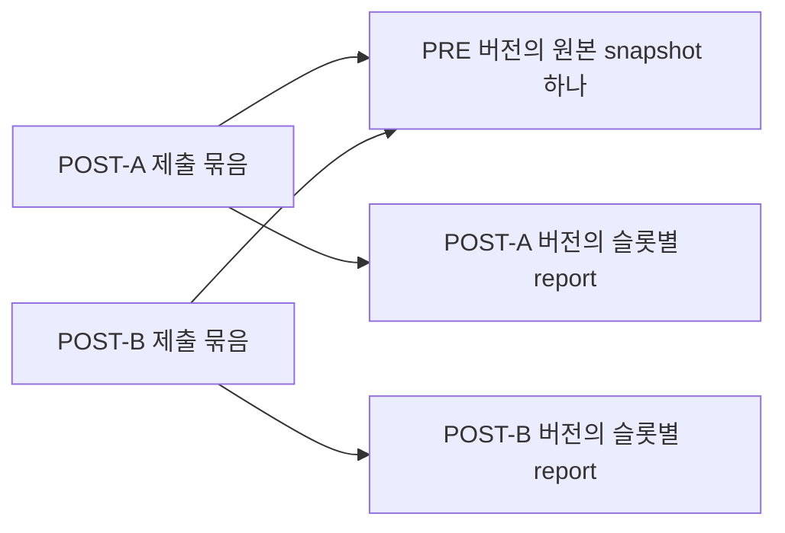

# 분산 수집·PRE/POST 버전 인계 설계 — Q1 검토 반영

기준: 2026-10-16. 사내 VWP 담당자의 비식별 Q1과 사용자의 설계 업데이트 요청을 반영한다. 후속 사용자 요청으로 **별도 V2 제출·분할 전달·workspace import의 공통 구현을 추가했다.** 실제 회사 SDK/원천 대응과 인프라는 미연결이며 [실행 안내](SUBMISSION.md)를 따른다. 기존 `CollectionPlan`/collector의 schema 1과 별도로 검증하며 보호 검사를 해제하지 않는다.

사용자가 호출할 `sanity submit/status/retry`, PATH 설치, VWP 내부 제출 폴더·bridge 원본 보관소·네 테이블 저장/응답 경로는 [사용자 제출 설계](SUBMISSION_DESIGN.md)에 확정한다. 공통 명령·spool/DB 연결과 `008_submissions.sql`을 제공했으며 실제 신원/승인·원천 SDK·마운트는 사내에서 준비한다.

## 1. 설계 결정과 적용 범위

| 문의 | 설계 결정 | 지금 가능한 일 / 공통 후속 구현 |
|---|---|---|
| Q1: 서로 다른 PRE/POST 물리 루트 | VWP 내부 export로 완료된 원본의 바이트 사본을 한 report 입력 루트에 모은다 | 회사 launcher에서 가능. 원본·예상 목록을 바꾸지 않고 기존 collector 사용 |
| Q2: 한 REVISION의 stage/design | 제출 묶음과 개별 원천 실행을 분리한다. GCA 수집 프로필의 공통 업무 단계는 `sanity`, design은 실제 블록/설계 식별자다 | V2 source별 실제 tool/version과 source stage를 보존한다. 회사의 실제 의미/값 확인 필요 |
| Q3: NET_VER/REVISION/ECO | 별도 구조화된 원천 메타데이터로 전송한다. `condition`을 버전 필드의 운반 수단으로 쓰지 않는다 | V2 `collection`·`inventory.units[].source`로 검증·전송. 기존 schema 1에는 삽입하지 않음 |
| Q4: 예상 목록 원천 부재 | 중앙 목록과 함께 **담당자가 명시적으로 승인한 범위 선언서**도 예상 목록의 원천으로 인정하도록 설계한다 | 발견 결과의 자동 승인은 금지. 실제 승인 근거 없는 schema 1은 계속 `confirmed=false`이고 기존 판정 저장/완료 차단 유지 |
| Q5: 분산 중복 수신 | 버전·검사 단위·실행·원본 snapshot·분석·전송 요청의 ID를 분리한다 | V2 source 키·workspace 논리 중복/충돌·재검사 이력을 구현. 기존 analysis/bundle 계약 유지 |

이 결정은 수집/인계 설계 변경이다. item의 판단 기준·원문 의미·SSO 권한·PoR 정책을 새로 추정하지 않는다.

## 2. 제출 묶음과 report의 소속

사용자 한 명은 자기 작업 PC의 launcher로 **하나의 제출 대상 REVISION**을 준비한다. N명의 결과를 중앙 collector가 사용자명이나 경로로 자동 수집하지 않는다. 제출 범위에는 대상 POST의 선언된 ECO 슬롯×대상 mode×item과 연결된 PRE의 대응 단위가 들어갈 수 있다.

다음 세 개념을 구분한다.

- **제출 묶음:** 사용자가 한 번에 준비한 REVISION 범위의 plan/export. 이 묶음의 포함 관계가 report의 버전을 결정하지 않는다.
- **원천 버전:** project·block·NET_VER·전체 REVISION·PRE/POST로 식별되는 소속. PRE 원문은 자기 PRE 버전에 속한다.
- **원천 실행:** 해당 버전·슬롯·item·mode의 실제 실행. 같은 버전에서 재검사하면 새 실행이며, 같은 실행을 다시 복사/전달하는 것은 재검사가 아니다.

예를 들어 POST-A와 POST-B 제출에 같은 PRE snapshot이 포함되면, 두 제출이 같은 PRE 원본을 참조한다. PRE를 각 POST의 새 report로 복제하거나 발생 건수·사례 수를 늘리지 않는다. 수신은 PoR·담당자·기존 사람 판정을 자동 변경하지 않는다.

### GCA 회사 프로필의 현장 확인 범위

Q1의 mode 3종과 `-full`, PRE/POST report 이름, 완료 표식, REVISION 분해는 **사내에서 확인할 회사 프로필**이다. 공통 collector/parser에 전역 규칙으로 하드코딩하지 않는다.

- POST 제출의 REVISION 분해와 참조 PRE의 문법을 구분한다. POST를 나누어 얻은 PRE 참조에 POST의 `_` 개수 규칙을 재적용하지 않는다. PRE 단독 제출 문법은 별도 현장 확인 대상이다.
- `ecoNN`/`ecoNNN`의 자리수·대소문자·선행 0을 임의로 통일하지 않는다. 회사가 확인한 슬롯 값과 동일성 규칙을 보존한다.
- capture mode의 미포함은 프로필의 범위 선택이다. 업무상 제외 승인과 동일하지 않다. 승인된 범위 밖이라는 근거를 보존하고, 원래 필수인 검사를 단순 누락이나 가짜 N/A로 바꾸지 않는다.
- `.done`은 해당 REVISION·ECO·mode·실행과의 연결 및 생성 의미를 확인한다. 디렉터리에 임의의 `*.done`이 있다는 사실만으로 모든 report를 완료 처리하지 않는다. parser의 전체 건수·잘림 검증은 별도로 필요하다.
- PRE 대응의 project/block/NET_VER 관계를 검증한다. 이름 앞부분이 같다는 사실만으로 다른 블록/NET_VER의 결과를 연결하지 않는다.

## 3. 로컬 export와 기존 collector의 경계

`CorporatePlanProvider.get_plan()`은 plan만 반환한다. 원문 읽기/복사·JSON 쓰기·collector 호출은 `vwp/integration/company_plan/`의 별도 launcher가 담당한다. 사내 VWP 영역의 입력 준비이며 VWP↔OA 전송 채널을 추가하는 일이 아니다.

예시 경로는 합성이며, `--reports`에 전달하는 **입력 루트 아래**를 기준으로 한다.

| 원천 종류 | export 입력 루트 아래 실제 파일 | `unit.report` |
|---|---|---|
| PRE | `pre/mission-full/gca/sample.place.rpt` | `reports/pre/mission-full/gca/sample.place.rpt` |
| POST 최초 슬롯 | `post/chip_finish/mission-full/gca/sample.run.rpt` | `reports/post/chip_finish/mission-full/gca/sample.run.rpt` |
| POST ECO | `post/eco01/mission-full/gca/sample.run.rpt` | `reports/post/eco01/mission-full/gca/sample.run.rpt` |

`collect --reports EXPORT_REPORT_ROOT`가 결과 snapshot의 `reports/` 접두사를 붙인다. 입력 경로에 접두사를 중복해서 넣지 않는다. 여러 item/report가 있으면 충돌 없는 상대 경로를 명시하며, 현재 schema 1은 unit당 한 report·unit 간 서로 다른 report 경로를 요구한다.

launcher의 필수 조건:

1. 원본은 읽기만 하고 별도 export 위치에 일반 파일로 복사한다. symlink/hardlink로 원본을 연결하거나 encoding·줄바꿈·내용을 변환하지 않는다.
2. 원본이 완료된 후 export하며, 복사 전후 원본 상태/바이트 해시와 사본의 해시를 비교한다. 이어서 기존 collector가 export 사본의 일관성을 다시 검사한다. collector의 검사가 원래 물리 루트의 변경까지 증명하는 것은 아니다.
3. 파일이 없거나 실행이 미완료인 예상 unit도 plan에 남긴다. 파일 존재에 맞춰 unit을 삭제하거나 `COMPLETED`/적용 제외로 바꾸지 않는다.
4. 선언 범위에서 발견된 예상 밖 report를 조용히 버리지 않는다. 안정된 파일은 export에 보존하여 기존 `unexpected_files`에 잡히게 하고, 미완료/식별 불명 파일은 진단·미해결 상태로 남긴다. 다른 사용자·다른 버전의 자료를 함께 내보내지 않는다.
5. plan·승인 자료·완료 표식·원천 경로 대응표는 report 입력 루트 밖에 둔다. collector는 입력 루트의 모든 일반 파일을 report 자료로 수집하므로 보조 파일을 섞지 않는다. 실제 원천 절대 경로는 사내 비공개 진단에만 기록한다.
6. 기존 `validate_plan`과 `collect`를 사용한다. 회사 launcher가 공통 검증/봉인/DB/전송을 대신 구현하지 않는다.

## 4. 예상 목록 발견과 승인

### 4.1. 인정할 예상 목록 원천

목표 설계는 다음 두 원천을 지원한다.

- 승인된 실행 설정·기준 목록 등 기존 권위 원천.
- 해당 블록의 업무 범위를 수정할 권한이 있는 담당자가 명시적으로 승인한 **예상 범위 선언서**.

디렉터리 탐색은 REVISION·ECO 등 후보를 찾는 단계다. 예상 unit은 report의 존재 여부와 독립적으로, 선언된 버전 관계·전체 슬롯·mode·item·프로필로 생성한다. 예를 들어 POST 슬롯 두 개와 PRE 하나, mode 세 개, item 하나를 선언했다면 예상 단위는 9개다. 실제 파일이 8개라면 9개를 유지하고 한 개를 누락으로 표시한다. 발견한 report 여덟 개를 예상 목록 여덟 개로 삼지 않는다.

선언서에는 project/block/NET_VER·제출 REVISION·참조 PRE, 포함할 POST 슬롯, mode/item 및 프로필 버전, 범위 밖 항목과 근거를 명시한다. 발견하지 못한 슬롯도 추가할 수 있어야 한다. 스캔한 슬롯을 사용자가 검토 없이 기본 승인한 것으로 간주하지 않는다.

### 4.2. 승인과 내용의 결합

승인은 **정확한 예상 단위 집합의 digest·프로필 버전·범위**에 결합한다. 승인 주체·시각·참조를 남기고, 실제 검증된 주체에게 해당 블록의 권한이 있는지 확인한다. 입력에 쓰인 `approved_by` 문자열, PC 로그인명, REVISION 안의 사용자명만으로 승인/권한을 인정하지 않는다.

예상 집합 digest의 대상은 원천 버전·ECO 또는 null·item·mode의 **예상 단위 identity**, 선언 범위/제외 근거, 프로필 ID/개정이다. 단위 identity는 중복을 거부하고 canonical JSON 바이트 순서로 정렬한다. 실제 파일 존재·raw hash·실행 상태·복사 시각·업로드 사용자·실제 실행 ID는 예상 집합 digest에 넣지 않는다. 같은 예상 단위의 누락 파일이 나중에 도착하는 것만으로 scope 승인이 무효가 되지는 않는다. 실행/원문/분석의 유효성은 별도 검사한다.

승인 대상 집합이 바뀌면 이전 승인을 자동 상속하지 않는다. ECO 추가, PRE 연결 변경, mode/item/프로필 범위 변경은 새 선언 개정과 승인이 필요하다. 승인은 선언한 한 묶음의 예상 범위에만 해당하며 프로젝트 전체·다른 사용자의 결과 완전성을 보장하지 않는다.

schema 1에는 이 승인 참조의 운영 연결이 없다. V2는 `scope_digest`와 `approved`로 정확한 집합/프로필·참조의 결합을 검사하고 승인 여부를 영속 전달한다. 실제 승인 원천·approver/담당 권한 조회는 회사 `approval_valid` 구현이 필요하다. 사내 AI가 승인 근거를 만들거나 `confirmed=true`만으로 통과시키지 않는다.

### 4.3. 미승인 상태와 완료

| 상태 | 허용/차단 |
|---|---|
| 후보 탐색·미승인 예상 목록 | 입력 준비·구조 검사·수집·가능한 원문 분석. 전체 완전성/승인으로 표시하지 않음 |
| `confirmed=false`인 기존 bundle | `INVENTORY_UNCONFIRMED` 유지. 기존 OA 판정 저장 및 전체 완료 차단 |
| 승인된 예상 목록 + 누락/실패/미지원/불명확 기준 | 승인과 별개로 해당 원본/분석 차단 유지. PASS·검토 완료 아님 |
| 승인된 예상 목록 + 전체 unit의 유효한 근거/사람 검토 | 기존 완료 조건을 모두 충족한 경우에만 완료 |

이번 설계에서 미승인 상태의 정식 사람 판정 저장이나 초안 자동 승격을 새로 허용하지 않는다. 중앙 예상 목록이 없을 때의 **승인 가능한 원천을 보완**하며, 현재 fail-closed 동작을 제거하지 않는다. scope 승인과 evaluation 임계값·적용 제외 승인은 서로 별개다. 임계값/업무 기준이 없으면 추정하지 않고 `FACTS_REQUIRED`로 인계한다.

## 5. 필드 배치와 계획 V2

### 5.1. 현재 schema 1

- GCA 수집 프로필의 `run.stage="sanity"`는 이 프로젝트의 공통 수집 업무 단계라는 **설계상의 매핑**이다. 회사의 물리 실행 단계가 확인됐다는 뜻이 아니다. mode·PRE/POST·ECO·REVISION을 stage로 합쳐 표현하지 않는다. 다른 기존 프로필의 stage 의미는 변경하지 않는다.
- `run.design`에는 확인된 설계/블록 식별자를 사용한다. NET_VER는 design의 대체 값이 아니다. `run.project/design`을 workspace 내부 ID로 자동 재해석하지 않는다.
- `run.tool/tool_version`는 한 쌍만 표현한다. PRE/POST 사이에 실제 도구 버전 등이 다르면 하나로 위장하지 않는다. 별도 V2에서 source별로 전달하며 실제 값이 미확정이면 `FACTS_REQUIRED`로 인계한다.
- `unit.condition.mode` 등 승인된 실행 조건만 condition에 둔다. NET_VER·REVISION·PRE/POST·ECO의 workspace 연결을 위해 임의 키를 끼워 넣지 않는다.
- `get_plan()` 반환 서명과 schema 1은 유지한다. 새 메타데이터는 비공개 대응표/설계 fixture로 준비하며 legacy validator가 우연히 통과해도 지원된 전송 필드로 취급하지 않는다.

### 5.2. 목표 CollectionPlan V2의 논리 필드

다음은 구현된 V2의 필드 배치다. 정확한 허용 키·타입은 [common/sanity_submission.py](../common/sanity_submission.py)의 `validate_plan`, SDK/실행은 [SUBMISSION.md](SUBMISSION.md)를 따른다. 기존 schema 1 collector가 아닌 새 제출 CLI/source 작업자에 전달한다.

| 위치 | 필드와 의미 |
|---|---|
| `collection` | `source_namespace`, `project_key`, `block_key`, `net_ver`, `submission_revision`, `layout`, `target_eco`, `pre_revision`, `stage`, `profile_id`, `profile_version` — 제출 묶음의 범위 |
| `inventory` / 최상위 `approval` | inventory의 승인 여부/원천/개정과 `units`; approval은 null 또는 정확한 집합에 결합한 `scope_sha256`, `reference`, `actor`, `approved_at` |
| `inventory.units[].source` | `net_ver`, `revision`, `layout`(PRE/POST), `eco`, `mode`, `execution_ref`, `execution_order`(권위 있는 비음수 정수), `source_stage`, `tool`, `tool_version` — report 자신의 원천 버전/실행 |
| `inventory.units[]`의 추출/판정 입력 | `review_unit_id`, `item_id`, `family`(GCA/VCLP/SPYGLASS), `report`, `parser`, `rule_version`, `condition`, `identity_fields`, `execution_status`, `applicable`, `exclusion`, 필요한 `evaluation`의 기존 의미 유지 |
| 봉인 산출물 | 정규 상대 경로·실제 raw bytes hash·snapshot/분석/전송 식별자. provider가 미리 검사 완료 값으로 채우지 않음 |
| 전달 감사 | 검증된 전달자·수신 시각·요청 ID. 원천 실행/버전 ID와 분리하고 클라이언트 주장만으로 신원 확정하지 않음 |

PRE의 `eco`는 `null`이다. 물리 export 경로의 `pre/`를 업무 ECO 값으로 저장하지 않는다. POST에는 실제 `chip_finish` 또는 확인된 ECO 값이 필요하다. `units[].source.revision/layout`이 제출 묶음과 다를 수 있는 경우는 검증된 PRE 대응이며, 다른 POST 버전을 무조건 합치지 않는다. mode의 중복 표현이 있으면 `condition.mode`와 일치해야 한다.

원천 버전 scope는 데이터 소유·감사·원문 조회에 엄격히 유지한다. 사례 재사용 범위는 별도로 검사하며 project/block/item·parser/규칙·실행 조건과 버전 호환성 확인을 유지한다. REVISION을 condition에서 분리했다는 이유로 다른 버전의 사례를 무조건 재사용하지 않는다. 기존 legacy scope 계산은 그대로다.

## 6. ID와 분산 재수신

`H(value)`는 프로젝트의 canonical JSON에 대한 SHA-256 digest다. 입력 배열의 순서·문자열 값은 계약대로 고정한다. 원천 이름의 자의적인 소문자화·접미사 삭제·사용자명 제거로 같은 ID를 만들지 않는다. 원천 ID와 OA 내부 ID의 관계는 검증된 대응표를 사용한다.

| ID 계층 | 설계 입력 / 역할 |
|---|---|
| 버전 키 | `sv-` + `H([source_namespace, project_key, block_key, net_ver, full_revision, layout])` — 사용자 PC·복사 경로와 무관한 원천 버전 |
| 단위 키 | `su-` + `H([version_key, eco_or_null, item_id, mode])` — 해당 버전/슬롯의 검사 조건 |
| 실행 키 | `sx-` + `H([unit_key, execution_ref])` — 같은 단위의 실제 재검사 구별 |
| 원본 식별 | `(execution_key, raw_sha256)` — 특정 실행의 불변 원문. 재전달은 같은 값 |
| 분석 식별 | 실제 source별 run/inventory/file/producer/parser 계약을 사용한 기존 `PgEvidence.analysis_id`. report ID는 `sr-` + `H([execution_key, raw_sha256, analysis_id])` |
| 제출 내용/전송 식별 | 봉인된 전체 제출 payload의 내용 digest — 내용이 바뀐 제출을 기존 ID로 덮어쓰지 않음 |
| 요청 UUID | 같은 업로드/편집 요청 재시도는 재사용. 다른 내용을 같은 UUID로 보내면 충돌 |

한 unit에 여러 독립 report가 필요하면 report-kind 식별과 parser 입력 계약을 별도로 확장해야 한다. 현재 unit당 report 하나 제약을 filename/index로 몰래 우회하지 않는다.

`execution_ref`는 원천에서 확인된 불변 실행 식별자다. 원천이 ID를 제공하지 않는다면 현장 담당자가 재검사 구분·최초 발급·재전달 보존 규칙을 정해 인계해야 한다. PC별 임의 UUID, 복사 시각, mtime 또는 내용 해시만으로 **실행 ID가 확정됐다**고 보지 않는다. 원천 ID 없이 내용까지 같은 두 실제 재검사를 구별할 수 있다고 약속하지 않는다. 이 사실이 미확정이면 해당 운영 연결은 `FACTS_REQUIRED`다.

원천 snapshot 키와 제출 내용 ID에는 전달자·사내 절대 경로·복사 시각을 사용하지 않는다. 전달 감사 정보는 별도 기록한다. 원천 실행이 같으면 다른 PC에서 재전달해도 같은 원본을 가리켜야 한다. 서로 다른 원천 실행이면 바이트가 같아도 별도 발생이다.

`raw_sha256`는 원본 파일 bytes의 hash다. 기존 workspace의 `source_sha256`는 정규화한 report snapshot의 digest이므로 서로 대체하지 않는다. import 후에도 파일 무결성, 파싱/분석 계약, workspace 검토 대상의 결합을 각각 검증한다.

### 수신의 원자성·충돌 정책

한 collection이 하나의 무제한 메시지라는 뜻은 아니다. 구현된 SOURCE_MANIFEST/PART/COMMIT는 envelope 포함 압축 전/후 각각 4MiB, data part당 최대 1,000 records다. 전체 예상 집합·조각 순서/건수/해시와 원천 참조를 검증하기 전에는 collection을 수신 완료로 표시하지 않는다. 영속 수신 staging과 최종 적용을 구분하며 조각 재전송·재개는 동일 불변 자료를 참조한다. 기존 schema 1의 64MiB 등 한도를 회사 wrapper가 늘리거나 자료를 잘라 완료로 표시하지 않는다.

1. 입력 전체의 ID/소속/예상 집합/승인/해시를 검증하고, 적용은 원자적으로 수행한다. 기존 네 테이블과 제한 로그인·DB 큐 경계를 유지한다. 추가 종류/제약/인덱스는 `008_submissions.sql`이며 운영 적용은 DBA 검토 대상이다.
2. 같은 버전 키는 기존 workspace 버전에 연결한다. 표시 이름·파일명·REVISION의 사용자명으로 새 사용자/블록을 만들지 않는다.
3. 같은 단위·실행·원문이면 원본 occurrence를 추가하지 않는다. 다른 제출에 포함된 사실과 검증된 전달 감사는 별도 연결로 남긴다. 서로 다른 payload의 bundle ID가 다르다는 이유만으로 같은 PRE 원문을 중복 생성하지 않는다.
4. 같은 단위·실행에서 다른 raw bytes가 오면 완료된 실행의 원문 불변성 충돌이다. 기존 원문/판정을 덮어쓰지 않고 충돌로 보류한다. 실제 재실행은 새 `execution_ref`로 구분한다.
5. 동일 원문에 parser/규칙을 바꿔 재분석하면 별도 분석 개정을 만든다. 과거 분석·사람 판정·분류 근거·PoR을 자동 승계하거나 삭제하지 않는다.
6. 새 ECO 또는 예상 범위 변경은 새 선언/제출 개정이다. 기존 원천 버전·PRE·다른 ECO의 report를 새로 복제하지 않는다. 최신 표시의 순서는 원천 실행 순서에 근거해야 하며 수신 시각/ID 정렬로 실제 최신 실행을 추정하지 않는다.

기존 bridge의 `analysis_id`는 run/inventory/files/producer/parser 계약으로 결정되고 OA legacy 수신은 `bundle_id`로 동일 bundle을 식별한다. 별도 V2 source 경로가 위 workspace 논리 키·이력/최신 목록을 연결하며 기존 ID를 재해석하지 않는다. 사내 AI는 SQL을 수정하지 않는다.

## 7. 담당과 구현 순서

| 작업 | 담당 / 산출물 |
|---|---|
| 회사 프로필·원천 대응 | VWP AI: 허용된 `company_plan/`에서 directory 후보 탐색·승인된 선언 입력 대응·로컬 export·전용 합성 테스트·원천 ID/완료 의미 자료 |
| parser 의미 확인 | VWP AI가 정답·의미를 사내 인계하고 VWP-bridge AI가 허용된 parser/등록/전용 테스트 구현 |
| COMMON-02A | Codex: V2 타입/validator, collection과 원천 실행 분리, versioned 계약과 schema 1 호환/거부 경계 |
| COMMON-02B | Codex: 예상 선언/승인 검증·내용 결합·권한 연결. 회사 증거는 VWP/OA 담당자가 제공 |
| COMMON-02C | Codex: VWP 봉인/DB 전달과 OA 원자 import·논리 키·중복/재검사/충돌·PRE 참조 보존 |
| COMMON-02D | Codex: workspace source/분석 개정·누락 상태·감사 연결과 기존 UI 흐름 연결 |
| COMMON-02E | Codex: 사용자 CLI·설치/설정, VWP 내부 제출 폴더 접수·영속 원본 보관·DB 접수/응답·receipt 조회/재개. [제출 설계](SUBMISSION_DESIGN.md) 기준 |

COMMON-02A~E의 공통 구현은 제공했다. 실제 원천/신원·승인 SDK, 인증된 VWP mount/ACL, OA 계정/담당 준비와 운영 DB 적용은 남아 있다. SSO 업무 연결은 COMMON-01, 회사 모델 job은 COMMON-03~05와 함께 관리한다. 회사 wrapper가 공통 작업자를 대체하지 않으며 운영 쓰기·SQL 적용·배포는 기존 사용자 관리 절차를 따른다.

### 사내에서 추가 확인할 사실

- project/block의 안정 키와 NET_VER/전체 REVISION의 정확한 원천 대응, PRE 연결의 유효 범위.
- PRE 단독 제출 문법, POST REVISION 문법, ECO alias/자리수 규칙, mode/item 프로필의 승인 범위.
- `.done`이 가리키는 실행·완료/실패 의미, PRE와 POST의 실제 tool/version·source stage.
- **동일 버전 재검사를 구별하는 원천 `execution_ref`와 순서** 및 다른 PC 재전달 시의 보존 방식.
- 범위 선언을 승인할 담당 권한/검증 경로, 평가 임계값·단위·적용 제외의 실제 승인 근거.

사실 미확정은 `FACTS_REQUIRED`, 예상 밖 구현 오류는 `WAITING_FOR_CODEX`다. 이 문서는 내부 AI의 보호 파일 수정·사내 원문 외부 공개·자체 인증 구현 권한을 추가하지 않는다.

## 8. 수용 시나리오

아래는 수용 기준이다. 합성/독립 PostgreSQL에서 실행한 범위와 결과는 [REVIEW.md](../REVIEW.md)에 기록하며, 회사 원천 의미·SSO·실제 mount/TLS/DB 검증을 대신하지 않는다.

| 입력/행동 | 기대 결과 |
|---|---|
| POST 슬롯 2개 + PRE, mode 3개, item 1개 중 파일 1개 누락 | 예상 9개 유지, 실제 8개·누락 1개. 누락을 N/A/PASS로 대체하지 않음 |
| 디렉터리 발견 결과만 전달 | 자동 승인 없음. 미승인 상태와 기존 완료/판정 차단 유지 |
| 권한 있는 담당자의 정확한 예상 집합 승인 | 그 집합·범위·프로필 개정에만 유효. 누락/실패/기준 불명 차단은 별개 |
| 승인 후 ECO 추가 또는 PRE/프로필 변경 | 기존 승인 자동 승계 없음. 기존 report/검토 보존, 새 범위 확인 필요 |
| PRE/POST 원본이 다른 루트·같은 basename | 고유 상대 경로로 byte 동일 export. 원본 불변, 보조 파일은 report 루트 밖 |
| export 중 원본 변경 또는 report 쓰기 미완료 | 수집 성공/완료로 표시하지 않음. 부분 결과를 정식 import하지 않음 |
| 서로 다른 project/block에 같은 NET_VER/REVISION/ECO | 버전·원문·판정·권한 혼합 없음 |
| 같은 snapshot을 다른 PC가 재전달 | 같은 원본 occurrence로 연결하고 전달 감사만 추가 |
| POST-A·POST-B가 동일 PRE 실행을 포함 | PRE 버전과 원문은 하나, 두 제출의 참조 보존. 중복 로그/사례 없음 |
| 같은 단위/실행 키에 다른 원문 | 충돌 보류, 원본/기존 판정 덮어쓰기 없음 |
| 같은 버전에서 새 실행 ID로 재검사, 바이트는 동일 | 별도 실행으로 보존. 이전 판정 자동 승계 없음 |
| 원천 실행 ID 정책이 없고 동일 바이트 재검사가 존재 | 구별 가능하다고 추정하지 않고 `FACTS_REQUIRED` 인계 |
| 동일 원문을 새 parser/규칙으로 분석 | 원문과 버전은 유지, 분석 개정 분리·판정 재검토 |
| PRE/POST의 tool/version이 서로 다름 | 각각의 실제 버전 유지. schema 1 한 값으로 평탄화 금지 |
| REVISION에 다른 사용자의 이름이 포함 | 인증 주체/담당 권한은 검증된 계정과 블록 배정으로 판단 |
| 단순 수신 또는 버전/슬롯 선택 | PoR·사람 확정·SSO/CORPORATE 보호 상태 변경 없음 |
| 여러 대용량 report로 collection이 전송 한도를 초과 | 한도 내 분할/재개, 부분 수신은 미완료, 전체 참조·건수·해시 검증 후 적용. 절단/중복/무제한 메시지 없음 |
