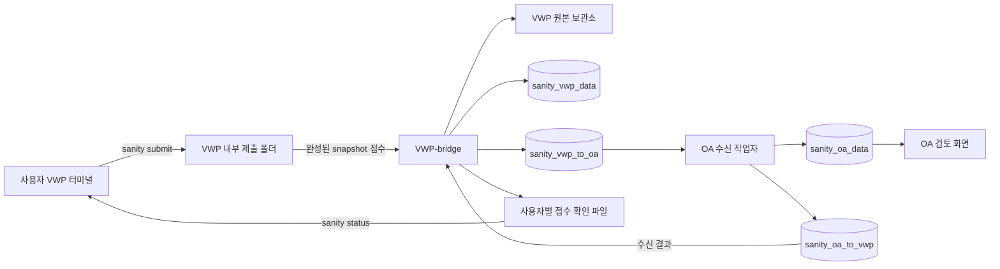

# 사용자 report 제출 명령과 저장 경로

**현재 구현:** [토큰 없는 HTTPS 접수와 OA 범위 확정](HTTPS_SUBMISSION.md)을 사용한다. CLI schema 3·bridge schema 4이며 원본은 010 이후 VWP private DB에 보관하고 파싱 중에만 임시 복원한다. OA SSO OWNER의 명시적 범위 확정 전에는 보고서를 공개하지 않는다. 아래 공유 파일시스템·영구 archive·신원/승인 어댑터 설계는 legacy 호환 경로의 기록이다.

기준: 2026-10-16. 사용자가 VWP에서 직접 호출하는 명령, VWP-bridge 접수, PostgreSQL 저장, OA 반영을 정한다. **공통 CLI·접수/보관·V2 분할 송수신·OA 조회를 구현했다.** 실제 회사 SDK/신원·승인·report 경로, 제출 파일시스템과 운영 DB 적용은 사내에서 연결·검증해야 한다. 실행 코드·설정·회사 메서드·시험 방법은 [SUBMISSION.md](SUBMISSION.md)를 따른다.

원천 버전·실행·PRE 재사용·예상 범위 승인 정책은 [SOURCE_COLLECTION_DESIGN.md](SOURCE_COLLECTION_DESIGN.md)를 따른다. 이 문서는 그 설계의 사용자 진입점과 운영 저장 경로를 보완한다. schema 1의 `collect`/`analyze`와 SSO·CORPORATE 보호 상태를 유지하고 네 테이블의 확장은 새 `008_submissions.sql`로 제공한다. 사내 실경로·계정·report는 이 공개 문서에 기입하지 않는다.

## 1. 결정한 전체 경로



- 사용자는 **원본 report에 접근 가능한 자기 VWP 작업 환경의 터미널**에서 실행한다. OA 웹의 파일 업로드나 사용자 PC의 DB 직접 쓰기를 진입점으로 삼지 않는다.
- 사용자 작업 환경과 VWP-bridge 사이에는 **VWP 내부의 인증된 공용 제출 파일시스템**을 사용한다. 같은 서버에서도 동일한 폴더 계약을 사용한다. OA에는 이 파일시스템을 마운트하지 않는다.
- VWP-bridge만 VWP 제한 DB 로그인으로 분석·송신을 수행한다. OA는 자기 제한 로그인으로 수신·업무 저장을 수행한다. VWP↔OA 간 전송은 기존 PostgreSQL 네 테이블만 사용한다.
- 제출 폴더는 입력 인계와 상태 조회를 위한 것이다. PostgreSQL 장애 때 대신 업무 데이터를 확정하는 임시 DB가 아니다.

## 2. 설치와 사용자가 실행할 명령

### 2.1. 설치 위치

사용자는 저장소 루트로 이동하거나 Python 모듈 경로를 알 필요가 없어야 한다. 배포 담당자가 검토된 Git checkout과 해당 환경의 Python 실행기를 다음 위치에 설치한다. 아래는 **채택한 기본 배포 경로**이며 현재 이 저장소가 생성한 디렉터리가 아니다.

| 위치 | 용도 / 관리 주체 |
|---|---|
| `/opt/sanity/releases/<release-id>/` | 서버별 Git checkout·의존성. 배포 담당자 관리, 일반 사용자 읽기/실행 |
| `/opt/sanity/current` | 검토한 release를 선택하는 배포 링크. 실행 시작 시 실제 release 경로를 고정 |
| `/opt/sanity/current/bin/sanity` | 제공한 `bin/sanity` 사용자 명령. 승인된 회사 입력 어댑터를 명시적으로 주입 |
| `/etc/sanity/vwp-submit.json` | 사용자 설정: `schema_version`, `spool_root`, `storage_id`, `service_uid`, `default_profile`. DB 비밀 없음 |
| `/etc/sanity/vwp-bridge-submit.json` | 같은 다섯 키와 bridge의 `archive_root`, `node_id`. 회사 SDK는 고정 어댑터에 명시적 주입하며 동적 모듈/자원 한도 키는 받지 않음 |

배포 담당자는 VWP 사용자의 표준 shell 환경에서 `/opt/sanity/current/bin`을 PATH에 한 번 등록한다. 회사의 실제 설치 마운트가 다르면 두 설정의 경로를 함께 대응하고 비공개 배포 기록에 남긴다. 사용자별 alias·현재 작업 폴더·서로 다른 checkout에 따라 명령 구현이 달라지지 않게 한다. 두 JSON 설정은 `common/sanity_submission_files.py`가 읽고 기존 `.env`/`common/sanity_config.py`와 분리한다. 예제와 필수 소유권/마운트 조건은 [실행 안내](SUBMISSION.md#2-설치설정인프라)를 따른다. 내부 AI가 공통 설정을 임의 변경하지 않는다.

### 2.2. 일반 제출

아래는 합성 값으로 쓴 **사내 어댑터/인프라 연결 후 사용 예시**다.

```bash
sanity submit \
  --project PROJECT_A \
  --block CPU \
  --net-ver NET_01 \
  --revision preA_postB-BE \
  --layout post \
  --eco eco02
```

| 인자 / 명령 | 계약 |
|---|---|
| `--project`, `--block`, `--net-ver`, `--revision`, `--layout` | 대상 명시 필수. 등록된 project/block과 확인된 전체 REVISION을 사용. 현재 디렉터리나 REVISION 안의 사용자명에서 권한을 추정하지 않음 |
| `--eco` | POST에서는 이번 추가/검토 대상 ECO 필수. PRE 단독 제출에서는 받지 않으며 source ECO는 null. ECO를 생성·증가시키는 명령이 아님 |
| `--profile` | 선택. 생략하면 배포 설정에 명시된 승인 대상 프로필 사용. item·mode·PRE 관계·예상 범위의 버전을 미리보기에서 표시 |
| `--dry-run` | 후보·예상 목록·원천 관계·미확정 사실을 확인. 제출 폴더 공개·DB 쓰기 없음. 실제 제출 시 원본 상태와 확인 내용을 다시 검사 |
| `sanity status <submission-id>` | service가 작성한 자기 접수 확인 파일 조회. DB 자격증명 불필요. `--wait`는 상태 갱신을 기다리며 timeout/중단이 제출 취소를 뜻하지 않음 |
| `sanity retry <submission-id>` | 동일 UUID·동일 봉인 내용의 전달/접수 재개. report를 다시 읽어 다른 바이트로 교체하거나 새 검사 실행을 생성하지 않음 |

report 위치는 사내 VWP 담당자가 구현한 회사 입력 어댑터가 확인된 경로 규칙으로 찾는다. 사용자는 `plan.json`, 임시 export 경로, DB 주소를 직접 작성하지 않는다. 경로 대응이 불명확하면 후보를 실제 사실처럼 제출하지 않고 `FACTS_REQUIRED`를 표시한다.

**`--eco eco02`는 전 REVISION 예상 목록을 eco02 파일만으로 축소하라는 뜻이 아니다.** Q1의 한 REVISION 제출 원칙을 유지한다. 회사 원천/선언에 `chip_finish`, `eco01`, `eco02`와 PRE가 포함돼 있다면 미리보기에 그 전체 예상 범위를 보여준다. 초기 구현은 그 범위의 snapshot을 준비하며, 재포함된 과거 ECO/PRE는 서버에서 같은 원본으로 연결한다. 파일 전송 생략 최적화는 검증된 서버 원본 참조 계약을 추가하기 전에는 제공하지 않는다. 다른 제출에 이미 파일이 있었다는 이유로 이번 예상 누락을 임의로 숨기지 않는다.

### 2.3. 확인 화면과 응답

명령은 제출 전에 다음 내용을 한 화면에 보여주고 명시적인 확인을 받는다.

1. 검증할 계정, 프로젝트·블록·NET_VER·전체 REVISION·PRE/POST, 이번 대상 ECO.
2. 실제 제출 범위의 전체 ECO·연결 PRE·item·mode와 프로필 개정, 예상/발견/누락/미완료/예상 밖 report 수와 전체 바이트 수.
3. 예상 범위 승인 여부·승인 참조. 제출 확인과 업무 범위 승인은 별개이며, 단순 `y` 입력으로 `inventory.confirmed=true`를 만들지 않는다.
4. 원천 실행 ID·도구 버전·완료 의미 등 미확정 사실과 검토 차단 사유.

예상 report 누락이나 미승인 범위는 현재 계약처럼 보존해 제출할 수 있지만 미완료/미승인 상태로 남는다. 소속·신원·원천 실행 동일성을 검증할 수 없거나 원본이 복사 중 바뀌면 정상 접수로 진행하지 않는다. 완성된 파일 중 일부만 읽고 전체 성공으로 표시하지 않는다.

제출 폴더에 완성된 내용을 공개한 직후 출력 예시:

```text
submission_id=11111111-1111-4111-8111-111111111111
delivery_state=LOCAL_QUEUED
OA 반영 전입니다. sanity status <submission_id>로 확인하세요.
```

기본 `submit`의 종료 코드 0은 **제출 폴더에 인계 완료**만 뜻한다. bridge 접수·DB 저장·OA 반영·검토 완료·PASS를 뜻하지 않는다. `status --wait`는 종료 시점의 상태를 그대로 표시하고 미완료 timeout을 성공으로 바꾸지 않는다. 사용 취소는 제출 폴더 공개 전에만 가능하며, 공개 후 터미널을 닫아도 접수 작업은 계속된다. OA 반영 후에는 인증된 자기 범위의 workspace 이동 링크와 검토 가능/차단 사유를 표시한다.

## 3. 파일이 저장되는 위치

`<principal-key>`는 사내에서 검증한 불변 신원을 대응한 디렉터리 키다. 사용자 입력·표시 이름·PC의 임의 환경변수로 정하지 않는다. `<submission-id>`는 CLI가 준비 시작 시 한 번 만들고 영속화하는 UUID다. 경로에 project/REVISION/ECO의 자유 문자열을 직접 삽입하지 않는다.

| 단계 | 기본 경로 | 내용 / 접근 |
|---|---|---|
| 사용자 로컬 준비 | `$XDG_STATE_HOME/sanity/submissions/<submission-id>/`; XDG 미설정 시 `$HOME/.local/state/sanity/submissions/<submission-id>/` | 자기 상태·계획/승인 참조·export·snapshot·해시. 사용자만 접근. DB/모델 비밀 없음 |
| VWP 내부 인계 중 | `/srv/sanity/vwp-submit/inbox/<principal-key>/.<submission-id>.partial/` | snapshot 사본과 제출 manifest 준비. bridge는 접수하지 않음 |
| VWP 내부 인계 완료 | 같은 부모의 `<submission-id>.ready/` | 전체 파일·크기·해시·manifest 확인 후 같은 파일시스템에서 atomic rename으로 공개 |
| VWP-bridge 원본 보관 | `/var/lib/sanity/vwp-bridge/submissions/<submission-id>/` | service가 직접 복사·검증한 byte 동일 snapshot, manifest, 분석 참조. bridge 전용 영속 볼륨 |
| 사용자 접수 확인 | `/srv/sanity/vwp-submit/receipts/<principal-key>/<submission-id>.json` | service만 작성, 해당 사용자 읽기. 상태·시각·차단 코드·허용된 OA 링크만 포함 |
| bridge 비공개 진단 | 원본 보관 디렉터리의 `diagnostics/` | 절대 원천 경로 대응·비공개 오류 진단. 일반 접수 확인 파일/공유 DB payload와 분리 |

로컬 준비의 plan·승인 자료·경로 대응표는 `reports/` 밖에 두며, collector의 입력 report 루트에는 report만 둔다. 인계 완료 디렉터리에는 `submission.json`과 `snapshot/`을 두고, `snapshot/` 안의 manifest/report 형식은 구현할 V2 계약으로 검증한다. `submission.json`은 전송 UUID·내용 digest·프로토콜/release·예상 범위 참조를 포함한다. 현재 schema 1에 sidecar를 추가하면 이 계약을 지원하는 것이 아니다.

### 3.1. 사내 제출 파일시스템의 배포 조건

- `/srv/sanity/vwp-submit`은 **사용자 VWP 작업 환경과 VWP-bridge 양쪽에 동일한 내용으로 제공하는 사내 저장소**다. 로컬 경로 문자열만 같은 서로 다른 디스크로 배포하지 않는다. OA·브라우저·외부 네트워크에는 제공하지 않는다.
- 사내에서 검증 가능한 파일 접속 신원과 사용자별 ACL을 제공해야 한다. 사용자는 자기 inbox만 작성하고 자기 receipt만 읽는다. bridge는 inbox를 읽고 receipt를 쓰며, 다른 사용자가 원문·접수 정보를 읽을 수 없어야 한다. 사용자 PC가 임의로 제시하는 UID/파일 소유자만 신뢰하는 구성은 사용할 수 없다.
- 회사 신원→불변 계정→프로젝트/블록 권한을 bridge에서 검증하고 OA import 시 최신 배정으로 다시 검사한다. 제출/재개는 해당 블록의 검증된 담당자만 가능하며 TOP 조회 역할만으로 제출 권한을 주지 않는다. manifest의 `submitted_by`나 디렉터리 이름은 권한 증거가 아니다. 필요한 신원/배정 원천은 COMMON-01과 사내 대응 자료로 연결하며 검증 수단이 없으면 접수를 차단한다.
- rename·쓰기 완료·장애 후 가시성·ACL이 실제 사내 파일시스템에서 보장되는지 배포 전에 검증한다. 미구비 시 `SUBMISSION_STORAGE_NOT_CONFIGURED`로 중단한다. HTTP/SCP·개인 DB 계정·OA 공유 폴더로 자동 우회하지 않는다.

### 3.2. 접수와 원본 불변성

`.ready`는 접수 후보라는 표시다. 사용자가 그 폴더를 쓸 수 있었으므로 bridge가 신뢰한 보관본을 대신하지 않는다.

1. bridge는 경로 탈출·symlink/hardlink·특수 파일·manifest 밖 자료와 자원 한도를 검사한다. 완료 report의 바이트·크기·예상 목록과 원천 실행 참조를 검증한다.
2. bridge 전용 영속 볼륨의 임시 디렉터리로 일반 파일 사본을 만들고 해시를 재검사한다. 완성된 보관본만 공개하고 그 상대 보관 참조와 manifest digest를 DB 접수 기록에 결합한다. 사용자는 보관본을 수정할 수 없다.
3. 보관 완료 후 DB 등록 전에 중단되면 같은 UUID와 digest로 등록을 재개한다. DB 등록 후 receipt 갱신 전에 중단되면 DB에서 receipt를 재생성한다. 파일 rename과 DB commit을 하나의 원자적 작업이라고 주장하지 않는다.
4. 동일 UUID에 다른 내용은 `SUBMISSION_CONFLICT`다. 기존 보관본·분석·사람 판정을 덮어쓰지 않는다. 이상 입력의 비공개 진단을 남기되 분석 완료로 승격하지 않는다.
5. 여러 bridge 작업자가 같은 제출을 발견해도 DB 잠금/lease와 불변 내용 대조로 한 논리 접수만 진행한다. 작업자의 로컬 보관 볼륨이 다른 경우 다른 노드가 파일을 가지고 있다고 가정하지 않는다. 원본 보관 volume을 소유한 작업자로 고정하거나 동일한 접근을 보장한 영속 volume으로 배포한다.

## 4. DB의 저장 위치와 메시지 방향

### 4.1. 네 테이블의 소유권

| 저장 위치 | 기록 주체 | 제출 시 저장할 내용 |
|---|---|---|
| VWP의 원본 보관 볼륨 | VWP-bridge service | 원본 report의 byte 동일 사본·manifest. 전체 report 파일의 기준 보관본 |
| `sanity_vwp_data` | VWP 제한 로그인 | 접수 UUID/신원/내용 digest·보관 참조·진행 상태, 원천/분석과 전체 `RUN/UNIT/FILE/EVIDENCE`. source 파싱은 AI 초기 그룹을 만들거나 확정하지 않음 |
| `sanity_vwp_to_oa` | VWP가 INSERT, OA가 수신 상태 갱신 | 범위·원천/분석 참조, 전체 정규화 로그·위치/근거 ID와 필요한 필드, 누락/차단 상태를 담은 V2 manifest/분할 결과/최종 확정 메시지 |
| `sanity_oa_data` | OA 제한 로그인 | 접수/전달 이력, 수신 staging, 검증된 버전·ECO·실행·report와 전체 로그 페이지 자료. 기존 분류·판정·사례·PoR/변경 이력은 OA에 유지 |
| `sanity_oa_to_vwp` | OA가 INSERT, VWP가 수신 상태 갱신 | 이번 제출의 OA 저장 완료/거부 응답, 이후 기존 계약의 근거·AI 요청 |

VWP 원천 CLI에는 DB 접속 정보가 없고, 사용자가 SQL을 실행하지 않는다. 두 서버의 로그인·TLS·스키마는 [DB 연결 인계](../db/CONNECTION_HANDOFF.md)의 기존 지원 키를 사용한다. 실제 endpoint/schema·비밀번호·마운트 주소는 현장 비공개 설정으로 남긴다.

현재 private EVIDENCE의 원문 보존은 유지한다. 기본은 `raw_bytes`이며 선택형 [011](../db/PAYLOAD_STORAGE.md)은 같은 DB의 검증된 압축 본문에 원문을 보존하고 기존 hash로 동일 byte를 복원한다. 원본 report의 전체 byte 동일 파일과 추출/디코딩된 개별 근거 raw는 구분한다. **원본 파일을 OA 파일시스템에 복사하지 않는다.** 공유 결과의 로그는 비밀 마스킹/검증 경계를 따르며 전체 정규화 기록을 V2 parts로 받는다. V2 원본 파일 다운로드는 `SOURCE_FILE_ON_VWP`로 알리고, 기존 legacy 추가 근거 요청을 V2 파일 요청으로 재해석하지 않는다. 회사 정책상 private DB 원문 저장 자체가 불허되면 배포를 중단하고 별도 참조 어댑터를 검토한다.

선택형 [012](../db/EVIDENCE_PAGES.md)는 새 V2 근거를 같은 private DB의 `SOURCE_EVIDENCE_PAGE.page_bytes`에 최대 256건·4MiB씩 무손실 보관한다. 물리 행마다 로그 한 건이라는 가정만 바뀌고, 개별 로그 ID·원문·전체 fields·마스킹/전송·사람의 확정은 유지한다. 기존 행별 분석은 재처리에도 보존하고 자동 합치거나 삭제하지 않는다. 012 적용 후에는 012 호환 reader를 유지한다.

전체 용량 목표는 OA와 양방향 큐를 포함한다. 선택형 [013](../db/TOTAL_STORAGE.md)은 기존 공유 SOURCE_PART의 전체 본문 한 개를 VWP OUTBOX/OA part가 FK로 참조하게 한다. 준비한 본문은 최종 COMMIT 전에는 claim하지 않으며 원본 재검증·preflight·OA 원자 공개/OWNER 확정은 유지한다. 참조된 큐 행은 ACK 뒤에도 삭제하지 않고, 양쪽 호환 코드와 DBA 적용이 필요하다.

### 4.2. 추가할 논리 레코드와 V2 메시지

다음 종류는 [008_submissions.sql](../db/008_submissions.sql)과 공통 송수신 코드로 제공한다. 기존 007까지만 적용한 DB에서는 사용할 수 없다. 내부 AI가 직접 INSERT하거나 기존 종류로 위장하지 않는다.

| 위치 / 종류 | 역할 |
|---|---|
| VWP private `SUBMISSION` | 사용자 제출 1건의 불변 manifest/actor와 가변 진행 상태. 원천 실행·분석 ID와 별도 |
| VWP private `SOURCE_RUN`, `SOURCE_OUTBOX` | 실행의 불변 원문 동일성/순서, 발행 전 불변 조각·명세와 발행 체크포인트 연결 |
| OA private `WS_SUBMISSION` | 전달 이력, staging/반영 상태·차단 사유·원천 연결. 재전달과 실제 새 실행을 구분 |
| OA private `WS_SOURCE_PART` | 원본/분석에 결합한 전체 정규화 record의 불변 페이지 조각. `WS_REPORT`는 header와 이 참조를 보유 |
| VWP→OA `SOURCE_MANIFEST` | 정확한 예상 집합·승인 참조·source/analysis 목록·전송 조각 수/해시 명세 |
| VWP→OA `SOURCE_PART` | manifest에 속하는 순번·내용 해시·범위·정규화 record 조각 |
| VWP→OA `SOURCE_COMMIT` | 전체 명세와 조각들의 내용/건수 digest 확정. 조각 누락 시 적용 보류 |
| OA→VWP `SOURCE_RECEIPT` | 제출 UUID·내용 digest·처리 개정에 결합한 `OA_STORED` 또는 명시적 거부/차단 결과. 원문을 포함하지 않음 |

같은 네 테이블 안에 필요한 record/message 종류·UNIQUE·인덱스와 불변성 제약을 증분 SQL로 확장했다. source 제어 레코드/메시지는 run/analysis/bundle을 null로 두고 별도 scope 제약으로 검증하며 가짜 ID를 만들지 않는다. 정확한 packet은 `common/sanity_submission.py`, 저장/수신은 `common/sanity_submission_store.py`·`oa/submission_receiver.py`에 고정한다. 기존 form·`002`·`003`을 재작성하거나 자동 migration하지 않는다.

### 4.3. 대용량·원자적 반영

- 평균 10,000건이며 100,000건 이상도 가능한 **report 안의 로그/위반 항목**을 전부 다룬다. 100,000을 전체 건수 상한으로 설정하지 않는다. 초기 목록은 metadata와 페이지로 조회하고 한 `WS_REPORT` JSON이나 한 큐 메시지에 전체를 넣지 않는다.
- 목표 `SOURCE_PART`는 envelope 포함 canonical JSON **압축 전/후 각각 최대 4MiB**, 최대 1,000 records다. 두 조건 중 먼저 도달하면 나눈다. 이는 기존 64MiB 전송 상한 안의 별도 V2 예산이다. 한 record가 조각 예산을 넘으면 명시적 `RECORD_TRANSFER_LIMIT`로 차단하고 임의 절단하지 않는다.
- 현재 snapshot은 기본 총 16GiB/10,000 files, plan 4,096 units, 공통 parser의 물리 행 1MiB 등 명시적 예산을 적용한다. 검토 전체 context는 1,000,000 records/256MiB다. 새 JSON 설정으로 이 한도를 늘리지 않는다. 실제 디스크 여유·보관 용량은 배포 담당자가 관리하며 I/O/한도 오류를 전체 완료로 바꾸지 않는다.
- VWP는 각 원천의 전체 파싱 근거를 봉인하고 불변 분할 outbox를 영속화한다. **최종 manifest/commit과 제출의 DB_QUEUED 전환을 같은 트랜잭션으로 확정한 후에만** 발행한다. 분석/조각 준비 중 중단은 불변 내용을 재대조해 복구하고, 개별 메시지 발행은 체크포인트로 재개한다. 모든 원천/조각을 하나의 장시간 트랜잭션에 넣지 않는다.
- OA는 각 조각을 영속 staging에 저장해도 제출 전체를 반영 완료로 표시하지 않는다. manifest·조각 순서/중복·source 소속·전체 ID/상태별 건수·해시와 최신 권한을 모두 확인한 뒤 짧은 최종 트랜잭션으로 version/ECO/report 참조·공개 상태·`SOURCE_RECEIPT` 등록을 확정한다. staging 데이터는 일반 검사/AI/사람 판정에 노출하지 않는다.
- `SOURCE_COMMIT`이 먼저 와도 필요한 조각이 빠졌으면 `IMPORTING`이다. 개별 큐 행의 `RECEIVED`는 staging 완료일 수 있으며 제출 전체의 `OA_STORED`를 대신하지 않는다.

## 5. 상태 확인과 중단 복구

아래 delivery 상태는 접수 레코드/receipt의 상태다. 기존 DB 큐의 READY/PROCESSING/RECEIVED와 별개이며 내부 AI 인계용 `READY_FOR_REVIEW` 상태와도 혼용하지 않는다.

| delivery 상태 | 의미 / 상태의 근거 |
|---|---|
| `LOCAL_QUEUED` | 제출 폴더의 완성본 공개. 아직 DB 접수 보장 없음 |
| `VWP_ACCEPTED` | bridge의 검증된 영속 보관본과 VWP DB 접수 기록 확정 |
| `PARSING` | source·item별 파싱/분석 진행. 체크포인트 복구 가능 |
| `DB_QUEUED` | 전송할 전체 불변 명세/조각을 확정하고 공유 큐 전달 진행. OA 저장 완료 아님 |
| `OA_STORED` | OA 최종 반영과 해당 결과 응답을 같은 트랜잭션으로 기록. VWP가 응답을 검증한 뒤 receipt 갱신 |
| `REJECTED` | 신원·scope·내용 충돌/무결성 등 영구 거부. 짧은 고정 코드와 실패 단계 보존 |

delivery와 별도로 `review_readiness=READY/BLOCKED`, `blockers`, 예상/수신/누락 건수, 갱신 시각·상태 개정을 표시한다. 유효하게 수신한 누락/미승인 분석은 `OA_STORED + BLOCKED`일 수 있다. 검토 가능한 결과도 사람 검토 완료나 PASS가 아니다. OA 반영은 AI 호출·분류/판정 확정·PoR 변경을 자동 실행하지 않는다.

원본 보관 이후 진행 상태의 기준은 VWP DB와 OA의 검증된 응답이다. service는 이 상태에서 사용자별 receipt를 임시 파일 작성 후 atomic replace로 갱신한다. 늦게 도착한 낮은 상태 개정으로 완료/거부 상태를 되돌리지 않는다. receipt가 오래됐거나 service/DB가 중단되면 마지막 갱신과 미확인 상태를 표시하며 완료를 추정하지 않는다. 원문·토큰·DSN·사내 절대 경로를 receipt에 넣지 않는다.

- `retry`는 같은 제출의 확인 가능한 전달 실패·중단만 재개한다. 정상 처리 중인 제출은 기존 상태를 보여주고 중복 작업을 만들지 않는다. 결과 불명확한 AI 호출의 자동 재시도를 허용하는 명령이 아니다.
- report가 새로 생기거나 실제 검사 실행/바이트가 바뀌었다면 새 제출 UUID를 사용한다. 같은 원천 실행/원문은 기존 원본을 참조하고, 실제 재검사는 새 `execution_ref`로 구분한다. 같은 실행에서 다른 바이트는 충돌이다.
- 다른 PC에서 같은 자료를 새 제출 UUID로 전달해도 전달 감사만 추가한다. 과거 PRE/ECO·검토·사례 수를 중복 생성하지 않는다. 접수 UUID와 원천/분석 내용 ID는 별개다.
- 새 ECO나 예상 범위 변경은 새 선언 개정과 정확한 집합의 승인을 요구한다. 기존 report·판정·PoR은 보존한다. 현재 PoR 대상이 ECO를 포함하지 않는 정책은 이 제출 명세로 바꾸지 않는다.

## 6. 보관·정리와 서버 준비

| 자료 | 정리 기준 |
|---|---|
| 사용자 로컬 export/snapshot | `VWP_ACCEPTED`와 내용 digest 일치를 확인한 뒤 복구에 불필요한 사본만 사용자 명령이 정리 가능. 접수 UUID·내용 digest·receipt 사본은 남김 |
| `.partial` | 미접수 입력. 진행 중인 쓰기/lease와 충돌하지 않는 운영 정리 대상으로 표시. 시간 경과만으로 정식 접수하지 않음 |
| `.ready` 인계 사본 | bridge 영속 보관본·DB 접수의 해시 일치와 복구 가능성을 확인한 후 service 정리 가능 |
| bridge 원본 보관본·분석 근거·수신 조각 | 업무/감사 원본. 기본 자동 삭제 없음. 회사 보존 기간·백업/복구·삭제 승인 정책 확정 후 운영 절차로 관리 |
| DB/receipt | 앱이 DB 행을 DELETE/TRUNCATE하지 않음. receipt는 DB에서 재생성 가능하되 다른 사용자에게 노출하지 않음 |

배포 전 필요한 현장 자료는 제출 저장소의 실제 마운트/인증·사용자 ACL/용량/rename 의미, bridge 영속 volume과 백업, 회사 신원·블록 배정 대응, 원천 report 위치/완료/실행 ID·프로필이다. 기본 경로를 채택했더라도 이 인프라가 이미 존재하거나 연결됐다는 뜻은 아니다. 연결 정보·보존 기간은 사내 비공개 운영 기록으로 남기고 공개 저장소에 채우지 않는다.

## 7. 구현 소유권과 순서

| 담당 / 작업 | 범위 |
|---|---|
| VWP 사내 AI / INT-02·06 | 허용된 `company_plan/`의 원천 경로·프로필·예상 범위 입력·byte 동일 export. 실제 제출 파일시스템/신원/완료/실행 ID 대응 자료와 전용 합성 테스트 |
| VWP-bridge 사내 AI / INT-03~06 | item parser·회사 모델 SDK의 기존 허용 구현, private DB/원본 보관 정책과 실행 환경 자료. 공통 제출 감시/DB 코드는 수정하지 않음 |
| OA 사내 AI / INT-01·06 | 검증된 신원·배정 원천과 접수 결과에 적용할 권한 자료. 자체 수신 API/파일 업로드/worker를 추가하지 않음 |
| Codex / COMMON-01 | 회사 검증 신원·블록 권한 연결. CLI 확인을 범위 승인으로 오인하지 않도록 검증 |
| Codex / COMMON-02A·B | V2 타입·validator·예상 범위/승인, 전체 REVISION 예상 목록과 source 소속 |
| Codex / COMMON-02C·D | 증분 SQL·원천/분석 저장·분할 송수신/원자 import, 대용량 페이지·두 단계 UI/감사 연결 |
| Codex / **COMMON-02E** | 사용자 `sanity submit/status/retry`, 설치 진입점·별도 배포 설정, VWP 내부 spool 공개/접수·원본 보관·receipt/응답·복구 연결 |
| 사용자/배포 담당자·DBA | 승인된 파일시스템/ACL/영속 volume, PATH·service 배포, 제한 로그인·증분 SQL·백업/보존 설정 |

소스 소유권은 사용자 CLI=`vwp/`, 접수·분석/receipt 작업자=`vwp_bridge/`, 수신/API/UI=`oa/`, 순수 계약/DB 접속=`common/`다. CLI·spool 공통 코드와 새 메시지/SQL은 Codex가 제공하며 회사 입력 어댑터에 DB 비밀·작업자·전송 프로토콜을 넣지 않는다. 새 회사 입력/신원 메서드의 허용 지점은 [실행 안내](SUBMISSION.md#3-세-사내-ai가-연결할-메서드)와 공통 가이드에 한정한다.

구현은 A/B·COMMON-01의 계약과 권한을 먼저 고정하고, E의 CLI/접수·C의 봉인/송수신·D의 화면을 연결한다. 모든 단계를 구현하고 아래 합성 수용 기준 및 사내 마운트/SSO 검증을 마치기 전에는 운영 제출 완료로 안내하지 않는다.

## 8. 후속 구현 수용 기준

아래는 시험 명세다. 실제 실행한 합성 검증 결과와 미확인 사내 조건은 [REVIEW.md](../REVIEW.md)에 구분한다.

| 시나리오 | 기대 결과 |
|---|---|
| Git 루트가 아닌 VWP 작업 폴더에서 명령 실행 | PATH의 고정 release 사용. Python/plan/export 경로를 사용자가 조립하지 않음 |
| 제출 파일시스템이 없거나 마운트가 다른 저장소 | 명시적 설정 오류. 개인 DB·HTTP/SCP·OA 파일 복사로 우회 없음 |
| 타인 inbox·receipt 읽기/쓰기, 신원/블록 권한 위조 | 파일 ACL과 service/OA의 검증에서 거부. 문자열 신원으로 권한 부여 없음 |
| `--eco eco02`에 승인 범위가 chip_finish/eco01/eco02+PRE | 전체 예상 목록 미리보기/검증. eco02 파일만으로 기존 예상 누락을 은폐하지 않음 |
| dry-run·확인 취소·복사 도중 중단 | 정식 접수/DB 쓰기 없음. `.partial`을 분석하지 않음 |
| rename 직후 bridge 중단 또는 DB 장애 | `LOCAL_QUEUED` 유지. DB 수신 성공/검토 가능으로 표시하지 않음 |
| 원본 보관 후 DB commit 전, commit 후 receipt 갱신 전 중단 | 동일 UUID/digest로 복구. 중복 접수·원본/판정 덮어쓰기 없음 |
| `.ready` 파일을 바꾸거나 경로/링크로 외부 파일 참조 | 보관 사본·hash/경로 검증에서 거부. 완성본으로 오인하지 않음 |
| 두 bridge 작업자가 같은 제출 접수 | 하나의 논리 접수. lease/volume 소유권 확인과 불변 내용 대조 |
| 10,000·100,000건 이상, 전송 전체가 64MiB 초과 | 4MiB/1,000건 이하 조각으로 모든 record 전달·페이지 조회, 전체 건수/해시 일치 |
| 한 record가 조각 예산 초과 | 명시적 제한 상태. 잘라서 완료하거나 조용히 누락하지 않음 |
| 조각 중복/재순서/누락, commit 먼저 도착 | 중복 내용 대조·누락 대기. 검증 전 일반 검토에 노출하지 않음 |
| OA 반영 후 응답 전달 중단·낮은 개정 늦게 도착 | 응답을 재전달/조회해 receipt 복구. 완료 상태 회귀·중복 import 없음 |
| `OA_STORED`지만 report 누락/범위 미승인 | `review_readiness=BLOCKED`와 사유. 검토 완료/PASS/PoR 자동 변경 없음 |
| 동일 제출 retry·다른 PC 재전달·실제 새 실행 | 제출 idempotency·원본 dedup·재검사 분리. 불확실 AI 호출 재시도 없음 |
| 인계 사본 정리 후 bridge 재시작·원문 요청 | 영속 원본/DB 근거로 복구 가능. OA 파일 보관소나 사용자 PC에 의존하지 않음 |
