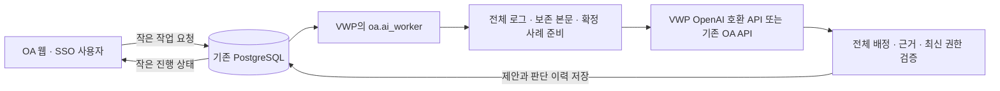

# VWP에서 AI 작업자 실행

2026-10-30 사용자 결정: OA 서버의 자원 부족을 피하기 위해 **AI 작업자 전체를 VWP 서버로 이동**한다. 같은 DB 계정으로 양쪽 데이터에 이미 접근 가능한 기존 배포를 사용한다. 신규 SQL migration이나 OA→VWP HTTP 중계 서버는 없다. 코드의 `oa` 패키지는 작업·권한·결과의 논리적 소유자를 뜻하며 물리적 실행 서버는 VWP다.



OA 웹의 AI 등록·현황 조회는 전체 입력 복원, 사례 검색, 토큰 계산과 배치 계획을 수행하지 않는다. VWP 작업자가 이 준비부터 호출·검증·저장까지 수행한다. 사람의 분류 확정·판정 저장과 다음 판단의 확정 사례 검색 계약은 유지한다. 작업 취소는 **늦은 응답의 적용을 차단**하며, 이미 전송된 모델 요청을 원격으로 중단하는 기능은 아니다.

item별 모델 전송 내용은 [AI 입력 필드 선택](../oa/AI_INPUT_FIELDS.md)을 따른다. plan unit의 `ai_fields`·`include_raw`·`include_details`는 전체 원본을 저장한 채 AI 요청만 줄인다. 선언이 없는 기존 item은 전체 입력을 유지한다.

## 1. 실행 환경

OA와 VWP 작업자에 같은 소스 버전을 배치한다. 기존 OA `oa.ai_worker` 관리 프로세스는 중지하고 VWP에서 하나의 작업자를 시작한다. `oa.main work`, 제출 파서 작업자, OA 수신 작업자는 별개 프로세스이므로 이번 이동 대상에 포함하지 않는다.

VWP에서 기존 [작업자 환경 예제](ai-worker.env.example)를 참고해 비공개 설정을 주입한다. 환경 예제에는 실제 값이 없다.

- 이미 사용하는 공유 DB 로그인과 `SANITY_DB_ALLOW_SINGLE_ACCOUNT=true`를 유지한다. `Database("oa")`로 논리적 OA 작업을 수행한다. 새 권한·역할을 생성하지 않으며, 같은 계정이므로 OA/VWP 계정 간 DB 권한 격리를 주장하지 않는다. 기존 읽기 전용 연결·스키마 점검을 먼저 수행한다.
- `SANITY_ADMIN_USER_ID`는 OA의 현재 SSO 관리자 ID와 동일하게 설정한다. 작업자는 현재 SSO 계정 활성 상태와 업무 배정을 DB에서 다시 확인한다. SAML 인증서나 SSO 로그인 SDK를 작업자에 전달할 필요는 없다.
- OA 또는 VWP 연결을 처리할 작업자에는 OA 웹과 같은 `SANITY_OA_AI_TOKEN_STORE_SECRET`를 안전하게 주입한다. 요청자의 개인 인증값을 복호화하는 기존 암호화 키다. 기존 승인 기준 catalog, tokenizer/해시와 사내 CA 파일도 같은 내용으로 준비한다. VWP에서 기존 OA 모델 API에 연결 가능한지는 현장 확인 대상이다.
- VWP 모델의 실제 HTTP/HTTPS URL·게이트웨이 공통 클라이언트 키·CA 경로는 VWP의 로컬 비공개 프로필에만 둔다. 개인 모델 인증값은 각 사용자가 OA에서 등록하며 프로필에 공용 모델 토큰을 넣지 않는다. 사용자 VWP 클라이언트에 DB 계정을 배포하지 않는다.

저장소 루트에서 직접 실행:

```sh
.venv/bin/python -m oa.ai_worker --site vwp --interval 2
```

`--once --site vwp`는 준비/호출/배치 진행 중 **최대 한 단계**를 수행한다. 한 번 종료됐다는 사실은 작업 전체 완료를 뜻하지 않는다. `--site oa`는 기존 직접 등록 작업의 호환 실행용이다. 새 웹 요청은 `worker_site=vwp`이며 OA 작업자는 가져가지 않는다. 기존 위치 표시가 없는 작업은 현재 작업자가 예약·체크포인트 규칙에 따라 인계한다. 전환할 때 두 물리적 서버에서 같은 작업자를 계속 운영하지 않는다.

## 2. VWP 모델 프로필과 OA 관리 화면

`SANITY_VWP_AI_PROFILES_FILE`에 절대 경로를 지정한다. 파일은 일반 파일·하드링크 수 1·심볼릭 링크 금지, root 또는 실행 서비스 UID 소유, **0600 등 그룹/다른 사용자 권한이 없는 모드**여야 한다. root 소유 파일도 서비스가 읽을 수 있어야 한다. 컨테이너 UID/GID는 `10001:10001`이다. 부모 경로와 파일 교체 권한도 운영 담당자가 보호한다.

아래는 **합성 형식 예제**이며 실제 운영 프로필로 쓰지 않는다. `profiles` 배열에 같은 형식의 프로필을 추가할 수 있다. 사용자 ID는 실제 승인된 SSO의 영속 ID를 사내에서 기입한다. `allowed_user_ids`에 포함된 사용자만 자신이 OA에 등록한 해당 연결의 개인 인증값으로 호출한다. 기존 공용 모델 토큰은 사용하지 않는다.

```json
{
  "schema_version": 1,
  "profiles": [{
    "id": "synthetic-vwp",
    "label": "합성 VWP 모델",
    "endpoint": "https://model.example.invalid/v1/chat/completions",
    "fallback_endpoint": "",
    "api": "chat_completions",
    "models": ["synthetic-model-a", "synthetic-model-b"],
    "auth_mode": "bearer",
    "token_source": "user",
    "client_api_key": "",
    "client_name": "",
    "client_version": "",
    "session_mode": "disabled",
    "session_id": "",
    "ca_path": "",
    "timeout": 120,
    "max_input_bytes": 1048576,
    "max_output_bytes": 2097152,
    "allowed_user_ids": ["synthetic-approved-user"]
  }]
}
```

지원 API는 `chat_completions`와 `responses`다. 개인 인증 방식은 `bearer`, `x_client_api_key`, `bearer_x_client`다. 각 사용자 인증값은 선택한 방식의 Bearer 또는 x-client 헤더에만 전달한다. 마지막 방식은 VWP 프로필의 별도 공통 `client_api_key`, `client_name`, `client_version`, `session_mode=per_request|fixed`를 함께 지정하며 Chat Completions만 지원한다. `fixed`에는 `session_id`가 필요하다. `token_source`는 생략하거나 `user`만 허용하며, 이전 프로필의 `token`은 빈 문자열만 허용한다. 비어 있지 않은 공용 토큰은 설정 오류다. 프로필마다 URL·같은 모델의 보조 URL·인증·모델 목록·입출력 바이트 한도를 독립 지정한다. `endpoint`와 `fallback_endpoint`에 사내 HTTP 또는 HTTPS 주소를 지정할 수 있다. 기본·보조 주소의 프로토콜은 각각 명시한다. HTTPS 대상에는 인증서·호스트명 검증을 적용하며, HTTP 전용 연결은 CA 파일을 읽지 않는다. 임의 헤더·명령 실행·리다이렉트·환경 프록시·TLS 검증 해제는 지원하지 않는다.

작업자는 시작 시와 약 5분마다 **비밀 없는 프로필 목록**을 기존 OA `WS_CONFIG`에 게시한다. 목록은 20분 뒤 만료된다. URL·개인 인증값·클라이언트 키·CA 경로는 이 목록에 포함되지 않는다. OA의 AI 연결 설정에서 **VWP AI 연결 추가 → 프로필 선택 → 허용 모델·기본 모델·선택형 개인 인증값 발급 URL 지정 → 저장**한다. 승인된 각 사용자는 OA의 개인 AI 토큰 화면에서 그 연결의 개인 토큰/API 키를 등록·교체·해제하고 허용 모델을 선택한다. 비밀값은 재표시하지 않고 기존 OA private `WS_CONFIG`의 사용자·연결별 암호문으로 보관한다. 토큰 발급 링크는 HTTPS만 허용한다.

한도는 모델의 context/token 한도와 별개다. 배치 한도는 관리 화면에서 실제 확인된 값으로 설정한다. 큰 보고서는 기존 전체 로그·보존 본문 배치를 사용하며 표본 추출이나 일부 성공 결과 공개로 대체하지 않는다. 사용자·연결·프로필과 인증 설정에 결합된 개인 인증값이 없거나 설정이 바뀌면 호출하지 않는다. 작업 제출 시 고정한 인증 개정과 범위를 준비·호출·재시도·재개·결과 적용에서 다시 확인한다. 도중 토큰 교체/삭제 또는 프로필 변경은 기존 결과 적용을 차단한다. 공용 토큰이나 다른 사용자의 키로 대체하지 않는다.

개인 키 방식으로 전환할 때는 기존 VWP 프로필의 공용 `token`을 제거하고 OA 웹과 VWP 작업자에 같은 암호화 키를 준비한다. 두 서버를 같은 릴리스로 갱신한 뒤 작업자가 새 프로필 목록을 게시하게 하고, 각 사용자가 OA에서 해당 연결의 키를 등록한다. 프로필 전체 hash가 인증 범위에 포함되므로 프로필을 변경하면 기존 키도 재등록해야 한다. 새 SQL migration은 필요하지 않다.

이전 공용 키 작업은 개인 인증 pin이 없으므로 새 키로 자동 인계하지 않는다. 호출 전 작업이나 적용 대기 결과는 `STALE`로 중단해 새 작업을 요청한다. 이미 호출을 예약해 결과를 모르는 작업은 기한까지 기다린 뒤 `UNKNOWN`으로 남기며 자동 재전송·수동 재개하지 않는다. 개인 키·VWP 공통 클라이언트 키·모델 주소가 로그 본문이나 부가 필드에 포함된 요청도 전송 전에 차단한다.

## 3. 카드와 실패 처리

워크스페이스의 프로젝트 현황에는 최근 3개 카드, **AI 작업 현황** 메뉴에는 내 최근 12개 작업을 표시한다. 조회 때마다 현재 보고서 접근 권한을 확인한다. 카드에는 준비·전송 시작·서버 응답·응답 수신·검증, 완료한 로그/호출 수, 실제 호출 시간에 근거한 건당 평균을 표시한다. 단일 비스트리밍 호출은 응답 전 처리량을 알 수 없어 진행률을 임의로 증가시키지 않는다.

배치 진행률은 **현재 단계/라운드** 기준이며 전체 작업의 완료율을 뜻하지 않는다. 현재 단계에서 2회 이상 호출을 완료했을 때만 그 단계의 예상 종료 시간을 표시한다. 이후 본문 통합·그룹 통합·최종 검증이 남을 수 있다. 작업자 응답이 90초 이상 없거나 조회가 실패하면 마지막 상태를 명시하고 예상 종료를 숨긴다. heartbeat는 별도 경량 스레드에서 약 30초마다 서버 위치별 작은 상태 행 하나를 갱신한다. 로그인 토큰 hash와 겹칠 수 없는 전용 키를 쓰고, 해당 표식은 항상 만료 상태여서 로그인 세션으로 사용할 수 없다. 삭제 권한을 추가하거나 매번 heartbeat 행을 쌓지 않는다. 작업/호출 단계의 작은 이력에는 로그 원문·인증값을 넣지 않는다.

- 웹 요청의 입력 준비는 lease 300초를 사용하며 중간 종료 시 최대 2회 준비 시도로 제한한다. 준비는 모델 호출을 하지 않는다. 두 번째 준비도 완료되지 않으면 `AI_PREPARATION_LIMIT`로 중단한다.
- 새 웹 작업은 최초 호출 이후 실패한 호출당 최대 5회 재시도한다. 대상은 전송 전 연결 실패, 서버가 명확히 반환한 HTTP 429/500/502/503/504, 완전히 수신한 응답의 지원되는 JSON·형식·배정 검증 오류다. 기본 대기 시간은 5·10·20·40·60초이며 숫자 `Retry-After`는 최대 300초까지 반영한다. 보조 URL 전환은 연결 수립 실패 때만 사용한다. 실패한 시도도 전체 호출 한도에 포함하며 성공한 앞선 배치 결과는 재사용한다.
- 재시도를 모두 사용한 안전한 실패나 호출 중이 아닌 저장 지점에서의 취소는 카드의 재개 기능으로 다시 시작할 수 있다. 요청자의 현재 권한·입력·모델·사례·기준·인증을 VWP 작업자가 재검증하며, 이미 완료한 배치는 재호출하지 않는다. 명시적 재개도 횟수와 전체 호출 한도가 있다. 단일 호출의 생성 중간 내용은 체크포인트가 아니므로, 확인된 실패의 단일 호출은 전체 입력으로 다시 실행한다.
- 읽기/쓰기 오류, 응답 타임아웃, 예약 후 프로세스 종료로 결과를 모르는 경우는 `UNKNOWN`이다. 자동 재전송·다른 모델로 우회하지 않는다. HTTP 인증 실패·잘못된 JSON·부분 배정·근거 불일치도 정상 결과로 처리하거나 건너뛰지 않는다.
- `RESULT_READY`는 저장된 결과를 재검증해 반영하며 재호출하지 않는다. 권한·입력·개정·참고 사례·설정·인증 revision이 바뀌면 `STALE`로 중단한다. 사용자 취소 이후의 늦은 응답은 되살리지 않는다.

### 결과 불명 배치의 명시적 복구

결과를 모르는 `UNKNOWN` 배치는 마지막 예약이 남아 있고 저장된 입력·권한·기준·사례·모델·개인 인증이 여전히 유효할 때, **원래 요청자**가 중복 호출 가능성을 확인하고 승인해 미완료 호출을 한 번 더 예약할 수 있다. 이전 호출이 서버에서 실제로 실행됐을 수 있으므로 과금과 중복 연산이 발생할 수 있다. 자동 전송이나 단일 호출 `UNKNOWN`의 복구는 지원하지 않는다. `UNKNOWN`에는 일반 재개를 사용하지 않는다.

화면은 작업 이벤트와 예약 단계의 식별값을 함께 제출해 보던 상태가 바뀌었는지 확인한다. 같은 복구 요청 UUID는 한 번만 적용하며, 다른 상태/요청 내용에 재사용할 수 없다. 이미 완료해 검증된 배치 결과는 그대로 두고 알 수 없는 단계만 다시 요청한다. 이전 호출의 늦은 응답은 새 시도를 덮어쓰지 않는다. 명시적 복구는 기존 재개 횟수와 전체 호출 예산을 공유하며, 결과 불명 호출도 예산에 포함된다. 기존 공용 키 작업처럼 현재 개인 인증 pin이 없는 작업은 복구하지 않는다.

## 4. 격리된 컨테이너 실행

[전용 Dockerfile](docker/Dockerfile-ai-worker)과 [Compose](docker/compose.ai-worker.yaml)는 웹/프런트 빌드 없이 작업자만 실행한다. 합성/실제 설정 모두 먼저 `config --quiet`로 검사한다. 예시 명령은 저장소 루트 기준이다.

```sh
docker compose --env-file /srv/sanity-vwp-ai/compose.env \
  -f vwp_bridge/docker/compose.ai-worker.yaml config --quiet
docker compose --env-file /srv/sanity-vwp-ai/compose.env \
  -f vwp_bridge/docker/compose.ai-worker.yaml up -d --build ai-worker
```

비공개 `compose.env`에는 `VWP_AI_BASE_IMAGE`, `VWP_AI_ENV_FILE`, `VWP_AI_PRIVATE_DIR`를 설정한다. 마지막 경로는 읽기 전용으로 `/run/sanity-ai`에 연결되며 그 안에 `profiles.json`과 필요한 CA·기준·tokenizer 파일을 준비한다. 비공개 pip 설정은 Docker build secret `pip_config`로 전달한다. 기본 자원 제한은 CPU 1개·메모리 2GiB·PID 128이며 `VWP_AI_CPUS`/`VWP_AI_MEMORY`를 실제 전체 입력 크기에 맞게 조정한다. 인바운드 포트·관리자 계정·쓰기 가능한 소스 마운트를 열지 않는다. 비정상 종료 재시작은 5회로 제한한다. OOM이 난 전송 예약을 다시 호출하지 않으며 기한이 지나면 결과 불명으로 확인한다. 메모리 제한은 OA의 부하 이동과 프로세스 격리를 위한 것이며 VWP 자원 용량을 보장하는 값은 아니다.

실제 VWP API 접속·인증 정책·모델 품질·지연/처리량·회사 Linux 파일 소유권/하드링크·Docker 실행은 사내 독립 환경에서 확인한다. 합성 API와 임시 DB 검증만으로 운영 연결 완료를 선언하지 않는다. 사내 AI의 수정 허용 목록과 예상 밖 오류 시 중단·문의 규칙은 이번 문서로 확대되지 않는다.
